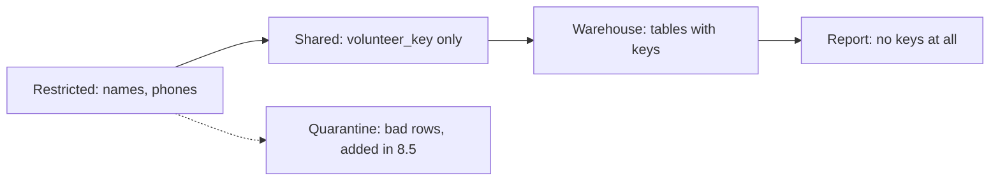

## A student who wants to draw charts

A student at a partner university offers to help Mizan with charts for the weekly report. Hala is glad of the help, and she stops before she replies. The files she would send hold the volunteers' names and phone numbers. There are 12 volunteers, V01 to V12, and each report line carries the name and phone of the volunteer who sent it. The student needs prices, markets and items. She does not need to know who sent each report.

If Hala sends a copy of `lake/restricted`, she shares personal data that nobody asked her to share. If she opens the folder to the student, anyone who borrows the laptop can read it too. If she sends nothing, she loses the help. The answer is to build a second copy of the data with the personal columns replaced. The two copies live in different places, with different rules about who may read them.

Those places are the zones from chapter 6.1: parts of the data store with their own rule about who may read them. Mizan has a restricted zone, which holds data as it arrived, with names and phone numbers, and which only a few people may read. It has a shared zone, which holds a copy where the name is dropped and the phone number is replaced by a code. Later chapters add a quarantine zone for rows that break a rule, and the warehouse that dbt builds from the shared data.

## Two orders of work

Moving data has three kinds of step. Extract means reading the data from where it is. Transform means cleaning it, joining it and reshaping it. Load means writing it into the place where people will use it. The order can differ. In ETL the data is transformed before it is loaded. In ELT it is loaded first, and the transformation happens afterwards, inside the place where it was loaded.

You may hear that ELT has replaced ETL. We found no source that says so. What changed is that many teams moved from drag-and-drop tools to code, and the choice of order remains a trade-off. Transforming first means that only the finished result is stored, which is smaller, and that unwanted data, such as a phone number, never reaches the warehouse. Loading first means that the raw data is kept, so when a rule changes you can run the transformation again over the same files. This course loads raw files first and transforms them in the warehouse with SQL. That is ELT, with one deliberate exception that the canvas shows.

```predict
prompt: "The restricted file has volunteer_name and volunteer_phone columns. Hala publishes a copy to the shared zone. What does the copy hold for the volunteer?"
options:
  - id: key
    label: "A keyed code, and no name or phone"
  - id: copy
    label: "The same name and phone, since the team is trusted"
correctOptionId: key
explanation: "The shared copy drops the name and replaces the phone with volunteer_key, a code made from the phone and a secret. The people who read the shared zone need prices and markets, not who sent them. Trust in a team is not a reason to copy data it does not need."
allowRetry: true
```

The canvas follows one price report from the phone to the warehouse. Before you step to the publish move, say to yourself which columns the shared copy keeps.

<InteractiveCanvas slug="elt-zones-flow" />

**What this shows:** the route of one report through four places, and the point where the volunteer's name and phone number are replaced by a code. After that point every file and every table holds a key, not a person.

**Try this:** before step 3, predict which columns the shared file keeps. The chips then show it: the name and the phone are gone, and a column called volunteer_key has appeared. At step 5, find the word that says when the transformation happens. In ELT it comes after loading.

**What changed:** between the restricted zone and the shared zone the report lost the two columns that identify the volunteer. Every step after it works on the copy, so no later step can leak what the copy does not have.

**Limits of the model:** the canvas follows one report, and a real file holds about a hundred. It shows where the personal data stops, not how strong the code is. Anyone who holds the secret and a phone number can work out the key.

## How the zones work at Mizan

The restricted zone is `lake/restricted`. The landing job from chapter 5.5 writes one Parquet file for each upload date, and nothing is removed from it. A few people may read this zone, and the project keeps the list short. The shared zone is `lake/shared`. A publish step copies one restricted file to a shared file with `volunteer_name` and `volunteer_phone` left out and one new column, `volunteer_key`. The warehouse reads the shared zone and nothing else.

The key is a pseudonym, as chapter 6.1 said. Replacing identifying details with a code is called pseudonymisation, and it means the data cannot be tied to a person without extra information that is kept apart. The code is computed from the phone number and a secret value that lives in an environment variable, `MIZAN_KEY`, and never in a file in the project. An environment variable is a named setting that your shell holds, outside every project file. The same phone and the same secret always give the same code, so an analyst can still count how many reports one volunteer sent. Without the secret nobody can recompute the code from a phone number.

Pseudonymised data is still about a person. Recital 26 of the European GDPR treats information that can be tied to a person with extra information as personal data. Which law applies to you, and what it requires in a real case, is a question for a data protection adviser. So the shared zone is not public. It is a zone with lower risk, for a wider group of people who are bound by the project's rules. Chapter 11.3 returns to this and shows why a plain hash of a phone number is not enough.



The diagram shows what changes as the data moves right. Each step has fewer people who can read it and less personal detail. The report, at the right end, shows only market and item prices. The dotted arrow is a later chapter. Rows that break a rule are kept apart. They are full raw rows with names and phones, so quarantine is restricted too.

## A worked example: one report in two zones

The publish step in chapter 6.5 produces this. The restricted file for 1 March has these columns for each report.

```text
report_id, market_code, item_code, price, reported_at, uploaded_at,
volunteer_id, volunteer_name, volunteer_phone, upload_date
```

The shared file for the same day has these.

```text
report_id, market_code, item_code, price, reported_at, uploaded_at,
volunteer_id, upload_date, volunteer_key
```

Two columns have gone and one has appeared. The `volunteer_id` stays, because it is an internal id such as V05 and not a name or a number. Here is one report from the shared file, made with the secret `some-long-random-text`. Your key will be different, because your secret is different.

```text
report_id  market_code  item_code  price  volunteer_id  volunteer_key
r-000006   M05          I08        3.5    V05           3bb4a6a5c948f2f4
```

Now the student can count the reports per market, per item and per volunteer id, and chart them, and she never sees a phone number. If the data on the student's laptop is lost, the loss is smaller than losing the restricted file.

Next comes the question of where the transformation happens. The warehouse in module 7 loads this shared file unchanged. Dbt models then clean, join and add up the data inside the warehouse. The step that removed the name and the phone is the one early transformation. It is done on purpose before loading, because it is cheaper to keep personal data out than to guard it later.

## Where people go wrong

The most common mistake is `SELECT *`. A publish step that copies all columns and then tries to remove the personal ones can leak through a single forgotten column. Choose the columns to keep, or name the ones to exclude and check the result against a list. A test that reads the shared file and fails if it finds a name or a phone number is cheap, and chapter 6.5 has one.

The second mistake is to forget the copies that are not data files. A log line that prints a whole row can hold the same personal data. So can a test fixture with a real phone number, or a quarantine folder with raw rows. Nobody thought of these places as a zone. The third mistake is to treat the key as anonymous. It is not. The fourth is to build the zones and never write down who may read each one. A rule in the head of one person is not a rule.

## The trade-off, and when to choose differently

Cutting personal data early is safer and less flexible. If Mizan later needs the phone number in the warehouse, for a good reason, the shared zone cannot supply it, and the job must go back to the restricted zone. The safer default is to cut, and to widen only when someone writes down a reason.

For the order of work, choose ETL when the data is large and you need only a small result. Choose it too when a rule says that some fields must never reach the warehouse. Choose ELT when raw data is cheap to keep and the rules for cleaning will change, as Mizan's rules did when the form added a field. Many pipelines mix the two, as Mizan does.

## Try it on your data

Land one day with your job from chapter 5.5. Ask DuckDB to describe the columns of the restricted file with `DESCRIBE SELECT * FROM 'lake/restricted/reports/upload_date=2026-03-01/part-0.parquet'`. Write each column on a line and mark it keep, drop or replace for the shared zone. Then write one sentence for each zone that says who may read it. Compare your list with the two lists in this chapter.

## Check your understanding

```quiz
type: mcq
question: "A clinic's appointment list has the columns patient_name, patient_phone, doctor_id, slot_time and status. The clinic's analyst wants to chart appointments per doctor per hour. Which columns may go to the shared zone?"
options:
  - "All five columns, because the analyst works for the clinic itself"
  - "Only slot_time, because every id counts as personal data too"
  - "Doctor, time and status, plus a keyed code; no name and no phone"
  - "All five columns, with the phone turned into a plain hash first"
correct: 2
explanations:
  - "Working for the clinic does not give the chart a reason to hold names and phones. The chart needs doctor, time and status. Keep the personal columns in the restricted zone."
  - "A doctor_id is an internal id, not a patient's name or number, and the chart needs it to count per doctor. Dropping it would make the chart impossible."
  - "Right. The chart needs the doctor, the time and the status. A keyed code lets the analyst count visits by patient, and the name and phone stay in the restricted zone."
  - "A plain hash of a phone number can be reversed by trying every possible number, and the name would still be there. This does not meet the aim of keeping personal data out of the shared zone."
```

```quiz
type: mcq
question: "Osama's courier company loaded its raw parcel files into storage first and transforms them with SQL. In April the rule for a 'late parcel' changed, and he must recompute last year's numbers. His facts: the raw files for 12 months are still stored, and the old results sit in a table. What do they support?"
options:
  - "Ask the couriers to send last year's parcels again"
  - "Keep the old results and apply the new rule from April on"
  - "Transform before loading from now on, and drop the raw files"
  - "Run the SQL models again over the stored raw files"
correct: 3
explanations:
  - "The raw files are still stored, so nothing needs to be sent again. Asking the couriers adds work and a chance of new duplicates."
  - "The facts say he must recompute last year's numbers. Applying the rule only from April leaves last year on the old rule, so the two periods cannot be compared."
  - "Dropping the raw files would remove the very data he needs the next time a rule changes. Transforming first is useful in some cases, but it does not help with this one."
  - "Right. Loading raw data first, which is ELT, keeps the original files. When a rule changes, the models run again over the same files and give last year's numbers on the new rule."
```

**Next:** Idempotent jobs and safe reruns: three ways to write a table, and the one that doubles the data.
