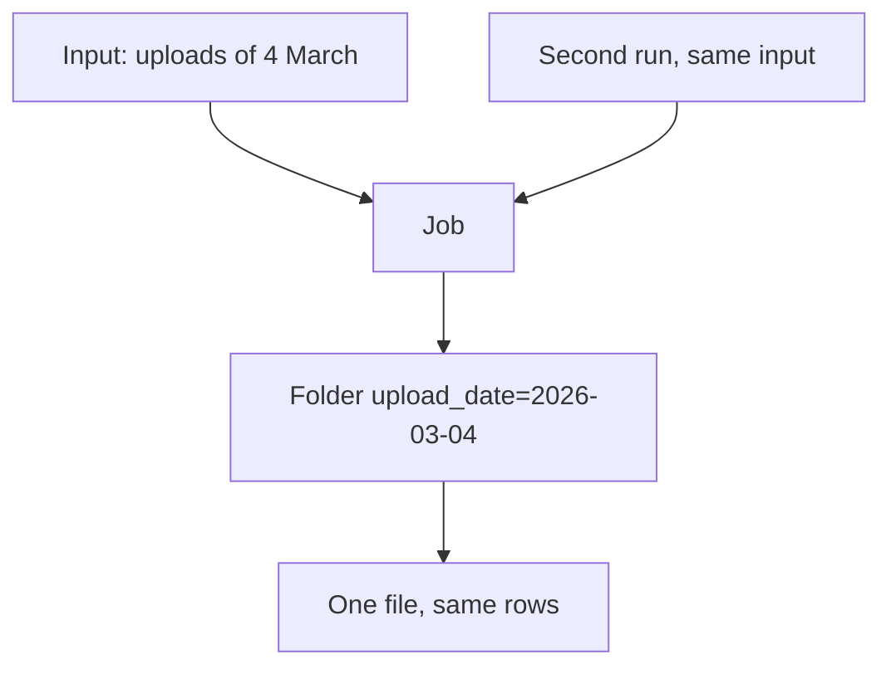

## The rerun that doubled a day

In chapter 6.1 Hala's script added the 137 lines of 12 March twice, and nobody noticed for four days. The cause was not a bug in the usual sense. The script did what it said: it added the day's lines to the table. A second run added them again. This chapter is about the property that would have made the second run harmless.

You met the word in chapter 6.1. A job is idempotent when running it twice gives the same result as running it once. The word does not mean that the job runs only once. That is a common mistake, and it gets the idea backwards. An idempotent job can run any number of times, because the first run and the tenth leave the data in the same state. For a pipeline that is a very useful property, because failures and restarts are common and you want the repair to be "run it again".

There are three common ways to write a day's data into a table. You can append it, which adds the rows at the end. You can replace the day's partition, which deletes the old output for that day and writes the new one. Or you can merge on a key, which updates the rows that already exist and inserts the ones that do not. Only the first one doubles the data on a rerun.

```predict
prompt: "On 4 March the uploads hold 100 reports. A job that appends runs twice for that day, and so does a job that replaces the day's partition. How many rows does each table hold?"
options:
  - id: both-doubled
    label: "200 rows and 200 rows"
  - id: only-append
    label: "200 rows and 100 rows"
correctOptionId: only-append
explanation: "Append adds the 100 rows a second time, so the table holds 200. Replace throws away the first copy of the day and writes the day again, so the table holds 100 after one run or two. The canvas shows the same for up to four runs."
allowRetry: true
```

The canvas uses Mizan's upload folder for 4 March: 100 lines, 100 different report ids, no bad rows, and prices that add up to 1,241.0 shekels. Choose how many times the job ran and how it writes.

<InteractiveCanvas slug="rerun-append-vs-overwrite" />

**What this shows:** the table for 4 March after a job has run one to four times, in three write modes. Append multiplies the rows and the day's total price. Replace and merge give the same table after one run or four.

**Try this:** leave the runs at 2 and the write mode on 0 (append). The table holds 200 rows, 100 of them duplicates, and the day's total price is 2,482.0 shekels. Switch the write mode to 1 (replace): 100 rows, no duplicates, 1,241.0 shekels. Then set the runs to 4 and compare all three bars.

**What changed:** append depended on how many times the job had run. Replace and merge did not. A job whose result depends on its own history cannot be rerun safely.

**Limits of the model:** the model uses one day of 100 rows that never changes between runs. It does not show a job that stops halfway, rows that change, or the cost of a merge on a big table. Replace and merge agree only because every run writes the whole day.

## What DuckDB does when you write twice

Hala wants to see this on real files, not only in a model. She writes the 100 lines of 4 March to a partitioned folder, and then writes the same lines again with different options. The commands use DuckDB's `COPY` with `PARTITION_BY`, and they write into a folder that starts with `try_`.

```python
import duckdb

con = duckdb.connect()
copy = """COPY (SELECT *, DATE '2026-03-04' AS d
      FROM read_json('data/raw/uploads/upload_date=2026-03-04/*.jsonl'))
      TO 'try_rerun' (FORMAT parquet, PARTITION_BY (d)"""


def counts():
    sql = "SELECT count(*), sum(price), round(avg(price), 2) FROM read_parquet('try_rerun/*/*.parquet')"
    print(con.execute(sql).fetchone())


con.execute(copy + ")")                       # first write
counts()
try:
    con.execute(copy + ")")                   # same write again
except duckdb.IOException as error:
    print(error)
con.execute(copy + ", OVERWRITE_OR_IGNORE)")  # same write, replacing
counts()
con.execute(copy + ", APPEND)")               # same write, adding
counts()
```

The function `counts()` prints the number of rows, the total price and the average price after each write. The results are these.

```text
after the first write      100 rows   total 1241.0   average 12.41
second plain write         IO Error: Directory "try_rerun" is not empty! Enable OVERWRITE option to overwrite files
with OVERWRITE_OR_IGNORE   100 rows   total 1241.0   average 12.41   (one file)
then with APPEND           200 rows   total 2482.0   average 12.41   (two files)
```

The same call can fail, replace or add, depending on one option. Replacing makes the job safe to rerun, and appending can double your rows. Look at the last column of the last line. The average is 12.41 in all three cases. That is the same lesson as chapter 6.1. A check that looks only at an average will pass on a doubled day. The count and the total are what change.

## Three ways to write a day

In a replace, the job owns the whole partition for its day. It writes the full result for that day and swaps it in. Chapter 5.5 did this with a temporary file and a swap. Replace is the simplest idempotent design when a run produces everything that belongs in one partition, and it is what the landing job uses.

In a merge, the job writes rows by a key. A row whose key already exists is updated and a row with a new key is inserted. A merge is the right design when a run brings only some of the rows of a table, such as the few registry rows that changed. It needs a key that is unique and stable. With a primary key on `report_id`, `INSERT OR REPLACE` run three times on 4 March gives 100 rows, a total of 1,241.0 and an average of 12.41 each time.

The third design is to keep every copy and choose one when you read. It is also safe, and staging models in module 7 do it for the registry extracts. Dbt keeps the latest row per key. This design moves the work to the reader and keeps a record of everything that was ever written.

A real case shows why the key matters.

<RealWorldEvent title="One audit, several records" when="2026" summary="A public audit data site reported that, before it had a formal resubmission process, a correction was published as a new full record. One audit can therefore appear several times as independent records, and anyone who adds up award amounts or finding counts can count it more than once. The site advised matching on identifiers and keeping the most recently accepted record, and said it will add version numbers and mark old versions as deprecated instead of deleting them." lesson="A dataset needs a rule for which version is current. Deduplicate on a business key, and keep the most recent record for each key." />

At Mizan the business key of a report is its `report_id`. Module 8 comes back to this, because a resend and a real repeat both look like a second row.

## Rules for a job you can rerun

The first rule is that the output location is a function of the input. A job for 4 March writes the folder for 4 March, whatever the clock says. A job that writes to "today" or "latest" will land in a different place when you rerun it tomorrow, and the first run's output stays behind. Pass the date to the job as a parameter, as the landing job does with `--date`.

The second rule is that a run writes its whole output in one step. A temporary file and a swap, as in chapter 5.5, mean that a crash leaves either the old file or the new one and never half of each. The third rule is that the job does not depend on what an earlier run left behind, except the thing it replaces. A job that reads yesterday's output to decide what to write today has a hidden dependence that a rerun can break.

The last rule is to test it. Run the job twice and compare the count and the total with one run. A test with that shape appears in every build chapter of this module, and it is the only proof that counts. A comment that says "safe to rerun" proves nothing.



The diagram has two runs and one output place. Both runs read the same input and write to the same folder, which holds one file after either of them. If the output place depended on the time of the run, there would be two arrows to two places, and the second run would leave a second copy.

## Where people go wrong

The first mistake is to rely on a note, "do not run this twice". A note works until the day the power is off and someone is tired. The second mistake is to test with a check that cannot fail. An average, a minimum or a maximum do not change when you double a table. Count the rows and add up a total, or compare with the number of input lines.

The third mistake is to think that a rerun after a partial failure is safe because the first run failed anyway. A run that stops halfway has written some rows. In append mode the rerun then adds all of them, and the first half is duplicated. The fourth mistake is the opposite one. A replace is only idempotent if the input is the same. If the source file changed between the runs, the second run gives a different answer, which is correct, because the input is different.

## The trade-off, and the alternative

Replace is the simplest, and it rewrites the whole day even if only one row changed. That is fine for a hundred rows and it is not fine for a hundred million. Merge writes only what changed, and it needs a good key and an engine that can find rows by key quickly. Keeping every copy and reading the latest is the most flexible and the most work at read time.

Choose by what a run brings. If a run owns a whole partition, replace. If a run brings a few changed rows of a big table, merge. If you need the history of every version, keep all copies and pick one on read. Mizan uses replace for landing and publishing, and a watermark with the latest-row rule for the registry, which the next chapter explains.

## Try it on your data

Take the landing job from chapter 5.5. Run it for 4 March twice and count the rows in the lake with a query. Then write a small test of your own that runs a job twice and checks the count and the total against one run. Finally break it on purpose in a scratch copy: change the job to append, and run your test. It should fail on the count, and it should still pass if you look only at the average.

## Check your understanding

```quiz
type: mcq
question: "Duaa's nightly job loads the day's orders for a shop. After a power cut she reruns it. Before the rerun the table for 9 May had 300 rows and an average order value of 21.50. Afterwards it has 600 rows and an average of 21.50. What do the facts show?"
options:
  - "The job is fine, because the average order value did not change"
  - "The rerun appended the day again, so the job is not safe to rerun"
  - "The data is wrong at the source, because the average stayed the same"
  - "The job merged on a key, because every row appears with a copy"
correct: 1
explanations:
  - "An average does not change when every value is repeated, so it cannot tell a good day from a doubled one. The row count went from 300 to 600, and that is the sign."
  - "Right. 300 rows became 600 and the average stayed the same, which is exactly what a repeated day looks like. A job that replaces the day, or merges on a key, would show 300 after the rerun."
  - "The source did not cause this. The same 300 orders were read twice. The average staying the same is expected when each row is copied."
  - "A merge on a key would leave 300 rows, because each order would find its existing row. Twice the rows means rows were added, not merged."
```

```quiz
type: mcq
question: "Karim's pharmacy job writes stock levels to a folder named by the date it runs, using the computer's clock. On 14 June it fails halfway. He reruns it on 15 June to fix 14 June. What goes wrong, and what is the fix?"
options:
  - "It writes to the 15 June folder; pass the date in as a parameter"
  - "It writes the 14 June rows twice; switch the job to append mode"
  - "It writes nothing; the clock stops a job from running after midnight"
  - "It overwrites 15 June by mistake; delete the folder before each run"
correct: 0
explanations:
  - "Right. The folder name comes from the clock, so the rerun on 15 June writes to the 15 June folder, and the 14 June folder keeps its half-finished output. Passing the date makes the same input always give the same output place."
  - "Append is the unsafe mode here. It would add the rows a second time. The fix is to control where the output goes, not to add to it."
  - "The clock does not stop the job. It runs, and it writes to the wrong folder."
  - "The rerun writes to a folder named for 15 June, so it does not overwrite anything there. The trouble is that 14 June is never repaired."
```

**Next:** Incremental loads and change data capture: how to load only what changed, and the changes that a watermark cannot see.
