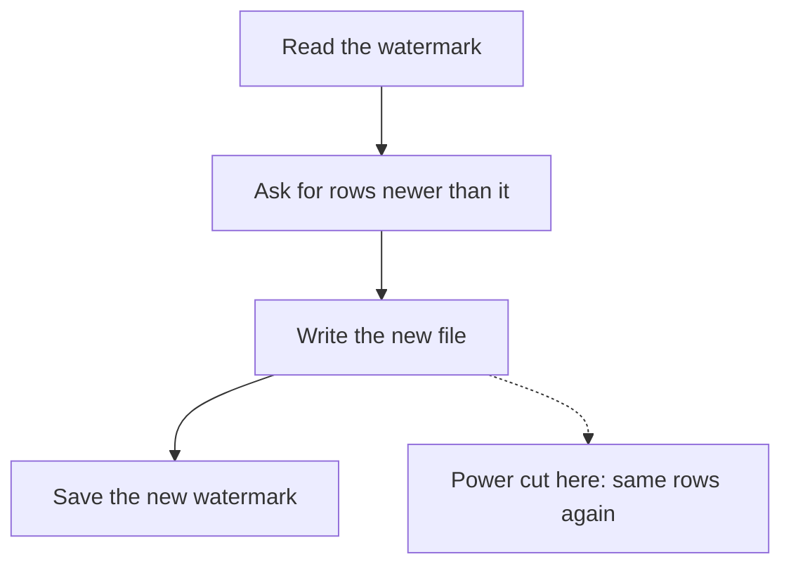

## A phone number that changed

On 16 March Yasmin tells Hala that one volunteer, V07, got a new phone on the 15th. The registry is Karam's SQLite database with two tables, `markets` and `volunteers`, and Yasmin updates it by hand. Hala's pipeline needs a copy of the registry in the lake, so that reports can be joined to the market and the volunteer.

The simplest way to keep a copy is to copy everything every night. At Mizan that is a good design. The registry holds 8 markets and 12 volunteers, and reading all of them takes a moment. Hala uses a smarter method here anyway, for two reasons. The registry will grow, and the habit of asking "what changed?" is what keeps big pipelines fast. When a table has fifty million rows, copying all of it every night stops being an option.

This is an incremental load: each run takes only the rows that are new or changed since the last run. The question is how a run knows which rows those are. The most common answer uses a column that records when each row last changed.

## The watermark

Karam's registry app stamps every row with `updated_at`, the time of its last change. Unchanged rows still carry the time of the first load, which is 1 March, and a changed row carries a later time. Hala's extract keeps one small value on disk: the largest `updated_at` that it has seen so far. That value is the watermark. On the next run the extract asks only for rows whose `updated_at` is later than the watermark.

```text
SELECT * FROM volunteers WHERE updated_at > '2026-03-01T00:00:00Z' ORDER BY updated_at
```

The timestamps are text in one fixed format, so comparing them as text gives the right order. The first run has no watermark, so it reads every row and then saves the biggest `updated_at` it saw. For the first extract on 14 March that value is 2026-03-01 00:00, because nothing has changed since the first load. After V07's change, the second run finds one row, V07, and moves the watermark to 2026-03-15 08:30.

The order of two actions inside the run matters. The run first writes the file with the new rows, and only afterwards saves the new watermark. If the power fails before the file is complete, the watermark has not moved and the next run reads the same rows again. If the power fails after the file but before the watermark is saved, the next run also reads the same rows again, and the file now exists twice. The rows are read at least once, never missed. Having a row twice does no harm when the next step keeps the latest row for each key. Saving the watermark first would turn a power cut into a lost change, which is far worse.



The diagram shows where a crash is harmless. Between writing and saving, a failure costs a duplicate, and a later step removes it. Before writing, it costs nothing. The only unsafe order would be to save first. The dotted arrow marks the one window where you accept a small cost on purpose.

## What a watermark cannot see

On 22 March V11 leaves the project and Karam deletes the volunteer's row from the registry. The row is gone, and so is its `updated_at`. The next run asks for rows newer than the watermark, and a row that does not exist cannot match. The run reads no rows. The lake still lists V11 as a volunteer, and nothing tells Hala that something changed.

```predict
prompt: "On 22 March V11's row is deleted from the registry. The nightly extract reads rows whose updated_at is after the watermark. How many rows does the run on 23 March read?"
options:
  - id: zero
    label: "0 rows: a deleted row has no updated_at"
  - id: one
    label: "1 row: V11, flagged as deleted by the registry"
correctOptionId: zero
explanation: "A query on updated_at can only find rows that exist. When the registry removes V11's row, there is nothing left to match, so the run reads 0 rows and the lake keeps V11. A change log would record the delete as an event, which is the second half of this chapter."
allowRetry: true
```

The canvas replays three runs of the extract on the registry rows. Step to the sixth step only after you have made your guess.

<InteractiveCanvas slug="cdc-watermark" />

**What this shows:** three runs of a watermark extract. The first run reads every row, the second finds a phone change by its later `updated_at`, and the third finds nothing, because the deleted row cannot match.

**Try this:** before step 6, predict how many rows run 3 reads, then check the chip. Find the step where the delete happens, and ask which column would have to change for a watermark to see it. At steps 1 and 2, notice that the file is written before the watermark is saved.

**What changed:** the watermark moved from 2026-03-01 00:00 to 2026-03-15 08:30 after the phone change, and it did not move after the delete. The lake gained V07's new row and never lost V11's old one.

**Limits of the model:** three of the twelve volunteers are shown, with times to the minute. The model does not show a clock that runs behind, or two changes with the same timestamp, which are further ways a watermark can miss a row.

## Two kinds of change data capture

Finding what changed in a source is called change data capture. The watermark method is the query-based kind. A job asks the source, with a `WHERE` on a growing id or an update time, for the rows that are new. It is simple, it needs nothing from the source except a trustworthy timestamp column, and it has known gaps. It cannot see deleted rows. It depends on every change moving the timestamp forward, and a timestamp column that can be empty breaks it.

The log-based kind reads the database's own record of changes. A project called Debezium does this for some databases: it reads that log and turns every change into an event. Each event carries the position in the log, which works as the bookmark. The events cover creates, updates and deletes, with the values before and after the change, so a delete is an event of its own. The cost is more to set up, some load on the source database, and a database that offers such a log. Karam's SQLite registry gives Hala no such log.

Query-based capture has one more weakness that comes from reasoning, not from a source. The timestamp is written by the application. If its clock runs behind, or if two changes commit out of order, a change can get a time that is older than the watermark and be skipped. Treat this as a risk to think about, not as a rule from a reference. It is one reason to compare counts between the source and the lake from time to time.

## A worked example: three runs on the registry

Chapter 6.5 builds the extract. This is what it prints for the registry as it stands at the end of the 28 days, and for a second run straight afterwards.

```text
markets: 8 rows extracted
volunteers: 11 rows extracted
markets: 0 rows extracted
```

After the registry was rewound to 16 March, the saved watermarks were these. Markets show the move of M03 on 12 March, and volunteers show V07's phone on 15 March.

```text
{"markets": "2026-03-12T09:00:00Z", "volunteers": "2026-03-15T08:30:00Z"}
```

Eleven volunteers appear in the first line because V11 had already left by the last day. If you rewind the registry to 14 March, the first run reads all 12 volunteers. A run with the registry at 16 March reads exactly one row, V07, and a run at 23 March reads none. The whole sequence is in the acceptance tests of chapter 6.5. One test exists only to record the limit. It extracts at 21 March, removes V11 and extracts again at 23 March. It checks that the second run reads 0 rows and that V11 is still in the lake.

## Where people go wrong

The first mistake is to believe the watermark sees everything. It sees what moves `updated_at` forward. Deletes, changes made by a script that does not set the timestamp, and rows with an empty timestamp are not seen. The second mistake is to save the watermark before the data is safe. The third is to use "now" as the watermark, which loses any row that changed while the run was working. The watermark should be the largest value in the rows read, not the clock.

The fourth mistake is to hide the limit. A pipeline whose documentation says "the registry is always up to date" is making a promise it cannot keep. Write down what the method misses, and put a test on it, as the build chapter does.

## The trade-off, and what to do about deletes

For Mizan's registry there are three honest options. The first is to ask Karam to stop deleting rows and instead mark a volunteer as having left, with a date, and to update `updated_at` when he does. A change then looks like any other change, and the watermark sees it. This is the cheapest fix and it needs a conversation. The second is to compare the list of ids in the source with the list in the lake each night. That is a small query, and it finds the rows that are gone. The third is log-based capture, which costs the most.

Choose a full copy for small tables, a watermark for big tables where deletes are rare or marked, and a change log when deletes and every intermediate change matter. There is no rule about the size where the choice flips. Measure the full copy first, and move to a watermark when the copy takes too long.

## Try it on your data

Open the registry with SQLite and run the query above with the watermark of your choice. Find the row with the latest `updated_at` in each table, which is the watermark a run would save. Then take four events: a new volunteer, a changed phone, a volunteer who leaves by deletion, and a volunteer who leaves with a `left_on` date and a new `updated_at`. Write down whether a watermark extract would find each one.

## Check your understanding

```quiz
type: mcq
question: "Sana's clinic app stamps updated_at on every insert and update of its appointments table. Her nightly extract uses a watermark. Last night four things happened. Which one will the next run miss?"
options:
  - "A new booking for Thursday, added by the receptionist"
  - "A booking moved from 10:00 to 11:00 by the patient"
  - "A booking cancelled by setting its status to 'cancelled'"
  - "A booking removed from the table by a staff member"
correct: 3
explanations:
  - "A new row gets a fresh updated_at, which is later than the watermark, so the run finds it."
  - "The app stamps every update, so the moved booking has a later updated_at and the run finds it."
  - "Setting a status is an update, and the app stamps updates, so the run finds the cancelled booking. This is also the method that makes a leave visible."
  - "Right. A removed row is gone, and so is its updated_at. A query on updated_at cannot find a row that does not exist, so the extract misses it and the lake keeps the old booking."
```

```quiz
type: mcq
question: "Manar's job saves the new watermark first and then writes the extract file. One night the power fails after the watermark is saved and before the file is written. The next run asks for rows newer than the saved watermark. What happens?"
options:
  - "The changes in that run are loaded twice, so a later step must remove copies"
  - "The job refuses to start, because the watermark and the files disagree"
  - "That run's changes are never loaded, as the watermark has passed them"
  - "Nothing is lost, because the next run starts again from the first watermark"
correct: 2
explanations:
  - "Duplicates come from the safe order, file first and watermark second. Here the watermark moved first, so the rows are skipped, not repeated."
  - "A job does not compare the watermark with the files unless someone writes that check. This job simply starts."
  - "Right. The watermark moved past those rows before they were written. The next run asks only for newer rows, so those changes are lost without any error. File first, watermark second, is the safe order."
  - "The saved watermark is the new one, so the next run does not start from the old value. That is what makes the loss silent."
```

**Next:** Build: incremental, pseudonymised ingestion: a publish step with a keyed code, an incremental registry extract and a run log, all with tests.
