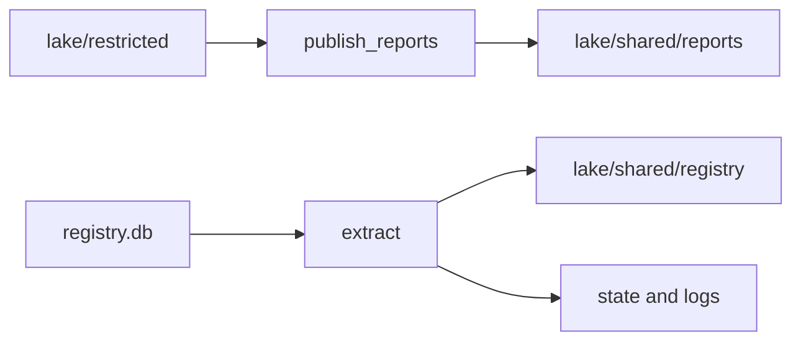

## What the pipeline cannot do yet

After chapter 5.5 the pipeline can land a day of uploads in the restricted zone, and a rerun is safe. It still has three gaps. Nobody except the people who may read the restricted zone can use the reports, because every line carries a volunteer's name and phone number. The registry of markets and volunteers is still a SQLite file that no report can join to. And when a run fails at night, nothing says which task ran, how long it took or how many rows it moved.

Without these pieces, the next modules cannot start. The warehouse in module 7 must read the shared zone and nothing else, so it needs a shared copy. The reports need the market and volunteer details, so they need the registry in the lake. And the scheduler in module 9 needs a log, because a retry or a skipped task is only useful if it is written down.

## What you will have at the end

You will have three small modules and eighteen passing tests. `pipeline/pseudonymise.py` turns a phone number into a keyed code and publishes a day of the restricted zone to the shared zone without names and phones. `pipeline/extract_registry.py` copies the registry tables to the shared zone, and on each run it takes only the rows that changed since the last run. `pipeline/runlog.py` appends one line to a log for every task attempt.

The commands from the end of this chapter work like this. `python -m pipeline.pseudonymise --date 2026-03-01` prints `2026-03-01: 90 rows published`. `python -m pipeline.extract_registry --table volunteers` prints `volunteers: 11 rows extracted` the first time and `volunteers: 0 rows extracted` straight afterwards.

## Where the repository is now

You have the landing job and its tests from chapter 5.5, the paths file with the `SHARED`, `STATE` and `LOGS` names, and the test setup from chapter 2.5. The setup gives each test a fake secret in `MIZAN_KEY`, so the tests do not depend on your own shell. The generator `make_source.py` has two options that the tests use: `--registry-only` writes only the registry, and `--as-of 2026-03-14` writes it as it stood at the end of that day. That lets a test replay the registry over time.

The registry is a SQLite file, `data/raw/registry.db`, with two tables.

```text
markets(market_code, name, area, opens, updated_at)
volunteers(volunteer_id, full_name, phone, market_code, updated_at)
```

## The design decisions

The publish step must make a code from a phone number. A hash is a one-way scramble of the input: the same input always gives the same output, and you cannot work backwards from the output by calculation. A plain hash would be one line of code. It has a flaw you will measure in chapter 11.3. There are so few phone numbers that anyone can hash all of them and look up the answer. So the code uses a keyed hash, called an HMAC, with a secret that comes from the environment variable `MIZAN_KEY`. The secret must never reach a file, a log or a line of SQL. The alternative is a table of random tokens, one per phone number, kept in the restricted zone. A random token has no mathematical link to the phone. It also needs a table that you store, protect and back up.

The code is made from the phone number, and this has a consequence you will see in the tests. When V07 changed phone on 15 March, V07 got a new code. A pseudonym built from an attribute that changes splits one person into two. A stable id or a token table would not. Mizan accepts this for now, and chapter 11.3 returns to it.

The registry extract keeps every extraction. Each run writes its changed rows into a new folder named by the time of the extraction, instead of overwriting one file. That keeps the history of the registry, and a staging model in module 7 will choose the latest row for each key. It also means the extract is safe to repeat: reading the same rows twice only adds a copy that the model ignores. As you saw in chapter 6.4, the run writes the file first and saves the watermark second.



The diagram shows two new paths into the shared zone. Reports go through a publish step that removes the person. The registry goes through an extract step that takes only what changed. The extract also writes to a small state area, which holds the watermarks.

## The task

1. Create `pipeline/runlog.py` and make its single test pass first. It is the smallest piece, and the others will use it.
2. Create `pipeline/pseudonymise.py` with `volunteer_key`, `MissingKeyError` and `publish_reports`, and a command line with `--date` and `--all`.
3. Create `pipeline/extract_registry.py` with `extract`, `read_watermarks` and `write_parquet`, and a command line with `--table`.
4. Save the test file below as `tests/test_ingestion.py` and run it until all eighteen tests pass.
5. Run the three commands and check the results against the output in this chapter.
6. Search your lake, state and log folders for your secret. It must not be there.

## The interface

```text
pipeline/pseudonymise.py

  class MissingKeyError(RuntimeError)

  volunteer_key(phone: str, secret: bytes) -> str
      """The first 16 hex characters of the HMAC-SHA256 of the phone number,
      made with the secret."""

  publish_reports(upload_date: str) -> int
      """Copy lake/restricted/reports/upload_date=<date>/part-0.parquet to
      lake/shared/reports/upload_date=<date>/part-0.parquet, without
      volunteer_name and volunteer_phone and with a new last column
      volunteer_key. The secret comes from the environment variable
      MIZAN_KEY. If it is not set, raise MissingKeyError (the message
      contains "MIZAN_KEY is not set") before anything is read or written.
      Returns the number of rows written."""

  Command line:  python -m pipeline.pseudonymise --date 2026-03-01
                 python -m pipeline.pseudonymise --all
  Output:        2026-03-01: 90 rows published

pipeline/extract_registry.py

  extract(table: str) -> int
      """table is "markets" or "volunteers"; anything else raises
      ValueError with "unknown table" in the message. Writes the rows whose
      updated_at is later than the saved watermark (all rows the first time)
      and returns how many. Writes nothing when there are none."""

  read_watermarks() -> dict[str, str]
      """The saved watermarks, for example {"markets": "2026-03-12T09:00:00Z"}.
      An empty dict when nothing has been saved."""

  write_parquet(rows: list[dict], folder: Path) -> None
      """Write the rows to folder/part-0.parquet. extract must call it by
      this name, because a test replaces it with a function that fails."""

  Command line:  python -m pipeline.extract_registry --table volunteers
  Output:        volunteers: 11 rows extracted

pipeline/runlog.py

  log_run(task, run_date, status, rows=None, detail="", started_at=None) -> dict
      """Append one JSON line to logs/runs.jsonl and return the record."""
```

## Constraints

The shared reports file has every column of the restricted file except the name and the phone, plus `volunteer_key` last. The `volunteer_id` stays, because it is an internal id such as V05 and not a name or a number. Publishing the same day twice leaves one file with the same rows, as in chapter 5.5.

The registry extract writes to `lake/shared/registry/<table>/extracted_at=<time>/part-0.parquet`. The folder name needs a time in UTC with no colons, because Windows does not allow a colon in a folder name. It also needs microseconds, so that two extractions in the same second do not share a folder. A volunteers file holds `volunteer_id`, `market_code`, `updated_at` and `volunteer_key`. The name and the phone are dropped in Python before any file exists. A markets file holds all five columns, as text. The watermarks live in `state/registry_watermarks.json`.

If writing the file fails, the watermark must not move, and `lake` must hold no files and no empty folders left by the run. A run that finds no changed rows writes no file at all and leaves the watermark alone. The log line has the keys `task`, `run_date`, `status`, `rows`, `detail`, `started_at` and `ended_at`, and both times are UTC and end in `Z`.

The secret must not appear in any file under `lake`, `state` or `logs`. It must not be put into a line of SQL either, because a query log could copy it. Make the codes in Python and give DuckDB only the finished pairs of phone number and code.

## The acceptance tests

Save this file as `tests/test_ingestion.py`. Copy it exactly.

```python
"""Chapter 6.5: pseudonymised publishing, incremental registry extraction and the run log."""
import hashlib
import hmac
import json
from pathlib import Path

import duckdb
import pytest

from pipeline import extract_registry, paths
from pipeline.land import land_uploads
from pipeline.pseudonymise import MissingKeyError, publish_reports, volunteer_key
from pipeline.runlog import log_run


def read(pattern):
    return duckdb.connect().execute(f"SELECT * FROM read_parquet('{pattern}', union_by_name = true)").fetchall()


def columns(pattern):
    return [r[0] for r in duckdb.connect().execute(f"DESCRIBE SELECT * FROM read_parquet('{pattern}', union_by_name = true)").fetchall()]


def registry_as_of(project, day):
    project.python("make_source.py", "--registry-only", "--as-of", day)


# ---- pseudonymise ----

def test_same_phone_gives_the_same_key():
    assert volunteer_key("+970-59-000-0101", b"secret") == volunteer_key("+970-59-000-0101", b"secret")
    assert len(volunteer_key("+970-59-000-0101", b"secret")) == 16


def test_different_secret_gives_a_different_key():
    assert volunteer_key("+970-59-000-0101", b"secret-a") != volunteer_key("+970-59-000-0101", b"secret-b")


def test_different_phones_give_different_keys():
    assert volunteer_key("+970-59-000-0101", b"s") != volunteer_key("+970-59-000-0102", b"s")


def test_key_is_a_truncated_hmac_sha256():
    expected = hmac.new(b"s", b"+970-59-000-0101", hashlib.sha256).hexdigest()[:16]
    assert volunteer_key("+970-59-000-0101", b"s") == expected


def test_shared_files_have_no_name_or_phone(project):
    project.make_data()
    land_uploads("2026-03-02")
    assert publish_reports("2026-03-02") == 89
    cols = columns("lake/shared/reports/*/*.parquet")
    assert "volunteer_name" not in cols and "volunteer_phone" not in cols
    assert "volunteer_key" in cols and "volunteer_id" in cols
    # and the values are really gone: no phone number or name appears in any cell
    cells = " ".join(str(c) for row in read("lake/shared/reports/*/*.parquet") for c in row)
    assert "+970" not in cells and "Haddad" not in cells


def test_keys_in_shared_files_are_the_hmac_of_the_phone(project):
    project.make_data()
    land_uploads("2026-03-02")
    publish_reports("2026-03-02")
    restricted = duckdb.connect().execute(
        "SELECT report_id, volunteer_phone FROM read_parquet('lake/restricted/reports/*/*.parquet')").fetchall()
    shared = dict(duckdb.connect().execute("SELECT report_id, volunteer_key FROM read_parquet('lake/shared/reports/*/*.parquet')").fetchall())
    for report_id, phone in restricted:
        assert shared[report_id] == volunteer_key(phone, b"test-secret-not-real")


def test_publishing_twice_leaves_one_file_and_the_same_rows(project):
    project.make_data()
    land_uploads("2026-03-02")
    publish_reports("2026-03-02")
    assert publish_reports("2026-03-02") == 89
    assert [p.name for p in Path("lake/shared/reports/upload_date=2026-03-02").iterdir()] == ["part-0.parquet"]


def test_no_key_stops_with_a_clear_error(project, monkeypatch):
    project.make_data()
    land_uploads("2026-03-02")
    monkeypatch.delenv("MIZAN_KEY")
    with pytest.raises(MissingKeyError, match="MIZAN_KEY is not set"):
        publish_reports("2026-03-02")
    assert not Path("lake/shared").exists()  # it stopped before writing anything


def test_the_secret_is_never_written_to_disk(project):
    project.make_data()
    land_uploads("2026-03-02")
    publish_reports("2026-03-02")
    extract_registry.extract("volunteers")
    for folder in [paths.LAKE, paths.STATE, paths.LOGS]:
        for path in folder.rglob("*") if folder.exists() else []:
            if path.is_file():
                assert b"test-secret-not-real" not in path.read_bytes()


# ---- registry extraction ----

def test_first_extract_gets_all_rows_and_the_second_gets_none(project):
    project.make_data()
    assert extract_registry.extract("markets") == 8
    assert extract_registry.extract("volunteers") == 11
    assert extract_registry.extract("markets") == 0
    assert extract_registry.extract("volunteers") == 0
    assert len(list(Path("lake/shared/registry/markets").glob("extracted_at=*/part-0.parquet"))) == 1  # no empty files


def test_registry_files_have_no_name_or_phone(project):
    project.make_data()
    extract_registry.extract("volunteers")
    cols = columns("lake/shared/registry/volunteers/*/*.parquet")
    # extracted_at is not in the file: DuckDB adds it from the folder name (hive partitioning)
    assert sorted(cols) == ["extracted_at", "market_code", "updated_at", "volunteer_id", "volunteer_key"]
    assert "full_name" not in cols and "phone" not in cols


def test_second_extract_picks_up_exactly_the_v07_phone_change(project):
    project.make_data(1)  # one day of reports is enough: we only look at the registry
    registry_as_of(project, "2026-03-14")
    assert extract_registry.extract("markets") == 8
    assert extract_registry.extract("volunteers") == 12
    first_key = dict(duckdb.connect().execute("SELECT volunteer_id, volunteer_key FROM read_parquet('lake/shared/registry/volunteers/*/*.parquet')").fetchall())["V07"]
    registry_as_of(project, "2026-03-16")
    assert extract_registry.extract("markets") == 0
    assert extract_registry.extract("volunteers") == 1
    changed = duckdb.connect().execute(
        "SELECT volunteer_id, volunteer_key, updated_at FROM read_parquet('lake/shared/registry/volunteers/*/*.parquet')").fetchall()
    v07 = sorted(r for r in changed if r[0] == "V07")
    assert len(v07) == 2 and v07[0][2].startswith("2026-03-01") and v07[1][2].startswith("2026-03-15")
    assert first_key != v07[1][1]  # a new phone number means a new code (the code is made from the phone)


def test_market_changes_are_picked_up_when_they_happen(project):
    project.make_data(1)
    registry_as_of(project, "2026-03-11")
    assert extract_registry.extract("markets") == 8
    registry_as_of(project, "2026-03-12")
    assert extract_registry.extract("markets") == 1  # M03 moved to Hill
    registry_as_of(project, "2026-03-20")
    assert extract_registry.extract("markets") == 1  # M06 changed its opening days


def test_a_failure_before_writing_does_not_move_the_watermark(project, monkeypatch):
    project.make_data(1)

    def broken_write(rows, folder):
        raise OSError("disk full")

    with monkeypatch.context() as patch:  # the broken writer is only in place inside this block
        patch.setattr(extract_registry, "write_parquet", broken_write)
        with pytest.raises(OSError):
            extract_registry.extract("markets")
    assert extract_registry.read_watermarks() == {}
    assert list(Path("lake").rglob("*")) == []
    assert extract_registry.extract("markets") == 8  # the next run still gets everything


def test_watermark_file_holds_the_biggest_updated_at(project):
    project.make_data(1)
    registry_as_of(project, "2026-03-16")
    extract_registry.extract("markets")
    extract_registry.extract("volunteers")
    assert json.loads(Path("state/registry_watermarks.json").read_text()) == {
        "markets": "2026-03-12T09:00:00Z", "volunteers": "2026-03-15T08:30:00Z"}


def test_limit_a_hard_delete_is_invisible_to_watermark_extraction(project):
    """V11 is deleted from the registry on 22 March. A query on updated_at cannot see a row that is gone."""
    project.make_data(1)
    registry_as_of(project, "2026-03-21")
    assert extract_registry.extract("volunteers") == 12
    registry_as_of(project, "2026-03-23")  # V11 is gone from the registry now
    db_rows = duckdb.connect()
    assert extract_registry.extract("volunteers") == 0  # nothing changed as far as updated_at can tell
    ids = [r[0] for r in db_rows.execute("SELECT volunteer_id FROM read_parquet('lake/shared/registry/volunteers/*/*.parquet')").fetchall()]
    assert "V11" in ids  # we still think V11 exists


def test_unknown_table_is_refused(project):
    with pytest.raises(ValueError, match="unknown table"):
        extract_registry.extract("passwords")


# ---- run log ----

def test_log_run_appends_one_json_line_with_utc_times(project):
    log_run("land", "2026-03-02", "ok", rows=89)
    log_run("publish", "2026-03-02", "failed", detail="boom")
    lines = [json.loads(x) for x in Path("logs/runs.jsonl").read_text().splitlines()]
    assert [(x["task"], x["status"], x["rows"]) for x in lines] == [("land", "ok", 89), ("publish", "failed", None)]
    assert lines[1]["detail"] == "boom"
    assert lines[0]["started_at"].endswith("Z") and lines[0]["ended_at"].endswith("Z")
    assert lines[0]["started_at"] <= lines[0]["ended_at"]
```

Each group of tests exists to stop one kind of mistake. The first four test `volunteer_key` as a pure function. The same phone and secret must give the same code, or an analyst could not count one volunteer's reports. A different secret must give a different code, and a different phone must too. The fourth test pins the exact method, a truncated HMAC-SHA256, so that every learner's codes match and later chapters can rely on them.

The next five test `publish_reports`. The first reads the shared file and fails if a column called a name or phone exists, or if a phone prefix or a surname appears in any cell. The second checks that each code in the shared file is the code of the phone in the restricted file. The third is the rerun test: a second publish leaves one file and 89 rows. The fourth removes the secret from the environment and expects `MissingKeyError` and no `lake/shared` folder, so a missing secret cannot produce a file made with an empty key. The fifth searches every file under `lake`, `state` and `logs` for the secret's bytes.

The extraction tests follow the story of chapter 6.4. The first extract reads 8 markets and 11 volunteers, and the second reads none and writes no empty file. The volunteers file has no name and no phone. The V07 test replays the registry to 14 March and to 16 March, reads exactly one changed row, and checks that V07 has two codes, because the phone changed. The market test replays 11, 12 and 20 March and expects one changed market each time, M03 and then M06. The failure test replaces the writer with one that fails, and checks that the watermark did not move, that `lake` is empty and that the next run still reads everything. The watermark test checks the saved file. One test records a limit: it extracts at 21 March, removes V11, extracts again and checks that nothing was found and V11 is still in the lake. It documents the gap, so it passes when the gap is there. The last test checks the log line.

## Run it

Set a secret first. It is for your own laptop, so use any long text. Then run the tests and the commands from the project folder.

```powershell
$env:MIZAN_KEY = "some-long-random-text"
pytest tests/test_ingestion.py -q
python -m pipeline.land --date 2026-03-01
python -m pipeline.pseudonymise --date 2026-03-01
python -m pipeline.extract_registry --table markets
python -m pipeline.extract_registry --table volunteers
python -m pipeline.extract_registry --table markets
python -c "from pipeline.runlog import log_run; log_run('land', '2026-03-02', 'ok', rows=89)"
Get-ChildItem lake,state,logs -Recurse -File | Select-String -Pattern "some-long-random-text" -List
```

```bash
export MIZAN_KEY=some-long-random-text
pytest tests/test_ingestion.py -q
python -m pipeline.land --date 2026-03-01
python -m pipeline.pseudonymise --date 2026-03-01
python -m pipeline.extract_registry --table markets
python -m pipeline.extract_registry --table volunteers
python -m pipeline.extract_registry --table markets
python -c "from pipeline.runlog import log_run; log_run('land', '2026-03-02', 'ok', rows=89)"
grep -r "some-long-random-text" lake state logs
```

The tests print this. The time varies from machine to machine.

```text
..................                                                       [100%]
18 passed in 7.23s
```

The commands print these lines, and the last search prints nothing, which is what you want.

```text
2026-03-01: 90 rows published
markets: 8 rows extracted
volunteers: 11 rows extracted
markets: 0 rows extracted
```

The `python -c` line calls `log_run` once by hand, so that the `logs` folder exists. After the extracts, `state/registry_watermarks.json` holds the largest `updated_at` of each table. With the registry as it stands at the end of the month, the markets watermark is 2026-03-20T09:00:00Z, the day M06 changed its opening days. A run log line looks like this. Your times will differ, and the two times are equal here because the call did not pass `started_at`.

```text
{"task": "land", "run_date": "2026-03-02", "status": "ok", "rows": 89, "detail": "", "started_at": "2026-10-24T13:20:36.100414Z", "ended_at": "2026-10-24T13:20:36.100414Z"}
```

If you run the publish command without a secret, it stops at once.

```text
MissingKeyError: MIZAN_KEY is not set. Set it in your shell before publishing, for example: export MIZAN_KEY=some-long-random-text
```

## A failure to try on purpose

The secret is what makes the code safe, so break that on purpose. In a scratch copy of `volunteer_key`, remove the secret and use a plain SHA-256 hash of the phone number. Run the tests.

```text
>       assert volunteer_key("+970-59-000-0101", b"secret-a") != volunteer_key("+970-59-000-0101", b"secret-b")
E       AssertionError: assert 'ec21dbef31c215a8' != 'ec21dbef31c215a8'
FAILED tests/test_ingestion.py::test_different_secret_gives_a_different_key
3 failed, 15 passed
```

Two secrets give the same code, because the secret is ignored. Anyone could now compute the code of every phone number without knowing anything secret, and chapter 11.3 shows how fast that is. Put the keyed hash back and confirm that all eighteen pass.

## If you are stuck

Build the pieces in this order, and run the tests after each one: the log first, then `volunteer_key`, then `publish_reports`, then `extract`. The log has one test and a pure function has four, so you are green early. For `extract`, think of the run as four steps in a fixed order: read the watermark, ask for newer rows, write the file, save the watermark. The failure test checks that the last step never happens before the third.

If a test fails and you cannot see why, check the secret first. Search for your secret as in the commands above. If a file contains it, you put the secret somewhere it should not be, such as a SQL string or a log message. If the failing test is about leftover folders, look in `lake` after a failed run: a folder that your code created before the write is the leftover. Create the folder inside the writer, so a failed write leaves nothing behind.

## Commit your work

Commit the three new modules and the test file together, and keep your secret out of the repository. It lives only in your shell. A message in plain words works, for example: `Publish pseudonymised reports and extract the registry incrementally`.

**Next:** A practice check on zones, safe reruns, incremental loads and change data capture, and then the module gate.
