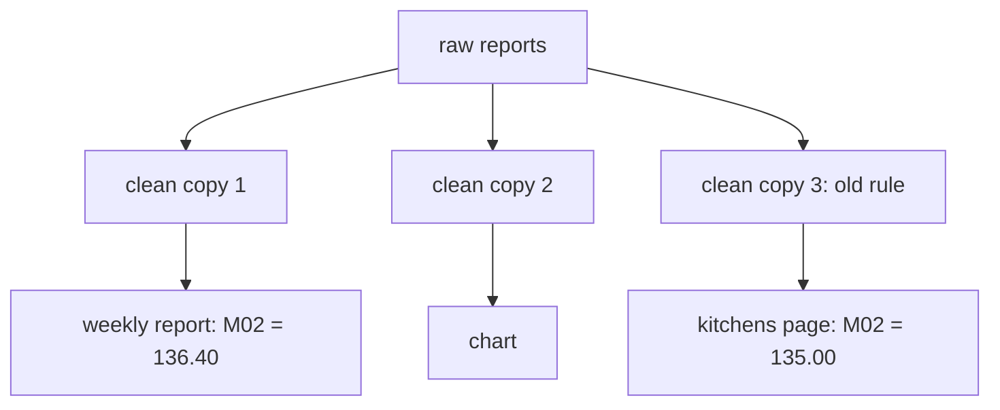

<BigWordAlert term="dbt model" plainEnglish="A SELECT statement saved in its own file. dbt runs the file and saves the result as a table or a view in the warehouse." whyItMatters="One idea in one file means you can name it, test it, reuse it and change it in one place." />

## One number, two answers

On a Wednesday evening, Hala opens a message from Omar. Omar is the programme officer at Mizan, and he reads the weekly food-basket report. He is not technical. He writes that the report shows 136.40 shekels for market M02 in week 12. The partner kitchens' page shows 135.00 for the same market and week. Hala, Omar and everyone else in this module are fictional, and all the data is synthetic.

Both pages come from the same raw reports, so the two numbers should be equal. Omar asks which one is right. He does not ask for a long answer. He needs one number to read to a partner kitchen on the phone in the morning.

Hala works part time and remotely for Mizan, and she plans her work around the hours when the power is on at home. Tonight the power stays on until 22:00, so she has about three hours. She knows where to look. Both pages are built by one file, `weekly_report.sql`, and in this example the file has 312 lines.

## Inside the file

Hala scrolls through the file. It cleans the raw price reports three times. One copy feeds the weekly report, one feeds a chart that Omar asked for in February, and one feeds the kitchens' page. Each copy keeps the latest send of every report, removes bad rows, and adds up the 12 items of the basket for each market and day.

Three weeks ago, Hala found rows with a price of 0 or less. She added one rule to remove them: the price must be above 0. She pasted the rule into the first two copies, then the phone rang and she moved on. The third copy, the one for the kitchens' page, still has the old version.

The diagram shows the file as Hala sees it. Follow the arrows from the raw reports to the two pages, and notice that three separate blocks of nearly the same SQL sit between them.



Hala counts the full days in each page. The weekly basket only counts a day when all 12 items were priced. The report counts 5 full days for M02 in week 12, and the kitchens' page counts 6. Before you read on, think about what could make one page count an extra day.

```predict
prompt: "The kitchens' page counts 6 full days for M02 in week 12, and the weekly report counts 5. Both read the same raw reports. What is the most likely reason?"
options:
  - id: kept
    label: "A bad row stayed in, so an incomplete day looked complete"
  - id: lost
    label: "The first page lost one day of data while it was being copied"
correctOptionId: kept
explanation: "The kitchens' page counts one more day, not one less. A row that should have been removed is the likely cause: on 18 March the flour report for M02 has a price of 0. The page with the rule drops it, so that day has 11 items and is not counted. The page without the rule keeps it, so the day looks complete and is counted."
allowRetry: true
```

## What Hala finds

She runs a small query for 18 March. Market M02 has reports for all 12 items that day, but the report for flour, `r-001618`, has a price of 0.0. With the rule, that report is removed, flour is missing, and the day has 11 items, so the weekly basket does not count it. Without the rule, the flour report stays in and the day looks complete. Its basket is 128.00 shekels, which is too low, because flour is counted at a price of 0.

The arithmetic matches Omar's numbers. Five full days add up to 682.00, and 682.00 divided by 5 is 136.40. The extra day adds 128.00, so 810.00 divided by 6 is 135.00. One bad row on one day moved a weekly number by 1.40 shekels, and nothing in the file complained.

Hala fixes the third copy in a minute. The harder question comes after that. She has just spent an hour finding a mistake that a single shared rule would have made impossible. The file will break again, in another place, the next time someone changes a rule in two of three copies.

She answers Omar before she goes to bed. She writes that the weekly report is right, at 136.40, and that the kitchens' page was wrong because of one bad row. She says the page will be correct by morning. Omar thanks her and asks whether the other seven markets are safe. Hala cannot answer that yet, and this is the real cost of the file. She does not know what else it gets wrong.

## Why one big file breaks

Four problems show up in Hala's file, and they show up in most files like it. The first is repetition. The same rule lives in three places, and a fix reaches only the places the author remembers. The second is that nothing has a name. When Omar asks about "the clean step", Hala can only point at line numbers, and line numbers move every time someone adds a comment.

The third problem is that nothing checks the result. No test failed when a price of 0 entered the basket. The first alarm was Omar's message, which means the readers found the bug before the author did. The fourth problem is that every check means running everything. To test one change Hala runs all three outputs, and the power may cut before she sees the answer.

None of these problems is about SQL syntax. Hala writes good SQL. The problem is the shape of the work: one file, one run, no names and no checks. After a few months of this, nobody changes a line they do not have to change.

## What changes when SQL becomes code

Software engineers have a standard way to handle this shape of problem. They split a program into small files, give each file a name, test each part, and save every change in version control. Transformation as code means doing the same with SQL. A **transformation** is any step that turns raw data into tables that people can use. Here, you write each step as its own file, in plain SQL, and a tool runs the files in the right order.

The tool in this course is dbt. It is free and open source, and its first generation, called dbt Core, is written in Python. The course pins dbt-core 1.12.6 with the DuckDB adapter dbt-duckdb 1.11.0, checked in October 2026. A model is a SELECT statement saved as a file. dbt runs the files in dependency order and builds tables, and tests check the assumptions you wrote down.

Small files also make changes easy to review. When the rule "price above 0" lives in one file, a change to it is a few lines in one commit. A reviewer can see exactly what moved. In a 312-line file, the same change hides among hundreds of lines that did not change. Hala already saves her work in Git, so each step gets its own history once the steps are separate files.

People who do this work are often called analytics engineers. They shape clean, tested tables for others to use, and they sit between data engineering and analysis. In small teams one person does several of these jobs, and Hala is one such person. The skill also appears in job postings. In the postings we read in October 2026, dbt was named in about half of the 25 we read closely. It was named in about a third of the 90 we scanned. This is a sample of public postings, not a census.

## What you build in this module

By the end of this module, `weekly_report.sql` is gone. In its place is a folder named `transform/`. It holds 8 models, 1 seed (a small CSV that dbt loads), 1 snapshot and 3 sources, plus 28 data tests and 1 unit test. One command, `dbt build`, loads the seed, builds every model in order and runs all the tests, 39 steps in all. The clean rule exists once, in `stg_price_reports`, and every page reads from it.

The work follows a plain order. In 7.2 you learn how models connect and why dbt builds them in a fixed order. In 7.3 you learn what a test can and cannot prove. In 7.4 you learn how a snapshot keeps history and how an incremental model avoids rebuilding everything. In 7.5 you build the whole project and pass its tests.

This module does not yet deal with late uploads, resends of the same report or a new field in the phone form. Those are the subject of module 8. Here the data arrives once, on time, and the job is to organise the SQL so that the later problems have a place to be solved.

<LearningObjectives objectives={["Explain why one long SQL file with repeated logic is hard to trust and change", "Organise SQL into staging and mart models that dbt builds in dependency order", "Write tests and a model contract for the assumptions you rely on, and say what a passing test cannot prove", "Keep history with a snapshot and process only recent rows with an incremental model", "Build the Mizan dbt project and pass its tests"]} />

## Key words

| Word | Plain English |
|---|---|
| **Transformation** | A step that turns raw data into tables people can use |
| **Staging model** | The first clean copy of one source, with one row for each real thing |
| **Mart** | A table shaped for the people who read the report |
| **Dependency** | Model B needs model A to be built first |
| **Test** | A check on built data that fails when a rule you wrote is broken |

## What is in this module

| Chapter | You will practise |
|---|---|
| 7.2 | Splitting SQL into staging and mart models and reading the build order |
| 7.3 | Writing tests and a contract, and seeing what they miss |
| 7.4 | Keeping history with a snapshot and growing a table with an incremental model |
| 7.5 | Building the Mizan dbt project and passing its tests |
| 7.6 | A graded check with five scenarios, including an AI answer to check |
| 7.7 | Explaining one test that protects you and one problem it would miss |

**Next:** Models, refs and layers in dbt: how one SQL file becomes many small ones that build in order.
