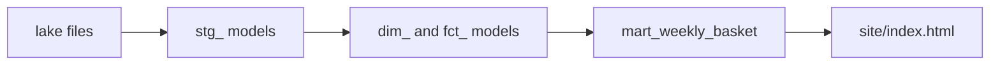

## The first piece Hala cuts out

On Thursday morning, Hala opens `weekly_report.sql` and cuts out the cleaning step. She saves it in a new file named `stg_price_reports.sql`. It is the only file where the rule "price above 0" will ever need to change. Every page that needs clean reports will read from this one file.

That small move is the whole idea of this chapter. A big query becomes several small files, and each file has a name that says what it holds. The hard part is not cutting. The hard part is telling the tool how the pieces connect, so that the cleaning file is built before the files that use it.

In dbt, a **model** is a SELECT statement saved in a `.sql` file. You never write `CREATE TABLE`. The file name becomes the table name, and dbt wraps your SELECT in the right statement. The pieces connect through one function, and that function is the new word of this chapter.

<BigWordAlert term="ref" plainEnglish="A function you write inside a model, like ref('stg_price_reports'). It points to another model, so dbt writes the right table name and builds that model first." whyItMatters="Every ref is an arrow. The arrows let dbt find the build order and skip models whose parents failed." />

## Two models and one arrow

Look at a small case from a different place: Majd's bakery. His sales sheet has one row for each sale, and a row with a quantity of 0 is a cancelled sale. He wants a daily total. He writes two models. The first cleans the raw table, and the second adds up the clean rows.

```sql
-- models/stg_sales.sql
select
    sale_id,
    item,
    qty * price as amount,
    cast(sold_at as date) as sold_date
from {{ source('shop', 'sales') }}
where qty > 0
```

```sql
-- models/daily_sales.sql
select sold_date, sum(amount) as total
from {{ ref('stg_sales') }}
group by sold_date
```

The double curly brackets are Jinja, a small template language that dbt runs before it sends SQL to DuckDB. The function `source('shop', 'sales')` names a raw table that dbt does not build. The function `ref('stg_sales')` names a model that dbt does build. When dbt compiles the second file for a database file named `shop.duckdb`, the result is plain SQL: `from "shop"."main"."stg_sales"`.

Before it runs anything, dbt reads every file and collects every `ref` and `source`. That step is called parsing. From the calls it draws a graph: an arrow runs from `stg_sales` to `daily_sales`, because the second model uses the first. A graph with arrows and no circles tells dbt an order that always works. First `stg_sales`, then `daily_sales`.

Suppose the sales sheet holds four rows: 10 loaves at 1.5, 5 loaves at 1.5, 4 trays at 3.0 and one cancelled row with a quantity of 0, all on 2 March. The staging model drops the cancelled row. The amounts are 15.0, 7.5 and 12.0, and the daily total for 2 March is 34.5.

## Layers: where each kind of work lives

Hala's project uses three layers, and the layer is a folder name plus a naming habit. **Sources** are the raw files that dbt reads but does not build. **Staging** models are the first clean copy of each source: one model for each source table, with names fixed, types cast and duplicates removed. **Marts** are the tables made for readers, such as `dim_market`, `fct_price_report` and `mart_weekly_basket`.

The names carry the layer. Staging models start with `stg_`, dimensions with `dim_`, facts with `fct_` and report tables with `mart_`. You met dimensions and facts, and the grain of a fact table, in chapter 4.3. A fact model such as `fct_price_report` keeps the grain you chose there: one accepted price report.

One rule keeps the layers useful: marts read staging models and other marts, and never read the raw files directly. If a mart read the lake itself, the cleaning rule would live in two places again, which is the problem from chapter 7.1.

The diagram shows the layers of the Mizan project. Read it from left to right. Notice that the lake files sit outside dbt, and that only the staging models touch them.



Each model can be built as a **view** or as a **table**. A view saves the query and runs it every time someone reads it. A table runs the query once and stores the rows. Mizan builds both of its layers as tables, and the setting lives in `dbt_project.yml`. Tables keep the warehouse independent of the lake folders, because after a build the rows are stored inside the warehouse file. A third choice, the incremental model, is the subject of chapter 7.4.

## Predict, then watch dbt build

dbt builds with one command, `dbt build`. It loads seeds, builds models in arrow order and runs tests. Now think about a failure. Suppose Hala forgets to run the registry extraction, so the market files do not exist. `stg_markets` cannot read its source. Several other models need `stg_markets`, directly or through other models.

```predict
prompt: "stg_markets fails because its source files are missing. dim_market needs stg_markets. What does dbt build do with dim_market?"
options:
  - id: built
    label: "It builds dim_market from yesterday's table"
  - id: skipped
    label: "It skips dim_market and does not build it"
correctOptionId: skipped
explanation: "dbt does not try a model whose parent failed. It marks the model SKIP. The old dim_market table is still in the warehouse, but it was not rebuilt, so it is out of date. A skip is a warning to fix the parent."
allowRetry: true
```

The canvas below shows six of the project's 13 nodes. First it builds them in order. Then it shows the run where the registry files are missing.

<InteractiveCanvas slug="dbt-build-order" />

**What this shows:** how the arrows from `ref()` and `source()` set the build order, and how a failure travels down the arrows that leave the failed model.

**Try this:** step to the failure, and before step 8 say which models will be skipped. Find the model with two parents and say what must happen before it starts. At the last step, name the model that still builds and the arrow it does not have.

**What changed:** after the failure, three models were skipped and one was still built. The difference was not the layer. It was whether a path of arrows led from the failed model.

**Limits of the model:** the picture is a slice with one thread. A real `dbt build` also runs tests, and a failing test blocks the models below it in the same way. With more threads, independent models build at the same time.

## What a real failure looks like

Here is a shortened piece of a real run in the Mizan project, with the registry files deleted. The lines show the same pattern as the canvas. The volunteers staging model failed for the same reason as the markets one, so its line is left out.

```text
1 of 39 ERROR creating sql table model main.stg_markets ........ [ERROR in 0.06s]
2 of 39 OK created sql table model main.stg_price_reports ...... [OK in 0.07s]
14 of 39 SKIP relation snapshots.snap_markets .................. [SKIP]
21 of 39 SKIP relation main.dim_market ......................... [SKIP]
28 of 39 SKIP relation main.fct_price_report ................... [SKIP]
```

The error message under it says `No files found that match the pattern "../lake/shared/registry/markets/*/*.parquet"`. That is a useful message, because it names the missing step. Hala does not need to read the SQL. She runs the registry extraction from chapter 6.5 and builds again.

Notice what the run does not do. It does not stop at the first error, and it does not build `fct_price_report` from a half-empty market list. `dim_item` and `dim_date`, which do not depend on markets, are built normally. A failure is contained to the models that depend on it.

## Where people go wrong

**A hard-coded table name.** A model that says `from main.stg_sales` instead of `ref('stg_sales')` works on the first day, because the table exists. But dbt cannot see the arrow. It may build the model before its parent, and the model then reads yesterday's table without any error. The wrong numbers look fine.

**Business logic in staging.** A staging model that also joins three tables and computes a basket cost is a mart in disguise. When the rule changes, nobody looks in the staging folder. Keep staging to renaming, casting and removing duplicates.

**One giant model.** Moving 312 lines into a single model gives you a new file with the same problems. The test is simple: can you say in one sentence what the model's rows are? If you cannot, split it. The sentence is the grain.

**A circle.** If model A refs model B and model B refs model A, no order exists. dbt refuses to run and names the circle. The fix is almost always a missing third model that both can read.

## When to choose differently

More models mean more files, and each file costs a little time to open and name. A CTE inside one model, from chapter 2.4, is the lighter choice when a step is used once and needs no test. Move a CTE into its own model when a second query needs it, or when you want to test it by itself. Hala moved the cleaning step because three queries needed it.

Views and tables trade differently. A view is always current and costs no storage, but it repeats its work for every reader. A table is fast to read but is only as fresh as its last build. Mizan's data is small, so the choice is about independence from the lake, not speed.

<Callout type="note" title="dbt has two generations">
dbt Core version 1 is written in Python and is free and open source. A second generation was released in September 2026 and is now the default install. This course pins version 1.12 so that every command behaves the same for everyone. The command `dbt --version` prints a notice that version 2 exists. That notice is expected.
</Callout>

## Try it on your data

Open the longest query you wrote in modules 2 and 3, for example your weekly change drill. Mark each CTE with the number of times its result is used, and write one sentence for what one row of it means. A CTE used twice, or one whose sentence is a clear grain, is a candidate for its own model. Write the model names you would give them, using the prefixes from this chapter.

## Check your understanding

```quiz
type: mcq
question: "Layla's shop project has four models. stg_orders and stg_refunds read raw sources. daily_orders uses ref to read stg_orders. net_sales uses ref to read daily_orders and stg_refunds. In one dbt build, stg_orders fails. Which models does dbt skip?"
options:
  - "daily_orders, net_sales and stg_refunds"
  - "daily_orders and net_sales, but not stg_refunds"
  - "Only daily_orders, because net_sales has a second parent"
  - "None, because dbt reuses yesterday's tables"
correct: 1
explanations:
  - "stg_refunds only reads a source and does not use stg_orders, so a failure upstream of stg_orders cannot reach it. It builds normally."
  - "Right. daily_orders needs stg_orders, and net_sales needs daily_orders, so both are skipped. stg_refunds has no arrow from stg_orders, so it still builds."
  - "net_sales has two parents, but one of them (daily_orders) is skipped. A model starts only when every parent is built, so net_sales is skipped as well."
  - "dbt does not substitute old tables. It marks the dependent models as skipped, and their old tables stay unchanged and out of date."
```

```quiz
type: mcq
question: "Fares writes net_sales.sql with the line 'from main.daily_orders' instead of using ref. On day one the numbers are right. Three weeks later they are wrong, with no error. What is the most likely cause?"
options:
  - "dbt refuses to build any file that names the schema main"
  - "ref adds a filter to the query, and without it extra rows are read"
  - "A hard-coded name is only a style choice and cannot change any number in a report"
  - "With no arrow, dbt may build net_sales first and read an old daily_orders"
correct: 3
explanations:
  - "dbt accepts a schema name in SQL. Writing main.daily_orders runs without any error, which is why the mistake stays hidden."
  - "ref adds no filter. It only writes the right table name and records the arrow between the two models."
  - "The name is not only style. Without ref there is no arrow, so the build order is no longer guaranteed, and wrong numbers can follow."
  - "Right. With no ref there is no arrow, so dbt may build net_sales before daily_orders. It then reads the table from the previous run and nothing reports the problem."
```

**Next:** Tests, contracts and docs: how to write down what you believe about the data, and what a passing test still cannot tell you.
