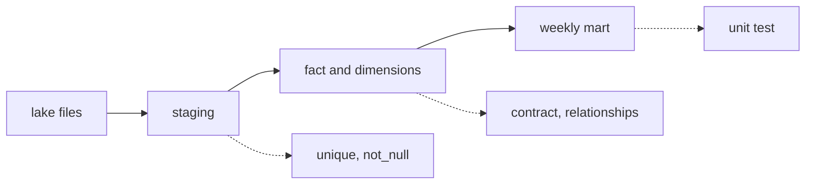

## The test that said 79

Hala wants to see a dbt test fail on purpose. She removes the step in `stg_price_reports` that keeps only the latest send of each report, and she builds that model and the models below it. The `unique` test on `report_id` stops it at once.

```text
5 of 20 FAIL 79 unique_stg_price_reports_report_id ......... [FAIL 79 in 0.02s]
6 of 20 SKIP relation main.dim_date ........................ [SKIP]
7 of 20 SKIP relation main.fct_price_report ................ [SKIP]
Got 79 results, configured to fail if != 0
Done. PASS=4 WARN=0 ERROR=1 SKIP=15 NO-OP=0 REUSED=0 TOTAL=20
```

The number 79 is familiar. It is the count of duplicate sends printed by `make_source.py` in chapter 1.4. A `unique` test returns each value that appears more than once, and each of the 79 resent reports appears twice. Fifteen models and tests below the failure were skipped, so a bad table did not travel to the report.

When a test fails, dbt prints the place where it saved the compiled SQL, under `target/compiled`. Open that file, run it in DuckDB and read the rows. For the 79 failures the rows are 79 report ids, each with a count of 2. That is the value of a test that returns rows: the failure already holds the evidence, and the next step is a query, not a guess.

This is what a test does well. It turns a belief ("one row for each report") into a check that runs on every build. But a test only checks what someone wrote down. This chapter shows the kinds of check dbt offers, and then shows the kind of mistake that none of them can see.

## Four kinds of check

A **data test** is a query that returns the rows that break a rule. If it returns no rows, the test passes. Four generic tests come with dbt: `unique`, `not_null`, `accepted_values` and `relationships`. You attach them to columns in a YAML file next to the models. Put `unique` and `not_null` on every key, and `relationships` on every column that points at another table.

Here is a small example from a different place, Layla's online shop. The `relationships` test checks that every customer in the orders table also exists in the customer table.

```yaml
models:
  - name: stg_orders
    columns:
      - name: order_id
        data_tests: [unique, not_null]
      - name: status
        data_tests:
          - accepted_values:
              arguments:
                values: ["paid", "refunded", "cancelled"]
  - name: fct_orders
    columns:
      - name: customer_key
        data_tests:
          - relationships:
              arguments:
                to: ref('dim_customer')
                field: customer_key
```

A **singular test** is one SQL file in the `tests/` folder. It is for a rule that does not fit a generic test. The Mizan project has one, and it guards the fact table against prices of 0 or less. You will add it in chapter 7.5.

```sql
-- tests/assert_prices_are_positive.sql
select report_id, price
from {{ ref('fct_price_report') }}
where price <= 0
```

A **unit test** checks the logic of one model with a few rows that you write yourself. You give it fake input rows and the rows you expect, and dbt compares them. Unit tests run on invented data, so they are the right place for a calculation such as the weekly basket. dbt recommends running them in development and in CI, not in production.

## A contract checks the shape

The fourth kind of check works differently, and it has a name that is easy to confuse with other things. A contract checks the shape of a table before it is kept.

<BigWordAlert term="Model contract" plainEnglish="A list of the columns and types that a model promises. When the contract is enforced, the build fails if the real table does not match the list." whyItMatters="A contract stops a change in shape at build time, before any report reads the table. A test checks the content afterwards." />

In the Mizan project, `fct_price_report` has an enforced contract: eleven columns with exact names and types, and `price` is `decimal(8,2)`. Suppose someone changes the model so that `price` becomes a `double`. The build refuses to keep the table.

```text
This model has an enforced contract that failed.
| column_name | definition_type | contract_type | mismatch_reason    |
| price       | DOUBLE          | DECIMAL(8,2)  | data type mismatch |
```

The message names the column and both types. That is much faster to read than a wrong total in a report a week later. Contracts and tests do different jobs. A contract catches a change in names and types when the model is built. A test catches bad content after it is built.

The last tool in this chapter is documentation. You write a `description` for each model and column in the same YAML file. The command `dbt docs generate` builds a small website from them, and it works offline. A good description is a promise to the next reader. It says what one row is, and it is often the first thing that Omar or a new teammate reads.

## What a test can and cannot see

Every test holds one assumption. The `unique` test holds "no report appears twice", and the `relationships` test holds "every row has a market". The assumptions come from people. If nobody writes down an assumption, no test exists for it. The sentence to remember is this one: a passing test means the checks you wrote passed, not that the data is correct.

Consider the fact table with 2,620 rows. Suppose some rows are bad in three ways. Some report ids appear twice. Some rows point at a market that does not exist. Some prices are wrong but look normal, for example flour entered as 9.0 when the shop price was 8.0. Before you play with the numbers, make a guess.

```predict
prompt: "In this example the fact table has three tests: report_id is unique, every market exists, and the price is above 0. It holds 10 duplicated report_ids, 4 rows with no market and 6 wrong prices that look normal. How many of these 20 bad rows do the tests point at?"
options:
  - id: fourteen
    label: "14, and the 6 wrong prices pass every test"
  - id: all
    label: "All 20, because every bad row breaks a test"
correctOptionId: fourteen
explanation: "The unique test fails for the 10 duplicates and the relationships test fails for the 4 rows with no market, which is 14 rows. A price of 9.0 instead of 8.0 is above 0, so the price test passes, and no test checks the price against the truth. The 6 wrong prices stay in the table."
allowRetry: true
```

The canvas lets you change the number of each kind of fault. Watch the third bar.

<InteractiveCanvas slug="what-tests-catch" />

**What this shows:** which kinds of fault a test points at, and the kind that no test sees. A duplicate breaks `unique`, a row with no market breaks `relationships`, and a normal-looking wrong price breaks nothing.

**Try this:** leave the defaults and read the three numbers. Then set the wrong prices to 0. Then set the duplicates and the rows with no market to 0, and keep the 6 wrong prices.

**What changed:** with only wrong prices left, all three tests pass and 6 bad rows are still in the table. A green build did not make the table right. It only meant that the written rules held.

**Limits of the model:** it is a simple illustration. It counts one bad row for each fault and treats a failing test as pointing at every row of its kind. A real test returns the rows that broke its rule, and a real table has more kinds of fault.

## A real event: when the count did not match

A row-count check is simple to write, and it finds a whole class of loss. In September and October 2020, in England, test results for a disease were passed as files into spreadsheets in an older format.

<RealWorldEvent title="Lost test results in a spreadsheet limit" when="September and October 2020" summary="Lab results were loaded into spreadsheet templates in an older format that held about 65,000 rows each. When a template was full, further cases were left out. About 16,000 confirmed cases were missing from the daily figures between 25 September and 2 October. They were added later, but contacts were not traced promptly." lesson="A file format has limits. Count the rows between each stage of a pipeline, so that a loss shows up as two numbers that do not match." />

The Mizan project has this test in its pytest file. The number of rows in the fact table must equal the number of distinct good report ids in the raw files, which is 2,620. If a stage ever drops rows, the two numbers differ and the test fails. Chapter 7.5 includes it.

## Where people go wrong

**Tests that cannot fail.** A `not_null` test on a column that the model already filters is a test that always passes. It gives a feeling of safety and checks nothing. Write the test for the rule that was broken last time, not for the rule that is easy to write.

**Trusting green.** A passing build is a statement about your tests. It is not a statement about the world. The wrong flour price in the example passed everything, and only a person who knew the market would have noticed.

**Writing tests only after a report breaks.** If you add a test only after a reader finds a bug, every new kind of bug is found by a reader first. Add a test for each incident that really happened, and add `unique`, `not_null` and `relationships` before anything breaks.

**Sensitive data in seeds.** A seed is a small CSV that dbt loads into the warehouse. It is for static lists, like the 12 items. It is not for data about people.

## Choosing where a rule goes

The diagram shows where each kind of check watches the Mizan build. The solid arrows are data. The dotted lines attach a check to the step it watches.



Notice two gaps. Nothing watches the lake files before staging, and nothing compares the weekly mart with the real prices in the markets. Chapter 11.2 adds checks on the incoming files. Only a person who knows the markets can fill the second gap.

Four places can hold the same rule, and they have different strengths. Put a rule about names and types in a contract, because it fails earliest. Put a rule about the content of a table in a data test. Put a rule about a calculation in a unit test, because you control the input. Put a rule that crosses stages in a pytest test, because it needs to read two places. An example is "the fact table has as many rows as the raw files have good reports".

More tests are not always better. Each test adds time to every build, and a test that often fails for a harmless reason teaches people to ignore failures. dbt lets you set a test to `warn` instead of `error` for rules that should raise attention but not stop the build. Use that sparingly, and look at warnings every week.

## Try it on your data

Open your weekly change drill from chapter 3.5. Write down three assumptions it makes, for example "report_id is unique", "every market code exists in the markets table" and "every price is above 0". For each one, decide which of the four places would guard it, and write one query that returns the rows that break it. Run the queries on your raw data. Any query that returns rows has just found a real fault.

## Check your understanding

```quiz
type: mcq
question: "Aya's school table fct_attendance has three tests: attendance_id is unique, student_key is not null, and class_key exists in dim_class. A teacher records 48 pupils present in a class of 30. The class key is valid and the id is new. What does dbt build show?"
options:
  - "All three pass, because the keys exist and the id is unique"
  - "relationships fails, because 48 is more than the class holds"
  - "unique fails, because two rows now describe the same class"
  - "not_null fails, because the number is too large to be stored"
correct: 0
explanations:
  - "Right. Each test checks one written rule, and the rows satisfy all three. No test compares the count with the size of the class, so the wrong number stays in the table."
  - "relationships only checks that class_key exists in dim_class. It knows nothing about class sizes, so it passes."
  - "unique is on attendance_id, and the new row has a new id. Two rows for one class are normal in an attendance table, so it passes."
  - "not_null checks that student_key has a value. A large number is still a value, so it passes."
```

```quiz
type: mcq
question: "Nabil's clinic model dim_doctor promises visit_minutes as an integer. A change turns the column into text. He wants the build to stop before any report reads the table. Which tool does that?"
options:
  - "A not_null test on visit_minutes, because text is never empty"
  - "The docs site, because it lists every column and its type"
  - "An enforced model contract, because it compares types at build time"
  - "A unique test on visit_minutes, because text repeats more often"
correct: 2
explanations:
  - "not_null checks for missing values. A text column can have no missing values and still be the wrong type, so the build passes."
  - "The docs site only describes the table. It does not stop a build, and nobody has to read it."
  - "Right. An enforced contract compares the names and types the model produces with the promised list, and the build fails with a message that names the column."
  - "unique checks for repeated values. Changing a type does not make values repeat, so this test says nothing about the type."
```

**Next:** Snapshots and incremental models: how to keep the history of a changing market, and how to build only what is new.
