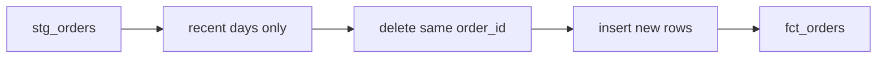

## The registry forgets

On the morning of 12 March, Yasmin changes market M03 in the registry. The market has moved from Harbour to Hill. The registry app, which Karam built, overwrites the old value. By lunchtime the word Harbour is gone from the app, and only Hill remains.

Hala looks at the fact table. Market M03 has 128 reports made before 12 March, and they were all taken at the Harbour market. If she keeps only the latest row of the registry, every one of M03's reports, old and new, will be filed under Hill. Last week's prices would describe a place that did not exist yet.

You met the answer in chapter 4.4: a type 2 dimension keeps one row for each version, with dates that say when the version was valid. The registry does not do this for us, because it overwrites. So the pipeline must do it, by remembering what it saw on each run. In dbt, that job is done by a snapshot.

## What a snapshot does

A dbt **snapshot** reads a table on every run and compares each row with the row it saved last time. If a row has changed, the snapshot closes the old version and adds a new one. It writes the times in two columns, `dbt_valid_from` and `dbt_valid_to`. The current version has an empty `dbt_valid_to`.

Since dbt version 1.9, you define a snapshot in a YAML file. Here is an example from a different place: Layla's shop, where product prices change. The `timestamp` strategy trusts an `updated_at` column to say which rows changed. A second strategy, `check`, compares a list of columns instead, and it is for sources that have no reliable timestamp.

```yaml
snapshots:
  - name: snap_products
    relation: ref('stg_products')
    config:
      schema: snapshots
      unique_key: product_id
      strategy: timestamp
      updated_at: updated_at
      hard_deletes: ignore
```

Three settings need a reason. The `unique_key` says which column identifies one thing across versions. The schema is separate because a snapshot cannot be rebuilt. Its past exists only in the table, so you keep it away from models that you may drop and recreate. The `hard_deletes` setting says what to do when a row disappears from the source: `ignore`, `invalidate` or `new_record`.

## What a snapshot sees, and what it misses

A snapshot records the state it finds at each run. It does not watch the source between runs. That one fact has a consequence that surprises people, and it is the reason this chapter has a canvas.

Suppose the snapshot runs on 11 March and on 14 March. In the meantime, M03 moves from Harbour to Hill on 12 March, and, in this example, moves again to Old Town on 13 March. The second change is invented for the exercise. Before you use the canvas, make a guess.

```predict
prompt: "M03 is Harbour at the 11 March run. It changes to Hill on 12 March and to Old Town on 13 March. The next run is on 14 March. How many history rows does the snapshot hold for M03 after that run?"
options:
  - id: three
    label: "Three rows: Harbour, Hill and Old Town, one for each"
  - id: two
    label: "Two rows: Hill is lost between the two runs"
correctOptionId: two
explanation: "On 14 March the snapshot sees only Old Town. It closes the Harbour row and adds an Old Town row. Hill existed for one day, between two runs, so no run ever saw it, and nothing in the source remembers it either."
allowRetry: true
```

The canvas steps through the same days, one at a time, and shows which row each run writes.

<InteractiveCanvas slug="snapshot-sees-runs" />

**What this shows:** a snapshot records the states it finds at its runs, not the states between them. Two changes between two runs leave one new row, and the middle state is lost.

**Try this:** predict the number of history rows before step 4. Then find the step where Hill is lost, and say what would have saved it. At the end, think about a snapshot that runs only on Sundays.

**What changed:** the reports of 12 March now join the Harbour version, because Harbour is valid until 13 March in the history. A lost state does not only leave a gap in the history. It also files facts under the wrong version.

**Limits of the model:** the picture has one market and the `timestamp` strategy only. The second change is an example added for this chapter, because the seed-7 data has only the move from Harbour to Hill.

The lesson is about schedule, not about dbt. A snapshot is only as exact as its run schedule. Chapter 9.4 runs the whole pipeline every day, which is why a daily snapshot is the usual choice. Even a daily run cannot see two changes on the same day.

## A worked example: M03 across three tables

In the Mizan data, M03 changes once, and the snapshot runs on time. The test that checks this uses 14 days of data. It extracts the registry as of 11 March and builds, then extracts it as of 14 March and builds again. The first block below is the snapshot, the second is the dimension built from it, and the third is the facts.

```text
snapshots.snap_markets for M03:  Harbour 2026-03-01 -> 2026-03-12 ; Hill 2026-03-12 -> NULL
dim_market for M03:              Harbour 1900-01-01 -> 2026-03-12, is_current false ; Hill 2026-03-12 -> NULL, is_current true
facts for M03:                   Harbour for reported_date 2026-03-01 .. 2026-03-11 ; Hill for 2026-03-12 .. 2026-03-14
```

Look at the first Harbour row in the dimension. It starts on 1900-01-01, not on 1 March. A snapshot cannot know how long the market had been in Harbour before the first run. If the dimension said "valid from 1 March", a report from 28 February would find no market at all. So `dim_market` gives the first version of every market a start date far in the past. The prototype in chapter 4.5 used the true dates from `market_history.csv`, which a real registry rarely gives you.

Each fact is joined to the version that was valid on its report date. A version is valid from its start date, inclusive, until its end date, exclusive. That is why a report on 11 March finds Harbour and a report on 12 March finds Hill.

## Incremental models: build only what is new

The fact table grows with every day of data. Rebuilding it from the first row each time is wasteful when the table is big. An **incremental model** builds the whole table on the first run. On later runs it reads only recent rows and merges them into the table that already exists.

You turn it on with the `incremental` materialization from chapter 7.2, and you add a block that runs only after the first build. Here is a small example from Layla's shop. It reads recent orders and replaces any order that it already holds.

```sql
{{ config(materialized='incremental', unique_key='order_id', incremental_strategy='delete+insert') }}

select order_id, customer_key, amount, ordered_date
from {{ ref('stg_orders') }}

where ordered_date >= (select max(ordered_date) from {{ this }}) - interval '2 days'

```

On the first run, `is_incremental()` is false, so the filter is skipped and every row is loaded. On later runs it is true. The name `this` means the table that the model itself builds. The filter reads only orders from the last two days before the newest order already in the table.

The `unique_key` is the safety. With the `delete+insert` strategy, dbt first deletes the rows in the table whose key appears in the new batch, and then inserts the new rows. Running the same batch twice leaves one copy of each order. This is the idempotent job from chapter 6.3, written inside a model.

The diagram follows one incremental run. Notice that the delete step uses the key, and not the dates.



## Where people go wrong

**No unique key.** Without `unique_key`, most adapters append. The first rerun adds the last two days a second time, and the fact table holds duplicates. The rows look normal and the build passes. A `unique` test on the key finds it, which is another reason to write that test.

**A strict greater-than.** If the filter says `>` the newest date in the table, a record that arrives later on the same day is skipped. Use `>=` so that the newest day is read again. A window of several days, like the one above, also reads records that arrived a day or two late. The size of that window is the subject of module 8.

**New columns.** An incremental model has a setting, `on_schema_change`, for the day when the model's SELECT gets a new column. Its values are `ignore`, `fail`, `append_new_columns` and `sync_all_columns`. None of them fills the new column for old rows. With an enforced contract, dbt allows only `append_new_columns` or `fail`, and the Mizan fact table uses `fail`, so a person decides.

**Changed dimensions.** An incremental fact keeps the foreign keys it was given on the day it was loaded. If a market's version is corrected later, old fact rows still point at the old version. Chapter 8.4 shows the repair, which is a backfill.

## When to choose differently

For the Mizan data, a plain table would do. In the reference run, dbt built all the models and ran all the tests in about 1.7 seconds, not counting its own start-up. Rebuilding 2,620 fact rows each time is cheap. We use an incremental model for two reasons. It is the pattern that bigger tables need, and module 8 builds late-data handling on top of it. The cost is more to reason about: you must now think about which rows a run re-reads.

There are other choices. A full rebuild is the simplest and often the right one. dbt also has a `microbatch` strategy that processes the data in slices of a day or an hour. It has a `lookback` setting and can retry a failed slice. This course uses the plain strategy with a visible window, so that you can see exactly what is re-read. Pick the simplest option that is fast enough, and move to a more complex one when the simple one hurts.

## Try it on your data

Choose a table from your drills that gains rows each day. Write one sentence that says which rows a run should read again, and one sentence that says which column is the key. Then check the rule with two runs: apply the same batch twice in DuckDB and count the rows after each. If the count changes after the second batch, your key or your filter is wrong.

## Check your understanding

```quiz
type: mcq
question: "Fares's clinic has an incremental model fct_bookings with no unique_key. It reads the last 2 days of bookings. The first run loads 500 rows, and the last 2 days hold 40 of them. No new bookings arrive. How many rows are in fct_bookings after a second run?"
options:
  - "500, because dbt remembers which rows it already loaded"
  - "460, because the old window is deleted and not replaced"
  - "540, because the 40 bookings in the window are added again"
  - "1,000, because dbt rebuilds the table and appends all of it"
correct: 2
explanations:
  - "dbt does not remember loaded rows. It only runs the SELECT you wrote and applies the strategy. Without a key, that strategy appends."
  - "A delete only happens when a unique_key tells dbt which rows to delete. This model has no key, so nothing is deleted."
  - "Right. With no key, the batch of 40 rows is appended on top of the 500 rows. Adding unique_key and the delete+insert strategy would replace those 40 rows and keep the count at 500."
  - "A full rebuild happens only on the first run or with --full-refresh. A normal rerun reads the 2 day window, which holds 40 rows, not all 500."
```

```quiz
type: mcq
question: "Ola's gym snapshots its trainer table every Sunday. A trainer's studio changes from A to B on Monday, and from B to C on Wednesday. How many history rows hold this trainer's studio after the next Sunday run?"
options:
  - "Three rows: studio A, studio B and studio C"
  - "Two rows: A and C, and studio B is never recorded"
  - "One row: only studio C, because a snapshot keeps the latest"
  - "Two rows: B and C, because the oldest version is dropped"
correct: 1
explanations:
  - "Studio B existed from Monday to Wednesday, entirely between two Sunday runs. A snapshot records only what it finds at a run, so B is never written."
  - "Right. The Sunday run sees C, closes the row for A and adds C. B lived between two runs, so no run saw it. A daily snapshot would have caught B."
  - "A snapshot keeps every version it has seen, not only the latest. The row for studio A stays, with an end date."
  - "A snapshot never drops old versions. Studio A is kept and closed. The studio that is missing is B, the one that no run saw."
```

**Next:** Build: the Mizan dbt project, where you put models, tests, the snapshot and the incremental fact table together and make `dbt build` pass.
