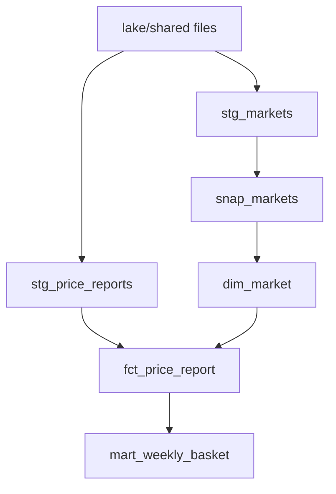

## What you will have at the end

Right now the weekly numbers come from a file that nobody trusts. When Omar asks which number is right, Hala has to read 312 lines to answer. By the end of this chapter, the numbers come from a dbt project with 8 models, 1 seed, 1 snapshot and 3 sources. One command builds all of it and runs 28 data tests and 1 unit test, 39 steps in all.

Your repository holds the work of chapters 1 to 6. The raw data is in `data/`. The restricted lake holds the landed uploads, and the shared lake holds the pseudonymised reports at `lake/shared/reports` and the registry extracts at `lake/shared/registry`. The `pipeline/` package and `tests/` folder already exist. This chapter adds a `transform/` folder and one test file. The dbt project reads only `lake/shared`. Personal data stays in the restricted zone, and the warehouse holds pseudonymised data only.

**What you need.** The workspace from chapter 1.4 with the virtual environment at a short path such as `C:\de\venv`, and `MIZAN_KEY` set in your shell. The first `dbt` command in a fresh environment can take about 30 seconds. A later `dbt build` takes about 12 seconds, and almost all of that is start-up. The models and tests themselves run in a second or two. Plan about two and a half hours.

<Callout type="warning" title="Check the install with dbt parse">
The command `dbt --version` works even when the install is broken. If the virtual environment is at a long path on Windows, dbt can fail on its first parse. Run `dbt parse` inside `transform/` to check the install, and see chapter 1.4 if it fails.
</Callout>

## The design decisions

You will make five choices, and each has an alternative. The first is how the project reads the lake. A source can declare an `external_location`, which tells the DuckDB adapter to read Parquet files directly instead of copying them. The staging models are then built as tables, so after the first build the warehouse no longer depends on those relative folder paths.

The second choice is the surrogate keys, the made-up keys from chapter 4.3. In the prototype of chapter 4.5 they were integers numbered with `row_number()`. Here they are hashes. `dim_market.market_key` is the snapshot's own id, a text hash that dbt calls `dbt_scd_id`, and `dim_item.item_key` is `md5(item_code)`. Integers numbered by position would change whenever a new market version appeared. That would break an incremental fact table, which keeps the keys it was given.

The third choice is the start date of each market's first version. A snapshot cannot know how long a market had been in its first state before the first run. So the first version of every market starts on 1900-01-01, and facts older than the first snapshot still find a market. The prototype had the true history file, and the real project does not.

The fourth choice is the fact table. It is an incremental model that re-reads a window of recent days and replaces rows by `report_id`. The window is set by the variable `lookback_days`, which is already in your `dbt_project.yml`. Its value is 3. Chapter 8.2 explains why 3, and what the choice costs. The fifth choice is where bad rows are removed. Landing in this module does not quarantine them yet, so `stg_price_reports` removes them with one `where` line. Chapter 8.5 moves that work into landing.

The diagram shows the models you add. Follow the arrows from the lake files to the weekly mart. Notice that `fct_price_report` has two parents here, and that the snapshot sits between `stg_markets` and `dim_market`.



## The task

Build the project in this order. Run `dbt build` often, after each step, because a small change is easier to debug than a large one.

1. Make sure the lake is ready (see the commands below). The build needs landed and published reports and both registry extracts. If the registry was never extracted, the source files do not exist and the build fails.
2. Create `transform/profiles.yml` and `transform/dbt_project.yml` from the two files below. They are given in full, because a wrong path here wastes an hour.
3. Copy `data/raw/items.csv` into `transform/seeds/items.csv`. A seed is a small static CSV that dbt loads as a table. It holds the 12 items and no personal data.
4. Write `transform/models/sources.yml` with three sources in the `lake` group. One is shown below, and the other two follow the same pattern.
5. Write the three staging models. One is given as a worked example. Use it as the pattern for the other two.
6. Write the snapshot `snap_markets` and the macro that lets the schema name `snapshots` mean exactly `snapshots`.
7. Write `dim_market`, `dim_item` and `dim_date`.
8. Write `fct_price_report` as an incremental model with an enforced contract.
9. Write `mart_weekly_basket`.
10. Write the tests in YAML, the singular test from chapter 7.3, and the unit test.
11. Run the acceptance tests.

### Two files given in full

The profile tells dbt where the warehouse file is. The paths are relative to the `transform/` folder, because you always run dbt from there.

```yaml
# Run dbt from the transform folder:  dbt build --profiles-dir .
# The paths below are relative to the folder you run dbt from.
mizan:
  target: dev
  outputs:
    dev:
      type: duckdb
      path: ../warehouse.duckdb
      threads: 1
      settings:
        TimeZone: UTC
```

The project file sets the folder names, the variable for the lookback window, and the materialization of each layer. It also fixes the column types of the seed, so DuckDB cannot guess them.

```yaml
name: mizan
version: "1.0.0"
profile: mizan

model-paths: ["models"]
seed-paths: ["seeds"]
snapshot-paths: ["snapshots"]
test-paths: ["tests"]
macro-paths: ["macros"]

# How many days back the fact table re-reads, so reports that arrive late are merged.
vars:
  lookback_days: 3

models:
  mizan:
    staging:
      +materialized: table
    marts:
      +materialized: table

seeds:
  mizan:
    items:
      +column_types:
        item_code: varchar
        item_name: varchar
        category: varchar
        unit: varchar
```

### One source, shown

The other two sources, `markets` and `volunteers`, read `../lake/shared/registry/markets/*/*.parquet` and `../lake/shared/registry/volunteers/*/*.parquet`. The three options at the end of each `read_parquet` call matter. Hive partitioning turns a folder name such as `upload_date=2026-03-01` into a column, and `union_by_name` lines up files by column name, so early files without a `unit` column still read.

```yaml
version: 2

sources:
  - name: lake
    tables:
      - name: price_reports
        description: One row per send of a report (a report can be sent more than once).
        meta:
          external_location: "read_parquet('../lake/shared/reports/*/*.parquet', hive_partitioning = true, union_by_name = true)"
```

### One worked model

This is the staging model for markets. Read it as a pattern. It names its source with `source()`, it uses the window function from chapter 3.2 to keep one row for each market, and it chooses which columns leave the layer. Notice that the order puts the newest `updated_at` first, and it uses `extracted_at` as a tie-breaker. That column comes from the folder name of each registry extract.

```sql
-- One row per market: the most recently updated row we have extracted.
with ranked as (
    select
        *,
        row_number() over (partition by market_code order by updated_at desc, extracted_at desc) as row_rank
    from {{ source('lake', 'markets') }}
)

select
    market_code,
    name,
    area,
    opens,
    cast(updated_at as timestamp) as updated_at
from ranked
where row_rank = 1
```

### The other models

For each model below, the grain is what one row means. Write each model so that every column in its list below exists, with the stated type where one is given.

| Model | Grain |
|---|---|
| `stg_price_reports` | one price report, the latest send of each `report_id` |
| `stg_volunteers` | one volunteer, the latest extracted row |
| `dim_market` | one version of a market |
| `dim_item` | one item |
| `dim_date` | one calendar day from the first to the last report date |
| `fct_price_report` | one accepted price report, one `report_id` |
| `mart_weekly_basket` | one market and one ISO week |

The columns and the notes for each model are these.

- `stg_price_reports`: `report_id`, `market_code`, `item_code`, `price` as decimal(8,2), `reported_at`, `reported_date`, `uploaded_at`, `volunteer_id`, `volunteer_key`, `unit`. Keep only rows with `price > 0` and a non-null `item_code`, in one `where` line. Cast `reported_at` to a timestamp, and take `reported_date` from it.
- `stg_volunteers`: `volunteer_id`, `market_code`, `volunteer_key`, `updated_at`. The extract holds no name and no phone, and neither should the model.
- `dim_market`: `market_key`, `market_code`, `name`, `area`, `opens`, `valid_from`, `valid_to`, `is_current`. Build it from `snap_markets`. The `market_key` is the snapshot's `dbt_scd_id`. The first version of each market starts on 1900-01-01, and `valid_to` is empty on the current row.
- `dim_item`: `item_key`, `item_code`, `item_name`, `category`, `unit`. Build it from the seed. The `item_key` is `md5(item_code)`.
- `dim_date`: `date_key` as an integer like 20260301, `date`, `iso_year`, `iso_week`, `weekday`. Use `generate_series` to make the days.
- `fct_price_report`: `report_id`, `reported_date`, `date_key`, `market_key`, `item_key`, `volunteer_id`, `volunteer_key`, `price`, `unit`, `reported_at`, `uploaded_at`. It is incremental, with `unique_key` set to `report_id`, strategy `delete+insert` and `on_schema_change` set to `fail`. Join each report to the market version where `reported_date >= valid_from` and `valid_to` is empty or later than `reported_date`.
- `mart_weekly_basket`: `market_code`, `iso_year`, `iso_week`, `week_start`, `full_days`, `avg_basket_cost`, `previous_week_cost`, `change`, `change_pct`. Use the same rule as drill d08 in chapter 3.5. Read the basket size from the variable `basket_items`, with 12 as the default.

Some of these notes hide traps that the tests will find. In `fct_price_report`, the incremental block reads reports whose `reported_date` is on or after the newest `reported_date` in `stg_price_reports` minus `lookback_days` days. In `mart_weekly_basket`, the basket for a day is the sum, over items, of the average price of each item that day, and only days with all items count. In DuckDB 2.0.0, `avg()` of a decimal column returns a double. So round once at the end, to two decimals, and cast the result to decimal(10,2), in the same way as drill d08. Rounding in other places can make the mart and the drill differ.

The contract on the fact table needs one list: `report_id` is varchar and not null, `reported_date` is date, `date_key` is integer, `market_key`, `item_key`, `volunteer_id`, `volunteer_key` and `unit` are varchar, `price` is decimal(8,2), and `reported_at` and `uploaded_at` are timestamps.

### The snapshot and the macro

Write `snapshots/snap_markets.yml` with these settings: the name `snap_markets`, `relation: ref('stg_markets')`, schema `snapshots`, `unique_key: market_code`, strategy `timestamp` with `updated_at: updated_at`, and `hard_deletes: ignore`. Add a comment that says why a snapshot cannot be rebuilt. The macro is `macros/generate_schema_name.sql`. It overrides the macro of the same name in dbt, with the arguments `custom_schema_name` and `node`. When the custom schema is none, it returns `target.schema`. Otherwise it returns the custom name, trimmed. Without it, dbt would name the schema `main_snapshots`.

### The tests

Write the tests in two YAML files, `models/staging/staging.yml` and `models/marts/marts.yml`. Every model also gets a one-line `description`. The data tests add up to 28 with the singular test.

| Model | Column | Tests |
|---|---|---|
| `stg_price_reports` | `report_id` | `unique`, `not_null` |
| `stg_price_reports` | `price`, `reported_date` | `not_null` on each |
| `stg_markets` | `market_code` | `unique`, `not_null` |
| `stg_volunteers` | `volunteer_id` | `unique`, `not_null` |
| `dim_market` | `market_key` | `unique`, `not_null` |
| `dim_market` | `market_code` | `not_null` |
| `dim_market` | `opens` | `accepted_values`: `daily`, `Sat to Thu` |
| `dim_item` | `item_key`, `item_code` | `unique`, `not_null` on each |
| `dim_item` | `category` | `accepted_values`: `grains`, `pulses`, `pantry`, `vegetables`, `dairy_eggs`, `bakery` |
| `dim_date` | `date_key` | `unique`, `not_null` |
| `fct_price_report` | `report_id` | `unique`, `not_null` |
| `fct_price_report` | `date_key` | `relationships` to `dim_date.date_key` |
| `fct_price_report` | `market_key`, `item_key` | `not_null`, and `relationships` to `dim_market` and `dim_item` |
| `mart_weekly_basket` | `market_code` | `not_null` |

Add the singular test `tests/assert_prices_are_positive.sql` from chapter 7.3. That makes 28. Now the unit test. It is named `weekly_basket_with_change_from_previous_week`, it tests `mart_weekly_basket`, and it overrides the variable `basket_items` to 2, so a basket is two items. Its inputs are these two tables.

| `fct_price_report` rows | reported_date | market_key | item_key | price |
|---|---|---|---|---|
| 1 | 2026-03-02 | m1 | i1 | 10.00 |
| 2 | 2026-03-02 | m1 | i2 | 20.00 |
| 3 | 2026-03-09 | m1 | i1 | 11.00 |
| 4 | 2026-03-09 | m1 | i1 | 13.00 |
| 5 | 2026-03-09 | m1 | i2 | 21.00 |
| 6 | 2026-03-10 | m1 | i1 | 11.00 |

The `dim_market` input has one row: `market_key` m1 and `market_code` M01. The expected output has two rows. Both have market_code M01 and iso_year 2026, and their week_start values are 2026-03-02 and 2026-03-09. Week 10 has 1 full day and an average basket of 30.00, with no previous week. Week 11 has 1 full day and a basket of 33.00, a previous week of 30.00, a change of 3.00 and a change of 10.0 percent. The reasoning is worth doing by hand. On 9 March item i1 has two reports, 11 and 13, whose average is 12, and 12 plus 21 is 33. On 10 March only one item was priced, so that day does not count.

## The acceptance test

This is the test file for the chapter. It builds the whole project once, in a temporary copy of your code, so it never touches your own warehouse. Each test exists for a reason, and the reasons are listed after the code.

```python
"""Chapter 7.5: the dbt project (staging, snapshot, star schema, tests, unit test, docs)."""
import json
import re
import shutil

import pytest
from pathlib import Path

from conftest import Project, run_sql

DRILLS = Path(__file__).resolve().parent.parent / "sql" / "drills"

pytestmark = pytest.mark.slow  # runs dbt many times


def good_report_ids(data_folder):
    """Report ids with a positive price and an item code, read straight from the JSON lines."""
    ids = set()
    for path in Path(data_folder, "raw", "uploads").glob("*/*.jsonl"):
        for text in path.read_text().splitlines():
            row = json.loads(text)
            if row["price"] > 0 and row["item_code"]:
                ids.add(row["report_id"])
    return ids


def test_first_dbt_build_succeeds(built):
    out = built.first_build.stdout
    assert "Completed successfully" in out
    assert "PASS=39 WARN=0 ERROR=0 SKIP=0" in out


def test_a_second_build_is_incremental_and_still_succeeds(built):
    again = built.dbt("build")
    assert "ERROR=0" in again.stdout
    assert built.query("SELECT count(*) FROM fct_price_report") == [(2620,)]


def test_fact_count_equals_distinct_good_report_ids(built):
    ids = good_report_ids(built.root / "data")
    assert len(ids) == 2620
    assert built.query("SELECT count(*), count(DISTINCT report_id) FROM fct_price_report") == [(len(ids), len(ids))]


def test_weekly_mart_has_8_markets_and_the_expected_weeks(built):
    rows = built.query("SELECT count(DISTINCT market_code), count(*), min(iso_week), max(iso_week) FROM mart_weekly_basket")
    assert rows == [(8, 38, 9, 13)]  # weeks 9 to 13 of 2026; only 6 markets have a full basket on Sunday 1 March
    weeks = built.query("SELECT iso_week, count(*) FROM mart_weekly_basket GROUP BY 1 ORDER BY 1")
    assert weeks == [(9, 6), (10, 8), (11, 8), (12, 8), (13, 8)]


def test_weekly_mart_gives_the_same_numbers_as_the_sql_drill(built, con):
    drill = {(r[0], r[2]): r for r in run_sql(con, DRILLS / "d08_weekly_change.sql")}
    mart = built.query("SELECT market_code, iso_week, full_days, avg_basket_cost, change FROM mart_weekly_basket")
    assert len(mart) == len(drill) == 38
    for market, week, days, cost, change in mart:
        _, _, _, drill_days, drill_cost, _, drill_change = drill[(market, week)]
        assert days == drill_days
        assert abs(float(cost) - drill_cost) < 0.006
        assert (change is None) == (drill_change is None)


def test_weekly_mart_values_for_one_market(built):
    rows = built.query("SELECT iso_week, full_days, avg_basket_cost, change, change_pct FROM mart_weekly_basket WHERE market_code = 'M08' ORDER BY iso_week")
    assert [(w, d, str(c)) for w, d, c, _, _ in rows] == [
        (9, 1, "139.00"), (10, 4, "142.75"), (11, 5, "143.70"), (12, 6, "144.58"), (13, 4, "146.00")]
    assert str(rows[1][3]) == "3.75" and str(rows[1][4]) == "2.7"


def test_dimensions(built):
    assert built.query("SELECT count(*) FROM dim_item") == [(12,)]
    assert built.query("SELECT count(*), min(date_key), max(date_key) FROM dim_date") == [(28, 20260301, 20260328)]
    # registry was extracted once, after both changes, so the snapshot has seen one version of each market
    assert built.query("SELECT count(*), count(DISTINCT market_code), sum(is_current::int) FROM dim_market") == [(8, 8, 8)]
    assert built.query("SELECT area FROM dim_market WHERE market_code = 'M03'") == [("Hill",)]


def test_every_fact_has_a_market_item_and_date(built):
    assert built.query("SELECT count(*) FROM fct_price_report WHERE market_key IS NULL OR item_key IS NULL OR date_key IS NULL") == [(0,)]


def test_staging_keeps_the_latest_send_and_unit_is_null_before_the_form_change(built):
    assert built.query("SELECT count(*) FROM stg_price_reports") == [(2620,)]
    # The form change is by UPLOAD date: a report made on 14 March but uploaded on 16 March already has a unit.
    assert built.query("SELECT count(unit) FROM stg_price_reports WHERE uploaded_at < TIMESTAMP '2026-03-15'") == [(0,)]
    assert built.query("SELECT count(*) - count(unit) FROM stg_price_reports WHERE uploaded_at >= TIMESTAMP '2026-03-15'") == [(0,)]


def test_the_dbt_unit_test_passes_on_its_own(built):
    done = built.dbt("test", "--select", "test_type:unit")
    assert "PASS=1" in done.stdout


def test_docs_generate_works_offline(built):
    done = built.dbt("docs", "generate")
    assert "Catalog written" in done.stdout
    assert (built.root / "transform" / "target" / "index.html").exists()


def test_the_contract_stops_a_column_type_change(built, tmp_path):
    copy = tmp_path / "broken"
    shutil.copytree(built.root, copy, ignore=shutil.ignore_patterns("target", "logs"))
    model = copy / "transform" / "models" / "marts" / "fct_price_report.sql"
    model.write_text(model.read_text().replace("    r.price,\n", "    cast(r.price as double) as price,\n"))
    done = Project(copy).dbt("build", "--select", "fct_price_report", check=False)
    assert done.returncode != 0
    assert "contract" in done.stdout.lower()
    assert re.search(r"price.*(DOUBLE|decimal)", done.stdout, re.IGNORECASE | re.DOTALL)


def test_snapshot_keeps_two_rows_for_m03_after_the_registry_change(project):
    project.make_data(14)
    project.python("make_source.py", "--registry-only", "--as-of", "2026-03-11")  # M03 is still in Harbour
    project.load_everything()
    assert project.query("SELECT area, dbt_valid_to IS NULL FROM snapshots.snap_markets WHERE market_code = 'M03'") == [("Harbour", True)]

    project.python("make_source.py", "--registry-only", "--as-of", "2026-03-14")  # now M03 has moved to Hill
    project.python("-m", "pipeline.extract_registry", "--table", "markets")
    project.dbt("build")

    rows = project.query("SELECT area, dbt_valid_from::date, dbt_valid_to::date FROM snapshots.snap_markets WHERE market_code = 'M03' ORDER BY dbt_valid_from")
    assert [(a, str(f), str(t)) for a, f, t in rows] == [("Harbour", "2026-03-01", "2026-03-12"), ("Hill", "2026-03-12", "None")]
    # the dimension gives the same two versions, and the first one is valid since the beginning
    dim = project.query("SELECT area, valid_from::varchar, valid_to::varchar, is_current FROM dim_market WHERE market_code = 'M03' ORDER BY valid_from")
    assert dim == [("Harbour", "1900-01-01", "2026-03-12", False), ("Hill", "2026-03-12", None, True)]
    # facts follow: reports up to 11 March point at the Harbour version, from 12 March at the Hill version
    facts = project.query("""
        SELECT m.area, min(f.reported_date)::varchar, max(f.reported_date)::varchar
        FROM fct_price_report f JOIN dim_market m ON m.market_key = f.market_key
        WHERE m.market_code = 'M03' GROUP BY 1 ORDER BY 2""")
    assert facts == [("Harbour", "2026-03-01", "2026-03-11"), ("Hill", "2026-03-12", "2026-03-14")]
```

The first two tests check that the build passes, and that a second build, which is incremental, still succeeds and leaves 2,620 fact rows. A fact table that grows on a rerun means the key is missing. The next two tests count rows. The fact table must have one row for each distinct good `report_id` in the raw files, and it is the row-count check across stages from chapter 7.3. The mart must have 8 markets and the expected weeks.

The next three tests compare the mart with something you already trust. The mart must equal drill d08 from chapter 3.5, and one market's weekly values must match exactly. If they differ, the logic in the mart has drifted from the SQL that you checked by hand. The dimension test checks 12 items, 28 dates and 8 markets with one current version each. Another test makes sure that every fact has a market, an item and a date.

The staging test checks the latest-send rule and one fact about the phone form: the new `unit` field depends on the **upload** date, not the report date. The unit test and the docs test run dbt's own features. The contract test copies your project, breaks the type of `price` and expects the build to fail with a message about the contract. The last test builds 14 days of data twice, with the registry as of 11 March and then as of 14 March. It expects the snapshot, the dimension and the facts to agree on the day that M03 moved.

## Run it

Prepare the lake once. These commands are from chapters 1.4 to 6.5. Skip any that you have already run on the full 28 days of data.

```powershell
$env:MIZAN_KEY = "some-long-random-text"
python make_source.py
python -m pipeline.land --all
python -m pipeline.pseudonymise --all
python -m pipeline.extract_registry --table markets
python -m pipeline.extract_registry --table volunteers
cd transform
dbt parse --profiles-dir .
dbt build --profiles-dir .
dbt docs generate --profiles-dir .
cd ..
pytest -q tests/test_dbt_project.py
```

On macOS and Linux, set the key with `export MIZAN_KEY=some-long-random-text` and use the same commands. The `pytest` run is marked `slow` in `pytest.ini` because it runs dbt many times. It takes a minute or two. If pytest warns about an unknown `slow` marker, add `markers = slow: runs dbt many times` under `[pytest]` in `pytest.ini`.

## Expected output

The build prints one line for each of the 39 steps. The last lines look like this. Your timing will differ.

```text
Found 8 models, 28 data tests, 1 seed, 1 snapshot, 3 sources, 501 macros, 1 unit test
...
Finished running 1 incremental model, 1 seed, 1 snapshot, 7 table models, 28 data tests, 1 unit test in 0 hours 0 minutes and 1.22 seconds (1.22s).
Completed successfully
Done. PASS=39 WARN=0 ERROR=0 SKIP=0 NO-OP=0 REUSED=0 TOTAL=39
```

The command `dbt docs generate` then writes the documentation site, and it works without internet. It ends with a line that names the catalog file.

```text
Catalog written to .../transform/target/catalog.json
```

The row counts in the warehouse are 2,620 in `stg_price_reports` and in `fct_price_report`, 12 in `dim_item`, 28 in `dim_date`, 8 in `dim_market` and 38 in `mart_weekly_basket`. You can check one of them with `dbt show --inline "select count(*) as n from {{ ref('fct_price_report') }}" --profiles-dir .`, which prints a table with 2620. The weekly mart for market M08 is a good last check.

```text
week  full_days  avg_basket_cost  change  change_pct
9     1          139.00           -       -
10    4          142.75           +3.75   2.7
11    5          143.70           +0.95   0.7
12    6          144.58           +0.88   0.6
13    4          146.00           +1.42   1.0
```

The acceptance tests finish with a line like this one. The time depends on your laptop.

```text
13 passed in 82.38s (0:01:22)
```

## Break it on purpose

Open `models/marts/fct_price_report.sql` and change the line that selects `r.price` so that it casts the price to a double. Then run `dbt build --select fct_price_report --profiles-dir .`. The build must fail before it keeps the table. The message tells you which column differs and how.

```text
This model has an enforced contract that failed.
| column_name | definition_type | contract_type | mismatch_reason    |
| price       | DOUBLE          | DECIMAL(8,2)  | data type mismatch |
```

Undo the change and build again. The contract is what makes a silent type change loud, and the same idea protects you in module 8.

## If you are stuck

**Hint.** Build one layer at a time. Run `dbt build --select stg_markets`, then `dbt build --select stg_markets+` to include everything that depends on it. If you ever build with fewer than 15 days of data, no Parquet file has a `unit` column yet, and `select unit` fails. DuckDB's `UNION ALL BY NAME` with an empty select that declares the column fixes that.

**A check to run.** Look at the first `ERROR` line in the output, not the last one. Every `SKIP` below it is only a consequence. The message `No files found that match the pattern` means a source folder is empty or the path is wrong. Run the registry extraction, and check that you start dbt from the `transform/` folder, because the paths are relative to it.

## Commit your work

Add `transform/target/`, `transform/logs/` and `*.duckdb` to `.gitignore` if they are not there yet. A good message is: "Add dbt project with staging, snapshot, star schema, tests and a weekly mart". Commit the `transform/` folder and the new test file together.

**Next:** A short graded check on models, tests, snapshots and incremental models, with five scenarios.
