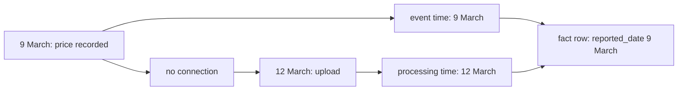

## How long should Omar wait?

On Friday, Omar asks Hala a plain question. Can he trust Monday's number, or will it change? Hala cannot answer with a guess. In chapter 8.1 she saw 35 reports arrive up to three days late, and she knows that other markets send late reports too. Her answer has to come from the data.

So she measures the delay for every report. For each report, she compares the day it was made with the day it first arrived. The query below runs on the `reports` view from chapter 2.5. It takes the earliest upload of each report, because a resend arrives later and would hide how late the first send was.

```sql
WITH first_send AS (
  SELECT report_id,
         min(uploaded_at) AS first_upload,
         min(reported_at) AS reported_at
  FROM reports
  GROUP BY report_id
)
SELECT date_diff('day', CAST(reported_at AS DATE), CAST(first_upload AS DATE)) AS days_late,
       count(*) AS reports
FROM first_send
GROUP BY days_late
ORDER BY days_late;
```

```text
days_late  reports
0          2422
1          76
2          69
3          66
```

Of the 2,633 reports, 2,422 arrive on the day they were made. The other 211 are late, which is 8.0 percent. Of those, 76 are 1 day late, 69 are 2 days late and 66 are 3 days late. None is later than 3 days. The 35 reports from the M05 outage are inside these numbers: 12 are 1 day late, 12 are 2 days late and 11 are 3 days late.

## Two clocks

Every report in this data has two times, and they answer different questions. The time in `reported_at` is when the volunteer recorded the price. The time in `uploaded_at` is when the pipeline could first see it. The vocabulary comes from Tyler Akidau's writing on streaming data. **Event time** is when something happened. **Processing time** is when the system learns of it.

The two differ, and the gap changes from report to report. Reports can also arrive out of order: a report made on Tuesday may arrive after one made on Wednesday. A pipeline that thinks in processing time sees "today's data". A pipeline that thinks in event time asks which day a price describes. Omar's report is about prices on days, so the pipeline must work in event time. Then it must decide how long to wait for late reports.

Event-time results are more correct, but they cost something. A day is never obviously complete, because a late report might still come. Akidau argues that completeness is often unknowable, so a result may need to be updated after it is first shown. That is the situation of Omar's Monday number. The pipeline needs a rule for how long a day stays open.

The diagram follows one report from M05 through both clocks. Read it from the top left. Notice that the fact row is dated by event time, even though the report arrives on 12 March.



<BigWordAlert term="Lookback" plainEnglish="The number of days back that each run reads again, so reports that arrive late are merged into the table." whyItMatters="A lookback that is too short loses late reports without any error. One that is too long repeats work on every run." />

## How the lookback works in Mizan

The fact table from chapter 7.5 is an incremental model. On each run after the first, it reads reports whose `reported_date` is on or after the newest report date in staging, minus `lookback_days` days. The variable `lookback_days` is in `dbt_project.yml`, and its value is 3. The window is measured in event time, from the newest day in the data.

Follow the 12 March run. After the upload, the newest report date is 12 March. The window starts on 9 March, so it covers 9, 10, 11 and 12 March. M05's reports for 9 March are on the first day of the window, and they are read. A report that is 3 days late fits exactly. A report that is 4 days late would fall one day outside.

The rows that the run reads are merged by key. The model deletes the rows with the same `report_id` and inserts the fresh ones, as in chapter 7.4. So reading yesterday's reports a second time does not duplicate them. This is the idempotency from chapter 6.3 working inside the model, and it is what makes a lookback safe.

Before you open the canvas, make a guess about the cheapest case. A lookback of 1 day reads the newest day and the day before it.

```predict
prompt: "In the seed-7 data, 211 reports are late: 76 by 1 day, 69 by 2 days and 66 by 3 days. About how many of the 211 does a lookback of 1 day catch?"
options:
  - id: twothirds
    label: "About two thirds, because most late reports are only a day late"
  - id: third
    label: "About a third, because the delay is spread over 1 to 3 days"
correctOptionId: third
explanation: "A lookback of 1 catches only the reports that are 1 day late, which is 76 of the 211, about 36 percent. The delays are almost evenly spread: 76, 69 and 66. A report that is 2 or 3 days late is outside a window of 1 day."
allowRetry: true
```

The canvas uses these exact counts. Change the lookback and watch the benefit and the cost.

<InteractiveCanvas slug="late-data-lookback" />

**What this shows:** a lookback of N days catches every report that is N days late or less, and each run reads N + 1 days again. The counts are the 211 late reports in the seed-7 data, including the 35 from the M05 outage.

**Try this:** move the lookback from 0 to 1 and read the three numbers. Then set it to 3. Then set it to 5 and look at the third number.

**What changed:** at 3 days all 211 late reports are caught. At 5 days the result is the same, but each run reads 6 days instead of 4. The extra days found nothing, because no report in this data is more than 3 days late.

**Limits of the model:** the counts come from one generated data set whose longest delay is 3 days. Real delays have no such limit. The only cost shown is the number of days read, and the model does not count the time to read them.

## What the cost is

Reading 4 days on each run is cheap for Mizan. The data holds about 97 lines a day, so a window of 4 days reads fewer than 400 lines. For a shop with a million new rows a day, the same window reads about four million rows on every run. This is an illustration, not a measurement. The lookback makes the cost proportional to the window, so the window should be as short as the data allows.

Without the lookback the loss is large. In chapter 8.1 you saw the cost of a window of one day. Then 208 good reports never reach the fact table, 7 of 38 market and week rows of the weekly mart disappear and 29 change. With a lookback of 3 days, running one upload day at a time gives exactly the same facts as one big run. Chapter 8.5 tests both claims.

## A near miss: which day is a report on?

Lateness depends on what counts as a day, and the day depends on a time zone. The field `reported_at` ends in `Z`, which means UTC. DuckDB reads such a time as a timestamp with a time zone. When you cast it to a date, DuckDB uses the time zone of the session. A report made at 23:30 UTC on 1 March is on 2 March in Gaza.

```sql
SET TimeZone = 'Asia/Gaza';
SELECT CAST(TIMESTAMPTZ '2026-03-01 23:30:00+00' AS DATE);
```

```text
2026-03-02
```

With the session set to UTC, the same query returns 2026-03-01. A report would change day, and so would its lateness, depending on the laptop that runs the query. The landing job of chapter 5.5 avoids this by converting each time to a plain UTC timestamp once, and the dbt profile sets `TimeZone: UTC`. After that, no step depends on the computer.

## Watermarks, in one paragraph

Streaming systems face the same question and give it a name. A <GlossaryTerm term="watermark" definition="A marker in a stream that says event time has reached a point, so events at or before that point are not expected any more." /> with time t says that event time has reached t. A late event is one that arrives after the watermark has passed its time, and some systems accept it for a set period called allowed lateness. A lookback is the batch version of the same idea, and dbt's microbatch strategy has a setting with this very name. Module 10 returns to watermarks.

## Where people go wrong

**A window shorter than the real delay.** The loss is silent. Nothing fails, and the weekly numbers are a little low. Measure the delay over months, not days, and keep a margin. A check that counts reports arriving later than the window turns a silent loss into an alert. Chapter 11.2 builds that kind of check.

**Measuring the window on the wrong clock.** A window on upload time and a window on report date answer different questions. Pick one and say which.

**Forgetting the dimension.** A lookback re-reads late facts. It does not re-read a late change to a market or an item. Chapter 8.4 shows that case.

## When to choose differently

There is another design. The model could read every row that was uploaded since the last run, whatever its report date, and merge by key. That catches any delay with no window to choose. It needs a trustworthy upload time, and it needs a plan for the weekly mart, which must be rebuilt for every old week that a late row touches. It also does not help when you re-land old files on purpose, because their upload times are old. The window design costs a few extra days of reading, and it makes the rule easy to say aloud to Omar: after 3 days, a day is final.

## Try it on your data

Run the query above on your own `reports` view and write the four numbers. Compute the share of reports that are late. Decide the smallest lookback that catches all of them, and compare it with the value of `lookback_days` in your project. Then write the sentence you would send to Omar about when a day becomes final.

## Check your understanding

```quiz
type: mcq
question: "Majd's school exports attendance rows each night. Counting from the class day to the day a row first arrives, the school has 1,000 rows: 880 arrive after 0 days, 90 after 1 day, 25 after 2 days and 5 after 3 days. Each run re-reads the last N days. Which lookback misses no row while reading the fewest days?"
options:
  - "0 days: reads 1 day per run and misses 120 rows"
  - "1 day: reads 2 days per run and misses 30 rows"
  - "2 days: reads 3 days per run and misses 5 rows"
  - "3 days: reads 4 days per run and misses no row"
correct: 3
explanations:
  - "With 0 days, only rows that arrive on the class day are read. The 90, 25 and 5 late rows are missed, which is 120 rows."
  - "With 1 day, the 90 rows that are 1 day late are caught. The 25 and 5 rows that are 2 and 3 days late are missed, which is 30 rows."
  - "With 2 days, the 90 and 25 rows are caught. The 5 rows that arrive after 3 days are still outside the window."
  - "Right. A lookback of 3 days catches every delay from 1 to 3 days, so no row is missed. It reads 4 days per run, and a lookback of 4 or 5 would read more days and catch nothing more."
```

```quiz
type: mcq
question: "Fares's clinic table has visit_date (the day the patient came) and entered_at (when the desk typed the visit). The model reads rows with visit_date on or after the newest visit_date minus 1 day. On Thursday, the desk types a visit from Monday. What happens on Thursday's run?"
options:
  - "The visit is missed, because the window starts on Wednesday"
  - "The visit is read, because entered_at is Thursday, the newest day"
  - "The visit is read, because a unique_key finds it wherever it is"
  - "The visit is missed only when the clinic is closed on Thursday"
correct: 0
explanations:
  - "Right. The window is measured on visit_date, in event time. On Thursday it starts on Wednesday, and a visit dated Monday is outside it, so the visit is 3 days late and not read."
  - "The window uses visit_date, not entered_at. A visit dated Monday is outside a window that starts on Wednesday, whatever day it was typed."
  - "A unique_key decides which old rows are replaced among the rows that are read. It does not make the run read more days."
  - "Whether the clinic is open on Thursday does not change the window. The window depends only on the newest visit_date and the lookback."
```

**Next:** Duplicates and the keys that remove them: how to tell a resend from a real repeat.
