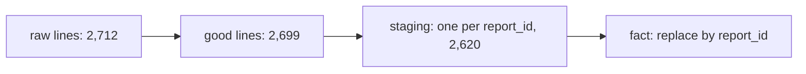

## 2,712 lines, 2,633 reports

Hala counts the lines in the upload folders of the whole month. There are 2,712 lines, but only 2,633 different `report_id` values. The difference is 79 lines, and each is a **resend**. The phone sent a report a second time, because it was not sure that the first upload worked. That is 3.0 percent of the reports. If she adds up prices without removing them, every resent price counts twice.

She also knows something else about the data. Volunteers sometimes price an item twice on the same day, because the price changed at midday. The second report is a new report with a new `report_id`, and usually a new price. In this data there are 31 of these **real repeats**. They look like resends at first glance: the same market, the same item, the same day. But they are real, and a weekly average that drops them is wrong.

So Hala has two kinds of line that look alike. One must be removed and the other must be kept. This chapter is about the one tool that tells them apart.

<BigWordAlert term="Business key" plainEnglish="The value that the source gives to each real thing, like report_id for a price report. Two lines with the same business key describe the same thing." whyItMatters="It is the only dependable way to tell a resend from a real repeat. It is the opposite of a surrogate key, which the warehouse makes up for itself." />

## Three tries

Hala tries three ways to remove duplicates, and she counts the lines that remain. She starts with the 2,699 good lines that are left after the `where` line of chapter 7.5 removes the 13 bad rows. Before you read the results, make a guess about the first try.

Her first try is the simplest: `SELECT DISTINCT *`, which keeps one line for each different combination of every column.

```predict
prompt: "Hala runs SELECT DISTINCT * on the 2,699 good lines. Each of the 79 resends is a copy of an earlier line. How many lines does DISTINCT remove?"
options:
  - id: none
    label: "None, because each resend has its own sent time"
  - id: all
    label: "All 79, because a resend repeats every other value"
correctOptionId: none
explanation: "DISTINCT removes a line only when every column matches. A resend is sent later, so its uploaded_at differs from the first copy, and the two lines are different rows. All 2,699 lines remain, and every resent price is still counted twice."
allowRetry: true
```

The canvas below uses five lines for one market and day, and applies each key in turn. It uses a small made-up example so that you can see every line.

<InteractiveCanvas slug="dedupe-key-choice" />

**What this shows:** three ways to remove duplicates on the same five lines. The whole row misses a resend whose sent time differs. Market, item and day removes a real report. The report_id removes only the resend.

**Try this:** before step 2, say how many lines the whole-row key keeps. Then find the line that key 2 drops by mistake. At the end, imagine that the form gave a resend a new report_id, and say which key would notice.

**What changed:** the sums differ: 60.0, 34.0 and 52.0. Only the third is right. The first counts flour twice, and the second loses a real oil report.

**Limits of the model:** the five lines are an example and not rows from the seed-7 data. Real resends can differ in more than the sent time, and keeping the newest line is a rule you choose.

## What the three keys do on the real data

On the 2,699 good lines the three tries give these counts. The right answer is 2,620, one line for each report.

```text
key                       lines kept   problem
every column              2,699        removes none of the 79 resends
market, item and day      2,589        removes 31 real repeats as well
report_id                 2,620        correct
```

The second key is dangerous because it looks sensible. A market has one price for an item on a day, so it seems that two lines for the same market, item and day must be one price. But the volunteer measured twice, and the second price is a new fact. The weekly mart of chapter 7.5 averages repeats on purpose, so both prices must reach it.

The count 2,589 also shows how quietly the error works. Nothing fails. The fact table is 31 rows shorter than it should be, and every average that included a repeat is a little off. The tests from chapter 7.3 cannot see it, because no test describes the missing rows.

## The near miss: almost every column

There is a try that looks safe. Compare every column except `uploaded_at`, which is obviously different between a resend and the original. In SQL that is `SELECT DISTINCT * EXCLUDE (uploaded_at, upload_date)`. On the seed-7 data it leaves 2,623 lines. That is three more than the right answer.

Where do the three come from? On 15 March the phone form added the `unit` field. A report first sent on 14 March has no unit. If the phone sends it again on 16 March, the copy has a unit. The two lines differ in one column, so the comparison keeps both. The method worked until the schema changed, and then it failed on exactly the lines that were affected by the change. This is why a list of columns is not a key. The key must be a value that the source promises to keep the same.

## Which copy to keep

Once the key is chosen, the pipeline must choose which line of each group to keep. The Mizan staging model keeps the newest, using `row_number()` over `report_id` ordered by `uploaded_at` descending, as in chapter 3.2. The resend is the latest word from the source, and it can carry a field that the first send lacked, like `unit`. A tie, two lines with the same sent time, needs a second sort column to make the choice the same on every run.

The raw lake keeps all the lines, resends included. That is 2,712 lines, or 2,699 good lines once chapter 8.5 sends the bad rows to quarantine, and the staging model chooses between them. This keeps an audit trail: when a number is questioned, you can show every line that the phone sent. Removing the resends in the raw layer would lose that evidence.

The diagram follows the counts through the pipeline. Notice that the reduction to 2,620 happens in staging, and that the fact table repeats the key.



## A real event: many copies of one audit

<RealWorldEvent title="One audit, several records" when="2026" summary="A US federal audit data site reported that, before a formal resubmission process existed, a correction was filed as a new full record. So one audit can appear several times as independent records, and anyone who totals award amounts or finding counts can count it more than once." lesson="A dataset needs a rule for which version is current. Match on the identifier and keep the most recently accepted record. The site planned version numbers that mark old versions as deprecated, not deleted." />

The audit site faced Hala's problem at a larger scale, with a human step in the middle. Its interim advice was the same rule Mizan uses: match on identifiers and keep the most recently accepted record. Its planned fix keeps old versions and marks them, which is a third option when you cannot throw anything away.

## Where people go wrong

**DISTINCT as a cure.** You met this in chapter 2.3. `COUNT(DISTINCT report_id)` gives the right number of reports, but the sum of prices still counts every resend twice. The query shows a correct count and a wrong total. Remove the duplicate lines, and do not hide them in the count.

**A key that is not unique.** Market, item and day looks like a key because it is natural, but the data contains two reports for it. Before you trust a key, ask the owner of the source whether two real events can share it. Karam can answer for the phone form: it makes one report_id for each report and keeps it on a resend.

**Deduplicating before you landed the lines.** If landing drops resends, you cannot answer "how often does the phone resend?" The answer, 79, is a number worth watching, because a sudden rise says the connection is poor.

## When to choose differently

Sometimes the source gives no id. Then you must build a key from the fields that define the event: for a price report, the market, the item, the report time and the volunteer. Choose fields that describe the event and never fields that describe the delivery, like `uploaded_at` or the file name. Accept that two real events with the same fields will merge, and monitor how often it happens.

The alternative to deleting is to keep every version and mark one as current, with a version number or a flag. It costs more space and more work in every query, and it is the right choice when old versions matter, as at the audit site. Mizan keeps one line for each report because its question, the weekly basket, never needs an old send.

## Try it on your data

Run this query on your own `reports` view. It counts the lines, the reports and the market, item and day combinations among the good lines.

```sql
SELECT count(*) AS lines,
       count(DISTINCT report_id) AS by_report_id,
       (SELECT count(*)
        FROM (SELECT DISTINCT market_code, item_code, CAST(reported_at AS DATE)
              FROM reports
              WHERE price > 0 AND item_code IS NOT NULL)) AS by_slot
FROM reports
WHERE price > 0 AND item_code IS NOT NULL;
```

```text
lines  by_report_id  by_slot
2699   2620          2589
```

If your numbers match, write down the two differences: 2,699 minus 2,620 is the resends, and 2,620 minus 2,589 is the real repeats. Say in one sentence which key you would trust and why.

## Check your understanding

```quiz
type: mcq
question: "Layla's client sells soap online. Her payment tool sometimes sends an order twice, with the same order_id and a different sent time. Customers also sometimes place a second order for the same product on the same day, and each order gets its own order_id. Which key removes the duplicates and keeps the real orders?"
options:
  - "Customer, product and day, because a resend falls on the same day"
  - "order_id, because each order has one and a resend keeps it"
  - "Every column, because two identical orders are duplicates"
  - "Sent time, because the newest send is the real one"
correct: 1
explanations:
  - "A customer who orders the same product twice on one day has two real orders. This key would merge them and lose one."
  - "Right. The order_id belongs to the order, and the payment tool keeps it when it resends. Two real orders have two ids, and a resend has the same id as the original."
  - "A resend has a different sent time, so its row differs from the original in one column. A whole-row comparison would keep both copies."
  - "Many different orders can share a sent time, and a resend has a different one. Sent time describes the delivery and not the order."
```

```quiz
type: mcq
question: "Mustafa's pharmacy removes duplicate deliveries by comparing every column except sent_time. On 15 March the form adds a pack_size field. A delivery first sent on 14 March has no pack_size. On 16 March the phone sends it again, and the copy has pack_size = 10. What happens to the resend?"
options:
  - "It is removed, because delivery_id is the same in both of the copies"
  - "It is removed, because sent_time is ignored when the rows are compared"
  - "It stays as a second row, because pack_size differs in the copies"
  - "It replaces the first send, because the newer copy always wins"
correct: 2
explanations:
  - "The comparison needs every column except sent_time to match, not only delivery_id. Here pack_size does not match, so the rows are not equal."
  - "Ignoring sent_time helps only when all the other columns match. The copy has a pack_size that the first send lacks."
  - "Right. The two rows differ in pack_size, so a comparison of all the other columns keeps both. The same thing happened with the unit field in the Mizan data, where it left three resends in the table."
  - "A comparison of columns has no rule about newer copies. It removes a row only when another row matches it on every compared column."
```

**Next:** Backfills and schema evolution: how to rerun a past range safely and absorb a new field without breaking the pipeline.
