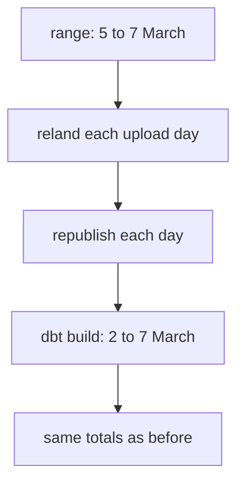

## The morning of 15 March

On 15 March, Hala opens the upload folder and sees that every line has a new field. It is called `unit`, and it holds kg, litre, tray of 30 or pack. Karam added it to the phone form. Now the price of eggs, sold in trays, is not confused with the price of rice, sold by the kilogram. Nobody told Hala. The 14 upload days before 15 March have no such field.

She expects a failure and sees none. The pipeline lands the new files, and the `unit` column of the fact table is empty for older reports and filled for newer ones. In the finished data, no report uploaded before 15 March has a unit, and every report uploaded from that day has one. The pipeline absorbed a change that nobody planned for.

That was luck, and it can be made into a rule. A different change would have broken the pipeline. If the form had dropped the `price` field, every line would have arrived without it. The pipeline needs to know the difference between a change it can absorb and a change that must stop it. This chapter gives that rule, and then it shows how to repair the days that were stopped.

## Two kinds of change

A **schema** is the list of fields in the data and the type of each one. A change to the schema is **additive** when it adds a field that nobody is required to use. A change is **breaking** when it removes a field, renames one, changes a type or changes what a field means. An additive change can be absorbed. A breaking change needs a decision from a person, because the pipeline cannot guess.

The rule needs to be written down where both sides can read it. A <GlossaryTerm term="data contract" definition="A written, versioned agreement about the fields, rules and owner of a dataset, which the producer and the consumers both rely on." /> does that job. The Open Data Contract Standard, kept by the Bitol project, is an open YAML structure with sections for the schema, data quality, the team, roles, service levels and support. The Mizan contract is written in the spirit of that standard, but it is much shorter.

Here is a small contract for a different place, Fares's clinic bookings. Read it as a pattern. It lists the fields, says which are required, and gives one rule for rows.

```yaml
name: bookings
version: 1.0.0
owner: Fares, clinic manager
fields:
  - {name: booking_id, type: string, required: true}
  - {name: patient_code, type: string, required: true}
  - {name: visit_date, type: date, required: true}
  - {name: room, type: string, required: false, since: "2026-04-01"}
rules:
  - name: visit_date_is_present
    fails_when: "visit_date IS NULL"
    reason: visit_date is missing
```

The contract is checked at two levels, and they behave differently. The first level is the shape of the whole batch. If a required field is missing, the batch fails as a whole, nothing is written, and the message names the field. The second level is each row. A row that breaks a rule is moved to a **quarantine** folder with the reason, and the good rows of the batch land. Fields that the contract does not list are allowed and kept.

<BigWordAlert term="Backfill" plainEnglish="Running the pipeline again, on purpose, for a range of past days." whyItMatters="It repairs history after a fix, a stopped batch or a late change. It is safe only when a rerun gives the same result as the first run." />

## Predict the path, then follow it

Two batches arrive at the contract check. Batch A has all the required fields and a new optional field, `unit`. Batch B has no `price` field, which is required. Think about what the check does with each.

```predict
prompt: "Batch A adds the optional field unit. Batch B has lost the required field price. What does the contract check do?"
options:
  - id: both
    label: "Both are stopped, because both differ from the old batches"
  - id: sorted
    label: "A is accepted, B is stopped: price is required"
correctOptionId: sorted
explanation: "The contract lists nine required fields and allows extra ones. Batch A has all nine, so it is accepted and keeps unit. Batch B lacks price, so the whole batch is stopped, nothing is written, and the message names the missing field."
allowRetry: true
```

The canvas follows both batches. It starts with the unit field from 15 March, which is real in the seed-7 data. It then shows a batch without price, which is an example for this chapter.

<InteractiveCanvas slug="schema-change-path" />

**What this shows:** the contract check sorts a changed batch into two paths. An added optional field is accepted and older rows get NULL for it. A batch that loses a required field is stopped, the source is fixed, and a backfill reruns the stopped days.

**Try this:** at step 3, say why the earlier days did not need rewriting. At step 6, say what the lake holds, and why stopping the batch is better than writing it without a price. At the end, name one more change that would be accepted and one that would be stopped.

**What changed:** after the backfill, the stopped days landed again and the totals matched. The change was repaired by a rerun, not by editing rows by hand.

**Limits of the model:** the unit field is real, and the missing price is an example. Real forms break in other ways, such as a renamed field or a changed type, and a team agrees those changes with the owner of the source.

## What happens to old rows

When a new field appears, old rows must have some value for it. In Mizan the answer is NULL, and it comes from how the files are read. The `read_parquet` call in the source uses `union_by_name = true`, so it lines up files by column name and fills the gaps. No old file is rewritten.

dbt has a related setting for models. When a model's SELECT gets a new column, `on_schema_change` decides what happens: `ignore` (the default), `fail`, `append_new_columns` or `sync_all_columns`. None of them fills the new column for rows that already exist. If the old rows need a real value, you backfill. The fact table keeps an enforced contract, so it allows only `append_new_columns` or `fail`, and Mizan chooses `fail`: a person decides.

## The backfill

A backfill is a rerun of the pipeline for a range of past days. You need one in four situations. A batch was stopped and then fixed at the source. A model had a bug and the numbers are wrong. A lookback was too short and reports were missed. Or a dimension changed late, and facts point at the wrong version.

The Mizan command is `python scripts/backfill.py --start 2026-03-05 --end 2026-03-07`. For each upload date in the range it lands the files again and publishes them again. Then it runs dbt for the report dates the range can touch. A report uploaded on 5 March can be dated 2 March, so dbt starts three days before `--start`. This is what a real run prints.

```text
2026-03-05: relanded and republished 101 rows
2026-03-06: relanded and republished 96 rows
2026-03-07: relanded and republished 99 rows
dbt build finished for reported dates 2026-03-02 to 2026-03-07
```

The diagram shows the order of the steps. Notice that the dbt range is wider than the range you asked for, and that the last box says the totals do not change.



The last box is not luck. Landing replaces the partition of a day, as in chapter 5.5. Publishing replaces the shared file, as in chapter 6.5. The fact table replaces rows by `report_id`, as in chapter 7.4. Each step is idempotent, so the whole backfill is. A test in chapter 8.5 runs a three-day backfill and checks that the count, the price total and the weekly mart are unchanged. Orchestrators have the same idea under names like catchup and backfill, and chapter 9.3 returns to them.

## A worked example: a dimension that changes late

The lookback re-reads late facts. It does not re-read a late change to a dimension. Here is the case that the tests document. The registry is extracted as of 11 March, and the facts are built. Market M03 moves to Hill on 12 March, but Hala learns it only on 16 March, when she extracts the registry again. The normal run re-reads only 13 to 16 March, because the lookback is 3 days.

```text
before the backfill:  Harbour for 2026-03-01 .. 2026-03-12 ; Hill for 2026-03-13 .. 2026-03-16
after the backfill:   Harbour for 2026-03-01 .. 2026-03-11 ; Hill for 2026-03-12 .. 2026-03-16
```

The facts of 12 March are wrong before the backfill. They keep the Harbour key, because an incremental fact keeps the foreign key it was given. The command `python scripts/backfill.py --start 2026-03-12 --end 2026-03-16` re-reads them, and 12 March moves to Hill. The lookback cannot do this job, because its window starts at 13 March.

## Where people go wrong

**Breaking changes that do not break.** A renamed field fails loudly, because a required field is missing. A field that keeps its name and type but changes its meaning does not fail. If prices change from shekels to agorot, the contract passes, and every number becomes a hundred times larger. Put units in field names or in the contract text, and watch the ranges of key numbers.

**A backfill that appends.** If the fact model had no key, each rerun would add rows. A backfill is a second chance to double count. Test it as you test a rerun: run it twice, and compare the counts.

**A silent backfill.** A backfill changes numbers that were already published. Tell the readers. Omar must hear "the numbers for 9 to 12 March changed by a small amount, and here is why".

**Backfilling a snapshot.** A snapshot cannot be rebuilt, because the past states exist only in the table. Backfill the facts, not the history of the snapshot.

## When to choose differently

A strict contract stops on every added field, and a team learns to ignore the alerts. A lenient contract accepts everything, and a changed meaning slips through. Mizan sits in between: additions are accepted, removals are stopped, and rows that break a rule go to quarantine. The quarantine holds the full raw rows, including names and phone numbers, so it belongs to the restricted zone. The retention job of chapter 11.5 deletes old quarantine files too.

A bigger team may keep a version number on the contract and run two versions side by side while consumers move. That costs more, and it is the right choice when many teams read the data. For one small pipeline, a short contract and a clear owner are enough.

## Try it on your data

Write a contract for your own reports in the pattern above, with the required fields, the optional `unit`, and two row rules. Then write the backfill command that you would run if the batches of 20 and 21 March were stopped and fixed. Say which dates dbt would rebuild, and give the reason for the start date.

## Check your understanding

```quiz
type: mcq
question: "Aya's school contract requires student_code, class_code and day. It says that extra fields are allowed and kept. Three batches arrive. Batch A adds a field called note. Batch B has no class_code. Batch C adds late_minutes and keeps every required field. Which batches are stopped?"
options:
  - "Only B, because its required field class_code is missing"
  - "A, B and C, because every batch differs from the contract"
  - "A and C, because new fields are not in the contract"
  - "None, because a contract checks only the first batch"
correct: 0
explanations:
  - "Right. The contract allows extra fields, so A and C pass the check. B lacks the required class_code, so the whole batch is stopped and nothing is written."
  - "A and C add fields, and the contract says extra fields are allowed and kept. Differing from the contract is not enough to stop a batch. Only a missing required field is."
  - "The contract states that extra fields are allowed and kept. New fields in A and C do not break it."
  - "A contract is checked on every batch. Checking only the first one would let a later change pass without notice."
```

```quiz
type: mcq
question: "Nabil's shop fact table holds 1,200 rows. The table is built by replacing rows by order_id. The last 3 days hold 180 of those rows. By mistake, he runs a backfill of those 3 days twice, and no new orders arrive. What does the table hold after both runs?"
options:
  - "1,560 rows, because the 180 rows are added again on each run"
  - "1,200 rows, but the totals are added twice and are doubled"
  - "An error, because the second run finds the rows already in the table"
  - "1,200 rows, same totals, because each run replaces the same rows"
correct: 3
explanations:
  - "Rows would be added again only if the model appended. This model replaces rows by order_id, so a row that is read again takes the place of its old copy."
  - "The row count stays at 1,200, and the totals stay too. Each order is one row, so nothing is counted twice."
  - "A replace by key never fails because a row exists. It deletes the old row first and then inserts the new one."
  - "Right. Each run deletes the rows with the same order_id and inserts them again, so the second run leaves the table as the first did. That is what idempotent means for a backfill."
```

**Next:** Build: survive late data, duplicates, a new field and a backfill, where you write the contract check, the quarantine, the lookback and the backfill command, and prove they work.
