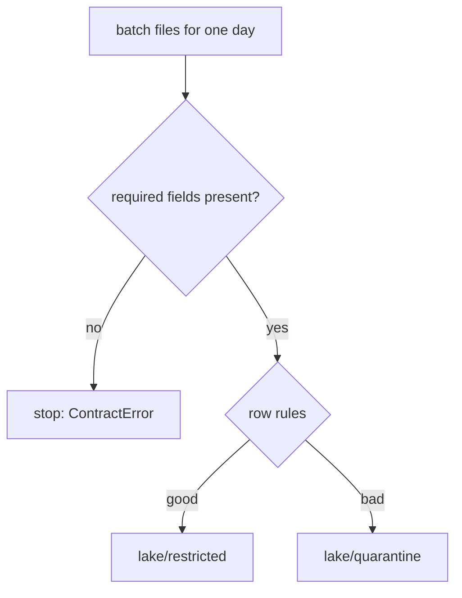

## What you will have at the end

The pipeline from module 7 builds and passes its tests, but it has not been asked the hard questions. What happens when M05's reports arrive three days late? What if the phone resends a report, or the form drops a field? What if Hala must rerun last week? By the end of this chapter, you have tests that answer all of these, and the code that makes the answers true.

You add four things. A written contract checks every batch at landing. Rows that break a rule go to a quarantine folder with the reason. The fact table can be rebuilt for an exact range of dates. And a command, `scripts/backfill.py`, reruns a range of upload days safely. Twelve tests in one file prove the result, and they take about two and a half minutes to run.

Your repository holds the work of chapters 1 to 7. Landing in `pipeline/land.py` has no contract yet, and returns every line, bad rows included. Your dbt project has `lookback_days: 3` in `dbt_project.yml`, and `stg_price_reports` has a `where` line that removes bad rows. This chapter moves the bad-row work into landing, and then it removes that `where` line.

**What you need.** The workspace from chapter 1.4 with `MIZAN_KEY` set, and the dbt project of chapter 7.5 passing. Plan about two and a half hours. Most of the time goes to the contract check and the tests, not to the backfill script.

## The design decisions

The first decision is where to check the data. You could check only in dbt, with tests. That finds bad data after it has entered the lake, and a missing `price` field would already have stopped the build late and far from the cause. Checking at landing stops a bad batch at the door and keeps the lake clean. The cost is that landing now has rules to maintain.

The second decision is what to do with a bad row. Dropping it loses evidence. Failing the whole batch for one bad row stops 90 good reports for one wrong price. So the contract works at two levels. A batch with a missing required field fails as a whole and writes nothing. A row that breaks a rule is moved to quarantine with a reason, and the good rows of the batch land. Quarantine keeps the full raw row, including the volunteer's name and phone, so it belongs to the restricted zone.

The third decision is about the rerun. A day that had bad rows yesterday may have none today, for example after the source was fixed. If the old quarantine file stayed, the quarantine would show rows that no longer exist. So landing removes the old quarantine file when a rerun finds no bad rows. The job stays idempotent.

The fourth decision is how the fact table is told to rebuild a range. Normally it reads the lookback window. For a backfill, you pass two variables, `start_date` and `end_date`, and the model reads exactly that range of report dates. The backfill command starts three days before `--start`, because a report uploaded on 5 March can be dated 2 March.

The diagram shows what landing does with one batch. Follow the two decisions from the top. Notice that a missing required field leaves the lake untouched.



## The task

Work in this order, and run the tests for each step before you move on.

1. Write `contracts/price_reports.yml`. It is given in full below.
2. Write `pipeline/contract.py` with the interface below.
3. Change `pipeline/land.py` so that landing checks the contract, writes good rows to `lake/restricted/reports` and bad rows to `lake/quarantine/reports`.
4. Remove the `where` line from `stg_price_reports`, because landing now keeps bad rows out.
5. Add the backfill range to `fct_price_report`.
6. Write `scripts/backfill.py` with the interface below.
7. Copy the helper `tests/day_by_day.py` and the test file `tests/test_late_and_backfill.py` from this chapter.
8. Land every day again, publish, rebuild, and run the tests.

### The contract, given in full

This file is the example contract of the course. It is written in the spirit of the Open Data Contract Standard, which is much larger. Read the comments, because they are the rules of the check. Your Python code must read this file and apply it, so the rules live in the contract and not in the code.

```yaml
# Data contract for the price reports that the phone form uploads.
# It is written in the spirit of the Open Data Contract Standard, but much shorter.
name: price_reports
version: 1.0.0
owner: Hala, data engineer at Mizan
consumers: Omar, programme officer (weekly report)
description: One row per price report sent by a volunteer. A report can arrive more than once.

# Every required field must exist in every batch. A batch without one of them is rejected.
# Fields that are not listed here are allowed and kept (adding a field is not a breaking change).
fields:
  - {name: report_id, type: string, required: true}
  - {name: market_code, type: string, required: true}
  - {name: item_code, type: string, required: true}
  - {name: price, type: double, required: true}
  - {name: reported_at, type: timestamp, required: true}
  - {name: uploaded_at, type: timestamp, required: true}
  - {name: volunteer_id, type: string, required: true}
  - {name: volunteer_name, type: string, required: true}
  - {name: volunteer_phone, type: string, required: true}
  - {name: unit, type: string, required: false, since: "2026-03-15"}

# A row that breaks a rule goes to quarantine with the reason. The first rule that fails is the reason.
rules:
  - name: price_is_positive
    fails_when: "price IS NULL OR price <= 0"
    reason: price must be above 0
  - name: item_code_is_present
    fails_when: "item_code IS NULL OR item_code = ''"
    reason: item_code is missing
```

### The interface of the contract check

Write these functions in `pipeline/contract.py`. The paths come from `pipeline/paths.py`, which already names `CONTRACT` and `QUARANTINE`. The functions use DuckDB SQL, because the rules in the contract are SQL conditions. You may add helpers, but keep these names and messages exactly, because the tests depend on them.

```python
class ContractError(Exception):
    """The whole batch breaks the contract (for example a required field is missing)."""


def load(path=paths.CONTRACT) -> dict:
    """Read the contract YAML file and return it as a dictionary."""


def required_fields(contract: dict) -> list[str]:
    """The names of the fields that are marked required: true."""


def check_shape(columns: list[str], contract: dict) -> None:
    """Raise ContractError if a required field is not in columns. Extra fields are fine.

    The message must read:
    contract price_reports v1.0.0: required field(s) missing from the batch: price
    """


def reason_sql(contract: dict) -> str:
    """A SQL CASE expression that gives the reason a row is bad, or NULL when the row is fine.

    The rules are tried in order, and the first one that fails gives the reason.
    """


def check_rows(con, table: str, contract: dict) -> None:
    """Check the shape of the table, then make two temporary tables in the connection:
    good_rows (every row that breaks no rule) and bad_rows (the other rows, plus a reason column).
    """
```

The `yaml` module (PyYAML) is already installed, because dbt needs it. The check of the shape needs only the list of column names, so it can run before any row is read.

### The changes to landing, the model and the command

In `pipeline/land.py`, add `land_day(upload_date) -> tuple[int, int]`, which returns the number of rows landed and the number quarantined. Keep `land_uploads(upload_date) -> int`, which now returns only the good rows, and keep `all_upload_dates()`. The command `python -m pipeline.land --all` prints one line per day in the form `2026-03-10: 85 rows landed, 3 quarantined`. If the shape check fails, no file and no folder may be written. Reuse the temporary-file swap from chapter 5.5 for both outputs, and keep unknown extra fields in the restricted file.

In `fct_price_report.sql`, keep the lookback branch. When the variable `start_date` is set, read the reports with `reported_date` between `start_date` and `end_date` instead. In `stg_price_reports.sql`, delete the line `where price > 0 and item_code is not null`.

In `scripts/backfill.py`, write a command with two required options, `--start` and `--end`, in the form `YYYY-MM-DD`. For each upload date from start to end, oldest first, land the day and publish it, and print `2026-03-05: relanded and republished 101 rows`. Then run `dbt build` from the `transform` folder with `--profiles-dir .` and the variables `start_date` (three days before `--start`) and `end_date` (the `--end` date), and print `dbt build finished for reported dates 2026-03-02 to 2026-03-07`. Keep the three days in a constant that matches `lookback_days`. A failed dbt run must make the script stop with an error that shows the last lines of dbt's output. In chapter 9.4 you will move the dbt call into the runner.

## The acceptance tests

Two files in `tests/` prove the chapter. The first is a helper. It processes the upload days one at a time, like a daily schedule, and reports what the fact table looked like after each day. It runs in its own process because dbt-duckdb keeps the warehouse file open for as long as a Python process lives, and one process cannot drive two projects. The helper is test code, and you copy it as it is.

```python
"""Test helper: process the upload days one at a time, like a daily schedule, and report what the fact table looked like.

Run from a project folder:  python day_by_day.py [--lookback N]
It prints one JSON object on the last line. It runs in its own process because dbt-duckdb keeps the
warehouse file open for the life of a Python process, so two projects must not share one process.
"""
import argparse
import json
import os
import sys
from pathlib import Path

import duckdb

sys.path.insert(0, os.getcwd())  # the project folder, so "import pipeline" works

from dbt.cli.main import dbtRunner  # noqa: E402

from pipeline import extract_registry  # noqa: E402
from pipeline.land import all_upload_dates, land_uploads  # noqa: E402
from pipeline.pseudonymise import publish_reports  # noqa: E402

MODELS = ["stg_price_reports", "dim_date", "fct_price_report", "mart_weekly_basket"]
OUTAGE_DAYS = "('2026-03-09', '2026-03-10', '2026-03-11')"


def dbt(*args):
    here = os.getcwd()
    os.chdir("transform")
    try:
        result = dbtRunner().invoke([*args, "--profiles-dir", "."])
    finally:
        os.chdir(here)
    if not result.success:
        raise SystemExit(f"dbt {args} failed")


def good_ids_uploaded_up_to(day):
    ids = set()
    for path in Path("data/raw/uploads").glob("*/*.jsonl"):
        if path.parent.name.split("=")[1] <= day:
            for text in path.read_text().splitlines():
                row = json.loads(text)
                if row["price"] > 0 and row["item_code"]:
                    ids.add(row["report_id"])
    return ids


def main():
    parser = argparse.ArgumentParser()
    parser.add_argument("--lookback", type=int, default=None)
    parser.add_argument("--final-build", action="store_true", help="finish with one full dbt build (all tests)")
    args = parser.parse_args()
    variables = ["--vars", f"{{lookback_days: {args.lookback}}}"] if args.lookback is not None else []

    for table in extract_registry.TABLES:
        extract_registry.extract(table)
    seen = {}
    for number, day in enumerate(all_upload_dates()):
        land_uploads(day)
        publish_reports(day)
        if number == 0:
            dbt("build", *variables)  # first run: seed, snapshot and every model
        else:
            dbt("run", "--select", *MODELS, *variables)
        con = duckdb.connect("warehouse.duckdb")
        outage = con.execute(
            "SELECT count(*) FROM fct_price_report f JOIN dim_market m USING (market_key) "
            f"WHERE m.market_code = 'M05' AND f.reported_date IN {OUTAGE_DAYS}").fetchone()[0]
        total, distinct = con.execute("SELECT count(*), count(DISTINCT report_id) FROM fct_price_report").fetchone()
        con.close()
        seen[day] = {"outage_rows": outage, "total": total, "distinct": distinct, "expected": len(good_ids_uploaded_up_to(day))}
    if args.final_build:
        dbt("build", *variables)
    print(json.dumps(seen))


if __name__ == "__main__":
    main()
```

The second file holds the twelve tests. They use 16 days of data, from 1 to 16 March. That covers the M05 outage and the form change on 15 March. Read the file once before you copy it.

```python
"""Chapter 8.5: late data, duplicates, schema change, the contract and backfills.

Most tests use 16 days of data (1 to 16 March). That covers the M05 outage (reports for 9 to 11 March
arrive on 12 March) and the form change (new unit field from 15 March).
"""
import json
import shutil
from pathlib import Path

import duckdb
import pytest

from conftest import Project, copy_code
from pipeline import extract_registry
from pipeline.contract import ContractError
from pipeline.land import all_upload_dates, land_uploads
from pipeline.pseudonymise import publish_reports

DAYS = 16
OUTAGE = ("2026-03-09", "2026-03-10", "2026-03-11")

pytestmark = pytest.mark.slow  # runs dbt many times


def new_project(tmp_path_factory, name, days=DAYS):
    folder = tmp_path_factory.mktemp(name) / "proj"
    copy_code(folder)
    project = Project(folder)
    project.make_data(days)
    return project


def process_one_day_at_a_time(project, *extra):
    """Land, publish and run dbt once for each upload day, like a daily schedule would.

    This runs tests/day_by_day.py in the project folder and returns what it saw after each day.
    """
    done = project.python(str(Path(__file__).resolve().parent / "day_by_day.py"), *extra)
    return json.loads(done.stdout.strip().splitlines()[-1])


@pytest.fixture(scope="module")
def once(tmp_path_factory):
    """16 days processed in one go. This is the answer the daily runs must match."""
    project = new_project(tmp_path_factory, "once")
    project.load_everything()
    return project


@pytest.fixture(scope="module")
def daily(tmp_path_factory):
    """16 days processed one upload day at a time. Records what the fact table looked like on the way."""
    project = new_project(tmp_path_factory, "daily")
    project.seen = process_one_day_at_a_time(project, "--final-build")  # ends with one full build, every test
    return project


def outage_ids(project):
    """Good M05 report ids for 9 to 11 March, read from the JSON lines."""
    ids = set()
    for path in (project.root / "data" / "raw" / "uploads").glob("*/*.jsonl"):
        for text in path.read_text().splitlines():
            row = json.loads(text)
            if row["market_code"] == "M05" and row["reported_at"][:10] in OUTAGE and row["price"] > 0 and row["item_code"]:
                ids.add(row["report_id"])
    return ids


def weekly_mart(project):
    return sorted(project.query("SELECT market_code, iso_year, iso_week, full_days, avg_basket_cost, change FROM mart_weekly_basket"))


def test_daily_runs_give_the_same_weekly_mart_as_one_big_run(once, daily):
    assert weekly_mart(daily) == weekly_mart(once)
    assert len(weekly_mart(once)) == 27  # weeks 9 to 12, only 16 days of data


def test_daily_runs_give_the_same_facts_as_one_big_run(once, daily):
    columns = "report_id, reported_date, market_key, item_key, volunteer_key, price, unit, reported_at, uploaded_at"
    assert sorted(daily.query(f"SELECT {columns} FROM fct_price_report")) == sorted(once.query(f"SELECT {columns} FROM fct_price_report"))


def test_m05_late_reports_are_in_the_fact_table_after_day_12(daily):
    assert daily.seen["2026-03-11"]["outage_rows"] == 0  # M05 had no connection yet
    arrived = len(outage_ids(daily))
    assert arrived == 34  # 37 lines arrived on the 12th: 34 different good reports, the rest are repeated sends or bad rows
    assert daily.seen["2026-03-12"]["outage_rows"] == arrived
    assert daily.seen["2026-03-16"]["outage_rows"] == arrived


def test_duplicate_sends_never_raise_the_fact_count(daily):
    for day, numbers in daily.seen.items():
        assert numbers["total"] == numbers["distinct"] == numbers["expected"], day


def test_unit_is_null_before_15_march_and_filled_after(once):
    assert once.query("SELECT count(unit) FROM fct_price_report WHERE uploaded_at < TIMESTAMP '2026-03-15'") == [(0,)]
    assert once.query("SELECT count(*) - count(unit) FROM fct_price_report WHERE uploaded_at >= TIMESTAMP '2026-03-15'") == [(0,)]
    assert once.query("SELECT count(DISTINCT unit) FROM fct_price_report") == [(4,)]  # kg, litre, tray of 30, pack


def test_a_backfill_of_three_days_leaves_every_total_unchanged(once, tmp_path):
    copy = tmp_path / "backfilled"
    shutil.copytree(once.root, copy, ignore=shutil.ignore_patterns("target", "logs"))
    project = Project(copy)
    totals = "SELECT count(*), sum(price), min(uploaded_at), max(uploaded_at) FROM fct_price_report"
    before = project.query(totals), weekly_mart(project)
    done = project.python("scripts/backfill.py", "--start", "2026-03-05", "--end", "2026-03-07")
    assert "2026-03-07: relanded and republished" in done.stdout
    assert (project.query(totals), weekly_mart(project)) == before
    project.query("SELECT 1")  # the warehouse can still be opened


def test_without_a_lookback_the_late_m05_reports_are_missed(tmp_path_factory):
    project = new_project(tmp_path_factory, "nolookback", days=13)
    seen = process_one_day_at_a_time(project, "--lookback", "0")
    missed = project.query("SELECT count(*) FROM fct_price_report f JOIN dim_market m USING (market_key) "
                           "WHERE m.market_code = 'M05' AND f.reported_date IN ('2026-03-09', '2026-03-10', '2026-03-11')")
    assert missed == [(0,)]  # the cost of having no lookback: those 34 reports never reach the fact table
    last = seen["2026-03-13"]
    assert last["total"] < last["expected"] - 34  # and the other late reports are missing too


def test_a_dimension_change_found_late_needs_a_backfill(tmp_path_factory):
    """M03 moved on 12 March. We only learn it on 16 March. The lookback is 3 days, so 12 March stays wrong until a backfill."""
    project = new_project(tmp_path_factory, "latedim")
    project.python("make_source.py", "--registry-only", "--as-of", "2026-03-11")
    project.load_everything()
    project.python("make_source.py", "--registry-only", "--as-of", "2026-03-16")
    project.python("-m", "pipeline.extract_registry", "--table", "markets")
    project.dbt("build")
    areas = "SELECT m.area, min(f.reported_date)::varchar, max(f.reported_date)::varchar FROM fct_price_report f JOIN dim_market m USING (market_key) WHERE m.market_code = 'M03' GROUP BY 1 ORDER BY 2"
    assert project.query(areas) == [("Harbour", "2026-03-01", "2026-03-12"), ("Hill", "2026-03-13", "2026-03-16")]  # 12 March is still Harbour: wrong
    project.python("scripts/backfill.py", "--start", "2026-03-12", "--end", "2026-03-16")
    assert project.query(areas) == [("Harbour", "2026-03-01", "2026-03-11"), ("Hill", "2026-03-12", "2026-03-16")]


# ---- the contract and the quarantine ----

def test_quarantine_has_the_bad_rows_with_their_reasons(project):
    project.make_data()
    for day in all_upload_dates():
        land_uploads(day)
    rows = duckdb.connect().execute(
        "SELECT reason, count(*) FROM read_parquet('lake/quarantine/reports/*/part-0.parquet') GROUP BY 1 ORDER BY 1").fetchall()
    assert rows == [("item_code is missing", 4), ("price must be above 0", 9)]
    quarantined_ids = {r[0] for r in duckdb.connect().execute("SELECT report_id FROM read_parquet('lake/quarantine/reports/*/part-0.parquet')").fetchall()}
    bad_in_json = set()
    for path in Path("data/raw/uploads").glob("*/*.jsonl"):
        for text in path.read_text().splitlines():
            row = json.loads(text)
            if not row["price"] > 0 or not row["item_code"]:
                bad_in_json.add(row["report_id"])
    assert quarantined_ids == bad_in_json and len(bad_in_json) == 13
    # good rows + bad rows = every line the generator wrote
    good = duckdb.connect().execute("SELECT count(*) FROM read_parquet('lake/restricted/reports/*/part-0.parquet')").fetchone()[0]
    assert good == 2699 and good + 13 == 2712


def test_a_day_with_bad_rows_lands_the_good_ones_and_is_still_idempotent(project):
    project.make_data()
    assert land_uploads("2026-03-10") == 85  # 88 lines, 3 of them bad
    assert land_uploads("2026-03-10") == 85
    assert [p.name for p in Path("lake/quarantine/reports/upload_date=2026-03-10").iterdir()] == ["part-0.parquet"]
    assert duckdb.connect().execute("SELECT count(*) FROM read_parquet('lake/quarantine/reports/upload_date=2026-03-10/part-0.parquet')").fetchone()[0] == 3


def write_batch(day, lines):
    folder = Path(f"data/raw/uploads/upload_date={day}")
    folder.mkdir(parents=True, exist_ok=True)
    (folder / "batch-01.jsonl").write_text("".join(json.dumps(x) + "\n" for x in lines))


def a_report(**changes):
    row = {"report_id": "r-900001", "market_code": "M01", "item_code": "I01", "price": 8.0, "reported_at": "2026-04-01T08:00:00Z",
           "uploaded_at": "2026-04-01T09:00:00Z", "volunteer_id": "V01", "volunteer_name": "Test Person",
           "volunteer_phone": "+970-59-000-0000"}
    row.update(changes)
    return row


def test_a_new_unknown_field_is_allowed_and_kept(project):
    write_batch("2026-04-01", [a_report(note="bought at the gate")])
    assert land_uploads("2026-04-01") == 1
    columns = [r[0] for r in duckdb.connect().execute("DESCRIBE SELECT * FROM 'lake/restricted/reports/upload_date=2026-04-01/part-0.parquet'").fetchall()]
    assert "note" in columns


def test_a_batch_missing_a_required_field_fails_with_a_clear_message(project):
    row = a_report()
    del row["price"]
    write_batch("2026-04-02", [row])
    with pytest.raises(ContractError, match=r"required field\(s\) missing from the batch: price"):
        land_uploads("2026-04-02")
    assert not Path("lake").exists()  # nothing was written
```

Each test exists for a reason. The first four compare the day-by-day run with one big run and with the raw files. The weekly mart and the fact rows from a run of 16 single days must be exactly equal to those from one run of all 16 days. After 11 March, M05 has no rows for 9 to 11 March, and after 12 March it has all of its good reports. A comment in the test mentions 37 lines, which is the count for the full 28 days. In the 16 days used here, those dates have 35 lines, 35 different reports and 34 good ones, which is the number the test checks. A resend never raises the fact count, on any day.

The next tests cover the new field and the backfill. The `unit` column must be empty for reports first uploaded before 15 March and filled afterwards, and it must hold four different values in all. A three-day backfill must leave the count, the price total, the first and last `uploaded_at` and the weekly mart unchanged. That is the proof that a backfill is safe.

Two tests document limits. With a lookback of 0 and 13 days of data, M05's late reports never reach the fact table, and the count of other late reports is wrong too. That is the cost of having no window. A late change to a dimension, M03's move found on 16 March, leaves 12 March on the old market until a backfill re-reads it. The last four tests check the contract. The quarantine holds the 13 bad rows with their reasons. A day with bad rows lands its good rows and is still idempotent. An unknown field is kept. A batch with no `price` fails with the message from the contract and writes nothing.

## Run it

Land every day again with the new code, publish, rebuild, and run the tests. The tests are marked `slow` because they run dbt many times.

```powershell
$env:MIZAN_KEY = "some-long-random-text"
python -m pipeline.land --all
python -m pipeline.pseudonymise --all
cd transform
dbt build --profiles-dir .
cd ..
python scripts/backfill.py --start 2026-03-05 --end 2026-03-07
pytest -q tests/test_late_and_backfill.py
```

On macOS and Linux, use `export MIZAN_KEY=some-long-random-text` and the same commands. If you ever need the dbt range by hand, on macOS and Linux write `dbt build --profiles-dir . --vars '{start_date: "2026-03-02", end_date: "2026-03-07"}'`. In PowerShell, write `--vars "{start_date: '2026-03-02', end_date: '2026-03-07'}"`.

## Expected output

Landing prints one line for each of the 28 days. These lines are a part of the output, from days with and without bad rows. The totals are 2,699 rows landed and 13 quarantined, which add up to the 2,712 lines of the month.

```text
2026-03-01: 90 rows landed, 0 quarantined
2026-03-08: 93 rows landed, 2 quarantined
2026-03-10: 85 rows landed, 3 quarantined
2026-03-12: 135 rows landed, 2 quarantined
2026-03-28: 110 rows landed, 1 quarantined
```

The rebuild still ends with `PASS=39`. To see the quarantine, run this in a Python session. It lists the reasons and counts.

```python
import duckdb
print(duckdb.connect().execute("SELECT reason, count(*) FROM read_parquet('lake/quarantine/reports/*/part-0.parquet') GROUP BY 1 ORDER BY 1").fetchall())
```

```text
[('item_code is missing', 4), ('price must be above 0', 9)]
```

The backfill prints these lines, and a second run prints the same lines and changes nothing.

```text
2026-03-05: relanded and republished 101 rows
2026-03-06: relanded and republished 96 rows
2026-03-07: relanded and republished 99 rows
dbt build finished for reported dates 2026-03-02 to 2026-03-07
```

The tests end with one line. Your time will differ.

```text
12 passed in 158.08s (0:02:38)
```

## Break it on purpose

Open `transform/dbt_project.yml` and change `lookback_days: 3` to `lookback_days: 0`. Then run only the two tests that depend on it:

`pytest -q tests/test_late_and_backfill.py -k "m05_late_reports or same_weekly_mart"`

Both tests must fail. The second one shows that the pipeline lost M05's reports.

```text
E       assert 0 == 34
FAILED tests/test_late_and_backfill.py::test_daily_runs_give_the_same_weekly_mart_as_one_big_run
FAILED tests/test_late_and_backfill.py::test_m05_late_reports_are_in_the_fact_table_after_day_12
2 failed, 10 deselected in 126.29s (0:02:06)
```

Put the value back to 3. This is the loss from chapter 8.1 shown in a test. A window of one day produces no error and a wrong result, and only a test that compares day-by-day runs with one big run can see it.

## If you are stuck

**Hint.** Build the contract check before you change landing, and test it alone with a tiny table in a DuckDB connection. Make `check_rows` create the two temporary tables, and read their rows back with `SELECT`. Add the quarantine write only when the good rows land correctly.

**A check to run.** If a test fails on counts, land a single day and count the rows in `lake/restricted` and `lake/quarantine` for it. For `2026-03-10` you must see 85 and 3. If `test_a_batch_missing_a_required_field_fails_with_a_clear_message` fails, the test fails on its last line, which checks that no `lake` folder exists. That means your code wrote something before it checked the shape.

## Commit your work

A good message is: "Add data contract, quarantine, lookback range and backfill command with tests". Commit the contract, the code, the model changes and the two test files together, and do not commit the `lake/` or `warehouse.duckdb` files.

**Next:** A short graded check on late data, duplicates, backfills and schema change, with five scenarios.
