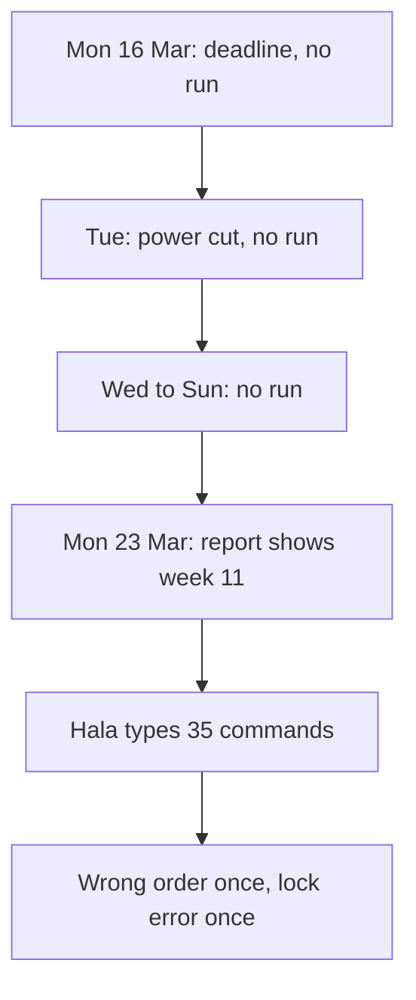

<BigWordAlert term="Orchestration" plainEnglish="Running the tasks of a pipeline in the right order, on a schedule, and deciding what happens when one of them fails." whyItMatters="A correct pipeline still needs something to start it. Without orchestration, the pipeline runs only when a person remembers, and a failed step can stay unseen for days." />

## The week nobody ran it

Hala is 26. She works part time and remotely for Mizan, and she takes small freelance jobs on the side. She plans her days around the hours when the power is on at home. Every morning she runs the Mizan pipeline by hand. All the people, markets and data in this course are fictional and synthetic.

Her routine has five commands. She extracts the registry, lands the uploads, publishes them without names and phone numbers, runs dbt build, and builds the report. The order matters, because each command needs the result of the one before it. On a good morning the routine takes her about 20 minutes, and most of that time is waiting.

The week of 16 March 2026 was not a good week. On Monday a freelance client sent a deadline, and Hala skipped the routine. On Tuesday the power was off in her street until the afternoon, and she kept the laptop battery for the client's work. On Wednesday she planned to run everything in the evening, and a family visit lasted until midnight. By Sunday she had not run the pipeline once.

The volunteers did not stop. Their phone forms kept uploading whenever a connection came back. Seven upload folders, one for each day from 16 to 22 March, held 679 lines. Of these, 677 were good lines and 2 were bad rows that landing sends to quarantine. The data was waiting in the right place. It had simply not moved.

## Monday morning

At 08:10 on Monday 23 March, Omar opens the report. Omar is the programme officer. He is not technical, and he does not need to be. Every week he reads the basket cost for each market and writes a short message for the partner kitchens, which plan their buying from it. For every market, the newest row in the report is week 11, which ended on 15 March. Week 12, from 16 to 22 March, is missing.

He writes to Hala: "Is the report broken, or are prices not coming in?" This is a fair question, and he cannot answer it himself. A late report and a wrong report look the same from where he sits. That is one reason a pipeline needs a record of what ran and when.

Hala opens the folders and sees at once that nothing is wrong with the data or with her code. Her tests pass. The pipeline was correct and it did not run. She starts the catch-up straight away. Seven days with five commands each is 35 commands, and she types them one at a time.

On the first day she makes a mistake. For 16 March she runs dbt build before she publishes. The build passes, because dbt builds from the files that already exist, so nothing in the terminal looks wrong. She sees the problem only when she compares row counts and finds no new facts for that day. She publishes, builds again, and moves on.

On 19 March, dbt stops with an error that says the warehouse file is locked. She had left it open in another program. She closes the program, runs the command again, and it works. By the end of the evening the report shows week 12. It took most of her evening, and she is still not sure that she did every step for every day in the right order.

## What went wrong

Look at the three problems in this story, because the rest of the module is built on them.

Nobody started the pipeline. It ran when Hala remembered, and Hala is a person with a job, a client and a house with an unreliable power supply. Nobody should have to be a clock. The second problem is order. The right order lived in Hala's head, and a tired person gets it wrong. A build that passes does not prove that the steps before it ran. The third problem is silence. The lock error was temporary, and a second try fixed it, but only because Hala was there to try again. If it had happened at night, the run would have stopped and nobody would have known until Omar asked.

Now picture the same week with a scheduler. At 06:00 each morning the scheduler starts the run for the day before. Landing reads the folder, publishing writes the shared files, and dbt build updates the warehouse. On Tuesday the power is off at 06:00, so the laptop is off and no run happens. A scheduler cannot fix a power cut. What it gives Hala is a log with a gap in it, and a command that fills the gap for the missing dates in one go. On Wednesday morning she runs that command, reads the log, and sends Omar a short message: the report is one day late because of a power cut. A late report that comes with a reason is much easier to trust than a quiet gap.

The diagram shows the real week as a chain. Follow it from the top.



What to notice: no box in the chain is a bug in the code. Every box is a person doing the work of a scheduler. The first three boxes are missed starts. The last two are the cost of doing the order and the error handling by hand. An orchestrator replaces exactly these boxes.

Before you read on, make a guess about the cause. The question is short, and your answer shows how you think about pipelines.

```predict
prompt: "Hala's pipeline code is correct and all her tests pass. Omar's report still shows nothing newer than 15 March on Monday 23 March. What is the most likely cause?"
options:
  - id: nothing-started
    label: "Nothing started the pipeline, and nothing told Hala"
  - id: hidden-bug
    label: "A hidden bug in the code stopped new rows from loading"
correctOptionId: nothing-started
explanation: "The seven upload folders held 679 lines, so the data had arrived, and the code and tests were fine. The pipeline was not started for seven days and no alert told anyone. A bug would show a failed run in a log. Here there was no run at all."
allowRetry: true
```

## Why this matters for the job

A pipeline that runs only when its author remembers is a risk for the whole team. The people who read the output cannot tell a late report from a wrong one. Teams that run pipelines every day use a tool or a script to start them, to put the tasks in order and to report failures. Airflow is a widely used scheduler where you describe tasks and their order. Dagster is an open-source alternative. You will not install either of them in this course. You will build the same ideas with a short Python script, and then see how the two tools write them down.

In a job, the person who built a pipeline is usually the first person asked why a report is late. A calm answer needs a log that says which task failed, at what time and for what reason. It also helps to have a short written note that tells the next person what to check and what to do. That note is called a runbook entry, and you will write one in the gate of this module.

There is also a point about trust. Omar will forgive one late report. He will not forgive a report that is quietly wrong, and he cannot check it himself. Orchestration is the part of data engineering that makes a pipeline predictable enough to be trusted by a person who cannot look inside it.

## What this module covers

Chapter 9.2 draws the pipeline as a graph of tasks, shows how the order follows from the arrows, and chooses a schedule that fits when the data arrives. Chapter 9.3 separates a failure that a retry can fix from one that it cannot, and shows how Airflow and Dagster express the same ideas. Chapter 9.4 is the build: you write a small scheduler of about 100 lines of code and a report page that opens on a phone. Chapter 9.5 is a practice check. In the gate, chapter 9.6, you write the runbook entry for a failed run.

You will keep using the pieces you built before. Landing, publishing and the dbt project become tasks. The idempotency you met in module 6 is what makes it safe to run a task twice. The backfill you met in chapter 8.4 becomes a command with a start date and an end date.

<LearningObjectives objectives={["Draw a pipeline as a graph of tasks and find an order that respects every dependency", "Choose a schedule that matches when the data arrives", "Tell a temporary failure from a permanent one, and retry only the first", "Run a backfill on purpose, one date at a time", "Write a runbook entry that tells the next person what to do after a failed run"]} />

## Key words

| Word | Plain English |
|---|---|
| **Task** | One step of the pipeline that can succeed or fail, such as landing the uploads |
| **Dependency** | A rule that one task must wait until another has succeeded |
| **Schedule** | A rule for when a run starts, such as every day at 06:00 |
| **Run** | One execution of all the tasks for one date |
| **Retry** | Trying a failed task again after a short wait |
| **Skipped** | A task that did not start because a task before it did not succeed |

## What is in this module

| Chapter | You will practise |
|---|---|
| 9.2 | Drawing tasks and dependencies, and choosing a schedule |
| 9.3 | Retries, failures and backfills, and how Airflow and Dagster show them |
| 9.4 | Building a small scheduler and the published report |
| 9.5 | A practice check with five cases |
| 9.6 | Writing a runbook entry for a failed run |

**Next:** Drawing the pipeline as a graph of tasks, and choosing when it should run.
