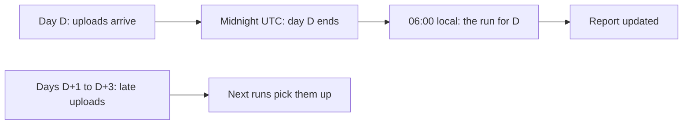

## Six boxes on a sheet of paper

During the Tuesday power cut, Hala has no screen to work on, so she takes a sheet of paper. She writes the name of each Mizan task in a box. Then she asks one question about each box: what must be finished before this task can start? She draws an arrow from every answer to the box that needs it.

She ends with six boxes and six arrows. A sixth task has joined her usual five. It is called checks, and for now it is only a place to put the quality checks you will write in module 11. The paper shows something her head did not. The tasks extract_registry and land do not depend on each other. Only publish needs land, and only dbt_build needs both extract_registry and publish.

That one question, "what must be finished before this can start?", is all a dependency is. The rest of this chapter turns Hala's paper into a rule that a program can follow, and then asks when that program should start.

<BigWordAlert term="DAG" plainEnglish="A directed acyclic graph: tasks drawn as boxes, dependencies drawn as arrows that point one way, and no circle of arrows that leads back to the start." whyItMatters="A DAG lets a program work out a safe order by itself, and lets it refuse a plan that could never finish." />

## A graph, not a list

A list says "do these in this order". A graph says "this task needs that task", and leaves the order to whoever runs it. The difference matters because many orders are correct. Mizan's six tasks have exactly three valid orders. Landing and publishing must stay in that order, but extract_registry can run before them, between them or after them, as long as it runs before dbt_build.

The word directed means each arrow has a direction, from the task that must finish first to the task that waits. The word acyclic means there is no cycle. A cycle would be a circle of arrows, for example a task that waits for another task that waits for the first one. Neither could ever start. A program that finds a cycle must stop and say so, not wait for ever.

Here are Mizan's tasks with their upstream tasks. An upstream task is one that must succeed first. The tasks after a task are called downstream.

| Task | Upstream tasks | What it does |
|---|---|---|
| extract_registry | none | Reads the changed rows of the registry |
| land | none | Reads the day's uploads into Parquet files |
| publish | land | Replaces phone numbers with keys and writes the shared files |
| dbt_build | extract_registry, publish | Runs dbt build |
| checks | dbt_build | Runs the quality checks (a placeholder until module 11) |
| report | dbt_build, checks | Builds the report page |

## How an order follows from the arrows

The rule for finding an order is short. Pick a task whose upstream tasks have all finished. Run it. Repeat until no task is left. If tasks are left and none of them is ready, the graph has a cycle, and the program stops with an error.

For Mizan, the first round finds two ready tasks, extract_registry and land. The small runner you will build breaks ties by the order of the table, so it takes extract_registry first. Then land is ready, then publish, then dbt_build, then checks, then report. The order is extract_registry, land, publish, dbt_build, checks, report. Another valid order starts with land and publish and puts extract_registry just before dbt_build. Both give the same result.

Before you open the canvas, make a prediction about failure. Think about what the graph means when a task cannot finish.

```predict
prompt: "In one run, publish fails for good. After publish come three more tasks: dbt_build, checks and report. Which of those three should still run in this run?"
options:
  - id: all-three
    label: "All three, using the older data in the warehouse"
  - id: none-run
    label: "None of them: all three are skipped"
correctOptionId: none-run
explanation: "dbt_build needs publish, and checks and report need dbt_build. When publish fails for good, every task after it is skipped. A skipped task is better than a task that builds a report from old data and makes it look fresh."
allowRetry: true
```

The canvas below follows one run for 12 March. It shows a task that times out once and is retried, and then what happens when a task fails for a reason that a retry cannot fix.

<InteractiveCanvas slug="pipeline-dag-retry" />

**What this shows:** one run of six dependent tasks, in which a task starts only when every task it needs has succeeded. The picture draws five of the six arrows. It leaves out the arrow from dbt_build to report, because checks already stands between them.

**Try this:** before the last two steps, predict which tasks still run after a permanent error in publish, then check your answer. Then count the log lines that land writes in this run.

**What changed:** the same task, land, appears twice, first with a timeout and then with a good result. The later tasks started only after the good result, and after the permanent error they did not start at all.

**Limits of the model:** it shows one date and one failure at a time, and it runs the tasks one after another. It uses the defaults of the small runner, which are not the defaults of any real scheduler.

## A second graph, with the reasoning shown

Zaid runs the sales report of a bakery. His nightly job has five tasks. The tasks read_sales and read_prices have no upstream task. The task join waits for both. The task report waits for join, and the task email waits for report. Here it is written as a list of tasks and what each one waits for.

```text
read_sales    waits for: nothing
read_prices   waits for: nothing
join          waits for: read_sales, read_prices
report        waits for: join
email         waits for: report
```

Run the rule. Round 1 finds two ready tasks, read_sales and read_prices. Take read_sales. Round 2: read_prices is still ready, and join is not, because it waits for read_prices too. Take read_prices. Round 3: join. Then report, then email. The runner you will build gives the order read_sales, read_prices, join, report, email for this table. Swapping the two read tasks gives the other valid order, so this graph has two valid orders.

Now Zaid makes a mistake and says that read_sales waits for email. Then email waits for report, report waits for join, and join waits for read_sales. That is a cycle. The runner you will build refuses it with a clear message: "the tasks depend on each other in a circle". A refusal before anything runs is a good outcome. The alternative is a job that waits for ever and no log line to explain why.

Here is what the runner printed for Zaid's table, and then for a table with a circle in it. The second answer is the last line of the error message.

```text
['read_sales', 'read_prices', 'join', 'report', 'email']
ValueError: the tasks depend on each other in a circle
```

## When should the run start?

A schedule is a rule for when a run starts. The simplest schedule on a laptop is a line in the system scheduler. On macOS and Linux that is cron. A cron line has five fields: minute, hour, day of month, month and day of week. The line `0 6 * * *` means minute 0 of hour 6 on every day. On Windows the equivalent is Task Scheduler, which you control from a terminal with the schtasks command. Chapter 9.4 gives both lines in full.

The harder question is not the syntax. It is the choice of time. A schedule should follow the data, not the clock. Mizan's phone forms upload through the day, and the uploads for a date are in their folder by the time that date has ended. The runner's daily command works on yesterday in UTC. So the run should start after midnight UTC, at a time when someone is likely to be awake and the power is likely to be on. Hala picks 06:00 on her own computer, inside her morning power hours.

A run is also "for" a date, and that date is not the time the run starts. The run that starts at 06:00 on 13 March is the run for 12 March. Airflow uses the same idea and names the start of the period the logical date, which marks the interval the run covers and not the moment it executes. If the run is for a date and not for "now", then a rerun on Friday for Wednesday reads Wednesday's folder, and gives Wednesday's result.



What to notice: the run waits until the day it covers has ended, and it does not wait for late uploads. The late uploads from the lookback window in chapter 8.2 are picked up by the next runs. This is why the schedule and the lookback are separate decisions. The schedule decides when a normal day is processed. The lookback decides how long a late report is still caught.

Because tasks are idempotent, a schedule is safe. If the scheduler starts a run twice, or Hala runs a date by hand after the scheduler has run it, the second run gives the same result as the first. You met this property in chapter 6.3. An orchestrator without idempotent tasks is a machine that doubles your rows on a bad day.

<Callout type="warning" title="A closed laptop runs nothing">
A scheduler on your laptop starts a task only while the laptop is on and awake. If it is off at 06:00, the run does not happen. The fix is a backfill for the missed dates, which chapter 9.3 explains.
</Callout>

## Where people go wrong

The first near miss is a missing arrow. Suppose someone writes dbt_build with only extract_registry as its upstream task and forgets publish. The run still looks fine on the day it is written, because the table lists publish before dbt_build. Then another person moves the lines to put dbt_build second. The runner now gives the order extract_registry, dbt_build, land, publish, checks, report. The build runs on yesterday's shared files, passes, and the report is one day behind with no error. A dependency that is not written down is only a habit, and the program can only follow what is written.

The second near miss is a schedule set in local time for a command that counts days in UTC. Suppose a computer's clock is two hours ahead of UTC and the run is set for 01:00 local time. At that moment it is 23:00 UTC on the day before. The daily command works on yesterday in UTC, so it takes the date from two days ago on the wall calendar. Nothing fails. The report is simply one day older than anyone expects. Pick a time at which the UTC day you want has already ended, and write the date of each run in the log so that someone can check it.

## The trade-off, and when to choose differently

A script plus cron or Task Scheduler is simple and costs nothing. It has no memory of past runs, no screen that shows the graph and no built-in retry or backfill. Everything beyond "start at 06:00" you write yourself, which is what you do in 9.4. That is the right choice for one pipeline on one laptop, and it is the reason this course builds the ideas by hand.

An orchestrator such as Airflow or Dagster keeps a history of every run, shows the graph and handles retries and backfills for you. It also costs setup time and a running service. Airflow is built for Linux. On Windows, people run it through WSL2 or in Linux containers. Dagster installs on Windows and stays an optional stretch in this course. These tool facts were checked in October 2026. Choose an orchestrator when several people share many pipelines, when pipelines depend on each other, or when you need run history. Choose a time-based schedule when the data arrives at a steady time, and consider starting a run when a file appears when the arrival time varies a lot.

## Try it on your data

Open your Mizan repository and write the table of tasks and upstream tasks for your own pipeline on paper, in the same shape as the table above. Count the valid orders. Then write down which date a run at 06:00 tomorrow is for, and what that run would do if you started it again at 07:00. If your answers are "the date that has just ended" and "the same result", your tasks are ready for a scheduler.

## Check your understanding

```quiz
type: mcq
question: "Noor, who manages a clinic, has a nightly job with five tasks. export_visits and export_doctors have no upstream task. clean waits for export_visits. join waits for clean and export_doctors. report waits for join. How many different orders can a runner use without breaking a dependency?"
options:
  - "Two, because the two export tasks can swap places with each other"
  - "Three, because export_doctors fits in three places among the others"
  - "Six, because the first three tasks can run in any order at all"
  - "One, because join waits for two tasks, so the whole order is fixed"
correct: 1
explanations:
  - "The two exports can swap, but that is not the only freedom. Clean must follow export_visits, and export_doctors can still sit before, between or after that pair, so there are more than two orders."
  - "Right. Export_visits must come before clean. Export_doctors can go first, between them or last, as long as it comes before join. That gives three orders, and join and report always come last, in that order."
  - "Clean waits for export_visits, so those two cannot swap. If all three tasks could run in any order there would be six, but one dependency removes half of them."
  - "Join waits for two tasks, but export_doctors does not wait for anything. It can move, so the order is not fixed."
```

```quiz
type: mcq
question: "Ammar built a daily job for his freelance client's online shop. The shop exports the day's orders as one file between 23:00 and 23:50. His job runs at 23:30 and reads the file for today. On most days it misses the last orders, and it never fails. What fits the facts?"
options:
  - "Retry the job three times at 23:30, so it reads the file again"
  - "Run the job twice, at 23:30 and again at 23:40"
  - "Start the job at 00:30 and have it read the file for yesterday"
  - "Make the job wait for itself, so no second run can start"
correct: 2
explanations:
  - "A retry repeats the same read at the same time. The job did not fail, and the file is still incomplete at 23:30, so a retry cannot help."
  - "A second run at 23:40 still comes before the export ends at 23:50, so the last orders are still missing. The idempotent rerun is safe but does not fix the timing."
  - "Right. The file for a date is complete only after the export ends. Starting after midnight and reading the file for yesterday follows the data, not the clock."
  - "A task that waits for itself is a cycle, and a runner would refuse it. It has nothing to do with when the file is ready."
```

**Next:** What a retry can and cannot fix, and how Airflow and Dagster write the same ideas.
