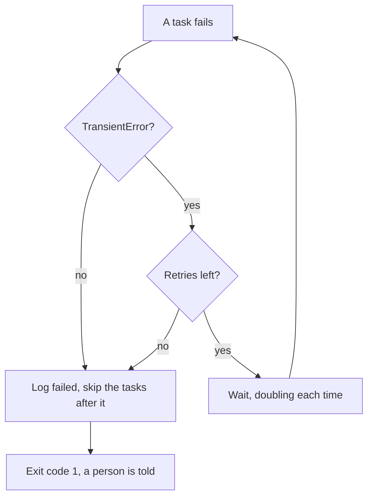

## The same message, three times

On the night of her catch-up, Hala meets two different errors. The first is the lock error from chapter 9.1. dbt cannot open the warehouse, because another program holds the file. She closes the program, waits a minute and runs the command again. It works.

Now suppose a second error appears for one of the days. A batch arrives from the phone form without the price field. Landing stops with a message from the contract you wrote in chapter 8.5: "required field(s) missing from the batch: price". Hala runs the command again. The same message. She runs it a third time, and the same message appears. Three tries, three identical failures.

The lock error went away by itself. The contract error did not, and it never will, because the data in the folder does not change when you wait. Someone has to fix the form or ask the volunteer to upload again. The lesson is that failures come in two kinds, and an orchestrator needs to treat them differently. Retrying the first kind is a good idea. Retrying the second kind only wastes time and fills the log.

<BigWordAlert term="Transient error" plainEnglish="A failure caused by a temporary problem, such as a locked file or a busy disk. It may not happen again if you wait and try again." whyItMatters="Retrying a transient error fixes the run without a person. Retrying anything else wastes time and hides the real problem." />

## Two kinds of failure

A <GlossaryTerm term="permanent error" definition="A failure caused by something that will not change by waiting, such as bad data, a typo in the code or a missing secret. Trying again gives the same failure." /> is the other kind. Here are examples from Mizan, sorted by kind.

| What happened | Kind | Why |
|---|---|---|
| The warehouse file is open in another program | Transient | Closing the program fixes it |
| A read of the upload folder times out because the disk is busy | Transient | It will probably work a moment later |
| A batch has no price field | Permanent | The data is wrong, so every try fails |
| A SQL file has a typo | Permanent | The code is wrong, so every try fails |
| MIZAN_KEY is not set | Permanent | Nothing changes until a person sets it |

Who decides which kind a failure is? The code decides, because the scheduler cannot tell. In the small runner you will build, only an error named TransientError is retried. Any other error fails the task at once. The runner raises TransientError in one place that you can see in advance: when dbt fails and its message says it could not set a lock on the warehouse file. Every other dbt failure is permanent. This is a safe default. An error that nobody has classified is treated as permanent, so the run stops and a person looks, instead of the code repeating something that may do harm.

The diagram shows the choice the runner makes after every failure.



What to notice: there are two ways to reach the box that logs failed, and only one of them involves waiting. A permanent error goes there at once. A transient error goes there only after the retries run out. The skipped tasks and the exit code both come from that one box.

## Waiting longer each time

A retry needs a wait, and the wait should grow. If the thing that failed is still down, trying again straight away fails again. Doubling the wait each time covers a longer outage with few attempts. In the small runner, the setting retries=2 means three attempts in all: the first try and two retries. The wait before retry number k is base_delay times 2 to the power of k, counting from zero. With a base delay of 1 second, the waits are 1 second and then 2 seconds. This growing wait is called backoff.

A longer example makes the pattern easier to see. Suppose a task fails at minute 0 because a shared drive is down. It may retry 3 times, with a first wait of 5 minutes. The waits are 5, 10 and 20 minutes. The retries start at minutes 5, 15 and 35. Before you use the canvas, decide what you think happens when the drive stays down for 20 minutes.

```predict
prompt: "A task fails at minute 0 because a drive is down for 20 minutes. It may retry 3 times. The first wait is 5 minutes and each wait is double the one before. Does the task get through?"
options:
  - id: yes-gets-through
    label: "Yes, a retry starts after the drive is back"
  - id: no-too-short
    label: "No, 3 waits of 5 minutes reach only minute 15"
correctOptionId: yes-gets-through
explanation: "The waits are 5, 10 and 20 minutes, not 5, 5 and 5. The retries start at minutes 5, 15 and 35, and the third retry comes after the drive is back at minute 20. It is the doubling that makes three retries reach so far."
allowRetry: true
```

Open the canvas and compare the two bars. One bar shows how far the last retry reaches when the waits double. The other shows how far it reaches when every wait is the same.

<InteractiveCanvas slug="retry-backoff-outage" />

**What this shows:** how far into an outage a task reaches, given the outage length, the number of retries and the first wait. Doubling waits reach further than equal waits with the same number of retries.

**Try this:** with the starting values, the task works on attempt 4 at minute 35. Raise the outage to 40 minutes and all four attempts fail. Add a fourth retry and the task works at minute 75. Then set the outage to 0 and see that no retry is used.

**What changed:** each move of a slider shows when the last retry now starts and whether that is after the outage ends. The change in the number of attempts follows from that one moment.

**Limits of the model:** this is a simple illustration with an outage that ends at a known minute. Real outages end when they end, and no setting of the sliders helps a task that fails because of bad input.

## Reading a run log

The runner writes one line to logs/runs.jsonl for every attempt of every task, with the status ok, retry, failed or skipped. Here are the lines for a land task that is busy on its first try, produced by running the real runner with a test task that raises TransientError once. The detail text is the message of the error, and the times are cut off to fit the page.

```text
{"task": "land", "run_date": "2026-03-12", "status": "retry", "rows": null, "detail": "file is busy", ...}
{"task": "land", "run_date": "2026-03-12", "status": "ok", "rows": 135, "detail": "", ...}
```

Now look at the other kind. When the upload folder for 2 March is missing, landing fails at once with no retry line. The tasks after it are written as skipped, with a reason.

```text
{"task": "land", "status": "failed", "detail": "FileNotFoundError: no batch files found in data\\raw\\uploads\\upload_date=2026-03-02", ...}
{"task": "publish", "status": "skipped", "detail": "an upstream task did not succeed", ...}
{"task": "dbt_build", "status": "skipped", "detail": "an upstream task did not succeed", ...}
```

The rule for reading a log is: find the first line with failed, because everything after it is skipped and is a result, not a cause. JSON writes each backslash of the Windows path twice, and on macOS and Linux the path has plain slashes. The runner also ends with exit code 1 when any task failed, so a scheduler, a script or a person can tell without opening the log. A run that fails silently is the worst kind, as the next example shows.

<RealWorldEvent title="Backups that failed without a sound" when="2017" summary="A code-hosting company deleted the wrong database directory while it repaired replication, and found that its regular backup had been failing silently. The failure emails were being rejected, so nobody knew. It recovered from a snapshot that was about six hours old." lesson="A job that fails without telling anyone is as dangerous as a job that does not run. Make failures loud, and practise the restore." />

An alert should say that a run ended failed, which task failed first and why. It should go to a person who can act, once. An alert for every retry teaches people to ignore alerts. Chapter 11.2 comes back to this.

Timeouts need the same care. A task that never ends is worse than one that fails, because the schedule stops and nothing is written to the log. Set a longest time for each task and treat a timeout as a failure. A timeout on a busy disk is usually transient. A timeout on a query that does too much work is not.

## Backfills in an orchestrator

You met the backfill in chapter 8.4: running a past period again on purpose. In an orchestrator it is the answer to a missed run, whether the cause was a closed laptop, a power cut or a failure that someone fixed later. Because every task is idempotent, running a date again is safe. The small runner's backfill command runs each date once, oldest first, and stops at the first date that fails. This is a design choice. Later dates would be built on top of a gap. A gap that is found early is easier to repair than one that is found after ten dates have been built on it.

Airflow and Dagster express the same ideas in their own words. The table sets them side by side. These facts were checked in October 2026.

| Idea | The small runner | Airflow | Dagster |
|---|---|---|---|
| A unit of work | A task in the TASKS table | A task in a DAG | An asset, the thing the code makes |
| Order | The upstream list | Dependencies between tasks | Dependencies between assets |
| Retry | retries and base_delay | Retries set on a task | A retry policy |
| Schedule | A cron line or schtasks | A schedule on the DAG | A schedule |
| One date | The --date option | The logical date, the start of an interval | A partition for the date |
| Missed dates | The backfill command | Catchup creates runs for missed intervals, and a backfill reruns a past period | Partitions give each date its own unit of work |

Airflow is built for Linux. On Windows, people run it through WSL2 or in Linux containers, so this course only reads about it. Dagster installs on Windows and is an optional stretch. Airflow's own guidance matches what you have learned. A task should give the same outcome on every rerun. It should read and write one specific date, not simply the latest data. The ideas are the same in all three. What differs is how much you have to write yourself.

## Where people go wrong

The most serious mistake is a retry on a task that is not idempotent. Suppose landing appended its rows each time. A task that fails halfway through its write and is retried leaves some rows twice. The retry that was meant to repair the run doubles the data. This is why chapter 6.3 comes before this chapter. Retries and backfills are only safe when running a task twice gives the same result as running it once.

Other common mistakes are smaller. Some people retry everything, including bad data, which hides the real problem for as long as the retries last. Some set too many retries with a long wait, and a run that should fail in seconds fails after an hour. Some send an alert for every retry. And some forget that a skipped task is not a broken task: it is waiting for the real failure to be fixed.

## The trade-off, and when to choose differently

More retries and longer waits make a run more patient. They also make a real failure slower to show. For a task that talks to a shared drive that is down for minutes at a time, a few retries with a wait that doubles is a good fit. For a task that calls something that costs money for every call, fewer retries are better. For a task that fails because of data, no retry is right and the correct action is to stop and tell a person.

You can write your own runner, as you do in 9.4, or use the retries of Airflow or Dagster. Writing your own teaches you what the settings mean. Using a tool saves you from writing a log, a history screen and a backfill command, and costs you a service to run. For one pipeline on one laptop, the small runner is enough.

## Try it on your data

List the tasks in your Mizan pipeline. For each one, write one cause of failure that is transient and one that is permanent. Then write the first line you would look for in a log after a failed run. If a task has no transient cause, it does not need a retry.

## Check your understanding

```quiz
type: mcq
question: "Rawan, who looks after a pharmacy's stock sheet, runs a job that reads a price list from a shared folder. Another program sometimes locks the file for up to 12 minutes. She sets 3 retries with a first wait of 2 minutes, doubling each time. The lock lasts 12 minutes. What happens?"
options:
  - "It works on attempt 3 at minute 6, after waits of 2 and 4"
  - "It fails all four attempts, because 2 minutes four times is 8"
  - "It gives up at minute 6 after three attempts and never tries again"
  - "It works on attempt 4 at minute 14, after waits of 2, 4 and 8"
correct: 3
explanations:
  - "At minute 6 the lock is still there, because it lasts until minute 12. The third attempt fails, and a fourth attempt is still allowed."
  - "The waits double, so they are 2, 4 and 8 minutes, not 2 minutes each time. The last attempt starts at minute 14, after the lock has ended."
  - "Three retries means four attempts in all: the first try and three retries. The runner does not stop at minute 6."
  - "Right. The attempts start at minutes 0, 2, 6 and 14. The first three fall inside the 12-minute lock and the fourth falls after it, so it works."
```

```quiz
type: mcq
question: "Ammar's job reads the order file of his freelance client's shop. On Thursday it stops with 'column total_price not found'. His runner retries 3 times, and each try gives the same message. The shop's developer renamed the column on Wednesday. What should Ammar do?"
options:
  - "Raise the retries to 10 and the first wait to 5 minutes"
  - "Treat it as permanent: stop, tell a person and fix the column name"
  - "Add a timeout of 10 minutes so the job cannot run for long"
  - "Run the job every hour instead of every day, so it has more chances"
correct: 1
explanations:
  - "The file will not change by waiting. More retries only repeat the same failure for longer."
  - "Right. A renamed column is a permanent error: every try fails the same way. The job should stop on the first failure, tell a person and be fixed at the source, and then the missed dates can be backfilled."
  - "A timeout limits how long a task may run. This task does not run for long, it fails at once, so a timeout changes nothing."
  - "More runs give the same failure more often. Nothing about the file changes with the schedule."
```

**Next:** Build the small scheduler and the report page, with tests.
