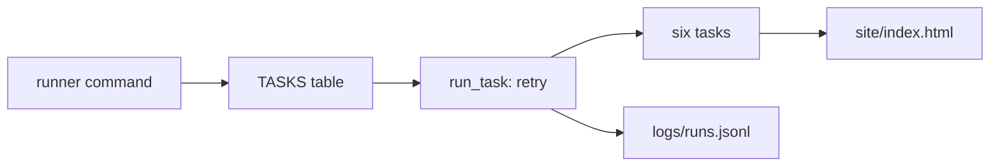

## What the pipeline cannot do yet

Your Mizan pipeline now has every part it needs. It lands the uploads, publishes them without personal data, builds the warehouse with dbt and checks the contract. But it still runs only when you type each command. You saw in the last three chapters what that costs. A week went by without a run, a build passed on old files, and a lock error had nobody there to retry it. Omar also has no page he can open on a phone. He still has to ask you for the numbers.

In this chapter you write the part that was missing. It is a small scheduler, a runner. It runs the six tasks in dependency order and retries the ones that can recover. It stops the ones that cannot, and it writes a log line for every attempt. It also fills in missed dates with one command. You also write the report page that Omar reads. At the end, one command produces the whole thing, and your computer can start that command for you every morning.

## What you will have at the end

A file `pipeline/runner.py` of about 100 lines of code, a file `report/build_report.py`, and a short placeholder file `pipeline/checks.py` that module 11 replaces. You will have the file `tests/test_runner.py`, with 11 tests, passing. You will run `python -m pipeline.runner run --date 2026-03-28` and see six tasks end with ok. You will open `site/index.html` on your computer and, if you can, on your phone. You will also have a scheduled task that starts the daily run.

**Where the repository is now.** You have `pipeline/paths.py`, `land.py`, `contract.py`, `pseudonymise.py`, `extract_registry.py` and `runlog.py`, the `transform/` project, `tests/conftest.py` and the earlier test files, and the lake and warehouse from your 28 days of data. The runner imports from these files and changes none of them. The runner also holds a small function, `run_dbt`, which runs dbt as a separate process from the `transform` folder. If your backfill script from chapter 8.5 imports a dbt helper from somewhere else, leave it, and move it over when you finish.

## The design decision

The smallest way to run six commands in order is a shell script with six lines. It is easy to write, and it has no idea which task failed, no retries, no log and no way to skip what depends on a failure. At the other end, you could install Airflow or Dagster. They have all of this, but Airflow is built for Linux and both are a lot to run for one pipeline on one laptop.

The runner is the middle option. It is a table of tasks, each with a list of the tasks it needs, plus about 100 lines of code that read the table. That is enough to teach every idea in this module, and you can read all of it in one sitting. Its limits are clear. It runs one task at a time, it has no screen, and it keeps its history in a plain file. When you outgrow it, you will know exactly what to ask an orchestrator for.

One more decision is worth explaining. The runner starts dbt as a separate process. The dbt DuckDB adapter keeps the warehouse file open for as long as its Python process lives, and a second connection with different settings is refused. A separate process opens the file, does its work and lets go of it.

The diagram shows what you are adding.



What to notice: every attempt of every task goes through one place, run_task, and that place writes to the log. The report is the last task and the only one that Omar sees. Everything else exists so that the page is there, on time and right.

## The task

1. Create the placeholder `pipeline/checks.py`. The runner's checks task needs it. It must define a `CheckResult` with the fields `name`, `ok`, `value`, `threshold` and `message`, and a function `run_all(run_date)` that returns three results named `freshness`, `volume` and `schema`, all ok, with the message "placeholder, replaced in chapter 11.5". A check that always passes proves nothing. It keeps the graph the right shape until you write the real checks.
2. Copy the test file below into `tests/test_runner.py`. Read it before you write any code, because it is the specification.
3. Write `pipeline/runner.py` to the interface below until the nine fast tests pass.
4. Write `report/build_report.py` until the report tests pass.
5. Run the whole file, then the real commands, then the failure test, then schedule the run.

## The interface

These are the names and signatures the tests use. Keep them exactly.

```python
class TransientError(Exception):
    """A temporary problem (a locked file, a busy disk). Waiting a little and trying again may fix it."""

def run_dbt(*args):
    """Run dbt from the transform folder with the given arguments, as a separate process.
    A failure whose output says it could not set a lock is raised as TransientError.
    Any other failure is raised as RuntimeError."""

# name: (function, [upstream task names]). A task runs only when all its upstream tasks succeeded.
TASKS = {
    "extract_registry": (task_extract_registry, []),
    "land": (task_land, []),
    "publish": (task_publish, ["land"]),
    "dbt_build": (task_dbt_build, ["extract_registry", "publish"]),
    "checks": (task_checks, ["dbt_build"]),
    "report": (task_report, ["dbt_build", "checks"]),
}

def execution_order(tasks) -> list:
    """Put every task after its upstream tasks. Ties are broken by the order in the dict.
    Raises ValueError, with the word 'circle' in the message, if the tasks depend on each other in a circle."""

def run_task(name, function, run_date, retries, base_delay, sleep) -> str:
    """Run one task. Returns 'ok' or 'failed'. Only TransientError is retried, and the wait doubles each time."""

def run_pipeline(run_date, tasks=TASKS, retries=2, base_delay=1.0, sleep=time.sleep) -> dict:
    """Run all tasks for one date. Returns {task name: 'ok' | 'failed' | 'skipped'}."""

def backfill(start, end, **options) -> dict:
    """Run each date once, oldest first. Stops at the first date that fails. Returns {date: status dict}."""

def main(argv=None) -> int:
    """The command line: run --date D, backfill --start A --end B, daily. Returns 1 when any task failed, else 0."""
```

Each task function takes the run date as a string such as `2026-03-12` and may return a row count. Here is what each of the six wraps. The task `extract_registry` extracts each registry table and returns the total rows. The task `land` calls `land_uploads`, and `publish` calls `publish_reports`. The task `dbt_build` calls `run_dbt("build")`. The task `checks` calls `run_all`, writes one log line per check named `check:freshness`, `check:volume` and `check:schema`, and raises an error if any check is not ok. The task `report` calls the `build` function of the report module.

The report module has one function and a command line.

```python
def build(warehouse=paths.WAREHOUSE, out=paths.SITE / "index.html"):
    """Write the report page and return its path."""
```

Run as `python -m report.build_report`, it prints `wrote site/index.html`.

## The constraints

For the runner, a task failure must never stop the program from writing its log. Every attempt writes one line through `runlog.log_run` from chapter 6.5, with the status `ok`, `retry`, `failed` or `skipped`. An `ok` line has the row count that the task returned and an empty detail. A `retry` line has the message of the error as its detail. A `failed` line from any other error has the name of the error type, a colon and its message, such as `ValueError: bad data`. A `skipped` line says that an upstream task did not succeed.

The retries default to 2, which is three attempts, and the wait before retry k is `base_delay * 2**k`. The sleep function is a parameter, so tests can replace it. The table `TASKS` must be one dict that the command line reaches through the default of `run_pipeline`, because some tests change its entries in place. The extra options of `backfill` are passed on to `run_pipeline`. The command `daily` runs yesterday in UTC. The command `backfill` runs each date once, oldest first, and stops at the first date with a failed task, because later dates would be built on a gap. For each date the command line prints one line: the date, then every task as `name=status`, separated by commas and spaces. The exit code is 1 when any task failed.

For the report, the page is one HTML file. It has one section for each market, with the market code and the current name from `dim_market`. Each section has a table of the latest four ISO weeks from `mart_weekly_basket`. The mart has the columns `market_code`, `iso_year`, `iso_week`, `week_start`, `full_days`, `avg_basket_cost`, `change` and `change_pct`. Each row shows the week and the basket cost in ILS. It also shows the change from the week before, as the word up, down or same with the number, and a bar made of plain CSS. A week with fewer than a full set of days says so, with the number of full days. The page has no JavaScript and no outside file, it has a viewport tag so that it fits a phone, and it has light and dark colours through `prefers-color-scheme`. Meaning must never depend on colour alone, which is why the change is written as a word.

## The acceptance tests

The first group of tests checks the graph. Why do they exist? The first test proves that every task runs after the tasks it needs and that the order is the one from chapter 9.2. The second proves that a circle of dependencies is refused before anything runs. Both use only the table, so they run in a fraction of a second.

```python
"""Chapter 9.4: the small scheduler and the HTML report."""
import json
from pathlib import Path

import pytest

from pipeline import runner
from pipeline.runner import TASKS, TransientError, backfill, execution_order, run_pipeline


def fake_tasks(calls, **overrides):
    """Six tasks with the same names and upstreams as the real pipeline, but they only record that they ran."""
    def make(name):
        def task(run_date):
            calls.append((name, run_date))
            return 1
        return task

    tasks = {name: (make(name), upstream) for name, (_, upstream) in TASKS.items()}
    for name, function in overrides.items():
        tasks[name] = (function, tasks[name][1])
    return tasks


def log_lines():
    return [json.loads(x) for x in Path("logs/runs.jsonl").read_text().splitlines()]


def test_tasks_run_after_their_upstream_tasks():
    order = execution_order(TASKS)
    assert order == ["extract_registry", "land", "publish", "dbt_build", "checks", "report"]
    for name, (_, upstream) in TASKS.items():
        for before in upstream:
            assert order.index(before) < order.index(name)


def test_a_circle_of_dependencies_is_refused():
    with pytest.raises(ValueError, match="circle"):
        execution_order({"a": (None, ["b"]), "b": (None, ["a"])})
```

The helper `fake_tasks` is how the tests avoid running real work. It builds six tasks with the real names and upstream lists, but each one only records that it ran. This is why your `run_pipeline` takes `tasks` and `sleep` as parameters. A function that cannot be given fake tasks cannot be tested without running dbt.

The second group tests retries. Why these three? The first checks that a transient error is retried once and then succeeds. It also checks that the wait is the one you asked for, and that the log has a retry line followed by an ok line. The second checks that the wait grows, and that retries stop after two. The third checks the other kind: a plain error is not retried, everything after it is skipped, and the exit code is 1.

```python
def test_a_transient_error_is_retried_and_the_run_succeeds(project):
    attempts, waits = [], []

    def flaky(run_date):
        attempts.append(run_date)
        if len(attempts) == 1:
            raise TransientError("file is busy")
        return 5

    status = run_pipeline("2026-03-02", fake_tasks([], land=flaky), base_delay=1.0, sleep=waits.append)
    assert set(status.values()) == {"ok"}
    assert len(attempts) == 2 and waits == [1.0]
    land = [x for x in log_lines() if x["task"] == "land"]
    assert [(x["status"], x["detail"]) for x in land] == [("retry", "file is busy"), ("ok", "")]


def test_the_wait_grows_and_retries_stop_after_two(project):
    waits, attempts = [], []

    def always_busy(run_date):
        attempts.append(1)
        raise TransientError("still busy")

    status = run_pipeline("2026-03-02", fake_tasks([], land=always_busy), retries=2, base_delay=0.5, sleep=waits.append)
    assert len(attempts) == 3 and waits == [0.5, 1.0]  # 3 attempts, waiting 0.5 s then 1 s
    assert status["land"] == "failed" and status["publish"] == "skipped"


def test_a_permanent_error_skips_everything_downstream_and_the_exit_code_is_1(project, monkeypatch):
    calls = []

    def broken(run_date):
        raise ValueError("bad data")

    for name, (function, upstream) in fake_tasks(calls, publish=broken).items():
        monkeypatch.setitem(TASKS, name, (function, upstream))  # the CLI uses the TASKS dict
    assert runner.main(["run", "--date", "2026-03-02"]) == 1
    assert [name for name, _ in calls] == ["extract_registry", "land"]  # publish failed, so nothing after it ran
    states = {x["task"]: x["status"] for x in log_lines()}
    assert states == {"extract_registry": "ok", "land": "ok", "publish": "failed", "dbt_build": "skipped", "checks": "skipped", "report": "skipped"}
    assert "ValueError: bad data" in [x for x in log_lines() if x["task"] == "publish"][0]["detail"]
```

The third group covers the clean exit, the log and the backfill. A run with no failures must return exit code 0, or a scheduler cannot tell good from bad. Every attempt must be in the log, with start and end times that make sense and end in `Z`, the UTC marker. A backfill must run each date exactly once, in order. And it must stop at the first date that fails, because the later dates would be built on a gap.

```python
def test_a_clean_run_has_exit_code_0(project, monkeypatch):
    for name, (function, upstream) in fake_tasks([]).items():
        monkeypatch.setitem(TASKS, name, (function, upstream))
    assert runner.main(["run", "--date", "2026-03-02"]) == 0


def test_every_attempt_is_logged_with_times(project):
    run_pipeline("2026-03-02", fake_tasks([]))
    lines = log_lines()
    assert [x["task"] for x in lines] == ["extract_registry", "land", "publish", "dbt_build", "checks", "report"]
    assert all(x["run_date"] == "2026-03-02" and x["status"] == "ok" and x["rows"] == 1 for x in lines)
    assert all(x["started_at"] <= x["ended_at"] and x["ended_at"].endswith("Z") for x in lines)


def test_backfill_runs_each_date_once_in_order(project):
    calls = []
    results = backfill("2026-03-05", "2026-03-07", tasks=fake_tasks(calls))
    assert list(results) == ["2026-03-05", "2026-03-06", "2026-03-07"]
    lands = [date for name, date in calls if name == "land"]
    assert lands == ["2026-03-05", "2026-03-06", "2026-03-07"]
    assert len(calls) == 3 * 6  # six tasks, three dates, nothing run twice


def test_backfill_stops_at_the_first_failing_date(project):
    calls = []

    def fails_on_the_sixth(run_date):
        calls.append(("land", run_date))
        if run_date == "2026-03-06":
            raise RuntimeError("no files")

    results = backfill("2026-03-05", "2026-03-07", tasks=fake_tasks([], land=fails_on_the_sixth))
    assert list(results) == ["2026-03-05", "2026-03-06"]
    assert results["2026-03-06"]["land"] == "failed"
```

The last two tests are marked slow, because they run dbt for real. The first builds the report from a fully loaded warehouse of 28 days and checks the things Omar depends on. The page is small, and all eight markets are on it. It has no script and no outside link, and it fits a phone. It shows the latest four weeks and no older one, and a market name comes from the registry. The second runs the real command line for three days and checks the log, the check lines and the number of facts.

```python
@pytest.mark.slow
def test_the_report_exists_has_all_markets_and_is_small(built):
    built.python("-m", "report.build_report")
    page = (built.root / "site" / "index.html").read_text(encoding="utf-8")
    assert (built.root / "site" / "index.html").stat().st_size < 50_000
    for code in [f"M0{n}" for n in range(1, 9)]:
        assert code in page
    assert "<script" not in page and "http" not in page  # no JavaScript, no outside files
    assert 'name="viewport"' in page.replace("'", '"')
    assert page.count("Week 13") == 8 and "Week 9<" not in page  # the latest four weeks: 10 to 13
    assert "Fisher Row Market" in page


@pytest.mark.slow
def test_a_real_three_day_backfill_from_the_command_line(project):
    project.make_data(3)
    done = project.python("-m", "pipeline.runner", "backfill", "--start", "2026-03-01", "--end", "2026-03-03")
    assert done.stdout.count("report=ok") == 3
    assert (project.root / "site" / "index.html").exists()
    logged = [json.loads(x) for x in (project.root / "logs" / "runs.jsonl").read_text().splitlines()]
    assert len([x for x in logged if x["status"] == "failed"]) == 0
    assert len([x for x in logged if x["task"] == "land"]) == 3
    assert {x["task"] for x in logged if x["task"].startswith("check:")} == {"check:freshness", "check:volume", "check:schema"}
    lines = [json.loads(x) for path in (project.root / "data/raw/uploads").glob("*/*.jsonl") for x in path.read_text().splitlines()]
    good = {x["report_id"] for x in lines if x["price"] > 0 and x["item_code"]}
    assert project.query("SELECT count(*) FROM fct_price_report") == [(len(good),)] == [(279,)]
```

Register a marker named `slow` in `pytest.ini`, with `testpaths = tests`, if the file does not exist yet. Without it, pytest prints a warning about an unknown marker. The 279 in the last test is the number of good reports in the first three days of seed 7. It depends on `--days`, and the test generates exactly three days, so it holds.

## Run it

Open a terminal in your project folder with the virtual environment active. First run the nine fast tests. They do not touch your data.

```bash
pytest -q tests/test_runner.py -m "not slow"
```

```text
.........                                                                [100%]
9 passed, 2 deselected in 0.74s
```

When they pass, run the whole file. The two slow tests copy your code into temporary folders and run dbt, so expect close to a minute. Timings vary from computer to computer.

```bash
pytest -q tests/test_runner.py
```

```text
...........                                                              [100%]
11 passed in 46.46s
```

Now run the real thing on your 28 days of data. Set the key first. In PowerShell:

```powershell
$env:MIZAN_KEY = "some-long-random-text"
python -m pipeline.runner run --date 2026-03-28
python -m report.build_report
```

On macOS and Linux, use `export MIZAN_KEY=some-long-random-text` for the first line. The run takes about 12 seconds, nearly all of it dbt starting.

```text
2026-03-28 extract_registry=ok, land=ok, publish=ok, dbt_build=ok, checks=ok, report=ok
wrote site/index.html
```

Open `site/index.html` in a browser. It is about 9.5 KB. The section for market M05 should show these rows, with the market name from the registry:

```text
M05 Northgate Market
Week 10   153.17 ILS   down -1.33 (-0.9%)
Week 11   154.75 ILS   up +1.58 (+1.0%)
Week 12   154.20 ILS   down -0.55 (-0.4%)
Week 13   154.58 ILS   up +0.38 (+0.2%)
```

To catch up on a range of dates, run the backfill command. The command below runs one dbt build for each date, and it is the same command that the workflow in chapter 11.5 will run on sample data. It takes about 75 seconds for ten dates on the reference computer.

```bash
python -m pipeline.runner backfill --start 2026-03-01 --end 2026-03-10
```

## Try one failure on purpose

A runner earns its place when something goes wrong. Hide one upload folder, run the pipeline for that date, and read what happens. In PowerShell:

```powershell
Rename-Item "data\raw\uploads\upload_date=2026-03-02" "hidden-2026-03-02"
python -m pipeline.runner run --date 2026-03-02
echo $LASTEXITCODE
Rename-Item "data\raw\uploads\hidden-2026-03-02" "upload_date=2026-03-02"
```

On macOS and Linux, use `mv` for the renames and `echo $?` for the exit code. The runner should stop at land, skip the rest and exit with 1:

```text
2026-03-02 extract_registry=ok, land=failed, publish=skipped, dbt_build=skipped, checks=skipped, report=skipped
1
```

Open `logs/runs.jsonl` and find the `failed` line. Its detail should name a `FileNotFoundError` and the folder. There is no retry line, because a missing folder is a permanent error. Put the folder back and run the same command again. All six tasks should end ok, and the log now has a second set of lines for that date.

## Schedule the daily run

The `daily` command runs for yesterday in UTC, so schedule it for a time after midnight UTC on your computer's clock, and inside the hours when you usually have power. Task Scheduler starts a task with a fresh environment, so a key that exists only in your open terminal is not there. Set it once as a user environment variable, open a new terminal, and then create the task. In PowerShell:

```powershell
setx MIZAN_KEY "some-long-random-text"
schtasks /create /tn "mizan-daily" /sc daily /st 06:00 /tr "cmd /c cd /d C:\de\mizan && C:\de\venv\Scripts\python -m pipeline.runner daily"
schtasks /run /tn "mizan-daily"
```

Use your own long random text for the key, and never write it in a file in the repository. Change `C:\de\mizan` and `C:\de\venv` to your own folders. The last line starts the task now, so you can see that it works before 06:00. On macOS and Linux, run `crontab -e` and add two lines, again with your own paths and key:

```text
MIZAN_KEY=some-long-random-text
0 6 * * * cd /path/to/mizan && .venv/bin/python -m pipeline.runner daily
```

Check the log the next morning. If a line says MissingKeyError, the key did not reach the task: set it again and check that the task runs under your own user. If the computer was off at 06:00, the run did not happen, and the way to repair that is a backfill for the missing dates.

## If you are stuck

Build the runner in the order the tests use it: `execution_order` first, then `run_task`, then `run_pipeline`, then `backfill`, then `main`, and run `pytest -q tests/test_runner.py -m "not slow"` after each step. A function that works alone is much easier to fix than a runner that fails in four places.

If `test_the_wait_grows_and_retries_stop_after_two` fails, print the list of waits your function passed to `sleep`. It must be `[0.5, 1.0]` for three attempts. The usual cause is waiting after the last failed attempt as well, which gives a third wait, or waiting `base_delay` every time instead of doubling it.

## Commit your work

Run `pytest -q -m "not slow"` once for the whole project. Then commit with a message such as "Add a small scheduler with retries, a run log and backfill, and a phone-friendly report".

**Next:** A practice check on graphs, schedules, retries and backfills, then the gate.
