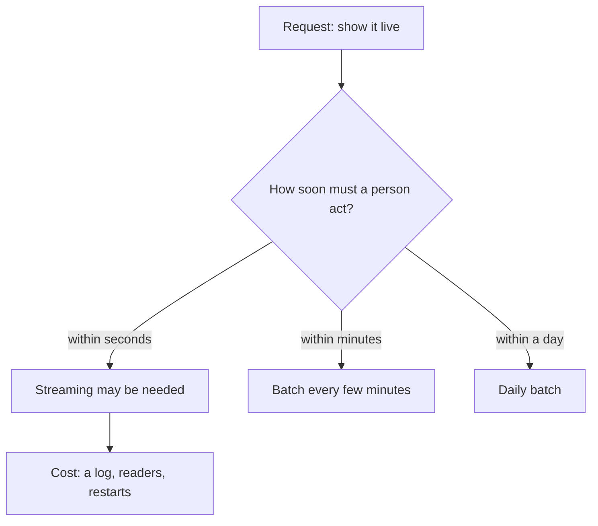

<BigWordAlert term="Streaming" plainEnglish="Handling data one event at a time, or in very small groups, as it arrives, instead of in a scheduled batch." whyItMatters="Streaming costs more to build and to keep running. It earns that cost only when a person or a program must act within seconds or minutes. Many requests that say live do not need it." />

## A request for live readings

Saeed runs a small solar repair shop. All the people, shops and readings in this module are fictional and synthetic. His shop installed solar batteries in six of the community kitchens that Mizan's partners run. Each battery has a small controller that sends one reading every 5 minutes: the battery level as a percentage, and the time. When a battery goes flat, a kitchen loses its refrigerator for the night, and food spoils.

Saeed wrote to Yasmin, the volunteer coordinator, and Yasmin passed the message to Hala. It said: "Can we have the battery readings live? My technician wants a screen that shows every battery as it is now." Hala is 26 and works for Mizan part time. She had just finished the scheduler in the last module, and her first thought was that this was a job for a streaming system. She had read the word in job postings. It looked like the next thing to learn.

She did not start with a tool. She asked Saeed a question instead: what will your technician do with a live reading that he could not do with a reading that is a few minutes old?

## The question behind the request

Saeed thought about it. The technician looks at the screen to find a battery that is getting low. When the level of a battery falls below 20 percent, he drives to that kitchen. The drive takes about 40 minutes. In this example, a battery at 20 percent lasts well over an hour. So the technician needs to know about a low battery within about 30 minutes of the reading, and that gives him time to arrive before the battery is empty.

Saeed had said "live", and what he needed was "within 30 minutes". These two are very far apart. A live view means the screen changes within a second or two of each reading. An alert within 30 minutes means the data may be a few minutes old and nobody will notice.

Hala did the arithmetic with the rule from chapter 1.3. Take a batch run every 15 minutes that takes about 1 minute. The data on the page is at most 15 plus 1, which is 16 minutes, behind the real battery. That is inside 30 minutes. A batch run every 15 minutes is 96 runs a day.

She also counted the data. Six batteries send 12 readings an hour each, so 72 readings an hour and 1,728 readings a day. That is about 18 times the daily lines that Mizan's volunteers send, and it is still a very small amount of data. A laptop reads a day of it in well under a second.

Then she compared the two designs. A batch every 15 minutes uses the scheduler she already has: land the new readings, load them, check them, and write a page with one line for each battery. A streaming design needs a log service that runs all day, a program that reads from it all the time, and a plan for what happens when the power fails. On her laptop, with power cuts, that is a lot to keep running, and it would solve a problem that Saeed does not have.

## What Hala decided

She wrote back to Saeed: "I can give you a page that shows every battery, no more than about 16 minutes old. It will have a line in red for any battery below 20 percent. If you ever need an answer within seconds, tell me, and we will look at streaming then." Saeed said that was what he wanted. He had not known that "live" and "within 30 minutes" were different requests.

Hala still wanted to understand streaming. She knew that interviewers ask about it. She also knew that some requests really do need it, such as a fraud check before a payment completes or a safety alarm that must sound at once. In the public postings we read in October 2026, Spark and streaming tools were named less often in roles without a senior title. In the 90 roles we scanned, 34 had no senior word in the title, and Kafka appeared in 4 of those 34. This is a sample of public postings, not a census. The honest summary is that you should know the ideas, and you should not assume that every request needs the tools.

Hala wrote down three questions that she now asks before any design. Who will look at the data, and what will they do with it? How soon after an event must they know: in seconds, minutes or hours? And what happens if the data is wrong or late for a while? The second question picks the design. The third question picks how careful the design must be. Saeed's technician looks at a screen and drives to a kitchen, and nothing terrible happens if the screen is five minutes behind. An alarm that protects a person from harm would have different answers, and the design would be different.

What would change her mind? Suppose the batteries sent a reading every second and Saeed needed an alarm within 10 seconds. A batch every 15 minutes would then fail the need. She would first try much shorter batches, because they cost less to run. She would look at a log and a streaming reader only if short batches were still too slow. The point is not that streaming is bad. The answers come first, and the tool comes after them.

The diagram shows the question Hala asked. Follow the arrows from the request.



What to notice: the first box is a request, and the decision does not come from the request. It comes from the answer to the question in the second box. Only one branch leads to streaming, and it comes with a cost that the other two branches do not have.

Before you read on, make your own choice for Saeed's case.

```predict
prompt: "Saeed's technician needs to hear about a low battery within 30 minutes. A batch run every 15 minutes takes about 1 minute, so the newest data a person sees is at most 16 minutes old. Does this case need a streaming system?"
options:
  - id: needs-streaming
    label: "Yes, anything that is called live needs streaming"
  - id: batch-is-enough
    label: "No, a batch every 15 minutes is fresh enough"
correctOptionId: batch-is-enough
explanation: "Saeed's real need is an answer within 30 minutes, and 16 minutes is inside that. The word live described how he pictured the screen, not what the technician has to do. Streaming would add a service to run all day and would not change the technician's decision."
allowRetry: true
```

## Why this matters for the job

Clients and managers often ask for live data. A data engineer who starts with a tool will build something expensive that nobody needed. A data engineer who starts with the question gets to the right size of solution faster, and can explain the choice in a few words. That habit is what an interviewer listens for in a design round: clarify the need, name the freshness, then choose.

It also matters for your own time and power. A streaming system is a service that runs all day and restarts after a crash. On a laptop that is off every night, or in a city with power cuts, a scheduler plus a backfill is a calmer choice.

You can learn the ideas of streaming without installing anything. Kafka, a well-known tool, needs Java 17 or later and a running broker. Spark is a download of about 450 MB plus Java. In this module you meet both through small models you can read and run in plain Python, and through the words their own documentation uses.

## What this module covers

Chapter 10.2 follows events into a log that is split into partitions, and shows where order holds and what a consumer's offset means. Chapter 10.3 explains what at-most-once, at-least-once and exactly-once really promise, and how to make a table safe to receive the same message twice. Chapter 10.4 asks when one machine is not enough, and what to measure before you reach for a cluster. Chapter 10.5 is a practice check. In the gate, chapter 10.6, you write a decision for a streaming request: batch or stream, with your reasons.

Everything you built before still applies. Idempotent writes from chapter 6.3 are the answer to repeated messages. The lookback from chapter 8.2 is the batch version of waiting for late events. The column pruning from chapter 5.2 is why one machine can read so much.

<LearningObjectives objectives={["Ask how soon a person must act on the data before you choose streaming", "Trace events through a partitioned log and a consumer's offsets, and say where order holds", "Explain at-most-once, at-least-once and exactly-once, and make a sink safe to receive a message twice", "Decide between one machine and a cluster with measurements, not habit"]} />

## Key words

| Word | Plain English |
|---|---|
| **Event** | One thing that happened, with the time it happened, such as one battery reading |
| **Stream** | Events that keep arriving, one after another, with no planned end |
| **Partition** | One ordered slice of a log, so that many readers can work at once |
| **Offset** | A reader's position in a partition: the number of the next event it will read |
| **Delivery guarantee** | A promise about whether a message can be lost, repeated or neither |
| **Cluster** | Several machines that work together on one job |

## What is in this module

| Chapter | You will practise |
|---|---|
| 10.2 | Tracing events through partitions and offsets |
| 10.3 | Telling the three delivery guarantees apart, and a table that is safe to repeat |
| 10.4 | Deciding between one machine and a cluster by measuring |
| 10.5 | A practice check with five cases, including an AI answer to check |
| 10.6 | A written decision: streaming or batch for a request |

**Next:** How a log keeps events in partitions, and what a consumer's offset really is.
