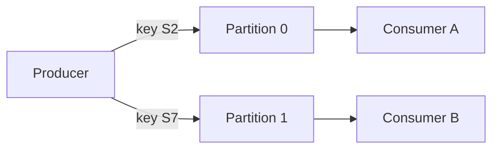

## Three readers, one set of readings

Saeed's six batteries send 72 readings an hour. Hala has already decided to serve his technician with a batch, but she keeps thinking about the readings themselves. Three people will want them: the technician's screen, a nightly report on battery health, and Saeed, who wants to check the last week when a customer complains. Each of them needs to see every reading.

A first idea is a queue, like a line at a bakery. The reading at the front of the line goes to one reader and then it is gone. With three readers, that fails at once. The first reader takes each reading and the other two get nothing. A second idea is to copy every reading three times, once for each reader. That works until a fourth reader arrives.

A log solves this in a different way. The readings are written once, in order, at the end of a long record. Reading them does not remove them. Each reader keeps its own bookmark, and moves it forward as it goes. One set of readings can serve any number of readers, and each reader can start again from an earlier point.

<BigWordAlert term="Log" plainEnglish="A record where new events are added at the end, in order, and old events stay where they are. Readers keep their own bookmarks." whyItMatters="Because reading does not remove events, many readers can use the same events, and a reader that crashed can go back and read again." />

## How a log is organised

A well-known tool for this is Kafka, and the ideas below follow its documentation. We will not install it. Each event has a key, a value, a time and, if wanted, some extra labels. For Saeed, the key is the battery's site id, such as S2, and the value is the battery level. The events are stored in a <GlossaryTerm term="topic" definition="A named log of one kind of event, such as battery readings. A topic is split into partitions." />. A topic is split into partitions, which you met by name in chapter 10.1. A partition is one ordered slice of the topic.

Which partition does an event go to? The key decides. Events with the same key always go to the same partition. That is the one rule that gives you order. Inside a partition, events keep the order in which they were added, and each one has a number, its position in that partition, which starts at 0. That number is the offset. Order is kept inside one partition, and not across a whole topic. If two events have different keys, they may be in different partitions, and nothing says which was first.

A consumer is a program that reads events from a topic. A <GlossaryTerm term="consumer group" definition="A set of programs that share the work of reading one topic. Each partition is read by exactly one program in the group at a time." /> lets several programs share the work. Inside a group, each partition is read by exactly one consumer at a time. Two groups are independent, so the technician's screen and the nightly report can each read the whole topic without disturbing each other. Each group keeps an offset for each partition, which is its saved position. A consumer can also choose to go back to an older offset and read again on purpose.

The log does not keep events for ever. How long it keeps them is set for each topic, which is called retention. In a production setup, each partition is also copied to several machines, and three copies is a common choice. Here we need only the idea: a log is a durable record that readers can read at their own pace.

Before you open the canvas, think about the moment that matters most. A consumer has read three events, written two of them to a database, and loses power before it saves its position.

```predict
prompt: "A consumer reads offsets 0, 1 and 2, writes the first two to a database, and crashes before it saves its position. Its saved position is still 0. Where does it start reading after the restart?"
options:
  - id: after-last
    label: "At offset 2, after the last event it wrote"
  - id: from-saved
    label: "At offset 0, its saved position"
correctOptionId: from-saved
explanation: "A consumer's position is what it saved, and the log does not know what the database holds. After the restart the saved position is still 0, so the consumer reads offsets 0, 1 and 2 again. Offsets 0 and 1 are repeats."
allowRetry: true
```

The canvas below follows three readings for site S2 into a partition and the crash that you just predicted. Pay attention to the saved position in each step.

<InteractiveCanvas slug="partition-offsets" />

**What this shows:** three readings with the same key go into one partition, in order, at offsets 0, 1 and 2. A consumer reads them without removing them, and a crash before it saves its position makes it read the same events again.

**Try this:** before step 8, predict where the consumer starts after the crash. Then count the rows in the database at the end and the readings that really exist in the log.

**What changed:** the saved position moved only at the last step, after all the work was done. That is why the repeated events were read, and why the database got two extra rows.

**Limits of the model:** it shows one partition and one consumer. It leaves out the other partitions, consumer groups with several readers and the copies that a real cluster keeps. The extra rows come from a sink that adds a row every time.

## A log you can read in 30 lines

Here is a log made of plain files, in Python. It has two partitions, one file for each. The function `partition_for` is a toy rule: it takes the number in the site id, so S2 goes to partition 0 and S7 goes to partition 1. Real systems use their own rule, and the idea is the same, because the same key always gives the same partition.

```python
import json
import shutil
from pathlib import Path

PARTITIONS = 2
LOG = Path("toy_log")


def partition_for(key):
    return int(key[1:]) % PARTITIONS  # a toy rule: the same key always gives the same partition


def send(key, value):
    file = LOG / f"partition-{partition_for(key)}.jsonl"
    with open(file, "a", encoding="utf-8") as f:
        f.write(json.dumps({"key": key, "value": value}) + "\n")


def read(partition, offset):
    lines = (LOG / f"partition-{partition}.jsonl").read_text(encoding="utf-8").splitlines()
    return [(i, json.loads(line)) for i, line in enumerate(lines) if i >= offset]


shutil.rmtree(LOG, ignore_errors=True)
LOG.mkdir()
for key, level in [("S2", 85), ("S7", 62), ("S2", 84), ("S3", 70), ("S2", 82), ("S7", 61)]:
    send(key, level)

offsets = {0: 0, 1: 0}  # the consumer's saved position in each partition
for p in (1, 0):  # read partition 1 first, to show that no order holds across partitions
    for offset, event in read(p, offsets[p]):
        print(f"partition {p} offset {offset}: {event['key']} {event['value']}%")
        offsets[p] = offset + 1
print("saved positions:", offsets)
print("a saved position of 1 in partition 0 gives offsets:", [o for o, _ in read(0, 1)])
```

The readings were sent in this order: S2, S7, S2, S3, S2, S7. This is what the script printed when it was run.

```text
partition 1 offset 0: S7 62%
partition 1 offset 1: S3 70%
partition 1 offset 2: S7 61%
partition 0 offset 0: S2 85%
partition 0 offset 1: S2 84%
partition 0 offset 2: S2 82%
saved positions: {0: 3, 1: 3}
a saved position of 1 in partition 0 gives offsets: [1, 2]
```

Read the output with the reasoning in mind. The three S2 readings, 85, 84 and 82, come out in the order they were sent, because they share a key and so share a partition. The readings of S7 and S3 also stay in order inside partition 1. But the reader took partition 1 first, so S7 and S3 came out before the first S2 reading, which was sent first. Nothing in the log says that the reading S2 85 came before S7 62 for a reader. The order across partitions is whatever the reader makes of it. The last line shows a rewind: a saved position of 1 gives offsets 1 and 2 next.

The diagram shows the same topic with two readers in one group.



What to notice: each partition has exactly one reader in the group, and there is no arrow between the two partitions. Order holds inside box B and inside box C. Between them, nothing is promised.

## Where people go wrong

The most common mistake is to think that a topic keeps its events in one global order. It does not. Order holds inside one partition, so related events must share a key. If you send a battery's readings without its site id as the key, they may land in different partitions. A reader may then see the 82% reading before the 85% reading. The battery will look as if it was charging when it was not.

A second mistake is to sort by time across partitions and to trust that the result is the order of events. Clocks on different senders can disagree, and a late event can carry an early time. The offset tells you the order in a partition. The time tells you what the sender thought.

A third mistake is to treat the saved position as a record of the work. The position is a number that the consumer chose to save. If it is saved before the work is done, work can be lost. If it is saved after, work can be repeated. The next chapter is about this choice.

## The trade-off, and when to choose differently

More partitions let more consumers work at once, and each partition is a smaller slice that keeps its own order. But you cannot rely on order across partitions, and it is hard to change the number of partitions later without changing which key goes where. Fewer partitions are simpler and keep more events in one order.

Often you do not need a log at all. For Saeed's data, a table with one row per reading and a column for the time is enough. A batch that remembers the largest time it has seen, as in the watermark of chapter 6.4, behaves like a consumer with an offset. A log earns its place in three cases. Many independent readers need the same events. Readers must be able to replay them. Or events arrive faster than one program can write to a table. For a laptop with six batteries, the table is the simpler choice.

## Try it on your data

Think of Mizan's uploads as a topic. Which key would keep one market's reports in order: the market code, or the report id? Write down your answer and why. Then copy the script above into a file, change the toy rule so that three partitions are used, and check which partition each site goes to. If you send a reading with the same key twice, does it land in the same partition both times?

## Check your understanding

```quiz
type: mcq
question: "Dalia's water tanker round has 40 tank sensors. Each sends a level every 10 minutes into a topic with 3 partitions. The key is the tank id. A group of 3 consumers reads the topic. Which statement is guaranteed?"
options:
  - "All 40 sensors' readings are read in the order they were sent"
  - "Each consumer in the group reads every partition of the topic"
  - "The readings of one tank are read in the order they were sent"
  - "A reading is removed from its partition once a consumer reads it"
correct: 2
explanations:
  - "Order holds inside one partition only. Tanks with different ids may be in different partitions, and nothing orders the readings of one tank against the readings of another."
  - "Inside a group, each partition is read by exactly one consumer at a time. With 3 partitions and 3 consumers, each consumer usually has one partition."
  - "Right. All readings of one tank share a key, so they share a partition, and a partition keeps its events in the order they were added. That is the order guarantee a key gives you."
  - "Reading does not remove events. They stay in the log until the topic's retention ends, which is why another group can read them too."
```

**Next:** What the three delivery guarantees promise, and how to make a table safe to receive the same message twice.
