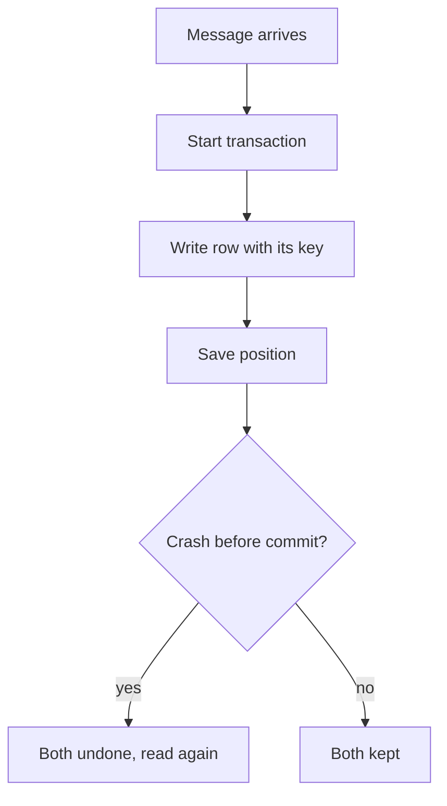

## Twenty rows, then none

To test her understanding, Hala stops a reader on purpose. The reader takes a batch of 10 battery readings, writes them to a table and then saves its position. She stops it after the write and before the save, and starts it again. The table now has 20 rows. Every reading is there twice.

Then she swaps the two steps. The reader saves its position first and writes second. She stops it after the save and before the write. When it starts again, the table has 0 rows. The log believes the batch was handled, so the reader never asks for it again. All 10 readings are gone, and no error was raised anywhere.

Both runs had one crash and the same code, with two steps in a different order. The first run repeated work. The second run lost work. The word for what a system promises about this is a delivery guarantee, which you met in the key words of chapter 10.1. This chapter explains the three promises, what the famous third one covers, and what you must do yourself.

<BigWordAlert term="Effectively once" plainEnglish="A message may arrive more than once, but the result is the same as if it had arrived once, because the table that receives it ignores repeats." whyItMatters="True exactly-once delivery to your own database is not something a log can promise alone. Effectively once is what you can build: at least once, plus a write that is safe to repeat." />

## The three promises

Kafka's documentation names three. At most once means a message may be lost, and it is never delivered twice. At least once means a message is never lost, and it may be delivered more than once. At least once is the default. Exactly once means each message is processed once and only once. The words describe what the system does when something goes wrong, because when nothing goes wrong, all three give the same result.

The order of the two steps decides which you get. If a reader saves its position first and works second, a crash between them loses the batch. That is at most once. If a reader works first and saves second, a crash between them repeats the batch. That is at least once. There is no order of two separate steps that avoids both problems, because a crash can fall between any two steps.

| Order of steps | A crash between them | Promise |
|---|---|---|
| Save position, then write | The batch is lost | At most once |
| Write, then save position | The batch is written again | At least once |
| Write and save position as one step | Neither happens, or both | Exactly once for that system |

The third row is the clue. If the write and the save can be made into one all-or-nothing step, a crash cannot fall between them. That is what the word transaction means. The catch is that both must live in the same system.

## What exactly-once covers

Kafka can do this when the data stays inside Kafka. A producer that is set to be idempotent, which is on by default in current clients, stops the duplicates that its own retries would cause. With a transactional setting, a program can write to several partitions and save its position as one atomic step, and consumers can be told to read only committed data. This is how a program can read from one topic, change the events and write to another topic with exactly-once results.

When the data goes somewhere else, such as a database or a file, the documentation says that exactly-once generally requires cooperation with that system. The practical method it describes is to store the position together with the output. So the plain statement is: Kafka can avoid duplicates when it reads from Kafka and writes back to Kafka using transactions. When the data goes to a database or a file, the result is only as exact as that system's design. So you still need keys that make a write safe to repeat.

This is the exactly-once myth. The claim that exactly-once is guaranteed from the sensor to your table is false as stated. Your table is outside the log, and it must do its share. What you can build is effectively once: at least once delivery, with a sink that ignores repeats. That is our plain name for the idea, not a feature of any tool. A sink is the place the data ends up, and here the sink is a table.

Before you use the canvas, think about the case Hala started with.

```predict
prompt: "A consumer saves its position first, then writes the batch of 10 readings to a table. It crashes after the save and before the write, and then restarts. What happens to the batch?"
options:
  - id: lost
    label: "It is lost: the log thinks it was handled"
  - id: twice
    label: "It is written twice, once before and once after"
correctOptionId: lost
explanation: "The position was saved, so the restarted consumer starts after the batch. The write never happened, so the table never gets the 10 readings and no error is raised. Saving first gives at most once. A batch is written twice only when the work comes first and the save comes after."
allowRetry: true
```

The canvas lets you change the order of the steps, the place of the crash and the kind of table. Start with the case above and then try each combination.

<InteractiveCanvas slug="delivery-guarantees" />

**What this shows:** a consumer handles a batch of 10 readings in two steps, writing and saving its position. The order of the steps, the place of a crash and whether the table is safe to repeat decide how many readings are lost or doubled.

**Try this:** with the starting values, the position is saved first and the crash comes before the work, so all 10 readings are lost. Switch to work first, then move the crash to late: the table has 20 rows. Then make the table safe to repeat and see the 20 become 10.

**What changed:** each move shows the old and new counts of lost readings, duplicate rows and total rows, with the reason. A safe table fixes doubled rows, and it does nothing for lost readings.

**Limits of the model:** it is a simple illustration with one batch of 10 readings and one crash. Real consumers handle many batches and can crash in the middle of one. A safe table needs a real key for each reading, and exactly-once between Kafka topics uses transactions, which this toy does not show.

## Making a table safe to repeat

Here is the idea in SQL, run in DuckDB. Two tables receive the same readings. The first has no key. The second has a key, `reading_id`, made from the partition and the offset, such as `p0-o1`. The program writes the first try (offsets 0 and 1, before the crash) and then the second try after the restart, which reads offsets 0, 1 and 2. The key goes in the table, and the second table ignores a row whose key it already has.

```sql
CREATE TABLE plain_readings (site VARCHAR, level INTEGER);
CREATE TABLE safe_readings (reading_id VARCHAR PRIMARY KEY, site VARCHAR, level INTEGER);

INSERT INTO plain_readings VALUES ('S2', 85);
INSERT INTO safe_readings VALUES ('p0-o0', 'S2', 85) ON CONFLICT DO NOTHING;
-- ... the same two statements for each reading of the first try and the second try
```

After the two tries, the program printed the number of rows in each table.

```text
plain table: 5 rows
safe table:  3 rows
[('p0-o0', 'S2', 85), ('p0-o1', 'S2', 84), ('p0-o2', 'S2', 82)]
```

The plain table holds 5 rows for 3 readings, because offsets 0 and 1 arrived twice. The safe table holds exactly 3. This is the same idea as the merge on `report_id` from chapter 6.3, and it is the stream version of overwriting a day's partition. Running the write again gives the same result as running it once.

The second method, from the documentation, is to store the position in the same place as the output and change both in one transaction. The next statements do that. If the program crashes before COMMIT, neither the rows nor the new position are kept.

```sql
BEGIN TRANSACTION;
INSERT INTO readings VALUES ('p0-o0', 'S2', 85), ('p0-o1', 'S2', 84), ('p0-o2', 'S2', 82);
UPDATE offsets SET next_offset = 3 WHERE partition_id = 0;
COMMIT;
```

After the commit, the table had 3 rows and the saved position was 3. A second transaction inserted one more reading and moved the position to 4. It was rolled back to simulate a crash. Afterwards the table still had 3 rows and the position was still 3. The write and the save always agree.



What to notice: the crash is possible between any two boxes, but the result is only ever one of two outcomes, both undone or both kept. The key on the row adds a second layer. If the position is saved somewhere else, the key still stops a repeat from doubling the row.

## Where people go wrong

The most common mistake is a key that is made at the moment of writing. A random identifier or the time of arrival is new on every try. The repeat gets a different key and the table keeps both rows. A key must come from the event itself: the position in the log, or an id that the sensor created.

A second mistake is to fix doubled rows in the report with `DISTINCT`. You met this in chapter 2.3: a distinct count hides a symptom and leaves the table wrong for everyone else who reads it. A third mistake is to choose at most once without noticing the cost. Nothing fails and nothing is logged. The table is simply smaller than the truth. A volume check, which you write in module 11, is what finds it.

## The trade-off, and when to choose differently

For most pipelines, at least once with a safe table is the right choice. Losing data is rarely acceptable, and a key is cheap. At most once can be right when the next message makes the lost one irrelevant. A battery level is one example: if one reading out of 12 in an hour is lost, the next reading shows the level anyway. A payment is not such a case, and a lost payment is a serious problem.

You can also avoid the issue by working in batches. A daily batch that replaces a day's partition is idempotent by design, so it never needs a position and a key. A streaming design adds the problem of repeated messages, and the cost of solving it. This is one more reason to ask how soon a person must act before choosing streaming.

## Try it on your data

Look at the step that lands uploads in your Mizan pipeline. If you run it twice for the same date, how many files and rows do you have? What is the key of a reading in that table? If your answer is that the partition is replaced and `report_id` identifies a report, then your pipeline is effectively once in batch form. Write down which of the two methods in this chapter your landing step is closest to.

## Check your understanding

```quiz
type: mcq
question: "Ammar's consumer reads a batch of 20 order events for his client's shop. It saves its position first and then writes the orders to a table. The program crashes after the save and before the write, and then restarts. What is the final state of the table?"
options:
  - "All 20 orders are in the table once, because the restart reads the batch again"
  - "The 20 orders are written twice, so the table has 40 rows"
  - "The table has 10 orders, because the crash happens halfway through the batch"
  - "None of the 20 orders is in the table, and no error is reported"
correct: 3
explanations:
  - "The restart does not read the batch again, because the position was already saved. The log believes the batch was handled, so it starts after it."
  - "Orders are written twice only when the work comes first and the save after it. Here the save came first, and the write never happened, so there is nothing to repeat."
  - "The facts say the crash falls between the save and the write, not in the middle of the batch. Nothing was written."
  - "Right. Saving first gives at most once. The position moved past the batch, but the write never happened, so the 20 orders are lost and no step reports an error."
```

```quiz
type: mcq
question: "Rawan's consumer writes 15 stock events to a table and then saves its position. After a crash and a restart, the table has 30 rows for 15 events. She must not lose events. Which change fixes the table?"
options:
  - "Key the table on each event's own id, so a repeat replaces the row"
  - "Save the position first, so the batch is not written twice"
  - "Add DISTINCT to the stock report so each event is counted once"
  - "Restart the consumer more slowly, so the crash cannot repeat"
correct: 0
explanations:
  - "Right. The event's own id is the same on every try, so a repeat finds its row and replaces it. The consumer can keep writing first, nothing is lost, and the table ends with 15 rows."
  - "Saving first would stop the repeats, but it brings back the loss: a crash between the save and the write would drop the batch. She said she must not lose events."
  - "A distinct count hides the extra rows in one report. The table is still wrong for every other reader, and the next query can double count again."
  - "How fast the consumer restarts has nothing to do with the order of the two steps. A crash between the write and the save repeats the batch at any speed."
```

**Next:** When one machine is enough, and what to measure before you reach for a cluster.
