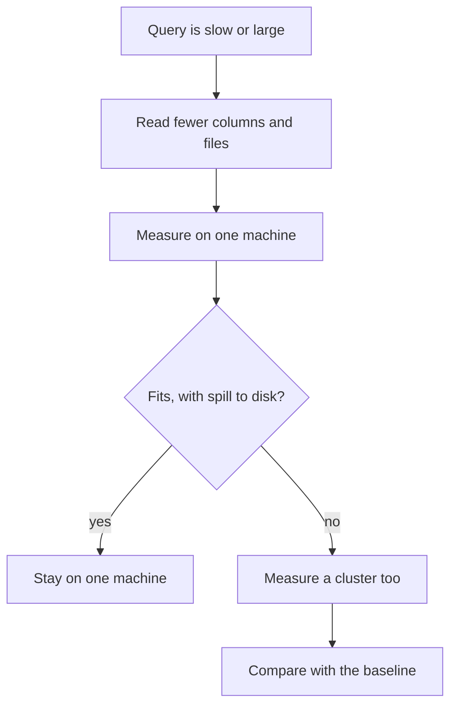

## A table of 200 GB

Ammar is a freelance developer. One of his clients is a delivery company with many vehicle sensors, and the client keeps a table of readings that is 200 GB on disk. The manager tells Ammar: "It is big data, so we need Spark." Ammar writes to Hala and asks whether he should agree.

Hala asks him two questions before she answers. What does the weekly report read from that table? Ammar looks: the report reads 3 of the table's 15 columns, which is 20 percent of the columns. And what has anyone measured? Nothing. The manager chose the tool from the size on disk.

This chapter gives Hala a way to answer. It starts with what a cluster is and what it costs. Then it looks at how far one machine can go. It ends with a short memo that turns a feeling into a decision. All the people and the delivery company are fictional.

<BigWordAlert term="Shuffle" plainEnglish="Moving data between machines so that rows with the same key end up together. It costs disk, network and time." whyItMatters="Moving data between machines is expensive. A job that needs many shuffles can spend more time moving data than reading it." />

## What a cluster adds

A cluster is several machines that work together on one job. Spark, a well-known engine, splits the work like this. A driver is the program that runs your code and coordinates the rest. A cluster manager hands out machines. Executors are the programs on those machines that run tasks and keep data. The driver sends tasks to the executors, and each task works on one partition of the data.

That sounds like a plain gain: more machines, more reading at the same time. The cost is in three places. Starting a cluster takes time before any reading happens. The machines must agree on who does what, which is coordination. And whenever a step needs rows with the same key to be together, such as a join or a group by key, the data must move between machines. That move is a shuffle. A shuffle costs disk reads and writes, turning data into bytes and back, and network transfer. In Spark, repartitioning, operations by key and joins can trigger one.

A fair question is whether the extra machines pay for these costs. In 2015, Frank McSherry, Michael Isard and Derek Murray asked exactly this in a paper called "Scalability! But at what COST?". They defined COST as the configuration that outperforms a single thread. They reported that many published distributed systems had a surprisingly large COST, often hundreds of cores, or did not beat one thread at all. The paper does not say that clusters are bad. It says that a cluster should be compared with a simple single-machine baseline, and that the comparison is often not made.

## How far one machine goes

Several things make one machine go further than the size on disk suggests. The first is column pruning, from chapter 5.2. A columnar file lets a query read only the columns it needs. Ammar's report needs 3 of 15 columns. If the columns are about equally wide, it needs about a fifth of the bytes, not all 200 GB. The second is partition pruning, from chapter 5.3. A query for one week skips the files of other weeks. The third is the engine itself. DuckDB can use disk when a query is too big for memory. Joins, group by, sorts and window functions can spill to disk, within the limits in its documentation. One operation, `string_agg`, cannot spill.

Memory needs care on a small laptop. DuckDB's memory limit defaults to 80 percent of the computer's memory, which leaves little for everything else on a machine with 4 GB. A limit of 2 GB is a safe teaching default. The value is a course choice, not a rule from the documentation.

PySpark can also run on one machine, in a mode called local. It needs Java 17, 21 or 25 and a download of about 450 MB, so this course reads about it and does not install it. These facts were checked in October 2026.

The honest summary is that a modern laptop with an efficient engine handles much larger data than people expect. A cluster is the right tool when the data or the work really does not fit one machine. No source gives a size above which you must use a cluster. If someone gives you a number of gigabytes as a rule, ask where it was measured.

Before you use the canvas, make a prediction with the numbers from Ammar's case.

```predict
prompt: "In the canvas's toy model, a table of 200 GB is read by a query that needs 20 percent of the columns. One machine reads 0.5 GB per second. A cluster of 4 machines needs 60 seconds to start and adds 2 seconds per machine. Which finishes first?"
options:
  - id: cluster
    label: "The cluster, because 4 machines read 4 times faster"
  - id: one-machine
    label: "One machine, because the query reads only 40 GB"
correctOptionId: one-machine
explanation: "The query needs 40 GB, so one machine takes 80 seconds. The cluster takes 60 seconds to start, 8 seconds of coordination and 20 seconds of reading, which is 88 seconds. The size on disk is not what the query reads, and the cluster pays for its start-up."
allowRetry: true
```

The canvas uses made-up speeds, so the exact numbers are not facts about any real machine. What matters is the shape: how the answer moves when you change each slider.

<InteractiveCanvas slug="one-machine-or-cluster" />

**What this shows:** a toy time model for one machine against a cluster. Skipping unneeded columns shrinks what the query must read, and the cluster adds a start-up time and a coordination time for each machine.

**Try this:** with the starting values, one machine takes 80 seconds and the cluster 88. Raise the share of columns read to 100 percent, so the query needs all 200 GB. Now one machine takes 400 seconds and the cluster 168. Then go back to 20 percent and raise the cluster from 4 to 16 machines.

**What changed:** the size on disk never moved. The bytes the query reads decided the winner, and past a point more machines made the cluster slower, because each added coordination time that the shorter reading did not repay.

**Limits of the model:** the speeds are made up, and the model gives no size at which a cluster is worth its cost. It ignores memory limits, joins that move data between machines and the cost of running a cluster. Measure your own query before you decide.

## Measure first, with a real plan

Here is a measurement that costs nothing and takes a minute. It builds a file of 1,000,000 synthetic readings with 10 columns, and asks DuckDB for the average of one column. `EXPLAIN ANALYZE` runs the query and reports what it really did.

```python
import duckdb

con = duckdb.connect()
con.execute("SET memory_limit = '2GB'")
con.execute("""
    COPY (
        SELECT i AS reading_id, i % 6 AS site, (i % 100) AS level, i * 2 AS c4, i * 3 AS c5,
               i * 4 AS c6, i * 5 AS c7, i * 6 AS c8, i * 7 AS c9, i * 8 AS c10
        FROM range(1000000) t(i)
    ) TO 'readings_demo.parquet' (FORMAT parquet)
""")
print(con.execute("EXPLAIN ANALYZE SELECT avg(level) FROM 'readings_demo.parquet'").fetchall()[0][1])
```

The file was about 32 MB. The setting `SET memory_limit = '2GB'` shows afterwards as 1.8 GiB, because 2 GB is a little less than 2 GiB. These lines are the important ones from the plan, with the timings left out because they change from run to run.

```text
Data Read:  83.7 kB
...
Table Scan
  Function: PARQUET_SCAN
  Projections: level
  Total Files Read: 1
  Row Groups Scanned: 9 / 9
  1,000,000 rows
```

Read it carefully. The scan lists only one projection, `level`, so only that column was read. The summary says about 83.7 kB of data was read from a file of about 32 MB. Your own number will differ, because this column holds repeated values, and real columns compress differently. The plan also shows that all 9 row groups were scanned and 1,000,000 rows came out. This is the mechanism behind the 20 percent in Ammar's case, now seen in a real plan.



What to notice: a cluster comes after three steps, not before them. The first step costs nothing, the second costs a few minutes, and only a measured failure on one machine leads to the last two boxes. Even then, the cluster is compared with the baseline, which is the COST question.

## The one-page memo

When a manager asks for a cluster, a short memo works better than an argument. Hala writes five lines. First, what the query reads: which columns, which dates, how many gigabytes. Second, what was measured on one machine: the time and the peak memory, on the real data or on a sample of it. Third, the deadline: how long the result may take, and how often it runs. Fourth, what a cluster would add: setup time, running cost and who looks after it. Fifth, the decision and the number that would change it. For Ammar's client, the memo said that the report reads about 40 GB, and that one machine finishes in the time the report needs. It said that the decision changes if the report starts to read all the columns, or if the deadline falls.

## Where people go wrong

The first mistake is to choose by the size on disk. A table of 200 GB that is read through 20 percent of its columns and one week of files is not a 200 GB problem. The second is to assume that more machines are always faster, as the canvas showed at 16 machines. The third is to measure once and to trust one number. Measure two or three times, and note the memory used, not only the time.

A fourth mistake is to copy a threshold. Someone writes "use Spark above a certain number of gigabytes" in a blog or an answer. Nobody measured your query on your machine. A fifth mistake is to forget that a cluster is also a system you run. It has versions, failures and a bill. A result that is slightly faster does not pay for a service that needs a person.

## The trade-off, and when to choose differently

One machine is simple, cheap and easy to debug. You can read the whole job in one place, and a laptop is enough to test it. Its limits are the disk, the memory, the time one program needs, and the number of people who can use it at once.

A cluster handles data that does not fit on one machine's disk, and work that splits into independent pieces. It costs start-up time, coordination, shuffles and the work of running it. Choose a cluster when you have measured that one machine cannot meet the deadline. Choose it when many people query at once, or when your team already runs one and the extra cost is small. Even then, the memo should show the baseline.

## Try it on your data

Run `EXPLAIN ANALYZE` on one of your Mizan queries on the Parquet files. Find the line for the scan and read which columns it projects and how many files and row groups it read. Then set `SET memory_limit = '2GB'` and run it again. Write the five lines of the memo for Mizan's weekly basket: what it reads, what you measured, the deadline, what a cluster would add and your decision. If you wrote "no cluster", say what number would change your mind.

## Check your understanding

```quiz
type: mcq
question: "Zaid's bakery chain keeps 400 GB of sales files. A report reads 10 percent of the columns, so 40 GB. In the canvas's toy rule, one machine reads 0.5 GB per second, and a cluster of 8 machines needs 60 seconds to start, adds 2 seconds per machine and reads 8 times faster. Which finishes first?"
options:
  - "The cluster, because the table is 400 GB and that is a large table"
  - "The cluster, because 8 machines read 8 times faster than one"
  - "One machine, which takes 80 seconds; the cluster takes 86 seconds"
  - "They tie, because both need to read the same 40 GB"
correct: 2
explanations:
  - "The size on disk is not what the query reads. The report needs 40 GB, and the toy rule counts only those bytes."
  - "Eight machines read faster, but the cluster also needs 60 seconds to start and 16 seconds of coordination. It reads 40 GB in 10 seconds, so its total is 86 seconds, not less than 80."
  - "Right. One machine reads 40 GB at 0.5 GB per second, which is 80 seconds. The cluster adds 60 seconds of start-up, 16 seconds of coordination and 10 seconds of reading, which is 86 seconds."
  - "Reading the same bytes does not make the times equal. The cluster reads faster but pays for start-up and coordination, and here those costs are larger than what it saves."
```

**Next:** A practice check on logs, offsets, delivery guarantees and scale, then the gate.
