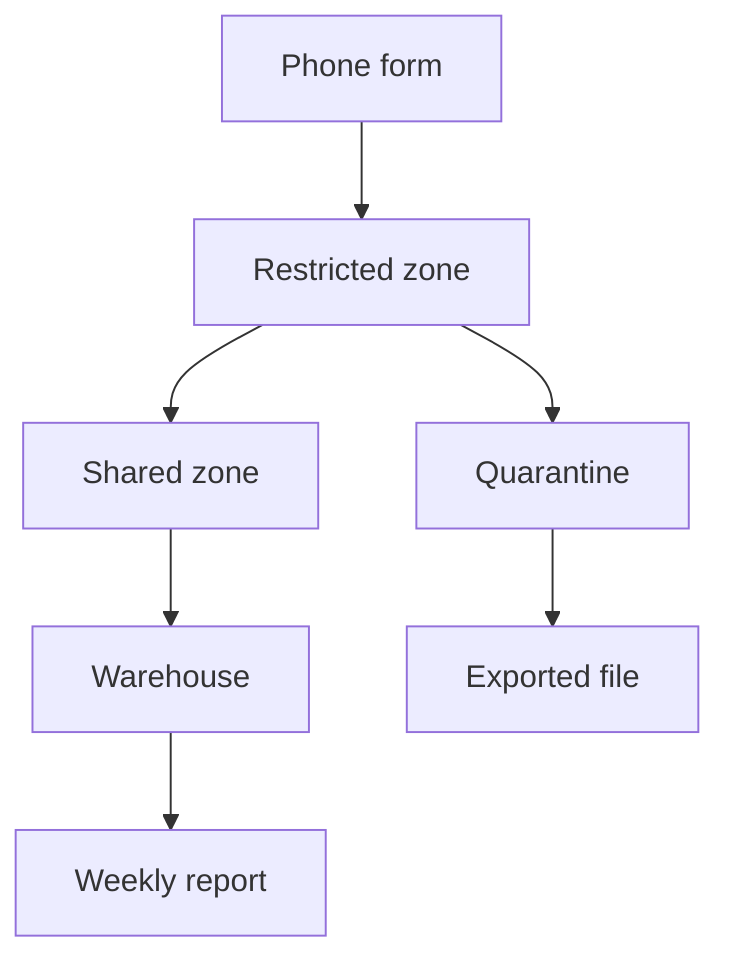

<BigWordAlert term="Data check" plainEnglish="A small automatic test that looks at the data itself on every run and raises an alarm when something looks wrong." whyItMatters="Tests on your code only prove that the code works. A data check tells a person when data stopped arriving, shrank or changed shape, before a reader acts on a wrong number." />

## A report that nobody doubted

On Monday 13 April, Omar opens the weekly basket report on his phone. Omar is the programme officer at Mizan, a small fictional NGO, and he is not technical. Every Friday he sends the report to two partner community kitchens, and they plan their food purchases from it. Mizan, its people and all its data in this module are fictional, and the data is synthetic.

This Monday something looks odd to him. The newest row for market M01 is still week 13. It shows a basket cost of 140.70 shekels, down 0.9 percent on the week before. That morning Yasmin, who coordinates the volunteers, tells him that the volunteer at M01 said flour got more expensive two weeks ago. The report says prices are easing. One of them is wrong, and Omar cannot tell which.

Omar writes to Hala, the junior data engineer who looks after the pipeline. She works part time and from home, and she plans her work around the hours when the power is on. She opens the run log and sees the problem in a minute. The last good run was on Monday 30 March. Since then the nightly job has failed 14 times, once every morning, with the same line: the upload folder for that day was not found.

Karam, the volunteer developer who built the phone form, had moved the upload folder in an update on 31 March. It was a sensible change. Nobody told Hala, and nothing in the pipeline told anyone that its input had gone. In the meantime the phone form kept uploading. About 100 lines a day had gathered in the new folder, roughly 1,400 lines in all, waiting for a pipeline that still read from the old place.

## Why nobody saw it

The page on the site stayed online. It was not wrong about the past. It was wrong about the present, and it did not say so. The tests from modules 7 and 8 did not help, because a test only runs when the pipeline reaches it, and the pipeline stopped at the first step. The runner did write `failed` in its log and finished with exit code 1. The scheduler showed that as a "last result" column that nobody opened.

So the pipeline was not silent. It reported the failure in a place where nobody read it. That is the first lesson of this module: a check is useful only if its result reaches a person who knows what to do with it. A red line in a log file that nobody reads is the same as no check at all.

Now imagine the same two weeks with one small check. It runs on its own schedule, so it still runs when the pipeline does not. On 1 April at 06:10, it compares the date of the newest landed upload, 29 March, with today's date. The upload is 3 days old and the limit is 2, so the check raises an alarm that Hala sees on her phone before she starts work. She asks Karam, learns about the moved folder and fixes the path the same morning. Omar's report is a few days late, not 14, and no kitchen plans its purchases from an old number. The check costs a few lines of code and a few seconds of run time. That trade is the reason this module exists.

## The second problem, in the same week

On Monday evening, after she fixes the folder path, Hala turns to another job. In March, 13 rows failed the data contract from chapter 8.5 and went to quarantine: 9 with a price of zero or below, and 4 with no item code. She wants the volunteers to correct them. She exports the quarantine files to one spreadsheet and drops it into the team's shared folder, so that Yasmin can ask the right volunteers.

On Wednesday, Yasmin opens the file and sees a column called volunteer_phone. Every one of the 13 rows has a volunteer's name and phone number in plain text. The folder is shared with the coordinators of the partner kitchens. She tells Hala within the hour, and Hala removes the file. The folder history shows that two coordinators had opened it. Nobody knows whether they saved a copy.

Nobody broke a rule on purpose. Chapter 6.2 set up zones, and one rule is that only pseudonymised data leaves the restricted zone. But quarantine keeps the full raw row, because that is the evidence needed to fix it, so it holds the same names and phones as the restricted zone. The export looked like a list of bad rows. It was a list of people.

That week Hala wrote one rule on a card above her desk: a file leaves the restricted zone only after the personal columns are removed, and when she is unsure she asks Yasmin first. A rule on a card is a start, but it depends on memory. Chapter 11.3 shows a safer design, where the pipeline itself makes the unsafe path hard to take.

## What the two problems have in common

Neither problem was a wrong query. The SQL was right and the code ran as written. In the first case, nobody was told when the data stopped. In the second, personal data left the place where it belongs. Both are about responsibility: to the readers who act on a number, and to the people whose data sits in the rows. The volunteers gave a phone number so that the form could work. Nobody had asked them about a spreadsheet for partner kitchens.

Here is the case as a picture. The long chain from the phone form to the weekly report is the path the data should take. The short branch from the restricted zone is the path of the exported file. Read it from top to bottom and look for the arrows that skip a step.



Notice two things. The report at the end has nothing watching it: if the arrows before it stop, it simply stays as it was. And the exported file has an arrow straight from quarantine, which skips the shared zone, the only place where names and phones are removed. Each of these arrows is a decision somebody made without noticing.

Before you read on, make a guess about the first problem.

```predict
prompt: "The pipeline's log recorded 'failed' on each of the 14 mornings, and the old report stayed online. What was missing?"
options:
  - id: alarm
    label: "An alarm that reaches a person"
  - id: tests
    label: "More tests on the numbers in the report"
correctOptionId: alarm
explanation: "The pipeline already knew it had failed. Tests on report numbers would not have run either, because the run stopped before it reached them. What was missing was a way to tell a person quickly, in a place they look, so that the failure is fixed in a day and not in two weeks. Chapter 11.2 shows how to build that."
allowRetry: true
```

## Why this matters for the job

Data engineers build and look after the systems that move data from where it is created to where people use it, and keep it correct on the way. The last part of that sentence is the hard part. Writing a pipeline that works on a good day is the first skill. Knowing on a bad day that something is wrong is the second skill. So is handling other people's data with care. Together they make a client or a team trust you with more.

In the postings we read in October 2026, testing or data-quality language appeared in 17 of the 25 we studied. This is a sample of public postings, not a census, but it matches what you will meet. A freelance client can accept a bug that is found and fixed in a day. A number that stays wrong for two weeks costs trust, and a phone number in the wrong folder costs more.

## What this module covers

The module has four jobs. First, notice when the data is wrong: checks for freshness, volume and schema, with thresholds that catch real problems without raising alarms on normal days. Second, protect the people in the rows: what to collect, how to replace a phone number with a code, why a plain hash is not enough, and how long to keep each kind of data. Third, keep the work safe to change: cost, owners and tests that run on every change. Fourth, build it: you add the checks, a retention job and an automatic test run to your own pipeline.

Chapter 11.3 teaches habits, using European and UK texts and a humanitarian handbook as its sources. At the end you write a short data protection note for Mizan, in your own words.

<LearningObjectives objectives={["Explain why a pipeline needs checks on the data itself, as well as tests on the code", "Add freshness, volume and schema checks with thresholds that catch real problems without raising alarms on normal days", "Explain why a hash of a phone number is not anonymous, and design a flow that keeps personal data in the right zone", "Say who owns each dataset, and run tests automatically on every change", "Write a short data protection note for a pipeline you built"]} />

## Key words

| Word | Plain English |
|---|---|
| **Alert** | A message that tells a person something needs attention |
| **Personal data** | Any information about a person who could be identified, such as a name or a phone number |
| **Retention** | How long a kind of data is kept before it is deleted |
| **Data owner** | The named person who answers for a dataset and what it promises |

## What is in this module

| Chapter | You will practise |
|---|---|
| 11.2 | Choosing freshness, volume and schema checks and their thresholds |
| 11.3 | Telling pseudonymised from anonymous data, and planning retention |
| 11.4 | Reducing scanned data, naming owners and running tests on every change |
| 11.5 | Building the checks, a retention job and an automatic test run |
| 11.6 | A graded check on scenarios, including an AI answer to check |
| 11.7 | Writing a data protection note for Mizan, or for the provided case |

**Next:** How to build checks that notice a stale or half-empty day, and how to set their thresholds so people still read the alarms.
