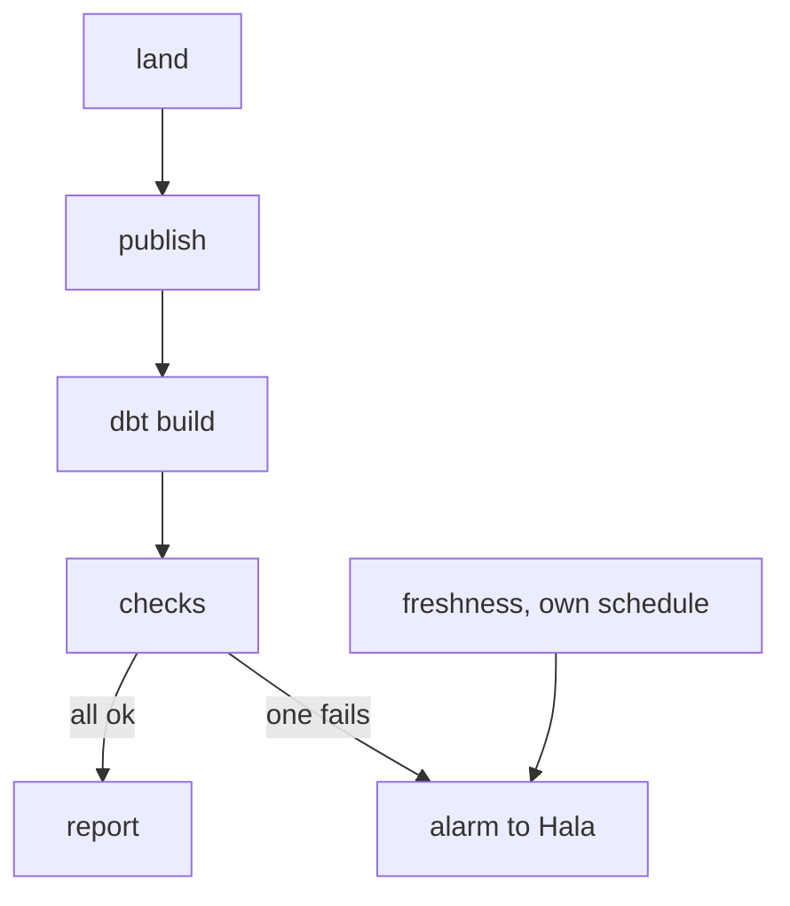

## The smallest check that would have helped

The Tuesday after the stale report, Hala asks herself one question. What is the smallest check that would have woken her on 1 April? The answer fits in one sentence: how old is the newest upload I have received? If it is more than two days old, tell a person. That one question would have saved Omar two weeks.

A check is different from a test. A dbt test from module 7 checks an assumption about tables that exist: the key is unique, the price is not empty. A data check looks at the data as it arrives and asks whether the arrival itself looks right. The difference matters because tests pass on tables with nothing new in them. A `unique` test on a table with no new rows passes, and so does `not_null`. Nothing is wrong with the rows that exist. The problem is the rows that are not there.

People call the habit of watching data this way <GlossaryTerm term="data observability" definition="Watching the health of your data over time, by monitoring how fresh it is, how many rows arrive, whether its shape changed and whether its values look normal." />. It is a practice, not a standard, and the useful version is plain. Watch four things, and ask one question about each.

| Check | The question it asks | A Mizan example |
|---|---|---|
| Freshness | Is the newest data recent enough? | The newest upload is from 29 March, and today is 1 April |
| Volume | Did enough rows arrive? | 37 rows when the 7 days before averaged 97.6 |
| Schema | Do the columns and types match the promise? | `price` arrives as text, not as a number |
| Distribution | Do the values look like they usually do? | The average flour price is 80 shekels, not about 8 |

The build in chapter 11.5 covers the first three. Distribution is an idea you can add later, with the same pattern: compute a number from today's batch and compare it with the recent past.

## How the three checks work

The freshness check reads the dates of the landed partitions in the restricted zone, takes the newest one, and counts the days from it to today. Mizan allows 2 days. It uses UTC dates, because chapter 5.5 showed why a computer's time zone must never decide a date. On 28 March it returns this: newest partition is 2026-03-28, 0 day(s) old, limit 2.

The volume check counts the rows received for one upload date. It counts the good rows and the quarantined rows together, because it asks whether the batch arrived, not whether every row was good. Bad rows have their own count. It then compares the day with the average of the up to 7 days before it. The alarm line is that average multiplied by 1 minus the <GlossaryTerm term="tolerance" definition="How far below its usual size a day may fall before the check raises an alarm, written as a share of the usual size." />. A tolerance of 0.5 means a day needs at least half of the usual rows.

Only a drop raises an alarm. On 12 March, 137 rows arrived against an average of 93.1, because the reports of M05 for 9 to 11 March arrived together after its connection came back. That is a catch-up, and the check correctly raises no alarm. If duplicates would show up as a spike in your source, add an upper line as well, and make it wider than the lower one.

The schema check opens the newest landed partition and compares its columns and types with the contract from chapter 8.5. A missing required field fails: the message says `price is missing`. A changed type fails: `price is VARCHAR, the contract says DOUBLE`. A new extra field is allowed, because adding a field is not a breaking change (chapter 8.4).

## Pick a tolerance, then test it

Before you read on, make a guess about the line a volume check should draw.

```predict
prompt: "The volume check uses a tolerance of 0%, so any day below the average of the 7 days before it raises an alarm. In the 14-day series on the canvas, one batch is missing on 24 March. How many alarms does the check raise?"
options:
  - id: more
    label: "More than one, including normal days"
  - id: one
    label: "One: only the day with the missing batch"
correctOptionId: more
explanation: "Normal days vary a little, and about half of them fall below their own average. With a tolerance of 0%, three normal days (16, 18 and 20 March) also raise an alarm, so there are four alarms for one real problem. The canvas lets you move the line until the false alarms disappear."
allowRetry: true
```

The canvas below holds 14 upload days of Mizan's data, 15 to 28 March, with one batch missing on 24 March. Move the tolerance and watch two numbers: whether the missing batch is caught, and how many normal days raise an alarm.

<InteractiveCanvas slug="volume-check-threshold" />

**What this shows:** the alarm line of a volume check on the day a batch went missing, and how many normal days fall below a line drawn at the same tolerance.

**Try this:** set the tolerance to 0%. Three normal days raise false alarms, as well as the real problem. Then set it to 10%: the false alarms disappear and the missing batch is still caught. Then set it to 65%: the line drops to 34.2 rows, below the 37 that arrived, so the problem passes.

**What changed:** a tighter tolerance moves the line up towards the average, so ordinary dips cross it. A looser tolerance moves the line down until a real loss sits above it.

**Limits of the model:** this is a simple illustration with one real problem in 14 days. It cannot tell you the best tolerance for another dataset, and it looks only at drops.

## A worked example, by hand

Take 24 March. The 7 days before it, 17 to 23 March, brought 99, 96, 97, 90, 105, 99 and 97 rows. They add up to 683, so the average is 97.57. With a tolerance of 0.5, the alarm line is 48.8. The first batch of the day never arrived, so only the 37 lines of the second batch were received. The 37 are below 48.8, and the check fails. This is the real output from the build, on the 28-day data with the first batch of 24 March deleted.

```text
CheckResult(name='volume', ok=False, value=37, threshold=48.8, message='37 rows on 2026-03-24; the 7 days before average 97.6, so at least 48.8 is expected')
```

Why an average of 7 days and not a fixed number such as "at least 90 rows"? A fixed number breaks when Mizan adds a market, and it breaks on a holiday. An average that moves with the data keeps working, and seven days cover one full week, so a weekly rhythm cancels out. If your source has a strong weekly pattern, compare a day with the same weekday of the earlier weeks instead.

The diagram shows where the checks sit in a run. Notice that the checks task comes after the dbt build and before the report, and that freshness has a second box of its own.



A failing check stops the report from being rebuilt, so readers see the last good page and not a bad new one. But that last page is old, and it does not say so. The alternative is to build the report anyway with a warning such as "data may be incomplete". Stopping is the safer choice when readers act on the numbers, as Omar's kitchens do. The second box exists because the checks task is skipped whenever an earlier task fails. A failed task is already an alarm. A job that never starts raises none, so freshness also runs on its own schedule.

An alarm still has to reach a person. In chapter 11.5 a failing check makes the run exit with 1 and writes a line in the log. Reaching you is a second small step: the failure notice of your scheduler, or one line of code that sends yourself a message, or a "data as of" date at the top of the report. Choose the one you will really see on your phone.

<RealWorldEvent title="Lost cases in a spreadsheet format" when="September to October 2020" summary="In England in 2020, test results were passed as text files into spreadsheet templates in an older format that held about 65,000 rows each. Once a template was full, further cases were left out. About 16,000 confirmed cases were missed from the daily figures between 25 September and 2 October, and they were added later." lesson="A format has limits, and a pipeline needs a row count between each stage, so a stage that drops rows is noticed on the same day." />

## Where people go wrong

<BigWordAlert term="Alert fatigue" plainEnglish="People stop reading alarms that go off too often, so the one real alarm is ignored with the others." whyItMatters="A check with a tolerance that is too tight teaches the team to ignore it. It then protects nobody on the day it matters." />

The first mistake is a tolerance that is too tight. On the canvas, a tolerance of 0% gives four alarms for one problem. After a week of that, nobody reads the fourth message. Pick the tolerance from your own history. The deepest normal dip in the 14 days was 20 March, with 90 rows against an average of 96.4, about 7 percent below it. A tolerance of 10 percent sits just above that dip.

The second mistake is a tolerance that is too loose. Mizan's build uses 0.5, and it catches the loss of the bigger batch. But a day is split roughly 60 and 40 between two batches. If only the smaller batch of 24 March were missing, 57 rows would arrive, which is above the line of 48.8, and the check would pass. A tolerance of 0.25 puts the line at 73.2, which catches both cases, and on these 14 days it raises no false alarm.

The third mistake is to check only the final table. Staleness and missing batches show up in the landed files first. The fourth is an alarm with no owner: it must go to a named person with a first step to take, as your runbook entry in chapter 9.6 does. The fifth is a check that nobody tested. The build tests each check by breaking the data on purpose, for example by deleting a batch file, and expects the check to fail.

Counting rows between stages shows the same idea in a simple form. At Mizan, the upload files hold 2,712 lines. Landing splits them into 2,699 good lines and 13 quarantined ones. Of the 2,699, 79 are repeated sends, which leaves 2,620 reports in the fact table. Every step can explain the difference, and if one day it cannot, you have found a problem before a reader did.

## The trade-off, and the alternative

Mizan's checks are Python functions that read files, so they can stop bad data before it is loaded. dbt has its own version for tables: source freshness compares a timestamp column with the clock, with a warning level and an error level. The dbt documentation advises running the check at least twice as often as the shortest promise you make about how fresh the data is. If you promise data no older than a day, check at least every 12 hours.

Choose dbt's version when the data already sits in warehouse tables and the team works in dbt. Choose file-level checks like these when you want to catch a problem before the load. Neither replaces the other, and a small team can run both.

## Try it on your own data

Run this in DuckDB from your project folder. It counts the lines in each upload day and shows the average of the 7 days before it, as the check does.

```sql
WITH daily AS (
  SELECT upload_date, count(*) AS rows_received
  FROM read_json('data/raw/uploads/*/*.jsonl', hive_partitioning = true, union_by_name = true)
  GROUP BY upload_date
)
SELECT upload_date, rows_received,
       round(avg(rows_received) OVER (ORDER BY upload_date ROWS BETWEEN 7 PRECEDING AND 1 PRECEDING), 1) AS average_7_days_before
FROM daily
ORDER BY upload_date;
```

On the 28-day data, 12 March shows 137 against 93.1, and 13 March shows 93 against 98.3. Find your quietest normal day and write down how far below its average it fell. That number is the least tolerance you can afford.

## Check your understanding

```quiz
type: mcq
question: "Hatem's solar shop receives battery readings every day. The 7 days before today brought 288, 288, 284, 288, 290, 288 and 286 rows (average 287.4). On a dust-storm day, rows normally fall to about 250. Today the logger restarted halfway and only 144 rows arrived. Which tolerance raises an alarm today but not on a dust-storm day?"
options:
  - "0%, a line of 287 rows"
  - "5%, a line of 273 rows"
  - "25%, a line of 216 rows"
  - "60%, a line of 115 rows"
correct: 2
explanations:
  - "A line of 287 rows would also alarm on every dust-storm day (250), and on the 284 and 286 days. It raises false alarms on normal days."
  - "A line of 273 rows alarms today, but also on a dust-storm day at 250. That is a false alarm on a normal day."
  - "Right. The line of 216 is above today's 144, so the alarm fires, and below the dust-storm 250 and the ordinary 284 to 290, so those days pass."
  - "A line of 115 rows is below today's 144, so the half-empty day passes and the problem goes unnoticed."
```

```quiz
type: mcq
question: "Rasha's bakery sends a sales file every day. Today it arrived at 06:00 as usual. It has 311 rows, and 300 to 320 is normal. The columns and types are the same as always. But the average sale is 1,850, while it is normally about 18.5, because the till began to send prices in cents. Which check catches it?"
options:
  - "A freshness check on the arrival time"
  - "A volume check on the row count"
  - "A schema check on columns and types"
  - "A distribution check on the values"
correct: 3
explanations:
  - "The file arrived at 06:00 as usual, so the freshness check passes."
  - "311 rows is inside the normal 300 to 320, so the volume check passes."
  - "The columns and types are the same as always, so the schema check passes. Cents and shekels are both numbers."
  - "Right. Only a check on the values themselves, such as the average sale, can see that every number is 100 times too large."
```

**Next:** Personal data: what to collect, why a hash of a phone number is not anonymous, and how long to keep each kind of data.
