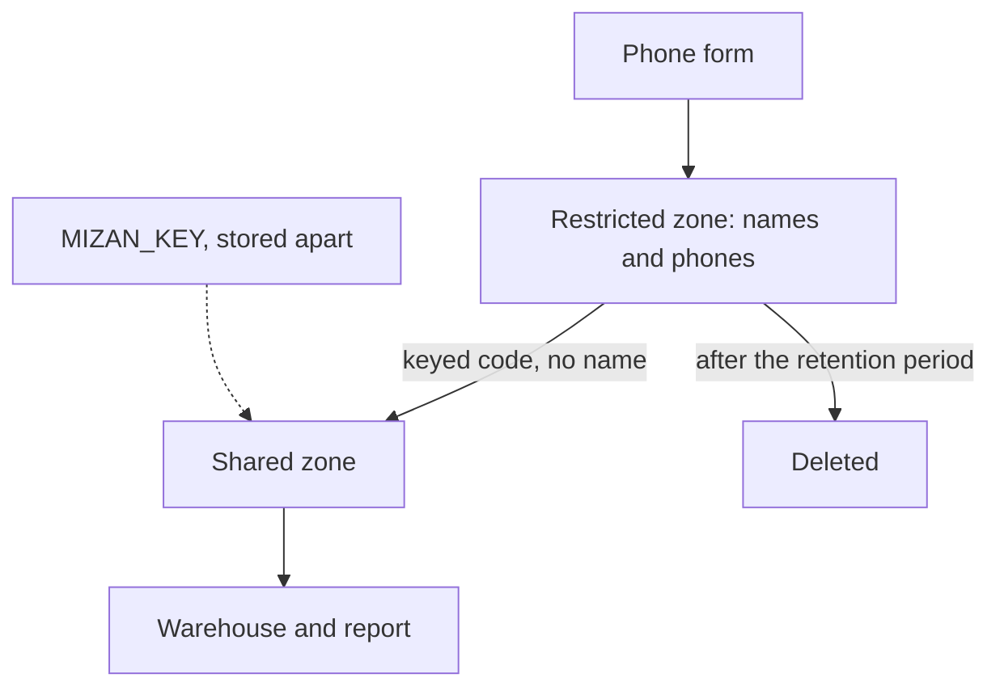

## Who can see a volunteer's phone number?

After the file in the shared folder, Yasmin asks Hala a plain question. Which parts of the pipeline can see a volunteer's phone number, and why do they need to? Hala opens the raw upload files. Every one of the 2,712 lines holds a volunteer's name and phone number next to a price. She counts the places those lines travel to: the upload folder, the restricted zone, quarantine, and a copy on her laptop. She cannot say why most of them need a phone number at all.

That question is the start of this chapter. A pipeline moves data, and whatever sits in a row travels with it, unless someone decides otherwise. The decision is a design choice, and it belongs to the person who builds the pipeline. Three questions help you make it: what do we collect, what is it for, and how long do we keep it?

## Three questions before any code

The ICRC Handbook on Data Protection in Humanitarian Action, third edition, 2024, sets out basic principles for people who handle data about others in difficult settings. Four of them matter for a pipeline. Purpose limitation means you state a specific, legitimate purpose when you collect data, and you reuse it only for a compatible one. Data quality means you correct inaccurate data, because a wrong row can cause harm, such as wrongly leaving a family out of aid. Retention, from the key words of chapter 11.1, is applied one kind of data at a time: each kind gets its own period, after which all copies are deleted. And minimisation is the one to start with.

<BigWordAlert term="Data minimisation" plainEnglish="Use the least personal data you need for the stated purpose, and delete it when you no longer need it." whyItMatters="Data you never collect cannot leak, and data you have already deleted cannot be found in a shared folder." />

Rules differ from country to country, and real cases are decided by local law and a data protection adviser. This course uses European and UK texts and the humanitarian handbook to teach engineering habits. It is not legal advice, and it will not tell you what the law requires where you live.

Apply the questions to Mizan. The purpose is a weekly report on food prices. The report needs the market, the item, the day and the price. It does not need a volunteer's name or phone number. The phone number has one use in the pipeline: it becomes a code, so Mizan can tell volunteers apart. But `volunteer_id` already does that. The strongest form of minimisation would be to ask Karam to stop sending names and phone numbers with every price report. The course keeps them so that you can practise protecting them, but in a real project, this is the first question to ask.

## Pseudonymised is not anonymous

Chapter 6.2 introduced pseudonymisation. Now we can be exact about it, with two texts. Article 4(5) of the <GlossaryTerm term="GDPR" definition="The data protection law of the European Union." /> defines pseudonymisation. The data is processed so that it cannot be attributed to a person without additional information. That extra information must be kept separately, under technical and organisational measures. Recital 26 adds that pseudonymised data is still information about an identifiable person. It says identifiability is judged by all the means reasonably likely to be used, with objective factors such as cost, time and available technology. Only anonymous information falls outside the data protection principles. The UK regulator says the same in other words: pseudonymised data stays personal data for anyone who holds the extra information.

In plain words: replacing a name with a code is pseudonymisation. It lowers the risk, but the data is still about a person. Anonymous means the person can no longer be identified by any means reasonably likely to be used. Mizan's shared zone is pseudonymised, not anonymous. It still holds `volunteer_id`, and at M05 one volunteer sends every report, so a market and a date already point to one person. That is reasoning from Mizan's data, not a legal test. Removing the name column did not remove the link.

## Why a hash of a phone number is not enough

A hash is a one-way scramble. Many people think that makes a hashed phone number anonymous. But phone numbers come from a small set, so an attacker can hash every possible number and compare the results with the codes. The UK regulator advises against unsalted hashing, and against old methods such as MD5 and SHA-1, which are open to this kind of brute force. In a researcher's test, SHA-256 of 10 million synthetic eight-digit phone-style numbers took 11.3 seconds in plain Python on one core. Mizan's numbers have a known prefix and 7 unknown digits. Before you read on, make a guess about how long it takes to try all of them.

```predict
prompt: "An attacker has a plain SHA-256 hash of each volunteer's phone number. Each number is a known prefix plus 7 unknown digits. Using the test rate of 10 million hashes in 11.3 seconds, how long does it take to try every number?"
options:
  - id: slow
    label: "More than a day on a laptop"
  - id: fast
    label: "Under a minute on a laptop"
correctOptionId: fast
explanation: "7 unknown digits make 10,000,000 possible numbers. At the test rate that takes about 11.3 seconds, so every volunteer's number can be recovered from a plain hash in less than a minute. Length helps only a little: each extra digit multiplies the time by ten."
allowRetry: true
```

The canvas shows the same arithmetic. Change the number of unknown digits, then add a secret key.

<InteractiveCanvas slug="hash-is-not-anonymous" />

**What this shows:** how many guesses an attacker needs for a phone number with some unknown digits, how long that takes at the test rate, and what a secret key changes.

**Try this:** leave 7 unknown digits and no key. All 10,000,000 numbers take 11.3 seconds. Raise the digits to 9: 100 times as many numbers and 18 min 50 s. Then switch the secret key on.

**What changed:** more digits make the attack slower but never impossible. The key removes the attack, because an attacker without the key cannot compute a code to compare with.

**Limits of the model:** it is a simple illustration. The rate comes from one test on one laptop core, and a faster computer or a special program would be quicker. It also assumes a leaked key does not exist.

## A key that stays apart

Mizan's code is a keyed hash, called an HMAC: the phone number is scrambled together with a secret key. The code is the first 16 characters of the result. Without the key, an attacker cannot compute the code of any guess, so the loop from the canvas has nothing to compare with. The key sits in the `MIZAN_KEY` environment variable. It is never written to a file in the project, and a test in chapter 6.5 scans the lake, the state folder and the logs to prove it. A key stored next to the data protects nothing, because whoever steals the data steals the key. If the key leaks, change it and rebuild every code.

A keyed code has one more limit, and Mizan met it. The code is made from the phone number. When volunteer V07 changed phone on 15 March, V07 got a new code.

```sql
SELECT volunteer_id, count(DISTINCT volunteer_key) AS codes
FROM read_parquet('lake/shared/reports/*/*.parquet', hive_partitioning = true, union_by_name = true)
GROUP BY volunteer_id
HAVING codes > 1;
```

On the 28-day data this returns one row: V07, 2 codes. A pseudonym built from an attribute that changes splits one person into two. Mizan is safe only because `volunteer_id` stays in the shared zone. A design that relied on the code alone would count V07 twice.

The diagram shows a flow that keeps personal data where it belongs. Notice that names and phones exist only in the first box, the key is stored apart, and a deletion step ends the life of the restricted copy.



## Retention: delete on time, delete every copy

Retention is a rule per kind of data. In the build, restricted partitions and quarantine partitions are kept for 30 days by default. That number is a teaching choice, not a legal one: choose a period you can explain from the purpose. Quarantine is on the list because it holds full raw rows, with names and phones. The shared, pseudonymised data stays, because the report needs history. It is still personal data, so give it a period too, for example the years the report must cover.

The handbook says to delete all copies and to ask third parties to delete theirs. That is harder than it sounds. The retention job deletes the folders in the lake. It does not delete the raw upload files on your disk, a spreadsheet someone exported, a backup, or the copy on a partner's laptop. Write the list of places data can be, and give each one an owner and a date. Seeds in a dbt project are a place too, and the dbt documentation says seeds are not meant for sensitive data. Do not put a phone number in a seed, because seed files sit in the project folder and are usually committed to git.

## Where people go wrong

The first mistake is to say "I hashed it, so it is anonymous". The second is to drop the name column and believe the person is gone. The third is to keep the key beside the data, for convenience. The fourth is to keep everything "just in case", which turns every old file into a risk. The fifth is to export from the restricted zone for a quick job, as in chapter 11.1. Each of these saves a few minutes and creates a risk that outlives the task.

## The trade-off, and the alternative

An HMAC needs no table: the same phone always gives the same code, and there is nothing to store except the key. Its weakness is the one V07 showed. The alternative is <GlossaryTerm term="tokenisation" definition="Replacing a value with a random token that has no mathematical link to the original, and keeping a mapping table, stored separately, from tokens back to values." />. A random token cannot be reversed by guessing. You can also give a person the same token after their phone changes, if your registry says it is the same person. The price is a mapping table, and that table becomes the thing you must protect most. Choose tokens when identifiers change and you need continuity. Choose an HMAC when you want no table to guard. If you do not need the personal field at all, drop it at the start of the pipeline.

## Try it on your own data

List the columns of your restricted and shared files and compare them.

```sql
DESCRIBE SELECT * FROM read_parquet('lake/restricted/reports/*/*.parquet', hive_partitioning = true, union_by_name = true);
DESCRIBE SELECT * FROM read_parquet('lake/shared/reports/*/*.parquet', hive_partitioning = true, union_by_name = true);
```

The restricted list has `volunteer_name` and `volunteer_phone`. The shared list has `volunteer_key` instead, and no name or phone. Now write a small table for your project with one row per personal column: why you need it, who can read it, and how long you keep it. If you cannot fill the first cell, that column is a candidate for removal.

## Check your understanding

```quiz
type: mcq
question: "Khalil's clinic replaces each patient's 9-digit ID number with its plain SHA-256 hash and shares the file with a researcher. There is no secret key. On one laptop core, 10 million hashes take about 11.3 seconds. What does that arithmetic say about the file?"
options:
  - "About 19 minutes to try every ID, so they can be recovered"
  - "About 19 days to try every ID, so sharing is reasonably safe"
  - "About 19 minutes, but a hash is one-way, so IDs stay hidden"
  - "About 11 seconds to try every ID, so a key adds little"
correct: 0
explanations:
  - "Right. A 9-digit ID has 1,000,000,000 possible values, which is 100 times 10 million. 100 times 11.3 seconds is 1,130 seconds, about 19 minutes. With no key, the file is pseudonymised at best."
  - "The arithmetic gives minutes, not days: 1,130 seconds is about 19 minutes."
  - "One-way describes the scramble, not the attack. The attacker hashes each possible ID and compares, and never needs to run the hash backwards."
  - "11 seconds is the time for 10 million numbers. A 9-digit ID has 100 times as many, and a secret key would remove the attack altogether."
```

```quiz
type: mcq
question: "Doaa's delivery app keeps customer phone numbers for 30 days. A job deleted the lake partitions older than 30 days. But a driver's laptop still holds an export of the same period, and a backup disk holds a copy of the whole lake. What is the position after 30 days?"
options:
  - "The rule is met, because the job reported every old partition as deleted"
  - "The rule is not met until the export and the backup copy are deleted too"
  - "The rule is met, because exports and backups are not part of the lake"
  - "The rule is met if the backup disk is locked away so nobody can read it"
correct: 1
explanations:
  - "The job only reports on the folders it was pointed at. The export and the backup still hold the numbers."
  - "Right. Retention means every copy is deleted, including exports and backups, and a partner's copy has to be requested too."
  - "A copy is a copy wherever it sits. The rule covers all copies of the data, not only the ones in the pipeline."
  - "Locking a disk limits who can read it, but the numbers are still kept past the period. Deletion means the data is gone."
```

**Next:** Cost, governance and CI: how to cut the data a query reads, how to name an owner for each dataset, and how to run your tests automatically on every change.
