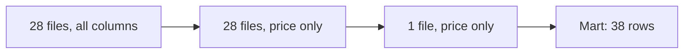

## A bill that doubled

Yahya runs an online shop and is one of Hala's freelance clients. He pays for a cloud warehouse that charges by the data a query scans. After a new sales dashboard went live, his monthly bill doubled. Hala opens the dashboard's query. It shows this week's revenue, and it reads every column of an orders table that holds 36 months of data in one block. Thirty-six months is about 156 weeks, and the dashboard needs one of them.

The same habit matters on a small laptop. Think of a home where the power is on for a few hours a day. A query that reads 28 files to answer a question about one day wastes your hours, not only your money. Cost, in this chapter, means the data a query has to read. Two more topics follow, because a cheap pipeline that nobody owns or tests is still a risk: who answers for each dataset, and how every change gets checked before it reaches the report.

## Read less: columns, partitions and summaries

A managed warehouse's documentation says that partitioning can reduce cost by reducing the bytes a query reads, and that this pruning applies when a filter uses the partition column. DuckDB shows the same idea on your own laptop. Ask for the plan of a query on Mizan's shared zone, which chapters 3.4 and 5.3 partitioned by upload date.

```sql
EXPLAIN SELECT avg(price)
FROM read_parquet('lake/shared/reports/*/*.parquet', hive_partitioning = true, union_by_name = true)
WHERE upload_date = DATE '2026-03-05';
```

These are the lines of the plan that matter, copied from the output on the 28-day data.

```text
Function: READ_PARQUET
Projections: price
File Filters: upload_date = '2026-03-05'::DATE
Scanning Files: 1/28
```

Two lines show the saving. `Projections: price` says the engine reads one column, because the file format stores columns apart (chapter 5.2). `Scanning Files: 1/28` says it opens one file of 28, because the filter is on the partition column. A query with `SELECT *` and no filter would read everything.

Try the plan again without the `WHERE` line. The `File Filters` and `Scanning Files` lines disappear, because nothing limits the files. Filter on `market_code` instead and the plan shows `Filters: market_code = 'M05'` inside the scan. That filter works on rows, but the plan has no `Scanning Files` line, so the engine did not reduce the files by name. Only a filter on the partition column does that.

There is a third lever, which is to summarise once and read the summary. The weekly mart has 38 rows, and the fact table behind it has 2,620. The report reads the 38. The diagram shows the three levers stacked, from the widest read to the narrowest.



Notice that each step keeps the answer the same and shrinks what is read. The first step picks columns, the second filters on the partition, and the third reads a summary that was built once. Only the second step needs the right partition key, and a partition that is too fine creates many small files, as chapter 5.3 showed. Measure on your own data before you trust any rule.

## Who answers for the data?

Governance sounds large, but for a small team it starts with one sentence: write down who owns each dataset and what it promises, then test the promise. The Open Data Contract Standard, from the Bitol project, has sections for schema, data quality, team, roles, the service-level agreement and support. A service-level agreement is a promise about the data, such as "never older than a day". Mizan's contract from chapter 8.5 is a much shorter file in the same spirit, with an owner and a list of consumers.

| Dataset | Owner | Who may read it | Kept for |
|---|---|---|---|
| Raw uploads | Karam's form, copied by Hala | Hala only | 30 days |
| Restricted zone | Hala | Hala only | 30 days |
| Quarantine | Hala | Hala only | 30 days |
| Shared zone | Hala | Hala and the report job | History for the report |
| Weekly mart and report | Omar for the meaning, Hala for the build | Omar and the partner kitchens | Current weeks |

Two more words help here. Lineage means a record of which job produced which dataset. The OpenLineage project defines an open way to record it. For dbt models you already have a simple version: `dbt docs generate` builds a documentation site from your project, including the graph of which model depends on which, and it works without an internet connection. A catalogue, a place where people find datasets and read about them, can be as small as that site plus the contract files in git. Anything larger is a choice for a bigger team.

## Change it safely

Every change should be saved in git and checked by an automatic run on a small sample of data before it is accepted. That run has a name.

<BigWordAlert term="Continuous integration (CI)" plainEnglish="An automatic run on a clean machine, started by every change to the code, that installs the project, builds a small sample and runs the tests." whyItMatters="It catches a change that works only on one person's laptop, and it keeps a broken change away from the version everyone uses." />

The dbt documentation recommends running unit tests in development and in CI, not in production. Mizan's CI file, which you write in chapter 11.5, does six things in order. It installs the pinned packages and checks the setup. It makes 10 days of sample data with a fixed seed: 933 distinct reports in 961 lines. It runs the pipeline for those days, runs the fast tests and then runs `dbt build`. A clean copy of the project finishes the pipeline step in a little over a minute, and `dbt build` ends with 39 of 39 nodes passing. In October 2026, a hosted CI service was free for public repositories on standard runners. Its free plan included 2,000 minutes a month for private ones. Check the current terms before you rely on that.

Before you read on, make a guess about one change.

```predict
prompt: "Hala renames the column price to price_ils in the staging model stg_price_reports and opens a pull request. The staging.yml file still has a not_null test on price. Is the CI run green or red?"
options:
  - id: green
    label: "Green: the model still builds and runs"
  - id: red
    label: "Red: a test still names price"
correctOptionId: red
explanation: "The model itself builds. But the not_null test on price refers to a column that no longer exists, so dbt reports an error on that test and skips the 15 nodes that depend on it. The run exits with 1, and the pull request is marked as failed."
allowRetry: true
```

The canvas follows that pull request step by step, from the branch to the merge.

<InteractiveCanvas slug="ci-blocks-bad-change" />

**What this shows:** a change goes through the same steps on a clean machine every time, and the first failing step stops the run, so a bad change cannot reach the main version.

**Try this:** at step 5, read the numbers: 23 passed, 1 error and 15 skipped. Then find the point where main is protected, and what Hala changes to get the green run.

**What changed:** the failure shows up on a branch, not in Omar's report. Skipped nodes are not failures of their own. They are nodes that could not run because the one before them failed.

**Limits of the model:** this is one change on 10 days of synthetic data. Real services add queues, caches and their own settings for required checks.

## Where people go wrong

On cost, there are three common mistakes. One is `SELECT *` on a wide table. Another is a filter on a column that is not the partition column. The third is a partition key so fine that every file is tiny. On ownership, the mistake is an owner that is a team name or an address nobody reads. Name a person, and write the date you last checked the table. On documentation, a page written by hand is out of date within weeks, so generate it from the code.

On CI, the largest mistake is to read green as correct. CI runs the tests you wrote and nothing else. A change that divides every price by 100 by mistake passes `not_null`, `unique` and a positive-price test, and the report is wrong. Two more mistakes matter for responsibility. Real personal data should not go into CI, because logs and caches are not made to protect it, so the sample is synthetic. And a secret must never sit in the workflow file. Mizan's file sets a made-up key, `ci-test-key-not-a-secret`, and a real key would live in the CI service's store for secrets. Last, CI protects main only if the check is required before a merge.

## The trade-off, and the alternative

Hosted CI needs a repository on a hosting service and some internet. The alternative is a local script, such as `scripts/check_all`, that runs the same commands on your laptop before you commit. It costs nothing and works offline. But it runs on your machine, so it cannot catch a package that only your laptop has. Nobody else can check that you ran it either. Many people use both: the script for speed, CI for the record. If your repository is private and the free minutes run out, run CI only on pull requests, not on every push.

## Try it on your own data

Add an owners table like the one above to your README, with a real person's name in each row. Then run `EXPLAIN` on the query behind your report and find the two lines `Projections` and `Scanning Files`. If the second shows all the files, ask whether the query filters on the partition column. Finally, from the `transform` folder, run `dbt docs generate --profiles-dir .` and find the graph of your models.

## Check your understanding

```quiz
type: mcq
question: "Yahya's orders table has 20 columns, all about the same size, and 36 months of data (about 156 weeks) in one block. His dashboard query reads every column and sums two of them for the latest week. The warehouse charges by data scanned. He can make one change. Which change reads less?"
options:
  - "Partition by order date, then filter to the latest week"
  - "Select only the 2 columns that the dashboard sums"
  - "Add LIMIT 10 so the query stops after 10 rows"
  - "Run the dashboard query at night, when fewer people are online"
correct: 0
explanations:
  - "Right. One week of 156 is under 1 percent of the rows. Picking 2 columns of 20 reads about 10 percent. Both help, but the partition filter helps more, and it can be added to the column choice later."
  - "This helps, since it reads 2 columns of 20, about 10 percent of the data. But filtering to one week of 156 reads under 1 percent, so it reduces more."
  - "A sum needs every row before it can answer, so LIMIT 10 would not stop the scan. It would also give the wrong answer."
  - "The time of day does not change how much data a query reads, so a night run is billed the same."
```

```quiz
type: mcq
question: "Mais's team has CI that runs pytest and dbt build on a 10-day sample. A change divides every price by 100 by mistake. All checks stay green: the tests are unique keys, no empty prices and price above 0. The report now shows prices 100 times too low. What does this show?"
options:
  - "CI is broken and a manual review should replace it"
  - "CI should run on all the production data instead"
  - "CI runs only the tests written, so add a price range test"
  - "The dbt build step is not needed in CI, since it already passed"
correct: 2
explanations:
  - "CI did its job: it ran every test and all of them passed. The gap is in the tests, not in the idea of CI, and a manual review has the same gap."
  - "The sample has the same fault. Running on production data would also put real personal data into a CI system. The missing piece is a test, not more data."
  - "Right. A passing run means the assumptions you wrote still hold. A test on a plausible price range would fail on prices 100 times too low."
  - "Leaving out a step removes a layer of protection. The step passed because no test describes this fault."
```

**Next:** Build: you add freshness, volume and schema checks, a retention job that deletes old personal data, and a CI workflow to your own pipeline.
