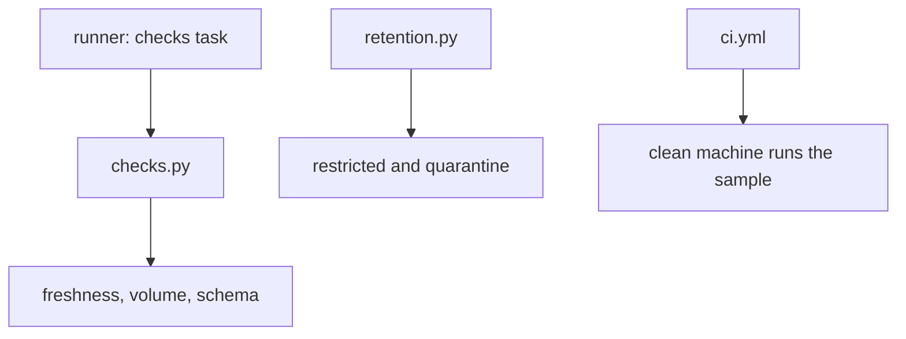

## What you will have at the end

Today your pipeline does what you told it, and nothing more. It cannot tell you when an upload is missing or half empty. Names and phone numbers stay in the restricted zone and in quarantine for ever. And when someone changes the code, nothing runs your tests until somebody remembers to. Chapter 11.1 showed what that costs: a report that was out of date for two weeks, and a file with phone numbers in the wrong folder.

At the end of this chapter, three things are in your `mizan-prices` repository. `pipeline/checks.py` has a freshness, a volume and a schema check, and your runner's checks task uses them. `pipeline/retention.py` deletes restricted and quarantine partitions that are older than a period you choose, and it can show what it would delete before it does. `.github/workflows/ci.yml` runs the pipeline and the tests on 10 days of sample data every time someone pushes a change. A new test file, `tests/test_checks_retention.py`, proves all of it, with 17 tests.

**What you need.** Your laptop, Python 3.11 or later, and the virtual environment from chapter 1.4, which must live at a short path such as `C:\de\venv`. The versions are the pinned ones: DuckDB 2.0.0, dbt-core 1.12.6, dbt-duckdb 1.11.0 and pytest 9.1.1, checked in October 2026. Nothing new to install. The 28-day data and the lake from earlier chapters must exist. If your `lake` folder is missing, run `python -m pipeline.land --all` and `python -m pipeline.pseudonymise --all` first. Plan about two hours: the checks take most of the time, and the CI file you copy as it is.

## Where the repository is now

The new code leans on pieces you already wrote. From chapter 5.5 you have `land_uploads(date)` and `all_upload_dates()` in `pipeline/land.py`, and the paths in `pipeline/paths.py`. From chapter 6.5 you have `publish_reports(date)`. From chapter 8.5 you have `pipeline/contract.py`, which loads `contracts/price_reports.yml` with `load()`, and a quarantine zone. From chapter 9.4 you have the runner. From chapter 2.5 you have the `project` fixture in `tests/conftest.py`, which copies your code into a temporary folder and sets a fake `MIZAN_KEY`.

The runner already has a checks task, and its job has four parts. It imports `pipeline.checks` only when it runs. It calls `run_all(run_date)` and writes one log line per check. When any check fails, it raises one error that joins the failing messages with a semicolon. This chapter writes the module it was waiting for. If your runner differs, change `task_checks(run_date)` to do the same. The `pytest.ini` file from earlier chapters also matters here. It registers the `slow` marker, so CI can skip the tests that run dbt many times.

```text
[pytest]
testpaths = tests
markers =
    slow: runs dbt many times (a minute or more). Skip with: pytest -m "not slow"
```

## Three design decisions

The first decision is what a check returns. Each check returns a small `CheckResult` object with a name, a yes or no, the number it measured, the limit it used and one plain sentence. It does not raise an error by itself. The alternative is to raise on the first failure, which is shorter to write. But then a run with a stale upload and a missing column would report only one problem, and tests would have to catch exceptions. Returning results lets the runner log all three checks and then decide.

The second decision is how retention deletes. It removes whole partition folders by upload date. The alternative is to delete individual people's rows, which you need when someone asks you to erase their data. That means rewriting files, and it is a larger job that this course leaves out. Be honest about this limit in your README.

The third decision is a dry run. A retention job deletes data that nobody can bring back, unless the source files still exist. So the job has a `--dry-run` flag that only lists what it would delete. Run it first, every time.

## What you are adding

The diagram shows three separate pieces. The checks are called by the runner after the dbt build. The retention job is a command you run on its own schedule, and it touches only the two zones that hold names and phones. The workflow belongs to the repository and runs on a machine that is not yours.



Notice that nothing in this chapter touches `lake/shared`. The pseudonymised data stays, because the report needs its history. Also notice that the checks and the retention job both take the date as an argument. That makes them easy to test, because a test can pretend that today is any day it likes.

## The task

1. Run `pytest -q -m "not slow"` in your project. Everything from earlier chapters should pass before you add anything. It takes about a minute.
2. Create `tests/test_checks_retention.py` from the four code blocks in the next section. Run it. All 17 tests fail with an import error. That is the right starting point.
3. Write `pipeline/checks.py` to the interface below. Make the volume tests pass first, then freshness, then schema, then the test of the runner task.
4. Write `pipeline/retention.py` to its interface. Make the retention tests pass, then try the dry run on your own lake.
5. Create `.github/workflows/ci.yml` with the text given below, and run the workflow test.
6. Run all three checks on your 28-day lake and read the messages.
7. Break the data on purpose and watch the volume check fail.
8. Run the CI steps by hand in a clean copy of your repository.

## The interfaces

These are the signatures and the rules. Use these exact names, because the tests and the runner call them.

```python
# pipeline/checks.py
from dataclasses import dataclass

@dataclass
class CheckResult:
    name: str          # "freshness", "volume" or "schema"
    ok: bool
    value: object      # what was measured: days old, rows received, number of problems
    threshold: object  # the limit it was compared with
    message: str       # one plain sentence a person can act on

def landed_dates() -> list[str]:
    """Upload dates that have a partition in lake/restricted/reports, oldest first, as 'YYYY-MM-DD'."""

def landed_rows(upload_date: str) -> int:
    """Rows received on one upload date: the good rows (restricted) plus the quarantined rows."""

def check_freshness(max_age_days: int, today: str | None = None) -> CheckResult:
    """Fail when the newest landed partition is more than max_age_days old, or when nothing has landed.
    today is 'YYYY-MM-DD' (default: today's date in UTC)."""

def check_volume(upload_date: str, tolerance: float = 0.5) -> CheckResult:
    """Compare the rows received on upload_date with the average of the landed days in the 7 days before it.
    Fail when the day is below average x (1 - tolerance). Only a drop fails.
    With no earlier days to compare with, pass. A day that never landed has 0 rows."""

def check_schema() -> CheckResult:
    """Compare the newest landed partition with the contract: every required field present
    with the type the contract promises. Fields the contract does not list are allowed."""

def run_all(run_date: str) -> list[CheckResult]:
    """freshness (limit 2 days, counted from run_date), volume for run_date, and schema, in that order."""
```

```python
# pipeline/retention.py
from pathlib import Path

def expired_partitions(as_of: str, keep_days: int = 30) -> list[Path]:
    """Partition folders under lake/restricted and lake/quarantine whose upload date is before
    (as_of minus keep_days). Never lake/shared."""

def apply_retention(as_of: str, keep_days: int = 30, dry_run: bool = False) -> list[Path]:
    """Delete the expired folders unless dry_run is true. Return the folders deleted, or that would be."""

# Command line:  python -m pipeline.retention --keep-days 14 --as-of 2026-03-28 --dry-run
# Prints "would delete <folder>" (or "deleted <folder>") for each folder, then one summary line.
```

The tests read the messages, so a few words are part of the interface. A freshness message contains `day(s) old`. A volume message contains `at least` when it compares, and `no earlier days` when there is nothing to compare with. A schema message contains `matches contract` when all is well. When something is wrong it says `price is missing`, or `price is VARCHAR, the contract says DOUBLE`. The schema message never mentions `upload_date`, which DuckDB adds from the folder name and which is not a field inside the file.

## The constraints

Use only the packages you already have, and no new ones. The checks only read: they never change a file. The retention job never touches `lake/shared`. Dates are plain `YYYY-MM-DD` text, converted with the standard library, and the default for today is the UTC date, as in chapter 5.5. A check never prints or logs a secret. And a function with a date argument must work for any date a test passes, not only for the real today.

## The acceptance tests

Create `tests/test_checks_retention.py`. The first block sets up the sample and tests the volume check. The `landed` fixture makes 16 days of source data and lands every day, so you have restricted and quarantine partitions without running dbt. In that sample, 14 March has 101 rows and the 7 days before it average 97.1, so the line at a tolerance of 0.5 is about 48.6.

The second test is the one that proves the check can fail. It deletes the first batch file of that day, which holds about 60 percent of the lines, and lands the day again. Only 40 rows arrive, so the check must fail. The test deletes `batch-01` on purpose: deleting `batch-02` would leave about 60 rows and pass at 0.5, as chapter 11.2 explained. The third test fixes a design choice: quarantined rows count as received, so 12 March has 134 rows, 130 landed and 4 quarantined. The last two tests cover the edges: a first day with nothing to compare with passes, and a day that never landed fails.

```python
"""Chapter 11.5: freshness, volume and schema checks, and retention."""
import shutil
from pathlib import Path

import duckdb
import pytest

from pipeline import checks, retention, runner
from pipeline.land import all_upload_dates, land_uploads
from pipeline.pseudonymise import publish_reports


@pytest.fixture
def landed(project):
    """Sixteen days landed (restricted and quarantine), but no dbt."""
    project.make_data(16)
    for day in all_upload_dates():
        land_uploads(day)
    return project


# ---- volume ----

def test_volume_passes_on_a_normal_day(landed):
    result = checks.check_volume("2026-03-14")
    assert result.ok and result.value == 101
    assert result.threshold == pytest.approx(48.6, abs=0.1)  # half of the 7-day average (97.1)


def test_volume_fails_on_a_day_with_half_the_rows(landed):
    batch = Path("data/raw/uploads/upload_date=2026-03-14/batch-01.jsonl")
    batch.unlink()  # the first upload of the day never arrived
    land_uploads("2026-03-14")
    result = checks.check_volume("2026-03-14")
    assert not result.ok
    assert result.value == 40 and result.value < result.threshold
    assert "at least" in result.message


def test_volume_counts_quarantined_rows_as_received(landed):
    assert checks.landed_rows("2026-03-12") == 134  # 130 landed + 4 quarantined


def test_volume_with_no_earlier_days_passes(landed):
    result = checks.check_volume("2026-03-01")
    assert result.ok and "no earlier days" in result.message


def test_volume_for_a_day_that_never_landed_fails(landed):
    assert not checks.check_volume("2026-03-20").ok
```

The second block covers freshness and schema. The freshness check takes `today` as an argument, so the test can pretend that it is 17 March or 20 March. The newest partition is 16 March, so it is 1 day old on the 17th, and 4 days old on the 20th, over the limit of 2. With nothing landed at all, the check must fail too, because no data is the stalest state.

For schema, a small helper rewrites the newest restricted file to break it on purpose. One test removes the `price` column, and another turns it into text. The messages must name the field and both types. The last test of this block checks the runner. With all checks fine, `task_checks` returns without an error. On 30 March, 14 days after the newest partition, it raises an error whose text mentions the freshness problem.

```python
# ---- freshness ----

def test_freshness_fails_when_the_newest_partition_is_too_old(landed):
    assert checks.check_freshness(2, today="2026-03-17").ok  # newest partition is 16 March: 1 day old
    old = checks.check_freshness(2, today="2026-03-20")
    assert not old.ok and old.value == 4 and old.threshold == 2


def test_freshness_fails_when_nothing_has_landed(project):
    assert not checks.check_freshness(2, today="2026-03-20").ok


# ---- schema ----

def test_schema_passes_and_allows_extra_fields(landed):
    result = checks.check_schema()
    assert result.ok and "matches contract" in result.message
    assert "upload_date" not in result.message  # the folder-name column is not a field of the file


def rewrite_latest_partition(sql):
    """Replace the newest restricted file with the result of a query on it (to break it on purpose)."""
    file = Path("lake/restricted/reports/upload_date=2026-03-16/part-0.parquet")
    con = duckdb.connect()
    con.execute(f"COPY ({sql.format(file=file.as_posix())}) TO 'broken.parquet' (FORMAT parquet)")
    con.close()
    shutil.move("broken.parquet", file)


def test_schema_fails_when_a_required_field_disappears(landed):
    rewrite_latest_partition("SELECT * EXCLUDE (price) FROM read_parquet('{file}')")
    result = checks.check_schema()
    assert not result.ok and "price is missing" in result.message


def test_schema_fails_when_a_type_changes(landed):
    rewrite_latest_partition("SELECT * REPLACE (CAST(price AS VARCHAR) AS price) FROM read_parquet('{file}')")
    result = checks.check_schema()
    assert not result.ok and "price is VARCHAR, the contract says DOUBLE" in result.message


def test_the_runner_checks_task_fails_when_a_check_fails(landed):
    runner.task_checks("2026-03-16")  # all fine: no error
    with pytest.raises(RuntimeError, match="freshness|old"):
        runner.task_checks("2026-03-30")
```

The third block tests retention. The `lake` fixture also publishes every day, so the shared zone has data to protect. A dry run with `keep_days=10` and `as_of` 16 March has a cutoff of 6 March. It must list restricted partitions 1 to 5 March, and the quarantine partitions before that date, and it must delete nothing. A real run keeps the 11 restricted partitions from 6 to 16 March, and leaves `lake/shared` as it was.

The next test says why quarantine is on the list: it holds full raw rows, with names and phones, so it follows the same rule. The default of 30 days deletes nothing from a 16-day sample. The last test runs the module as a command, the way you will.

```python
# ---- retention ----

@pytest.fixture
def lake(landed):
    for day in all_upload_dates():
        publish_reports(day)
    return landed


def listing(base):
    return sorted(p.relative_to(base).as_posix() for p in Path(base).rglob("part-0.parquet"))


def dates_in(base):
    """Upload dates of the partitions under one zone, for example lake/quarantine."""
    return sorted(p.split("upload_date=")[1].split("/")[0] for p in listing(base))


def test_dry_run_lists_the_right_partitions_and_deletes_nothing(lake):
    before = listing("lake")
    old_quarantine = [d for d in dates_in("lake/quarantine") if d < "2026-03-06"]
    old = retention.apply_retention("2026-03-16", keep_days=10, dry_run=True)  # cutoff 6 March
    restricted = [p.name for p in old if "restricted" in p.as_posix()]
    assert restricted == [f"upload_date=2026-03-0{d}" for d in range(1, 6)]
    assert len(old) == 5 + len(old_quarantine)
    assert listing("lake") == before


def test_a_real_run_deletes_old_restricted_partitions_and_keeps_shared(lake):
    shared_before = listing("lake/shared")
    retention.apply_retention("2026-03-16", keep_days=10)
    restricted = listing("lake/restricted")
    assert len(restricted) == 11 and all("upload_date=2026-03-06" <= p.split("/")[1] for p in restricted)
    assert listing("lake/shared") == shared_before  # pseudonymised data is kept


def test_old_quarantine_partitions_go_too_because_they_hold_names_and_phones(lake):
    quarantine_before = dates_in("lake/quarantine")
    assert quarantine_before, "the 16-day sample has bad rows, so quarantine is not empty"
    retention.apply_retention("2026-03-16", keep_days=5)  # cutoff 11 March
    assert dates_in("lake/quarantine") == [d for d in quarantine_before if d >= "2026-03-11"]


def test_nothing_is_old_enough_with_the_default_30_days(lake):
    assert retention.apply_retention("2026-03-16") == []


def test_retention_command_line(lake):
    done = lake.python("-m", "pipeline.retention", "--keep-days", "10", "--as-of", "2026-03-16", "--dry-run")
    assert done.stdout.count("would delete lake/restricted") == 5
    assert "would delete" in done.stdout and "partition(s)" in done.stdout
    assert len(listing("lake/restricted")) == 16
```

The fourth block reads your workflow file and checks that it has the right triggers and commands. A typing mistake in the YAML then fails on your laptop, and not on a server you cannot see. It uses PyYAML, which comes with dbt-core. The comment about the word `on` is there because the YAML reader turns a bare `on` into the value true.

```python
# ---- the CI workflow ----

def test_ci_workflow_is_valid_yaml_with_the_expected_steps():
    import yaml

    ci = yaml.safe_load((Path(__file__).resolve().parent.parent / ".github" / "workflows" / "ci.yml").read_text())
    triggers = ci.get("on", ci.get(True))  # the YAML word "on" can be read as the boolean True
    assert set(triggers) == {"push", "pull_request"}
    steps = ci["jobs"]["pipeline"]["steps"]
    commands = [s["run"] for s in steps if "run" in s]
    assert "pip install -r requirements.txt" in commands
    assert "python make_source.py --days 10 --start 2026-03-01 --seed 7 --out data" in commands
    assert any(c.startswith("python -m pipeline.runner backfill") for c in commands)
    assert 'pytest -q -m "not slow"' in commands and "dbt build --profiles-dir ." in commands
    assert [s for s in steps if "setup-python" in s.get("uses", "")][0]["with"]["python-version"] == "3.12"
    assert ci["jobs"]["pipeline"]["env"]["MIZAN_KEY"].startswith("ci-test")
```

## The CI workflow

This is the one file in the chapter that you copy as it is. Put it at `.github/workflows/ci.yml`. GitHub Actions runs every file in that folder.

```yaml
# Runs on every push and pull request: install, make 10 days of sample data, run the pipeline, test, build.
name: ci

on:
  push:
  pull_request:

jobs:
  pipeline:
    runs-on: ubuntu-latest
    env:
      # A made-up key just for tests. Never put a real key in this file.
      MIZAN_KEY: ci-test-key-not-a-secret
    steps:
      - uses: actions/checkout@v4

      - uses: actions/setup-python@v5
        with:
          python-version: "3.12"
          cache: pip

      - name: Install the pinned packages
        run: pip install -r requirements.txt

      - name: Check the setup
        run: python scripts/check_setup.py

      - name: Make 10 days of sample data
        run: python make_source.py --days 10 --start 2026-03-01 --seed 7 --out data

      - name: Run the pipeline for those 10 days
        run: python -m pipeline.runner backfill --start 2026-03-01 --end 2026-03-10

      - name: Fast tests
        run: pytest -q -m "not slow"

      - name: Build and test the dbt project
        run: dbt build --profiles-dir .
        working-directory: transform
```

Read it from the top. It runs on every push and every pull request. It runs on a fresh Linux machine, with a made-up key in the environment: the file says in a comment that a real key must never go there, and a real key belongs in the settings of the hosting service. It checks out your code, installs Python 3.12 with the pip cache, and installs the pinned packages. Then it checks the setup, makes 10 days of sample data with the fixed seed, and runs the pipeline for those days. Then it runs the fast tests, and builds the dbt project.

Why 10 days and not 28? It is faster, and the data is the same every time. It also ends before 15 March, so no file has the `unit` field yet. That is why the staging model of chapter 7.5 forces the column to exist, and the CI run proves it still does. The two ready-made steps, `actions/checkout` and `actions/setup-python`, are shown with the versions the reference build used. Check the current versions when you publish. After the first green run, open the branch settings of your repository and make the check required before a merge, as chapter 11.4 explained. Without that, CI only reports.

## Run it

Set the key in your shell first. In PowerShell:

```powershell
$env:MIZAN_KEY = "some-long-random-text"
```

In bash on macOS or Linux:

```bash
export MIZAN_KEY=some-long-random-text
```

Run the new tests. The count of 17 matches the file above. The time varies by machine.

```bash
pytest -q tests/test_checks_retention.py
```

```text
.................                                                        [100%]
17 passed in 21.56s
```

Now run the three checks on your real 28-day lake, as the runner would on the last day.

```bash
python -c "from pipeline import checks; [print(r) for r in checks.run_all('2026-03-28')]"
```

```text
CheckResult(name='freshness', ok=True, value=0, threshold=2, message='newest partition is 2026-03-28, 0 day(s) old (limit 2)')
CheckResult(name='volume', ok=True, value=111, threshold=48.3, message='111 rows on 2026-03-28; the 7 days before average 96.6, so at least 48.3 is expected')
CheckResult(name='schema', ok=True, value=0, threshold=0, message='partition 2026-03-28 matches contract v1.0.0')
```

Next, the retention job. Always start with a dry run. A cutoff of 14 days before 28 March is 14 March, so the job lists 13 restricted partitions (1 to 13 March) and the 4 quarantine partitions from those days.

```bash
python -m pipeline.retention --keep-days 14 --as-of 2026-03-28 --dry-run
```

```text
would delete lake/restricted/reports/upload_date=2026-03-01
would delete lake/restricted/reports/upload_date=2026-03-02
... (13 restricted partitions, 1 to 13 March)
would delete lake/quarantine/reports/upload_date=2026-03-08
would delete lake/quarantine/reports/upload_date=2026-03-10
would delete lake/quarantine/reports/upload_date=2026-03-12
would delete lake/quarantine/reports/upload_date=2026-03-13
would delete 17 partition(s); kept everything newer than 14 days before 2026-03-28
```

With the default of 30 days, the same dry run lists nothing, because the data is only 28 days old: `would delete 0 partition(s); kept everything newer than 30 days before 2026-03-28`. If you run the real command without `--dry-run`, the folders are deleted. Your upload files in `data/raw` are still there, so you can restore the lake with `python -m pipeline.land --all`.

## Break it on purpose

A check that has never failed is a check you cannot trust. Delete the first batch of 24 March, land the day again, and run the volume check. In PowerShell:

```powershell
Remove-Item "data\raw\uploads\upload_date=2026-03-24\batch-01.jsonl"
python -m pipeline.land --date 2026-03-24
python -c "from pipeline import checks; print(checks.check_volume('2026-03-24'))"
```

In bash, replace the first line with `rm "data/raw/uploads/upload_date=2026-03-24/batch-01.jsonl"`. The check should fail like this:

```text
2026-03-24: 37 rows landed, 0 quarantined
CheckResult(name='volume', ok=False, value=37, threshold=48.8, message='37 rows on 2026-03-24; the 7 days before average 97.6, so at least 48.8 is expected')
```

If it says `ok=True`, your check is comparing with the wrong days, or counting something it should not. Now restore the data. The generator is deterministic, so it writes the same files again.

```bash
python make_source.py --days 28 --start 2026-03-01 --seed 7 --out data
python -m pipeline.land --date 2026-03-24
```

The second line prints `2026-03-24: 92 rows landed, 2 quarantined`, and the volume check passes again with 94 rows.

## Run the CI steps by hand

Before you push the workflow, run its steps in a clean copy of your repository. A copy made with `git clone` contains only the files you committed, so it has no `data` or `lake` folder, exactly like the CI machine. Commit your work first (see the end of this chapter), then make the clone next to your project. Keep the path short.

```bash
git clone . ../mizan-ci-check
cd ../mizan-ci-check
```

Set `MIZAN_KEY` to `ci-test-key-not-a-secret` in that shell, with the command for your system from above. Then run the same commands as the workflow, using the virtual environment you already have.

```bash
python scripts/check_setup.py
python make_source.py --days 10 --start 2026-03-01 --seed 7 --out data
python -m pipeline.runner backfill --start 2026-03-01 --end 2026-03-10
pytest -q -m "not slow"
cd transform
dbt build --profiles-dir .
```

In the reference build, the backfill prints ten lines and takes a little over a minute. The fast tests give `80 passed, 27 deselected` in about 50 seconds, and the build ends as shown below. Your counts match only if your repository has the same test files as the course.

```text
2026-03-10 extract_registry=ok, land=ok, publish=ok, dbt_build=ok, checks=ok, report=ok
80 passed, 27 deselected in 49.68s
Done. PASS=39 WARN=0 ERROR=0 SKIP=0 NO-OP=0 REUSED=0 TOTAL=39
```

## If you are stuck

**A hint.** Get one test green at a time, and start with the helper that the others share. `landed_rows` and `landed_dates` look at folders, and they should work before any check does. The volume check is the same arithmetic as the canvas in chapter 11.2: the average of the earlier days, times 1 minus the tolerance, compared with today.

**A diagnostic.** If `test_volume_passes_on_a_normal_day` reports a value lower than 101, your count leaves out the quarantined rows. If the threshold is not near 48.6, check which days you average: the 7 days before the date, not including it, and only days that landed. If a schema test fails because `upload_date` appears in the message, remove that column before you compare. If a freshness test fails with an error about comparing text and dates, convert the text with the standard library first. If the retention test finds quarantine partitions it did not delete, your function looks at only one of the two zones.

## Acceptance checklist

- [ ] `pipeline/checks.py` has the three checks, `landed_dates`, `landed_rows` and `run_all`
- [ ] `pipeline/retention.py` has `expired_partitions`, `apply_retention` and the command line with `--dry-run`
- [ ] `.github/workflows/ci.yml` is in place and the workflow test passes
- [ ] `pytest -q tests/test_checks_retention.py` shows 17 passed
- [ ] I deleted a batch file and saw the volume check fail, then restored the data
- [ ] I ran the CI steps in a clean clone
- [ ] `data/`, `lake/` and the warehouse are not committed

## Commit your work

Check `git status` before you commit. Only code, tests, the contract and the workflow belong in the commit. No data, no lake folder and no key.

```bash
git add pipeline/checks.py pipeline/retention.py tests/test_checks_retention.py .github/workflows/ci.yml
git commit -m "Add data checks, a retention job and a CI workflow"
```

**Next:** A graded check on checks, personal data, cost and CI, including an AI answer that sounds right and is not.
