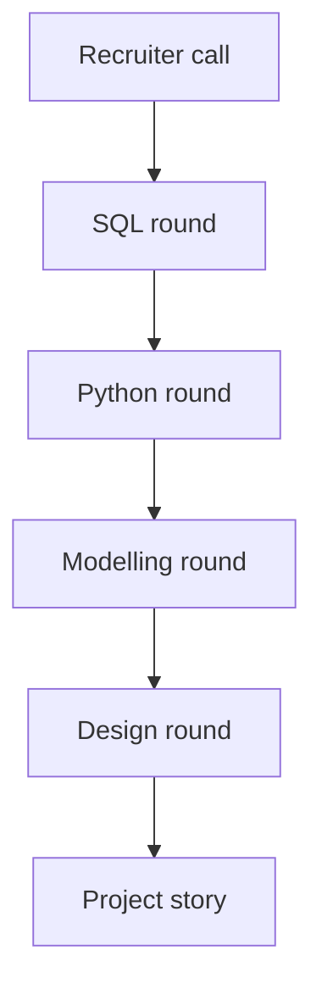

<BigWordAlert term="Interview loop" plainEnglish="The set of conversations an employer uses to decide on a hire, usually a screen and then several rounds, each testing a different skill." whyItMatters="Each round tests something different. If you prepare only for one, you can do well in it and still lose the loop in another." />

## A message on a Thursday

On a Thursday evening, Hala reads a message on her phone. A small company with a remote team has seen her portfolio, the Mizan pipeline, and invites her to an interview. The message is short. It says there will be a call with a recruiter, and then a technical session of about 45 minutes. It does not say what the technical session contains. Mizan, Hala and everyone in this module are fictional.

Hala has ten days. She knows her pipeline well, but she has never sat in an interview for a data role. She asks herself questions she cannot answer. Will they ask her to write SQL on a shared screen? Will they ask her to draw a data model? Will they ask about Mizan, or about a company she has never heard of? And what do they expect from someone with a first project and no job yet?

That evening she calls Mais, a friend who is also learning data engineering. They decide to find out what an interview loop contains, and then to practise it together. This module follows their plan. You can follow it alone too, and later in this chapter you will see how.

## What a loop looks like

Interview guides and a few employers describe a loop. It has a SQL round, a Python round, a data modelling round, a pipeline design round and a conversation about a project you built. For early-career roles, the loop usually leans on SQL and Python. Rounds and order vary by employer. In the postings we read in October 2026, three employers described their own process. One described a recruiter call and then technical sessions. One described a take-home task, then a recruiter call, then a technical interview, and then a behavioural and technical interview. One described a recruiter, a manager, a behavioural round, a technical case study and a reference check.

So there is no single script. The guides we read were written by practitioners and by a staffing company, and they are indicative, not rules. Even so, they agree on some points, and those points are a good base for ten days of practice. The diagram shows one possible order. Read it as a list of different skills, not as a promise about your interview.



Notice that every box needs a different kind of preparation. The recruiter call and the project story are about you and your work. The other four are about what you can do on the spot. In the next section, each round gets a short description of what it asks.

Before you read on, make a guess about the guides.

```predict
prompt: "Two interview guides, one from a practitioner and one from a staffing company, both call one round 'the gate'. Which round do you think it is?"
options:
  - id: sql
    label: "The SQL round"
  - id: design
    label: "The pipeline design round"
correctOptionId: sql
explanation: "Both guides say SQL is the gate, and for early-career roles the loop usually leans on SQL and Python. Design questions are often not asked at junior level, but if one comes, you are expected to name failure modes without being asked. Chapter 12.4 shows how."
allowRetry: true
```

## Round by round

In the SQL round, the guides list the same topics again and again: window functions, left joins with NULL handling, removing duplicates, and what happens to ties in a ranking. The expected result at junior level is a correct query that you can explain, and an answer that does not double count. Chapter 12.2 practises this, and it builds on modules 2 and 3.

In the Python round, the topics are practical data work: grouping, merging, reading messy input, and an ingestion job that is safe to run again. No chapter in this module repeats that work, because you did it in modules 5, 6 and 8. Be ready to explain `land.py`, the way a rerun leaves the same result, and what your code does with a bad row.

In the modelling round, you are asked to state the grain first, draw a small star schema, choose how to keep history, and defend one denormalised table. Chapter 12.3 practises the four steps aloud, with the grain first. In the design round, you answer a question about batch or streaming, orchestration, late data, backfills and failure. One guide says the junior bar is a working answer to a scoped problem, a loop heavy on SQL, light modelling and no design round. If a design question does come, ask clarifying questions first and name failure modes without being asked. Chapter 12.4 shows how, and also how to tell the story of your project with real numbers.

## What a junior is expected to do

The pattern across the rounds is simple. You are not expected to know everything. You are expected to ask a clarifying question before you answer. You say what you assume, you test your own answer on a small example, and you explain a trade-off in plain words. Those are habits, and a habit improves with practice. They are also what a client sees on the first day of a freelance job.

Be honest with yourself about the market. Many data engineering postings ask for around three years of experience, and some are limited to certain countries. A portfolio project and clear explanations help, but we cannot promise a job. What we can promise is that an interview is a skill you can practise, and that ten days of good practice beat ten days of reading.

## A ten-day plan

Hala works part time and her power comes in blocks, so she plans in small pieces. On days 1 and 2 she works on SQL, because the guides call it the gate. On days 3 and 4 she practises the modelling round, and on days 5 and 6 the design round and her project story. Day 7 is for recording one answer and listening to it. On days 8 and 9 she and Mais run two mock interviews, 45 minutes each, and swap roles. Day 10 she rests and reads her own notes once. Each day has one task of about an hour, so a day with a long power cut costs her one task and not the whole plan.

She also decides what she will not do. She will not learn a new tool this week. A clear answer on a tool she knows is worth more than a weak answer on one she met yesterday. She will not memorise answers, because a question that is slightly different would break a memorised script. And she will not skip the explaining part, because the interviewer must be able to follow her thinking.

An interview is also a conversation between two people who want the same thing, which is to find out whether you can do the work. A candidate who says "I am not sure, so I would check it like this" shows how they think. A guess shows nothing. That habit is the same one you use when you test a pipeline: say what you know, say what you will check, and then check it.

## How to practise: alone, with a friend, or on a recording

Practising alone works if you make it real. Pick a question, set a timer, and answer aloud, not in your head. Speaking out loud shows you where your explanation breaks. Write the question on a paper card, because a card needs no power and no connection. Keep a list of the questions you could not answer and come back to it the next day.

Practising with a friend is stronger. One of you is the interviewer and holds the rules of the question. The interviewer answers clarifying questions, gives one hint if the candidate is stuck, and asks one follow-up. Then you swap. This is how Hala and Mais work. They use a voice call when the connection allows, and a shared sheet of paper otherwise.

Recording yourself is the third way, and the one the gate of this module uses. A voice recorder on a phone works offline, and an audio file is small enough to send on a weak connection. Listen to it once for content, and once for clarity. Do you say what the grain is in the first sentence? Do you name a number? Do you stop talking when you are done? Most people hear three things to fix the first time.

<LearningObjectives objectives={["Name the rounds of a data engineering interview and what a junior is expected to do in each", "Answer a SQL question by clarifying, writing in steps, testing a small example and explaining the cost", "Run the four modelling steps aloud, starting with the grain", "Answer a pipeline design question by naming failure modes, and tell your project story with numbers", "Practise alone, with a friend, or by recording yourself, and record a mock answer"]} />

## Key words

| Word | Plain English |
|---|---|
| **Clarifying question** | A question you ask before answering, to find out what the problem really is |
| **Edge case** | An unusual input that can break an answer, such as a tie, a NULL or an empty table |
| **Think aloud** | Saying your reasoning out loud as you work, so the interviewer can follow it |
| **Mock interview** | A practice interview with a friend or a recording, with no job at stake |

## What is in this module

| Chapter | You will practise |
|---|---|
| 12.2 | The SQL round: clarify, write in steps, test edge cases, explain |
| 12.3 | The modelling round: the four steps aloud, grain first |
| 12.4 | The design round with failure modes, and your project story with numbers |
| 12.5 | Interview drills: two SQL, one modelling, one design and one story |
| 12.6 | Recording a mock answer, with a written option if you cannot record |

**Next:** The SQL round: how to turn a vague question into a correct, explained answer in four moves.
