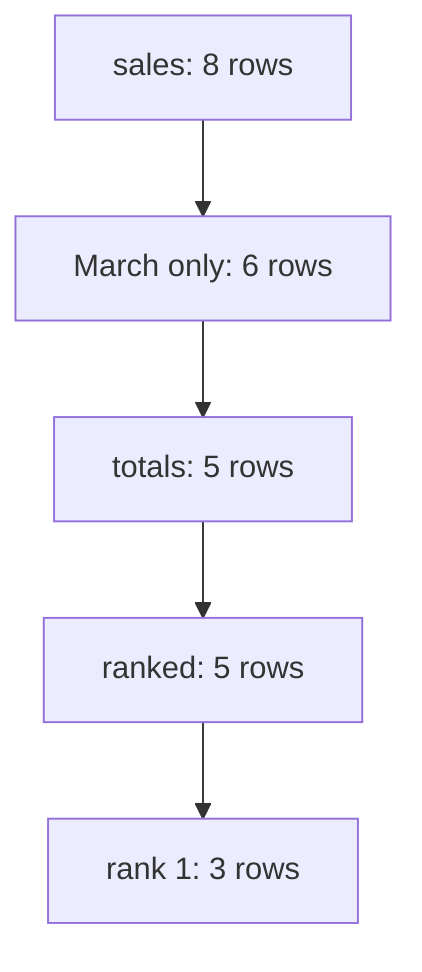

## A query that looks right

Khalil, a friend who works as an analyst, plays the interviewer for Mais. His question is one sentence long. For each branch of a bakery chain, show the product that sold the most units in March. The table is `sales`, with the columns `branch`, `product`, `sold_on` and `qty`. Mais starts typing at once, and in under a minute she has a query that runs and returns rows.

```sql
SELECT branch, product, units
FROM (
  SELECT branch, product, sum(qty) AS units,
         row_number() OVER (PARTITION BY branch ORDER BY sum(qty) DESC) AS rn
  FROM sales
  WHERE sold_on >= DATE '2026-03-01' AND sold_on < DATE '2026-04-01'
  GROUP BY branch, product
) AS ranked
WHERE rn = 1;
```

It looks fine, and it is wrong in two ways. Khalil never said what to do when two products tie, and Mais never asked. The query keeps one product per branch, so a tie disappears without a word. And a branch with no sales in March is missing from the result, with no row to show it. Neither problem causes an error, and that is the reason this round exists. A SQL round does not test whether you can write a query. It tests whether you can notice what your query does not say.

## Four moves

A strong answer has four moves, in this order. First, clarify. Ask what one row of the table is, whether any column can be NULL, and what to do on a tie. These are the same ideas as the grain of chapter 4.3, the NULL rules of 2.3 and the ranking functions of 3.2, used before you type. Second, say your plan in one sentence, then write the query in named steps, as in chapter 2.4. Third, test it on a tiny example that you write by hand, including a tie, a NULL and a row outside the date range. Fourth, explain what the query costs, and how you would find out.

The order matters because each move protects the next one. Questions protect the query from a wrong guess. The plan lets the interviewer correct you early. The tiny example catches the mistakes that questions did not. The explanation shows that you understand the engine and not only the syntax. Before you read on, make a guess about the first move.

```predict
prompt: "Khalil asks his one-sentence question about the best-selling product per branch. What should a strong candidate do first?"
options:
  - id: type
    label: "Start writing the query, to save time"
  - id: ask
    label: "Ask about the grain, NULLs and ties"
correctOptionId: ask
explanation: "Asking first costs under a minute and removes the guesses that make a query wrong without an error. A candidate who types first has to guess what a row is, whether qty can be NULL and what a tie means, and may build the whole answer on a wrong guess."
allowRetry: true
```

The canvas replays a practice round between Khalil and Mais, one move at a time. Watch which side speaks at each step.

<InteractiveCanvas slug="sql-round-steps" />

**What this shows:** the order of moves in a strong SQL answer, with who speaks at each step, from the vague question to the follow-up about a branch with no sales.

**Try this:** before step 2, predict what Mais does first. Then, at step 6, think about what would happen if she used `row_number` instead of `rank`, and which row of North she would lose.

**What changed:** each step adds something to the answer: a rule, a plan, a query, a test or a cost. By the end, only the follow-up is left to the interviewer.

**Limits of the model:** this is one friendly practice round. Real interviewers answer fewer questions, move faster and choose other follow-ups. The steps are a habit to practise, not a script.

## Explaining the cost, and watching the clock

The cost answer deserves a few more words, because many candidates skip it. A good one has three parts. Say how many times the query reads the data: here, once. Name the expensive step: here, the sort inside each branch. And say what would change the answer. An index on `sold_on` helps only if March is a small share of the table. When March is most of the table, a full scan reads less in total, as chapter 3.4 showed. On a partitioned lake, the plan from `EXPLAIN` shows how many files are read.

Time is part of the round too. If the technical session lasts about 45 minutes and holds three questions, each gets about 15 minutes. Spend two on questions, five on the query, three on the tiny test and the rest on the explanation. If you are running late, shorten the test and not the questions, because a fast wrong answer is worse than a slow right one.

## The worked example, with eight rows

Mais writes eight rows by hand. They are small enough to check by eye, and each one has a job.

| branch | product | sold_on | qty |
|---|---|---|---|
| North | khobz | 2026-03-02 | 120 |
| North | khobz | 2026-03-15 | 80 |
| North | maamoul | 2026-03-10 | 200 |
| North | zaatar roll | 2026-03-20 | NULL |
| Centre | khobz | 2026-03-05 | 150 |
| Centre | maamoul | 2026-03-06 | 90 |
| Centre | khobz | 2026-04-01 | 500 |
| South | khobz | 2026-02-20 | 70 |

North has a tie: khobz sells 120 plus 80, which is 200, and maamoul sells 200. The zaatar roll has a NULL, so its total is NULL. Centre has a sale on 1 April, which must not count. South has one sale, in February. Before she runs anything, Mais says what she expects: North shows khobz and maamoul, Centre shows khobz at 150, and South shows nothing. Then she writes the query in named steps.

```sql
WITH totals AS (
  SELECT branch, product, sum(qty) AS units
  FROM sales
  WHERE sold_on >= DATE '2026-03-01' AND sold_on < DATE '2026-04-01'
  GROUP BY branch, product
),
ranked AS (
  SELECT branch, product, units,
         rank() OVER (PARTITION BY branch ORDER BY units DESC NULLS LAST) AS rnk
  FROM totals
)
SELECT branch, product, units
FROM ranked
WHERE rnk = 1
ORDER BY branch, product;
```

```text
Centre   khobz    150
North    khobz    200
North    maamoul  200
```

It matches her expectation. She says one more thing aloud: `NULLS LAST` is written out because the default order of NULLs depends on the database. In DuckDB 2.0.0 a NULL sorts last, but she does not assume the same for the interviewer's system. Now the follow-up from Khalil: what if a branch had no sales in March? South has no rows to rank, so it has no row in the result. Mais starts from the list of branches and joins the winners onto it.

```sql
-- a third named step after ranked, and a new final select
top AS (
  SELECT branch, product, units FROM ranked WHERE rnk = 1
)
SELECT b.branch, t.product, t.units
FROM branches AS b
LEFT JOIN top AS t ON t.branch = b.branch
ORDER BY b.branch, t.product;
```

Here `branches` is a table of the three branch names, and the winners are joined onto it. The result gains one row, `South` with NULL in the product and units columns. That row is the honest answer: the branch exists and had no sales. The diagram shows how many rows survive each step, which is the check Mais makes on the tiny example.



Notice that the count falls at three steps and stays the same at one. The date filter removes the April and February rows. The totals step joins the two khobz rows of North into one. The filter on rank 1 removes the rows below first place. The ranking step itself keeps all 5 rows, because it only numbers them. If a step changes the count in a way you cannot explain, you have found the bug.

## Where people go wrong

The biggest mistake is to start typing. The second is `row_number` where the interviewer wants ties. The third is a date range written with `BETWEEN` on a timestamp column. A sale at 18:30 on 31 March is later than the bound `'2026-03-31'`, which means midnight, so it is dropped. Here is a tiny test. A table holds a 40-unit sale at 18:30 on 31 March and a 25-unit sale on 30 March. With `BETWEEN '2026-03-01' AND '2026-03-31'` the total is 25. With `>= '2026-03-01' AND < '2026-04-01'` it is 65. The half-open range is correct, and the same habit works for any timestamp.

Other mistakes are quieter. Summing after a join can double count, as in chapter 2.2. `COUNT(*)` and `COUNT(column)` give different answers when the column has NULLs. A candidate may also be silent for two minutes while thinking. Say what you are doing, even if it is only "I am checking the tie case". And do not hide behind syntax: if you forget the name of a function, say what it does and ask.

## The trade-off, and the alternative

DuckDB lets you write `QUALIFY rnk = 1` and skip the second named step. It is shorter, and it is fine if the interviewer uses DuckDB or a system with the same word. Many systems do not have it, and the named-steps version works almost everywhere. In an interview, say which one you use and why. The same goes for `rank` and `dense_rank`: choose by the question. If the question asks for the top two products and ties should not push anyone out, `dense_rank` may be the better fit. Ask.

## Try it on your own data

Use your Mizan data. The question is: which markets share the lowest flour price (item I01) on 8 March? Do the four moves out loud, to a friend or to a recording. Ask what a row is, whether the price can be NULL, and what a tie means. Then write the query in named steps, test it on five rows you write by hand, and say what it costs. The expected result on the 28-day data is two rows, M04 and M07, both at 7.5 shekels, which you also met in the drill d07.

## Check your understanding

```quiz
type: mcq
question: "In a practice round, Doaa counts appointments per doctor in one clinic: Amal 12, Basil 10, Chadi 10, Dana 9. Her query ranks doctors by this count, highest first, with rank(), and keeps rows where the rank is 2 or less. Which doctors does it return?"
options:
  - "Amal and Basil only, because the filter keeps two rows"
  - "Amal only, because he is the only doctor with rank 1"
  - "All four doctors, because rank counts every doctor once"
  - "Amal, Basil and Chadi, as the tied pair share rank 2"
correct: 3
explanations:
  - "rank() gives equal counts the same rank. Basil and Chadi both get rank 2, so both pass the filter. The filter keeps ranks, not a number of rows."
  - "The filter keeps rank 2 or less, not only rank 1. Basil and Chadi have rank 2, so they pass."
  - "Dana's count of 9 gets rank 4, because rank skips the numbers after a tie: 1, 2, 2, 4. Rank 4 is above 2, so Dana is out."
  - "Right. The ranks are 1, 2, 2 and 4. Amal, Basil and Chadi are 2 or less, so three rows return. row_number() would have returned only two of them."
```

**Next:** The data modelling round: how to say the grain first, list the dimensions and facts, and step back when a new question does not fit.
