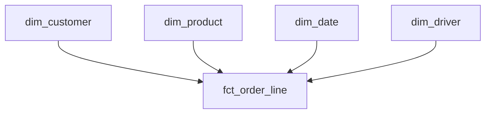

## Four tables in thirty seconds

Rasha plays the interviewer for Ibrahim. The task is short: model the data of a water delivery round run by Doaa. Drivers take bottled water to homes and shops, and bring back empty bottles. Ibrahim has done module 4, so he draws quickly. In thirty seconds there are four boxes on the page: customers, drivers, products and deliveries. Rasha asks one question. What is one row in your deliveries table?

Ibrahim stops. He knows the answer is on the page somewhere, but he cannot say it in one sentence. Is a row a bottle, a stop, an order or a day? The boxes are fine. The missing sentence is what the interviewer wants. The guides we read say the same about modelling rounds: state the grain first, choose a star schema, choose how to keep history, and be ready to justify a denormalised table. Chapter 4.3 gave you Kimball's four steps. This chapter turns them into something you say aloud, in order, in about three minutes.

## The four steps, aloud

The steps are the business process, the grain, the dimensions and the facts. Say them in that order, and start the grain with the words "one row is". A short script helps, because under pressure you will skip a step you have not rehearsed.

```text
The business process is ___.
One row in the fact table is ___.
It is described by ___ (the dimensions).
The numbers on each row are ___ (the facts).
```

The business process is the event the business cares about, such as delivering an order. The grain is the answer to Rasha's question, and every other choice follows from it. The dimensions are the who, what, where and when that describe a row: here the customer, the driver, the date and the product. The facts are the numbers on the row that you can add up. A number belongs in the fact table only if it is true at the grain. Doaa's monthly bill for a customer is not true for a single stop, so it does not go on a stop row.

Before you read on, make a guess about what happens when a question does not fit.

```predict
prompt: "Ibrahim's fact table has one row per delivery stop. Rasha asks which customers ordered water but got no delivery. A stop that did not happen has no row. What should Ibrahim do first?"
options:
  - id: grain
    label: "Go back to the grain and check it still fits"
  - id: patch
    label: "Add a column to the fact table that answers it"
correctOptionId: grain
explanation: "A failed order has no stop, so no column on a stop row can describe it. The problem is the grain. Changing it to one row per order line, with a status, lets failed orders appear as rows. After that, Ibrahim checks the dimensions and facts at the new grain."
allowRetry: true
```

The canvas follows Ibrahim through the four steps and the new question. Watch where the path goes after the question arrives.

<InteractiveCanvas slug="modelling-round-steps" />

**What this shows:** the four modelling steps in order, and the step back to the grain when a new question does not fit.

**Try this:** before step 5, predict which step the new question sends Ibrahim back to. Then count how many changes he made to the dimensions when the grain changed.

**What changed:** the grain moved from one row per stop to one row per order line with a status. The dimensions and the facts needed only small changes, because they were chosen at the grain.

**Limits of the model:** this is a small case with one new question. Real models meet many, and some need a second fact table at a different grain instead of a changed one.

## The worked example, in the shape of an answer

Here is how Ibrahim answers after the step back. "The business process is delivering water orders. One row in the fact table is one order line: one customer, one product, one day, with a status of delivered, failed or cancelled. It is described by the customer, the product, the date and the driver assigned. The numbers on each row are the bottles ordered, the bottles delivered and the amount charged. For a failed line, the bottles delivered and the amount charged are 0." That answer has about 75 words. It takes about 30 seconds to say, and each sentence can be checked.

Then he adds the part that shows judgment. Customers sometimes move house. Suppose Doaa wants the deliveries by district, as the district was on the day. Then the customer dimension needs history with valid dates. That is a type 2 change, like market M03 in chapter 4.4. If she only ever asks about the current district, an overwrite is simpler. He says which one he chose and why. And he explains why the dimensions are flat tables: a star schema repeats a few values, such as the district name on every customer row, so that a report needs one join per dimension and no chains of joins. The price is some repeated data.

The diagram shows the model he would draw after the answer. Notice that every arrow points at the fact table, and that the fact table holds keys and numbers, not descriptions.



The sentence under the fact table, "one row per order line", is the real picture. Draw the boxes in a minute, and spend the rest of the time on that sentence.

## Follow-up questions to expect

After the answer, interviewers usually probe the choices, not the picture. Rasha asks Ibrahim why he did not choose one row per bottle. His answer: the driver records counts, not single bottles, so a bottle-level row would be invented detail. She asks what happens when a driver changes. He says the driver dimension keeps one row per driver, and a delivery points at the driver assigned on that day, so old deliveries keep their old driver. She asks how he would find a customer who ordered every week and then stopped. He says he would count order lines per customer per week, and look for the weeks with none.

Notice what each answer does. It states a fact about the data, names the part of the model that handles it, and gives a short reason. You can prepare for this by writing three probing questions for any model you draw, and answering them aloud. Practise with pen and paper. A star schema is five boxes and a few lines, and you can draw it without a screen. If the interview is on a shared screen, the same sentences work, and a slow connection does not matter, because the script is the part you speak.

## Where people go wrong

The most common mistake is to start with the tables. A candidate draws boxes first and the grain later, or never. The second is to mix grains. Suppose a fact table has one row per order line, and it also carries the order total on every line. Order 301 has three lines of 12.00, 8.50 and 9.50, so its total is 30.00. If a report sums the order total, it counts 30.00 three times and shows 90.00. This is the double counting of chapter 2.3, built into the table. The fix is to keep the order total out of the line table, or to put it in a separate fact table with one row per order.

The third mistake is a fact that cannot be added. An average price or a percentage cannot be summed over rows. Store the parts, such as the amount and the bottle count, and divide in the report. The fourth is a missing date dimension, which makes every report build its own calendar. The fifth is to answer in silence for four minutes and then show a finished picture. Say the grain first, so the interviewer can stop you early if it is wrong.

## The trade-off, and the alternative

A star schema is not the only answer. For a small dataset and one report, a single wide table, with the customer's district copied onto each row, can be simpler and perfectly fast. A star schema pays off when several reports share the same dimensions, when history matters, and when many people write queries. Say which case you are in. The same is true for history: a type 2 dimension costs more to build and to explain, so use it when someone will ask a question about the past. In the interview, name the alternative you rejected and the reason. That sentence is what separates a recited answer from an understood one.

## Try it on your own data

Say your own Mizan model aloud, once, using the script. A good answer sounds like this: "The business process is reporting a food price. One row is one accepted price report, with one report ID. It is described by the market, the item and the date. The number on each row is the price." Notice the dimension that carries history: the market, because M03 moved from Harbour to Hill on 12 March. Then pick a second case, such as the sales of a bakery with several tills, and do the four steps on a paper card in two minutes. Check that the card says "one row is" in its second line.

## Check your understanding

```quiz
type: mcq
question: "In a practice round, Ibrahim's fact table has one row per order line, and every line also carries the order total. Order 301 has three lines of 12.00, 8.50 and 9.50, and an order total of 30.00 on each line. A report sums the order total by day. What does the report show for order 301?"
options:
  - "30.00, because the order has only one total"
  - "10.00, because the report averages the lines"
  - "90.00, because the 30.00 repeats on 3 lines"
  - "3.00, because the report counts the order lines"
correct: 2
explanations:
  - "The order has one total, but the table stores it on three rows, and a sum adds all three rows."
  - "The report sums the column, so no average is taken. The 10.00 would be the average line amount, which is a different column."
  - "Right. The order total sits on three rows, so the sum is 3 times 30.00, which is 90.00. The grain of the table is the order line, and the order total belongs to a coarser grain."
  - "Counting lines would give 3, and the report does not count. It sums the order total, which is 30.00 on each of the 3 lines."
```

**Next:** The pipeline design round and your project story: how to name failure modes without being asked, and how to tell the story of your pipeline with real numbers.
