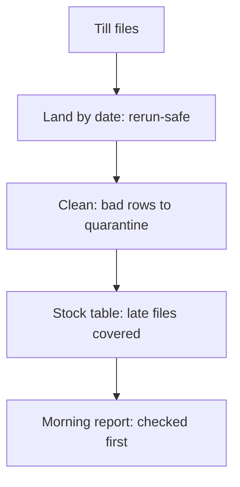

## Boxes before questions

Mais plays the interviewer, and Hala has the pen. The question: a pharmacy owner called Hatem has three branches, and each till exports a file at closing time. He wants to know each morning which medicines are low. Design the pipeline. Hala starts to draw. A box for the files, a box for a database, a box for a dashboard, and an arrow from each to the next. She has drawn five boxes and said nothing about why.

Mais stops her with one question. What will Hatem do with the answer? Hala thinks. He reads it at 08:00 and decides what to order. He does not need minutes. He needs yesterday's closing stock, ready before 08:00. That one answer changes the design. A pipeline that must show a stock change within seconds is a different machine from one that must be ready each morning. The boxes came too soon, and the first minute of a design round belongs to questions.

## The shape of a design answer

A good design answer has four parts, in order. First, ask: who uses the result, what decision does it support, how fresh must it be, and how much data is there. Second, choose the shape: a daily batch, an hourly micro-batch or streaming, and say why. Third, walk the path of the data from source to report in plain steps. Fourth, name the ways it can fail, without waiting to be asked.

The guides we read say the same about design questions. Ask clarifying questions first, and cover batch or streaming, orchestration, late data, backfills, idempotency and failure modes. They also say that a design round is often not asked at junior level, and that if it comes, naming failure modes unprompted is the habit to show. You already built most of the answers in modules 5 to 9. This chapter is about saying them in the right order.

Before you read on, make a guess about the shape for Hatem.

```predict
prompt: "Hatem reads his stock report once, at 08:00, and decides what to order. Each till exports one file at closing time. Which way of running the pipeline fits best?"
options:
  - id: stream
    label: "Streaming, so every sale updates the report at once"
  - id: daily
    label: "A daily batch that finishes before 08:00"
correctOptionId: daily
explanation: "The decision is made once a day from yesterday's closing stock, and the tills already export one file a day. A daily batch is the simplest shape that meets the need. Streaming would add cost and skills the question does not ask for."
allowRetry: true
```

The canvas lets you change what matters and watch the best shape change. Keep the pharmacy in mind.

<InteractiveCanvas slug="design-round-choice" />

**What this shows:** the best way to run a pipeline depends on how much each need matters. Each shape has a score on fresh data, low cost and the team's skills, and the weights decide the winner.

**Try this:** start with fresh data as a small need, as for Hatem. The daily batch leads. Then raise fresh data to very important, and see the hourly micro-batch take over. Then lower cost and skills to nice to have, and see streaming win by one point.

**What changed:** the winner changed because the weights changed, not because any shape got better. A question that does not say how fresh the data must be cannot be answered well, which is why you ask first.

**Limits of the model:** the scores are the course's own judgment for a small team, not measurements. The model cannot see late data, reruns or privacy, so you have to name those yourself.

## Failure modes, named without being asked

<BigWordAlert term="Failure mode" plainEnglish="A specific way a system can go wrong, such as a file that arrives late or a job that runs twice." whyItMatters="Naming failure modes before you are asked shows that you have run a pipeline in real conditions, and not only drawn one." />

Hala's second pass over the pharmacy answer adds one failure mode to each stage. Files can arrive late, because a till was offline: she plans a window of recent days that is read again each run, as in chapter 8.2. A job can run twice after a power cut: she writes each day to its own place and replaces it, so a rerun gives the same result (6.3). A past day can need fixing: she keeps a backfill command for a date range (8.4). A column can change, such as a new field on the export: she checks the file against a contract and keeps additions (8.4). A bad row can appear, such as a negative stock count: it goes to quarantine and not into the report (8.5).

Two more matter for any real data. The files may contain customer names for prescriptions, so personal data stays in a restricted zone and the report gets only codes (11.3). And she adds checks for freshness, volume and schema, with an alarm that reaches a person (11.2). The diagram attaches each of these to a stage. Notice that the names of the boxes carry the failure mode.



Read the answer aloud in about 90 seconds. "First I would ask how fresh the report must be and how many tills there are. Hatem reads it once at 08:00, so I would use a daily batch. Each till file lands in a folder for its date. I clean it, send bad rows to quarantine, and build a stock table. The report is built last, after checks on freshness, volume and schema. Late files: I would re-read the last three days each run. Reruns: each day replaces its own folder, so running twice gives the same result. Backfills: a command for a range of dates. Privacy: names stay in a restricted folder, and the report has only codes. I can go deeper on any of these."

## Your project story, with numbers

The same round often ends with a conversation about a project you built. The guides call it the behavioural part, and they say to tell it in structure, to give trade-offs, and to separate your part from the team's. A story has five parts: the problem, the design, the numbers, a trade-off and what you would change. Your Mizan pipeline is a good source, because you know every number in it.

| Number | What it is | Where it comes from |
|---|---|---|
| 28 days, 8 markets, 12 items | The size of the source data | make_source.py summary |
| 2,712 lines, 2,633 distinct reports | Lines uploaded, and reports after removing repeats | A query on the upload files |
| 79 repeated sends (3.0 percent) | Duplicates removed by report_id | The same query |
| 211 late reports (8.0 percent) | Reports uploaded after the day they were made | make_source.py summary |
| 13 bad rows: 9 price, 4 no item code | Rows sent to quarantine | The quarantine files |
| 2,620 accepted reports | What the fact table holds | 2,633 minus 13 |

A number is strong when it says what it counts, over what and compared to what. "A three-day lookback caught the 34 reports that M05 sent late after its connection came back on 12 March, and a lookback of zero days missed them" is strong. "My pipeline handles late data well" is not. Never invent a number. If you did not measure it, say so, and say how you would.

Here is a story in about 90 seconds. "I built a pipeline for a small NGO that publishes a weekly food-basket report. Volunteers send prices from eight markets by phone, and the uploads arrive late or twice. I landed the files by date, replaced each day on a rerun, and built the report with dbt. In 28 days of data, 2,712 lines became 2,620 accepted reports: 79 repeated sends were removed and 13 bad rows were quarantined. The hardest case was one market that lost its connection for three days. A three-day lookback caught its 34 late reports, and a lookback of zero days would have missed them. The trade-off was cost, because the lookback re-reads three days on every run. If I started again, I would ask the form's developer to stop sending the volunteers' phone numbers at all." Each sentence in it has a fact that you could check in the repository.

One more topic needs honesty. Some postings say that the interview includes a discussion or an exercise about using AI tools. If you used one while you built, say what you asked it for, what you checked, what you changed or rejected, and what you decided yourself. Be ready to explain every line of your repository. If you cannot explain a line, you do not own it yet. Read it, test it or rewrite it. Never present generated code as your own understanding.

## Where people go wrong

The first mistake is to draw before asking. The second is to name tools instead of reasons: "I would use Kafka" says nothing about why. The third is to pick streaming because it sounds modern, when the need is a morning report. The fourth is to describe only the path that works. The fifth is to say "we" for everything in a story, so that the interviewer cannot tell what you did. The last is to give a number with no baseline.

## The trade-off, and the alternative

You have ten minutes and eight failure modes. Naming all eight takes a minute and leaves nothing deep. The alternative is to name the three that matter most for this question, say "I can go deeper on any of these", and let the interviewer choose. For Hatem's pharmacy, late files, reruns and privacy come first. For a payments feed, duplicates would. Choosing is part of the answer.

## Try it on your own data

Write your story in five sentences, one for each part, using at least four numbers from your own run. This query gives the first three numbers of the table above.

```sql
SELECT count(*) AS lines,
       count(DISTINCT report_id) AS distinct_reports,
       count(*) - count(DISTINCT report_id) AS repeated_sends
FROM read_json('data/raw/uploads/*/*.jsonl', union_by_name = true);
```

On the 28-day data it returns 2,712, 2,633 and 79. Then record the story as a voice note and listen for the places where you say "we", or a number without a comparison.

## Check your understanding

```quiz
type: mcq
question: "Ibrahim practises the numbers part of his story about a clinic booking pipeline. From his run on 28 days of data: 3,150 booking lines were uploaded, 99 were repeated sends, and 12 of the remaining rows were quarantined. Which sentence is the strongest to say?"
options:
  - "3,150 lines became 3,039 bookings, after 99 repeats and 12 bad rows"
  - "The pipeline handles a large amount of data very quickly and safely"
  - "It processed all 3,150 lines without any errors, so nothing was lost"
  - "It reached 100 percent accuracy on all of the bookings in the run"
correct: 0
explanations:
  - "Right. It says what is counted, over what, and how the numbers fit: 3,150 minus 99 is 3,051, and minus 12 is 3,039. An interviewer can check every figure."
  - "No number, no comparison and no baseline. Words such as large and quickly cannot be checked."
  - "The run quarantined 12 bad rows, so a claim of no errors at all contradicts the stated facts."
  - "Nothing in the facts measures accuracy, so a claim of 100 percent is invented. Never state a number you did not measure."
```

**Next:** Interview drills: five graded scenarios on SQL, modelling, design and your story.
