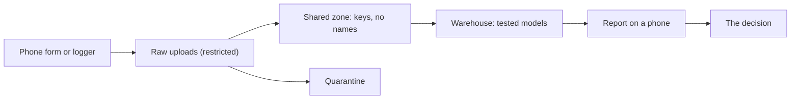

<BigWordAlert term="Hardest constraint" plainEnglish="The one rule in a scenario that a simple pipeline is most likely to break, such as duplicate people, health data or records that change after they are saved." whyItMatters="It tells you where to spend your time. It is also the first thing a mentor or an interviewer will ask you about." />

## A request with no data

Hala has run the Mizan pipeline every morning for four weeks. On a Thursday evening, while the power is on, she reads a message from Omar. A colleague at another small NGO wants to know whether the same kind of pipeline would work for them.

The colleague is Raed, a programme officer at a relief kitchen network. His volunteers hand out food parcels at six distribution points and record each handout on a phone form. Every week he gets a spreadsheet, and every week he doubts the totals. Some families seem to receive two parcels, and some seem to receive none.

Hala answers yes, with changes. She does not have Raed's data, and she does not want it. It holds the names and phone numbers of families, and it should not be stored on a laptop used for study. So she does what the capstone asks of you. She writes a small program that makes fake handouts, with the same kinds of problems real ones have. She plants late uploads, duplicate sends, a new field in the middle of the month and a distribution point that changes its area. Hala, Raed and everyone else in this module are fictional, and all the data is synthetic.

This is the capstone. You build a second pipeline from scratch, in a domain that is not food prices, using what you learned in modules 1 to 12. You write your own generator, so your data is yours and your portfolio differs from every other fellow's. At the end you record a five-minute defence. This chapter has no code. It shows the five scenarios, the rules your generator follows, what a finished project must have and how a mentor will read it. You choose a scenario at the end.

## Why you write the generator

You could look for a public data set instead. Most have no planted problems, so you would never learn whether your pipeline handles late rows. Many also hold real personal data. A generator you write gives you control: you decide how many duplicates exist, so you know exactly what a correct pipeline should produce.

That second point matters for testing. Mizan's raw files hold 2,712 lines, but only 2,620 of them are accepted reports. The difference is 79 duplicate sends and 13 bad rows. A test that wants to check the fact table needs the number 2,620, and it has to come from somewhere reliable.

```predict
prompt: "Hala wants a test that checks her fact table has the right number of rows. Her raw files hold 2,712 lines, but only 2,620 are accepted reports. Where should the test get the right number from?"
options:
  - id: generator
    label: "The generator prints how many good records it made"
  - id: files
    label: "The test counts the lines in the raw files by itself"
correctOptionId: generator
explanation: "The generator planted every duplicate, late row and bad row, so it knows the exact number of good records. A count of raw lines includes 79 duplicate sends and 13 bad rows, so it would be wrong by 92. A test that worked out the rules again would repeat the pipeline's own rules and could share its mistakes."
allowRetry: true
```

The generator prints that number every time it runs, and your tests compare the pipeline against it. You will see the exact lines it prints in chapter 13.2.

## The five scenarios

Each scenario gives you a person, a decision, a hardest constraint and a hero output. The <GlossaryTerm term="hero output" definition="The one report or table that the person in the brief will actually read to make a decision." /> is what your report page shows. Each data spec table lists what your generator must make. All five use the same layout of folders, which chapter 13.2 describes.

### 1. Aid distribution

Raed decides every week which distribution points get more parcels. He needs two numbers per point. Coverage is the share of registered households that received a parcel. Repeat handouts are households that received more than one parcel in a week.

The hardest constraint is duplicate registrations and household personal data. Many families register at two points, and the same phone number appears written in two ways. If your pipeline counts registrations as households, coverage is wrong. If it joins on phone numbers without care, names and numbers spread into places they should not reach. The hero output is coverage and repeat handouts by point and week.

| Part | What the generator must make |
|---|---|
| Handouts (JSON lines) | handout_id, point_code, registration_id, parcel_type, handed_at, uploaded_at, staff_id, head_name, head_phone |
| Registry table: points | point_code, name, area, updated_at |
| Registry table: households | registration_id, head_name, head_phone, household_size, point_code, updated_at |
| Size | 6 points, about 400 households, about 60 handouts a day |
| Duplicate registrations | About 20 households registered twice, at two points, with the same phone in two formats |
| Bad rows | A few with no registration_id or an unknown parcel_type |
| Schema change | From day 11 the form adds delivery_mode (collected or delivered) |
| Dimension change | On day 8 one point moves from one area to another |
| Personal fields | head_name, head_phone |

### 2. Clinic appointments

Hadeel manages three small clinics. She decides which clinic needs reminder calls or more booking slots. She reads the no-show rate and the average number of days between booking and visit.

The hardest constraint is sensitive health data and status changes. An appointment starts as booked and later becomes checked in, no show or cancelled. The reason for the visit is health data, and the report does not need it. The pipeline must keep each appointment's story right and keep the reason out of the shared zone. The hero output is the no-show rate and average waiting days by clinic and week.

| Part | What the generator must make |
|---|---|
| Appointment updates (JSON lines) | appointment_id, clinic_code, doctor_code, patient_name, patient_phone, reason |
| The same lines, when and what | status, booked_at, booked_for, status_at, uploaded_at |
| Registry table: clinics | clinic_code, name, area, updated_at |
| Registry table: doctors | doctor_code, name, clinic_code, specialty, updated_at |
| Size | 3 clinics, 6 doctors, about 70 appointments a day, 1 to 3 status lines each |
| Status changes | Status is booked, checked_in, no_show or cancelled. Some status lines arrive before the booking line |
| Bad rows | A few with a status outside the four, or no booked_for |
| Schema change | From day 11 the form adds visit_type (first or follow_up) |
| Dimension change | On day 8 one doctor moves to another clinic |
| Personal fields | patient_name, patient_phone, reason |

### 3. Solar and power readings

Samer is a technician who services solar systems in small shops. He decides which shop needs a battery check this week. He reads the energy each site made per day and the number of hours its battery was low.

The hardest constraint is late and out-of-order readings. A logger stores readings while the shop has no connection and sends them in batches later, sometimes in reverse order. A reading belongs to the time it was measured, not the time it arrived. The hero output is daily energy and low-battery hours by site.

| Part | What the generator must make |
|---|---|
| Readings (JSON lines) | device_id, read_at, battery_pct, panel_watts, uploaded_at |
| Registry table: sites | site_code, shop_name, owner_name, owner_phone, updated_at |
| Registry table: devices | device_id, site_code, model, updated_at |
| Size | 4 shops, 8 devices, one reading every 15 minutes: 96 a day per device, about 770 a day in all |
| Order | Some batches are written in reverse time order |
| Duplicates | A device sends the same reading again (same device_id and read_at) |
| Bad rows | A few with battery_pct below 0 or above 100, or no panel_watts |
| Schema change | From day 11 the logger adds temperature_c |
| Dimension change | On day 8 one device moves from one shop to another |
| Personal fields | owner_name, owner_phone |

### 4. School attendance

Nour is the head teacher of a primary school. She decides which classes need a call to families. She reads the attendance rate by class and week, counting school days only.

The hardest constraint is classes and calendars that change during the term. A student moves from one class to another, and the calendar gains a closed day. If every old row is joined to the student's current class, past rates change by themselves. If a closed day counts as an absence, the rate falls for no reason. The hero output is the attendance rate by class and week.

| Part | What the generator must make |
|---|---|
| Attendance lines (JSON lines) | student_code, student_name, class_code, school_date, status, teacher_code, uploaded_at |
| Registry table: students | student_code, student_name, parent_phone, class_code, updated_at |
| Registry table: classes | class_code, teacher_code, updated_at |
| Registry table: calendar | school_date, is_open, updated_at |
| Size | 6 classes, about 150 students, one line per student per school day, school days Sunday to Thursday |
| Late rows | One teacher uploads two days of sheets together |
| Bad rows | A few with no student_code or a status outside present, absent and late |
| Schema change | From day 11 the sheet adds arrival_time for late students |
| Dimension change | On day 8 one student moves to another class, and one later school day is marked closed |
| Personal fields | student_name, parent_phone |

### 5. Freelance shop orders

Alaa runs a small online shop that sells school bags and stationery. She is a freelance client, and she decides how much to order from her suppliers. She reads net sales by week after refunds.

The hardest constraint is updated and deleted records. After an order is placed, it can be edited, refunded or deleted, and each change arrives as a new event, sometimes out of order. If every event counts as a new order, sales are counted twice. If deletes are ignored, deleted orders count as sales. To keep the grain small, each order has one product line. The hero output is net sales by week, with deleted orders left out.

| Part | What the generator must make |
|---|---|
| Order events (JSON lines) | order_id, version, status, product_code, quantity, unit_price, refund_amount |
| The same lines, when and who | updated_at, uploaded_at, customer_name, customer_phone, customer_address |
| Registry table: products | product_code, name, category, updated_at |
| Size | 25 products, about 40 new orders a day. About 10 percent are edited, 5 percent refunded and 3 percent deleted |
| Updates | Status is placed, edited, refunded or deleted, and version grows with each change. Some versions arrive out of order |
| Bad rows | A few with quantity 0 or below, or no product_code |
| Schema change | From day 11 the shop adds discount_code |
| Dimension change | On day 8 one product moves to another category |
| Personal fields | customer_name, customer_phone, customer_address |

## Rules every generator follows

The five tables above are different, but the planted problems follow the same rules. About 8 percent of records arrive 1 to 3 days after they were made. About 3 percent are sent twice with the same business key. About 0.5 percent are bad rows, and a bad row is always the only line of its record, so a bad record never has a good version. These are the same proportions you met in Mizan, and they keep a three-day lookback valid. The generator counts records by business key and prints five summary lines, which chapter 13.2 lists.

Each scenario also has a small registry, one SQLite file called `registry.db`, as in Mizan. Each day's upload is split over two files, `batch-01.jsonl` with about 60 percent of the lines and `batch-02.jsonl` with about 40 percent. The schema change starts on day 11 and the dimension change on day 8. That way a 14-day test run sees both. The generator is seeded: the same seed gives byte-identical files. It also has a mode that rewrites only the registry as it was on a chosen day, which is how the tests make a dimension change arrive later. Chapter 13.2 gives the exact options.

The diagram shows the shape that every scenario shares. Follow it from the left.



What to notice: personal data lives only in the first two boxes, and the quarantine box holds bad rows, which are restricted too. Everything after the shared zone works with keys. The decision at the end is why the pipeline exists, so write down your person's decision in your README before you write any code.

## What a finished project must have

Every project, in every scenario, must have the same ten things. A mentor reads them with the table below. "Met" needs the full description. "Partly" means the idea is there but a part is missing. "Not yet" means the mentor cannot find it.

| Must-have | Met | Partly | Not yet |
|---|---|---|---|
| 1. One command from a clean folder | `python scripts/demo.py` on a folder with no data, lake or warehouse ends without error and writes the report | Works, but needs a second command or a leftover file | Needs manual steps, or fails |
| 2. Tests pass | `pytest -q` passes, including one test of your own for the hardest constraint | Only the course tests pass | A test fails |
| 3. The stated grain | README states the grain in one sentence, and the fact table has a unique key at that grain | Grain stated, but the table breaks it | No stated grain |
| 4. A type 2 dimension | Two versions with `valid_from`, `valid_to` and `is_current`, and each fact joins the version valid on its date | History kept, but facts join the current version | The old version is overwritten |
| 5. Idempotent reruns | The same day run twice, and a 3-day backfill, leave counts and totals unchanged | Counts match but another column changes, or no backfill shown | A rerun adds rows |
| 6. Late data and duplicates | Fact rows equal the good records the generator planted; late records appear after they arrive | One of the two is handled | Neither |
| 7. A schema change absorbed | The new field is NULL before the change and filled after, with no code edit | Works only after a manual fix | The run fails or the field is lost |
| 8. Personal data stays restricted | No personal column or value in the shared zone or warehouse; the secret comes from the environment | Columns removed, but a personal value remains | Personal data or the secret in a file |
| 9. A report | One small page that opens on a phone and shows the hero output with its date range | A page exists, but numbers are not explained | No report |
| 10. README and runbook | README answers five questions, and the runbook covers five situations | One of them is missing parts | Missing |

**Pass rule:** the project passes when no must-have is "Not yet" and at least eight are "Met". Chapter 13.5 asks you to check this yourself before your mentor does.

## How to choose

Choose by the hardest constraint, not by the domain. Ask which problem you would like to explain well in an interview. Each scenario teaches the same patterns, but each pushes one of them harder.

The school scenario is closest to Mizan, so it is the gentlest start. The clinic scenario asks for the most care with privacy. The solar scenario makes the most rows: 8 devices times 96 readings times 28 days is 21,504 readings, so check your laptop's memory early. The order scenario has a trap in its version numbers, because the newest upload is not always the newest version. The aid scenario is the only one where two records can describe the same family, so it asks you to decide when two records are the same person.

You can change your mind in the first hour of chapter 13.2, before you write the generator. After that, finish the one you chose. A finished project that you can defend is worth more than two started ones.

<LearningObjectives objectives={["Choose one of five scenarios by its hardest constraint", "Read a data spec and list the problems your generator must plant", "Name the ten must-haves that every capstone needs", "Read the rubric as a mentor will, with Met, Partly and Not yet", "Explain why a generator that prints its own counts makes a better test"]} />

## Key words

| Word | Plain English |
|---|---|
| **Scenario** | One of five briefs: a person, a decision and a data spec |
| **Hardest constraint** | The one rule that a simple pipeline is most likely to break |
| **Hero output** | The report or table the person reads to decide |
| **Must-have** | A thing every project needs, checked by a test or by what a mentor can see |
| **Defence** | A five-minute recording where you run your project and answer questions |

## What is in this module

| Chapter | You will practise |
|---|---|
| 13.2 | Writing the generator, then landing, modelling, testing and running the pipeline |
| 13.3 | Adding checks, privacy design, a report, a README and a runbook |
| 13.4 | Recording a five-minute defence and answering follow-up questions |
| 13.5 | Checking your project against the rubric and looking back at your first pipeline |

**Next:** Write the generator and build the pipeline in your chosen scenario.
