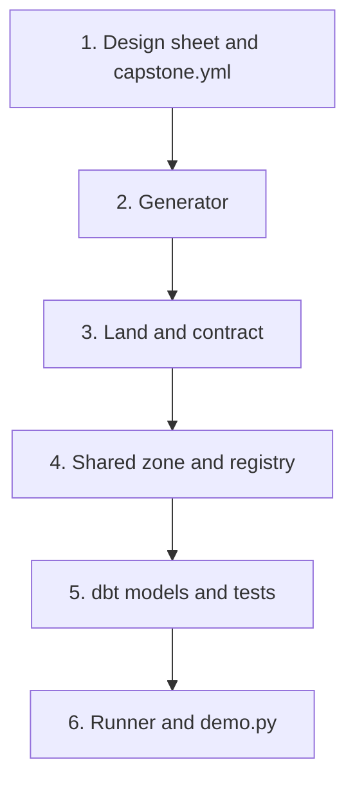

## What you will have at the end

On the first evening of the capstone, Hala has a scenario, an empty folder and four hours of power. She could start with a dbt model, because that feels like the real work. But a model needs data to run on, a number to check against, and a way to know whether a rerun doubles the rows. She has none of these yet. If she starts with the model, she will write code that looks finished and cannot be tested.

This chapter builds those things in an order where each step can be tested before the next one starts. At the end, one command, `python scripts/demo.py`, begins with an empty folder. It makes your data, runs the pipeline for every day and leaves a tested warehouse. Eight acceptance tests check the result: the generator, the one-command run, the fact table, a rerun, the new field and the type 2 dimension.

The examples in this chapter use a sixth case that is not on the list of five: Ziad's water delivery round. A driver records each stop on a phone, and Ziad wants to know how many jugs went out per route per week. Because the case is not yours, you can check your understanding without seeing your own scenario solved. Plan your four hours like this. Spend 20 minutes on design and 60 on the generator. Spend 30 on landing, 30 on the shared zone and the registry, 60 on dbt and 30 on the runner and the demo command. That adds up to 230 minutes, so there is little room for the first failures, which always come. Start in a session with good power.

## Where the project is now

You start in a new, empty folder with a short path, such as `C:\de\capstone`. The Mizan project stays untouched. Reuse the virtual environment from chapter 1.4, because the stack is the same: DuckDB 2.0.0, dbt-core 1.12.6 with dbt-duckdb 1.11.0 and pytest 9.1.1, checked in October 2026. Run `git init`, copy `requirements.txt`, `pytest.ini` and `.gitignore` from Mizan, and make your first commit.

Copying working code from Mizan is allowed. Engineers reuse their own pieces. The rule is that you understand every line you keep, because the defence in chapter 13.4 will ask about them. When you copy a file, rename everything that was about food prices, and run its tests before you move on.

## Decide five things before you code

Open `README.md` and write five decisions. Each one answers a question that the code would otherwise answer by accident. First, the grain: one sentence that finishes "One row in the fact table is ...". Second, the business key: the columns that identify one real thing, such as an order or a reading. Third, which copy wins when the same key arrives more than once. Fourth, how many days late a record can be, which sets your lookback. Fifth, which dimension has history, and which fields are personal.

The table gives a suggested answer for each scenario. You may choose differently if you can defend it. The third column matters more than it looks. For orders, the copy that wins is the one with the highest version, not the one uploaded last, because version 3 can arrive before version 2. For clinic appointments, the winner is the line with the latest status time, for the same reason. A record that was deleted or cancelled stays in the fact table with a flag. Then the fact count still equals the number of good records, and the report can leave flagged rows out.

| Scenario | One fact row is | Business key | Winning copy |
|---|---|---|---|
| Aid distribution | a parcel handout | handout_id | latest upload |
| Clinic appointments | an appointment | appointment_id | latest status_at |
| Solar readings | a reading | device_id, read_at | latest upload |
| School attendance | a student on a school day | student_code, school_date | latest upload |
| Shop orders | an order | order_id | highest version |

| Scenario | Type 2 dimension | Changed on day 8 |
|---|---|---|
| Aid distribution | dim_point | a point's area |
| Clinic appointments | dim_doctor | a doctor's clinic |
| Solar readings | dim_device | a device's shop |
| School attendance | dim_student | a student's class |
| Shop orders | dim_product | a product's category |

## The names the tests use

Your scenario is different from every other fellow's, so the tests cannot know your table names. You tell them in one file, `capstone.yml`, in the project folder. Here is Ziad's version for the water round. Copy the shape, keep the keys and change the values to yours.

```yaml
# capstone.yml: the names the tests use. Change the values, keep the keys.
scenario: water-round              # a short label for your scenario
start: "2026-03-01"                # first day of generated data
seed: 7                            # the generator's seed
test_days: 14                      # days the tests generate; the dimension change and the new field must fall inside
fact_table: fct_delivery           # your fact table in warehouse.duckdb
business_key: [stop_id]            # the columns that identify one fact row
new_column: jugs_returned          # the field the form adds on day 11
personal_fields: [customer_name, customer_phone]   # personal columns in the raw lines or the registry
secret_env: CAPSTONE_KEY           # the environment variable that holds your secret
dimension:
  table: dim_route                 # your type 2 dimension
  key: route_code                  # its natural key
  changed_key: R03                 # the record the generator changes on the change day
  change_day: "2026-03-08"         # day 8
```

The tests also rely on a few fixed commands and paths. They are the same for every scenario, so a mentor can run any project the same way. Function names inside your files are yours. Only the lines below are fixed.

| Command or path | What it must do or hold |
|---|---|
| `python make_source.py --days N --start D --seed S --out data` | Writes the raw files and prints five summary lines |
| the same, plus `--registry-only --as-of D` | Writes only `data/raw/registry.db`, as it was at the end of day D |
| `python -m pipeline.runner run --date D` | Runs every task for one upload date, exit code 0 or 1 |
| `python -m pipeline.runner backfill --start A --end B` | Runs each date in order, stops at the first failure |
| `python scripts/demo.py --days N --start D --seed S` | Makes data, backfills every day, builds the report |
| `data/raw/uploads/upload_date=D/batch-01.jsonl`, `batch-02.jsonl` | The raw lines for one upload date |
| `data/raw/registry.db` | SQLite file with your master tables and `updated_at` columns |
| `lake/restricted`, `lake/shared`, `lake/quarantine` | The three zones |
| `logs/runs.jsonl`, `warehouse.duckdb` | The run log and the warehouse |

## The design choice and its alternative

Should the fact table be incremental, with a lookback window, or rebuilt in full on every run? For 14 days of data, a full rebuild takes a second or two. It is simpler, and it is idempotent by construction, because the table depends only on the files. An incremental model with a lookback is only worth the extra work when a full rebuild gets too slow, and at your size it will not.

So why build the incremental one? The mentor will ask what changes at a hundred times the data. "I already read only the recent days" is a stronger answer than "I would have to change it". The window also gives you a clear way to explain late data, and you practised it in chapter 8.5. If you choose the full rebuild, that is fine. Write down why in the README, and describe what you would change at scale.

The same reasoning applies to dbt. Plain SQL scripts would also work for this size. dbt is worth using for its tests, its dependency graph and its snapshot for history. Those serve the must-haves on tests and on type 2 history.

The diagram shows the build order. Read it from the top.



What to notice: every box uses only the output of the box above it. That is why the generator comes before anything else, and why you can test each step alone. If step 5 fails, you know steps 2 to 4 are fine, because you tested them on their own.

## Step 1: write the design sheet

Create `README.md` with five headings that chapter 13.3 will fill: How to run, The grain, The data model, Privacy zones, and What changes at 100 times the data. Write them as level 2 headings, which are lines that start with two # signs. The test in chapter 13.3 looks for exactly these. Fill in "The grain" now with your one sentence. Create `capstone.yml` from the template above. There is no test for this step. Its purpose is to make you decide before you type.

Put the dimension change on day 8 and the new field on day 11 in your generator, and keep `test_days` at 14. Then a short test period sees both.

## Step 2: write the generator

Follow the pattern of `make_source.py` from chapter 1.4. Put the tables of fixed values first. Then add one random generator made from the seed, a function that writes the registry, a loop that writes each day, and a summary at the end. Use no clock and no other source of randomness, so the same seed gives the same bytes. SQLite appends to an existing file, so remove the registry file before you write it.

```text
make_source.py
  python make_source.py --days N --start YYYY-MM-DD --seed S --out DIR
  python make_source.py --days N --start YYYY-MM-DD --seed S --out DIR --registry-only --as-of YYYY-MM-DD

  Writes DIR/raw/uploads/upload_date=D/batch-01.jsonl and batch-02.jsonl (about 60 and 40 percent of the day's lines)
  and DIR/raw/registry.db. With --registry-only it writes registry.db only.
  Prints exactly these five lines, in this order (the numbers are yours):
    distinct records: <business keys made>
    lines written: <all lines in all files>
    late records: <records first uploaded after the day they were made>
    duplicate sends: <extra lines that repeat an earlier line of the same record>
    bad rows: <records whose only line breaks a rule>
```

Three constraints matter. A bad row must be the only line of its record, so a bad record never also has a good version. The planted problems are the ones in your data spec from chapter 13.1. And the registry as of a day must show a changed record with the new values only from the change day on.

Check the generator by hand before you go on. Run it twice and compare the folders. Open one batch file and read three lines. Check that late records are about 8 percent of distinct records. If your numbers are far from the proportions in chapter 13.1, the pipeline will still work, but the tests will say less.

## Step 3: land the uploads and check the contract

Landing turns one upload date of JSON lines into one Parquet file, as in chapter 5.5. The contract from chapter 8.5 decides which rows are good.

```text
pipeline/land.py
  land_uploads(upload_date: str) -> int
  """Read data/raw/uploads/upload_date=D/*.jsonl. Write the good rows to
  lake/restricted/<name>/upload_date=D/part-0.parquet and the bad rows, with a reason column, to
  lake/quarantine/<name>/upload_date=D/part-0.parquet. A rerun replaces both. Return the number of good rows."""

contracts/<name>.yml
  required fields, optional fields with a "since" date, and rules with a SQL fails_when and a reason
```

Convert times to plain UTC once, here, so no later step depends on the computer's time zone. Write to a temporary file and then replace the real file, so a crash never leaves half a file. Read the Parquet files later with `union_by_name = true`, so files from before the schema change and after it can be read together. A batch that lacks a required field must stop with a clear `ContractError` and write nothing. An unknown extra field is kept.

A good sanity check: the good rows landed plus the rows in quarantine must equal the lines written. In Mizan, 2,699 good lines plus 13 quarantined lines make the 2,712 lines the generator wrote. If your sum is short, a day was skipped. If it is long, a rerun appended.

## Step 4: publish the shared zone and extract the registry

The shared zone holds the same rows without personal fields. Read the secret from the environment variable named in `capstone.yml`, and stop with a clear message before anything is written if it is missing. Make the keys in Python and give DuckDB only the finished pairs, so the secret never reaches SQL or a file. Chapter 13.3 reviews this design, so write it correctly now.

```text
pipeline/pseudonymise.py
  publish(upload_date: str) -> int
  """Copy one restricted partition to lake/shared without the personal fields, adding a key made
  with an HMAC and the secret. A rerun replaces the file. Return the number of rows."""

pipeline/extract_registry.py
  extract(table: str) -> int
  """Read rows of data/raw/registry.db whose updated_at is after the saved watermark, drop personal fields,
  write lake/shared/registry/<table>/extracted_at=<time>/part-0.parquet, then save the new watermark.
  Return the number of rows."""
```

Write the file first and save the watermark second. If the process stops between the two, the next run takes the same rows again, which is harmless, because staging keeps one row per key. A watermark cannot see a hard delete. Write that limit in your README if your registry can delete rows.

## Step 5: build the dbt project

Use the structure from chapter 7.5. It has a profiles file that points at `../warehouse.duckdb` and sets `TimeZone: UTC`. It also has sources that read the Parquet files, staging models, a snapshot, dimensions, a fact table and one mart for your hero output.

```text
transform/models
  staging: stg_<events>        one row per business key; the winning copy; columns typed
  snapshot: snap_<registry>    timestamp strategy on updated_at, hard_deletes: ignore
  marts:   dim_<name>          your type 2 dimension, with valid_from, valid_to, is_current
           fct_<name>          the table named in capstone.yml; unique business key; includes new_column
           mart_<name>         the hero output of your scenario
```

Choose the winning copy with `row_number()` and the rule from your design sheet. Make sure the fact table has the new field. The staging model must produce it as NULL even when no file has it yet, as you did in chapter 7.5. Join each fact to the dimension version that was valid on its date. Add tests: `unique` and `not_null` on the business key, `relationships` from the fact to each dimension, and `accepted_values` for any status column.

Run `dbt build --profiles-dir .` from the `transform` folder after the first land and publish. The first dbt command in a fresh environment can take 30 seconds. Later builds take about 12 seconds each, mostly for starting Python and reading the project.

## Step 6: write the runner and the demo command

The runner is the small scheduler from chapter 9.4. Its tasks and upstream tasks for now are as follows.

```text
pipeline/runner.py
  tasks: extract_registry [], land [], publish [land], dbt_build [extract_registry, publish]
  run_pipeline(run_date: str) -> dict          {task: "ok" | "failed" | "skipped"}
  backfill(start: str, end: str) -> dict       each date once, oldest first, stop at the first failed date
  A TransientError is retried with a growing wait; any other error fails the task at once and
  skips what depends on it. Every attempt is a line in logs/runs.jsonl. Exit code 1 if anything failed.

scripts/demo.py
  python scripts/demo.py --days N --start D --seed S
  """Make the data and run backfill from the first day to the last. From chapter 13.3 the runner's report task also writes the page."""
```

The demo command is your answer to the first must-have. It must work from a folder with no `data`, `lake`, `state`, `logs` or warehouse. It is also what a mentor will run first.

## The acceptance tests

The tests live in three files: two in this chapter and one in chapter 13.3. The first holds helpers and two fixtures that every capstone test uses. Create `tests/conftest.py` with this content. The `summary` fixture runs your generator once and keeps its five numbers as the truth. The `built` fixture copies your code into a temporary folder and runs your demo command there, so the tests never touch your own data.

```python
"""Shared helpers and fixtures for the capstone tests.

The tests never touch your own data/, lake/ or warehouse: they work in temporary copies of your code.
Everything that belongs to your scenario is read from capstone.yml in the project folder.
"""
import hashlib
import os
import re
import shutil
import subprocess
import sys
from datetime import date, timedelta
from pathlib import Path

import duckdb
import pytest
import yaml

REPO = Path(__file__).resolve().parent.parent
TEST_KEY = "test-secret-not-real"
CONFIG = yaml.safe_load((REPO / "capstone.yml").read_text(encoding="utf-8"))
SUMMARY_LABELS = ["distinct records", "lines written", "late records", "duplicate sends", "bad rows"]
LAST_DAY = (date.fromisoformat(CONFIG["start"]) + timedelta(days=CONFIG["test_days"] - 1)).isoformat()

# Folders that hold results, not code. They are never copied into a test project.
SKIP = shutil.ignore_patterns(
    "data", "lake", "state", "logs", "site", "target", "tests", "__pycache__", ".pytest_cache",
    ".venv", "venv", ".git", "dbt_packages", "*.duckdb", "*.duckdb.wal",
)


def run_cmd(args, cwd, check=True):
    """Run a command in a folder with a fake secret, and return the finished process."""
    env = {**os.environ, CONFIG["secret_env"]: TEST_KEY, "PYTHONUTF8": "1"}
    done = subprocess.run(args, cwd=cwd, capture_output=True, text=True, env=env)
    if check and done.returncode != 0:
        raise AssertionError(f"command failed: {args}\n{done.stdout}\n{done.stderr}")
    return done


def parse_summary(text):
    """Turn the generator's 'label: number' lines into a dict."""
    return {m.group(1): int(m.group(2)) for m in re.finditer(r"^([a-z][a-z ]*): (\d+)$", text, re.MULTILINE)}


class Project:
    """A temporary copy of your code. Helpers run your commands inside it."""

    def __init__(self, root):
        self.root = Path(root)

    @classmethod
    def fresh(cls, folder):
        shutil.copytree(REPO, folder, ignore=SKIP)
        return cls(folder)

    def python(self, *args, check=True):
        return run_cmd([sys.executable, *args], cwd=self.root, check=check)

    def generate(self, days, *extra):
        return self.python("make_source.py", "--days", str(days), "--start", CONFIG["start"],
                           "--seed", str(CONFIG["seed"]), "--out", "data", *extra)

    def query(self, sql, params=None):
        con = duckdb.connect(str(self.root / "warehouse.duckdb"), read_only=True)
        try:
            return con.execute(sql, params or []).fetchall()
        finally:
            con.close()

    def fact_fingerprint(self):
        key = ", ".join(CONFIG["business_key"])
        rows = self.query(f"SELECT * FROM {CONFIG['fact_table']} ORDER BY {key}")
        return hashlib.sha256(repr(rows).encode()).hexdigest(), len(rows)


@pytest.fixture(scope="session")
def summary(tmp_path_factory):
    """The generator's own summary for the test period. It is the truth the pipeline is checked against."""
    project = Project.fresh(tmp_path_factory.mktemp("summary") / "proj")
    return parse_summary(project.generate(CONFIG["test_days"]).stdout)


@pytest.fixture(scope="session")
def built(tmp_path_factory):
    """A clean copy of your code, run with the one command: scripts/demo.py."""
    project = Project.fresh(tmp_path_factory.mktemp("built") / "proj")
    project.python("scripts/demo.py", "--days", str(CONFIG["test_days"]), "--start", CONFIG["start"],
                   "--seed", str(CONFIG["seed"]))
    return project
```

The second file holds the eight pipeline tests. It is marked `slow` like your dbt tests in Mizan, because it runs the whole pipeline, so keep the marker registered in `pytest.ini`.

```python
"""Capstone acceptance tests, part 1: the generator, the one-command run and the pipeline rules."""
import hashlib
from datetime import date, timedelta

import pytest
from conftest import CONFIG, LAST_DAY, SUMMARY_LABELS, Project

pytestmark = pytest.mark.slow


def folder_fingerprint(folder):
    digest = hashlib.sha256()
    for path in sorted(p for p in folder.rglob("*") if p.is_file()):
        digest.update(path.relative_to(folder).as_posix().encode())
        digest.update(path.read_bytes())
    return digest.hexdigest()


def test_the_generator_summary_lists_the_planted_problems(summary):
    for label in SUMMARY_LABELS:
        assert label in summary, f"the generator must print a line '{label}: <number>'"
    assert summary["lines written"] >= summary["distinct records"]
    assert summary["late records"] > 0, "the data must contain late records"
    assert summary["duplicate sends"] > 0, "the data must contain duplicate sends"
    assert summary["bad rows"] > 0, "the data must contain bad rows"


def test_the_same_seed_gives_the_same_files_and_another_seed_does_not(tmp_path):
    prints = []
    for number, seed in enumerate([CONFIG["seed"], CONFIG["seed"], CONFIG["seed"] + 1]):
        project = Project.fresh(tmp_path / f"p{number}")
        project.python("make_source.py", "--days", "3", "--start", CONFIG["start"], "--seed", str(seed), "--out", "data")
        prints.append(folder_fingerprint(project.root / "data"))
    assert prints[0] == prints[1], "the same seed must give byte-identical files"
    assert prints[0] != prints[2], "another seed must give different files"


def test_one_command_builds_everything_from_a_clean_folder(built):
    assert (built.root / "warehouse.duckdb").exists()
    assert list((built.root / "lake" / "shared").rglob("*.parquet")), "the shared zone should hold Parquet files"


def test_the_fact_table_has_one_row_for_every_accepted_record(built, summary):
    expected = summary["distinct records"] - summary["bad rows"]
    rows = built.query(f"SELECT count(*) FROM {CONFIG['fact_table']}")[0][0]
    assert rows == expected, f"{rows} fact rows, but the generator made {expected} distinct good records"


def test_the_business_key_is_unique_in_the_fact_table(built):
    key = ", ".join(CONFIG["business_key"])
    repeated = built.query(f"SELECT count(*) FROM (SELECT {key} FROM {CONFIG['fact_table']} GROUP BY {key} HAVING count(*) > 1)")
    assert repeated[0][0] == 0


def test_running_the_last_day_again_changes_nothing(built):
    before = built.fact_fingerprint()
    built.python("-m", "pipeline.runner", "run", "--date", LAST_DAY)
    built.python("-m", "pipeline.runner", "run", "--date", LAST_DAY)
    assert built.fact_fingerprint() == before


def test_the_new_field_is_absorbed(built):
    column = CONFIG["new_column"]
    empty, filled = built.query(
        f"SELECT count(*) FILTER (WHERE {column} IS NULL), count(*) FILTER (WHERE {column} IS NOT NULL) FROM {CONFIG['fact_table']}"
    )[0]
    assert empty > 0, f"rows from before the form change should have {column} = NULL"
    assert filled > 0, f"rows from after the form change should have a value in {column}"


def test_a_type_2_dimension_keeps_both_versions_of_a_changed_record(tmp_path):
    dim = CONFIG["dimension"]
    change = date.fromisoformat(dim["change_day"])
    first_day, second_day = CONFIG["start"], (date.fromisoformat(CONFIG["start"]) + timedelta(days=1)).isoformat()
    project = Project.fresh(tmp_path / "proj")
    project.generate(CONFIG["test_days"])
    project.generate(CONFIG["test_days"], "--registry-only", "--as-of", (change - timedelta(days=1)).isoformat())
    project.python("-m", "pipeline.runner", "run", "--date", first_day)
    project.generate(CONFIG["test_days"], "--registry-only", "--as-of", (change + timedelta(days=1)).isoformat())
    project.python("-m", "pipeline.runner", "run", "--date", second_day)
    versions = project.query(
        f"SELECT valid_from, valid_to, is_current FROM {dim['table']} WHERE {dim['key']} = ? ORDER BY valid_from",
        [dim["changed_key"]],
    )
    assert len(versions) == 2, f"expected two versions of {dim['changed_key']}, found {len(versions)}"
    old, new = versions
    assert old[2] is False and new[2] is True, "exactly the newest version must be current"
    assert old[1] is not None and old[1] == new[0], "the old version must end exactly when the new one starts"
    assert old[0] < old[1] and new[1] is None
```

## What each test protects

The summary test checks that your generator really plants late records, duplicate sends and bad rows. A generator that makes clean data would let every other test pass for the wrong reason. The seed test proves that your data is reproducible, which is what lets a mentor see the same numbers you see.

The one-command test proves the first must-have. The fact-count test is the main test of the project. It compares the warehouse with the generator's own count of good records, so one test covers duplicates, bad rows and late records at once. The unique-key test checks the grain in a different way, because a table can have the right number of rows and still repeat one key while missing another.

The rerun test runs the last day twice and compares a fingerprint of the whole fact table, not only the row count. It catches a table that has the same number of rows but a different content. The new-field test checks that old rows have NULL and new rows have a value. The last test replays the dimension change: the registry as of day 7, one run, the registry as of day 9, one run, and then two versions with matching dates.

## Run it

Set a secret, run the demo and the tests. The secret is made-up text for this synthetic project. Never put a real password here.

```powershell
cd C:\de\capstone
C:\de\venv\Scripts\Activate.ps1   # or the path of your own environment
$env:CAPSTONE_KEY = "any-long-random-text-for-this-project"
python scripts/demo.py --days 14
pytest -q tests/test_capstone_pipeline.py
```

```bash
cd ~/de/capstone
source ~/de/venv/bin/activate
export CAPSTONE_KEY="any-long-random-text-for-this-project"
python scripts/demo.py --days 14
pytest -q tests/test_capstone_pipeline.py
```

## Expected output

The generator prints its five lines first. Your numbers will differ, because your data differs. For comparison, the Mizan generator, run with 14 days, prints these five (and other lines of its own):

```text
distinct records: 1318
lines written: 1358
late records: 105
duplicate sends: 40
bad rows: 7
```

Then the demo prints one line per date, 14 lines in all. Chapter 13.3 adds the `checks` and `report` tasks, so your line has four tasks now, and six after that. This is the last line of the Mizan run with 14 days.

```text
2026-03-14 extract_registry=ok, land=ok, publish=ok, dbt_build=ok, checks=ok, report=ok
```

When the tests pass, pytest prints a line like this. The time depends on your laptop.

```text
........                                                                 [100%]
8 passed in 200.73s (0:03:20)
```

## Break it on purpose

Open your staging model and change the line that picks the winning copy, so that it partitions by the business key and also by the upload time. Now every send of the same record has its own number 1. Run the demo.

The run stops on the first day that contains a duplicate send, and the demo reports the failed task. Here is what the Mizan pipeline printed. The first line comes from the demo, the second from the run log.

```text
2026-03-01 extract_registry=ok, land=ok, publish=ok, dbt_build=failed, checks=skipped, report=skipped
dbt failed: ... in test unique_stg_price_reports_report_id ... Got 1 result, configured to fail if != 0
```

Your own `unique` test caught the mistake first. The acceptance tests are a second layer. They would catch it only if you had left that dbt test out. Undo the change and run the demo again.

## A near miss to know about

A common way to pass most tests and still fail the rerun test is a column that records when the row was loaded. An example is `loaded_at`, set to the current time. It looks harmless, and it is useful for debugging. But the second run of the same day writes a new time, so the fingerprint changes, and the rerun test fails. In a check of the Mizan project with `loaded_at` added to the fact table, the test printed the line below. Both tables have 1,499 rows, and the hashes differ. The counts are right and the table is still not idempotent.

```text
E   AssertionError: assert ('94829f14fb7...1ad4dc', 1499) == ('6479fd9bb33...1117b1', 1499)
```

If you want a load time, keep it in the run log, not in the fact table.

The second near miss is time. A stop made at 22:30 UTC on 3 March becomes 4 March if a step converts it with the time zone of a computer set ahead of UTC. Convert once, in landing, and your pipeline gives the same dates on any laptop.

## If you are stuck

First hint: test one step at a time, in the order of the diagram. After step 2, run the generator twice and compare the folders. After step 3, run `python -m pipeline.land --all` and check that good rows plus quarantined rows equal the lines written. After step 4, open one file in `lake/shared` and check that no personal field is there. Only then run dbt.

If the demo fails, open `logs/runs.jsonl` and find the first line with `"status": "failed"`. Its `detail` field holds the error. Everything after it with `"status": "skipped"` is a consequence, not a cause. If the fact-count test fails, compare the number in its message with the five numbers the generator printed.

## Commit your work

Commit in small steps, one per Step above. A suggested message for this chapter's last commit: `Add capstone runner, demo command and pipeline acceptance tests`.

**Next:** Add checks, the privacy design, a report, a README and a runbook.
