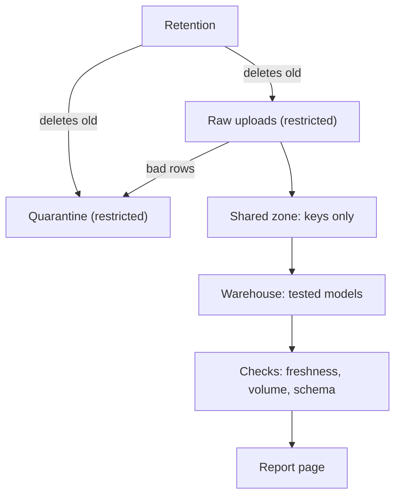

## What you will have at the end

Hala's capstone passes its eight pipeline tests. To see what is still missing, she copies the project, deletes the first batch file of the last day and runs that day again. A normal day in her data has about 100 lines, and the half-empty day has 40. Everything finishes green. The report shows a smaller number for that day, and nothing in the project says that something is wrong. Nobody would notice until a reader asked why a total looked low.

That is the first gap. There are two more. The project has no page that a reader can open on a phone, so the hero output exists only as a table in a database. And nobody except Hala can run it, fix it or explain where the personal data goes. A pipeline that only its author can operate is a risk for the people who depend on it.

This chapter closes the three gaps. At the end, your run fails loudly when a day looks wrong. The shared zone and the warehouse hold no personal data, and a retention command exists. A small report page opens on a phone. A README and a runbook let a stranger operate the project. Seven acceptance tests check this, and one test of your own checks your hardest constraint. Plan about 150 minutes: 40 for the checks, 30 for the privacy review and retention, 30 for the report and 50 for the README, the runbook and your own test.

## Where the project is now

Your repository passes the eight tests from chapter 13.2. `python scripts/demo.py` makes data and runs every day. The runner has four tasks: `extract_registry`, `land`, `publish` and `dbt_build`. Personal data is already removed when you publish, but you have not yet proved it, and you have no way to delete old restricted files.

## The design choices

The first choice is the tolerance of your volume check. The check compares a day's rows with the average of the previous seven days. The tolerance is the drop it allows. A tolerance of 0.5 means the day may fall to half of the average before the check fails. A tight tolerance such as 0.1 allows a fall of only 10 percent, so it raises an alarm on an ordinary Tuesday, and people learn to ignore alarms. A loose tolerance such as 0.9 lets a day with a third of its rows pass. So 0.5 is a reasonable start. You learned in chapter 11.2 that the right number comes from your own series, and that you revisit it.

The second choice is what to do with personal fields. You can drop a field, replace it with a key, or keep it in the restricted zone only. The rule from chapter 11.3 is to keep only what the purpose needs. If the report never uses a patient's reason for a visit, a shop customer's address or a student's name, it should not leave the restricted zone, even as a key. A key is a pseudonym. Pseudonymised data is still data about people. Local law and a data protection adviser decide real cases, and this course teaches the habit, not the law.

The third choice is how long to keep restricted files. A backfill needs the old restricted partitions, because it lands them again. So the retention period must be longer than the oldest day you will ever want to reprocess. If that is too long for the privacy you promised, the answer is to change the promise or the backfill plan, not to ignore one of them.

The diagram shows where the new pieces sit. Read it from the top.



What to notice: retention touches the two restricted boxes and never the shared zone. The report is built only after the checks pass, so a bad day produces a failed run and an old report, not a new report that looks fine.

## Step 1: add the three checks

Checks are small functions that return a result you can read. Add them to a file in `pipeline/` and make the runner call them after the build.

```text
pipeline/checks.py
  CheckResult(name: str, ok: bool, value: float, threshold: float, message: str)
  check_freshness(max_age_days: int, today: str | None = None) -> CheckResult
  check_volume(upload_date: str, tolerance: float = 0.5) -> CheckResult
  check_schema() -> CheckResult
  run_all(run_date: str) -> list[CheckResult]
```

Freshness compares the newest restricted partition with the run date and fails when the data is older than the limit. Volume counts the rows received for the date, from both the restricted zone and the quarantine, and compares them with the average of the seven days before. It fails only when the day is too low. A spike is normal, because a connection that returns brings a backlog. In Mizan the spike on 12 March had 134 rows against an average near 91 and passed. The volume check counts quarantined rows as received, so a day of bad rows does not look like missing data. Schema compares the newest partition with the contract and names the missing column or the changed type.

In the runner, add two tasks: `checks`, which depends on `dbt_build`, and `report`, which depends on `dbt_build` and `checks`. Each check writes its own log line named `check:` followed by its name. If any check fails, the task fails, the run exits with code 1 and the report task is skipped.

## Step 2: review the privacy design

Open your README and write the zone table: every field of your raw lines and your registry, and what happens to it. A field is dropped, replaced by a key, or kept restricted. Then check three things in your code.

The secret comes from the environment variable named in `capstone.yml`. It is not in a file, a log line or a commit. The key is made with an HMAC, as in chapter 6.5, not with a plain hash. And the key comes from a field that makes sense for your scenario. When a stable internal code already exists, such as a student code, a device id or an order id, it is already a pseudonym and needs no key. When the only thing that identifies a person is a phone number, the key is made from that phone. Write the flaw down. When the phone changes, one person gets two keys, as happened to V07 in Mizan.

Then add retention. It follows the Mizan command, with the same behaviour.

```text
pipeline/retention.py
  python -m pipeline.retention --keep-days 30 --as-of YYYY-MM-DD [--dry-run]
  Deletes restricted and quarantine partitions whose upload_date is earlier than as_of minus keep_days.
  Never touches lake/shared. With --dry-run it prints a line "would delete <path>" for each partition
  and changes nothing.
```

Quarantine holds full raw rows, including names and phone numbers, so it is restricted and retention must cover it. In Mizan, with 28 days of data, this is what a dry run prints.

```text
$ python -m pipeline.retention --keep-days 14 --as-of 2026-03-28 --dry-run
would delete lake/restricted/reports/upload_date=2026-03-01
... (13 lines, 03-01 to 03-13)
would delete 13 partition(s); kept everything newer than 14 days before 2026-03-28
```

## Step 3: write one test of your own for the hardest constraint

Your must-haves include one test that proves your scenario's hardest constraint. Write it in `tests/test_hardest_constraint.py`. Keep it small: build a tiny input by hand, run only the piece it needs and assert one fact. The table gives an idea for each scenario. The test is yours, so it is not given.

| Scenario | An idea for your own test |
|---|---|
| Aid distribution | Two registrations with the same phone in two formats give one household key |
| Clinic appointments | A status line that arrives late does not replace a newer status |
| Solar readings | A batch in reverse order gives the same daily total as the same batch in order |
| School attendance | A closed day is not counted as an absence, and a moved student keeps the old class's past rate |
| Shop orders | Version 3 arriving before version 2 gives the same final order, and a deleted order is not in net sales |

## Step 4: build the report

The report is the hero output of your scenario, as one small page. Write it as a function that reads the warehouse and writes a file.

```text
report/build_report.py
  python -m report.build_report            writes site/index.html
  build(warehouse: str, out: str) -> None
```

The page must open on a phone. Give it a `viewport` meta tag, one file with its CSS inside, no JavaScript and no link to another file. Show the hero output for the latest four weeks or days, in a table with a short bar for each value. Do not rely on colour alone: write the word "up" or "down" next to a change. Be honest about partial periods, as the Mizan report was: say how many full days a week has. In Mizan the page was 9.5 KB. A page that stays small loads on a weak connection.

## Step 5: write the README and the runbook

The README answers five questions under the five headings you created in chapter 13.2. How to run it, from a clean folder. What the grain is. What the data model is, with the type 2 dimension explained in two sentences. Which zones exist and where each personal field goes. And what would change at a hundred times the data.

The runbook is for someone who is not you, at a bad moment. It has five sections, written as level 2 headings like the README: A run failed, Rerun one day, Backfill a range, A check fails, and Delete old personal data. A good entry names the symptom, the first thing to look at, the command and how to confirm that it worked. Test your own runbook: follow it in a clean folder, copying each command exactly. A command you never ran is a guess.

## The acceptance tests

Create `tests/test_capstone_quality.py` with this content. It uses the same `conftest.py`. The privacy test is the longest. It reads every personal value from your raw lines and your registry. Then it looks for each one in every column of the warehouse and in every Parquet file of the shared zone.

```python
"""Capstone acceptance tests, part 2: privacy, secrets, checks, retention, the report and the documents."""
import json
import shutil
import sqlite3

import duckdb
import pytest
from conftest import CONFIG, LAST_DAY, REPO, TEST_KEY, Project

pytestmark = pytest.mark.slow


def personal_values(raw):
    """Every value that sits in a personal field in the raw JSON lines or the registry."""
    fields, values = set(CONFIG["personal_fields"]), set()
    for path in raw.glob("uploads/*/*.jsonl"):
        for line in path.read_text(encoding="utf-8").splitlines():
            for key, value in json.loads(line).items():
                if key in fields and isinstance(value, str):
                    values.add(value)
    registry = sqlite3.connect(raw / "registry.db")
    for (table,) in registry.execute("SELECT name FROM sqlite_master WHERE type = 'table'").fetchall():
        for _, name, *_ in registry.execute(f"PRAGMA table_info({table})").fetchall():
            if name in fields:
                values.update(v for (v,) in registry.execute(f"SELECT {name} FROM {table}") if isinstance(v, str))
    registry.close()
    return sorted(v for v in values if len(v) >= 3)


def describe(con, source):
    """Names of all columns, and the names of the text columns, of a table or a Parquet file."""
    columns = con.execute(f"DESCRIBE SELECT * FROM {source}").fetchall()
    return [c[0] for c in columns], [c[0] for c in columns if c[1] == "VARCHAR"]


def test_no_personal_data_reaches_the_shared_zone_or_the_warehouse(built):
    values = personal_values(built.root / "data" / "raw")
    assert values, "the raw data should contain personal values; check personal_fields in capstone.yml"
    fields = set(CONFIG["personal_fields"])
    con = duckdb.connect(str(built.root / "warehouse.duckdb"), read_only=True)
    tables = con.execute("SELECT table_schema, table_name FROM information_schema.tables WHERE table_type = 'BASE TABLE'").fetchall()
    sources = [f'"{schema}"."{table}"' for schema, table in tables]
    sources += [f"read_parquet('{p.as_posix()}')" for p in (built.root / "lake" / "shared").rglob("*.parquet")]
    assert sources
    for source in sources:
        names, strings = describe(con, source)
        assert not fields & set(names), f"{source} has a personal column: {sorted(fields & set(names))}"
        for column in strings:
            found = con.execute(f'SELECT count(*) FROM {source} WHERE "{column}" IN (SELECT unnest(?))', [values]).fetchone()[0]
            assert found == 0, f"{source}.{column} holds {found} personal values"
    con.close()


def test_the_secret_is_never_written_to_disk(built):
    for path in built.root.rglob("*"):
        outside_raw_data = path.relative_to(built.root).parts[0] != "data"
        if path.is_file() and outside_raw_data:
            assert TEST_KEY.encode() not in path.read_bytes(), f"the secret was written to {path}"


def test_the_report_is_one_small_page_for_a_phone(built):
    page = (built.root / "site" / "index.html").read_text(encoding="utf-8")
    assert "viewport" in page
    assert "<script" not in page and "http://" not in page and "https://" not in page
    assert len(page.encode()) < 100_000


def test_a_half_empty_day_makes_the_run_fail_and_is_logged(built, tmp_path):
    copy = Project(tmp_path / "copy")
    shutil.copytree(built.root, copy.root)
    (copy.root / "data" / "raw" / "uploads" / f"upload_date={LAST_DAY}" / "batch-01.jsonl").unlink()
    done = copy.python("-m", "pipeline.runner", "run", "--date", LAST_DAY, check=False)
    assert done.returncode == 1, "a volume check should fail when most of a day is missing"
    lines = [json.loads(x) for x in (copy.root / "logs" / "runs.jsonl").read_text(encoding="utf-8").splitlines()]
    assert any(l["task"].startswith("check") and l["status"] == "failed" for l in lines)


def test_the_retention_dry_run_lists_old_partitions_and_deletes_nothing(built):
    before = sorted(p.as_posix() for p in (built.root / "lake").rglob("*") if p.is_file())
    done = built.python("-m", "pipeline.retention", "--keep-days", "5", "--as-of", LAST_DAY, "--dry-run")
    assert "would delete" in done.stdout
    assert sorted(p.as_posix() for p in (built.root / "lake").rglob("*") if p.is_file()) == before


@pytest.mark.parametrize("name, sections", [
    ("README.md", ["how to run", "the grain", "the data model", "privacy zones", "what changes at 100 times the data"]),
    ("RUNBOOK.md", ["a run failed", "rerun one day", "backfill a range", "a check fails", "delete old personal data"]),
])
def test_the_readme_and_the_runbook_have_their_sections(name, sections):
    text = (REPO / name).read_text(encoding="utf-8").lower()
    for section in sections:
        assert f"## {section}" in text, f"{name} needs a section called '{section}'"
```

## What each test protects

The privacy test can find a problem, but it cannot prove that none exists. It finds personal columns by name and personal values by exact match. It cannot see a name hidden inside a longer text, so your review in step 2 still matters. The secret test scans every file outside the raw data for the test key, so a key written to a log, a state file or a dbt artifact fails it.

The report test checks the things a phone needs: a viewport tag, no script, no link to another file and a small size. The half-empty day test is the one from the hook. It removes the first batch file of the last day and expects exit code 1 and a failed check in the run log. The generator splits each day about 60 and 40, so removing the first file removes about 60 percent of the lines. Removing the second file would leave about 60 percent and might pass a tolerance of 0.5, so the test removes the first on purpose.

The retention test runs a dry run and proves it changes nothing. The last two tests are cheap. They check that the README and the runbook have their sections. They cannot check that the text is useful, so a mentor reads it.

## Run it

```powershell
cd C:\de\capstone
$env:CAPSTONE_KEY = "any-long-random-text-for-this-project"
python scripts/demo.py --days 14
python -m report.build_report
pytest -q tests/test_capstone_quality.py
pytest -q
```

```bash
cd ~/de/capstone
export CAPSTONE_KEY="any-long-random-text-for-this-project"
python scripts/demo.py --days 14
python -m report.build_report
pytest -q tests/test_capstone_quality.py
pytest -q
```

## Expected output

Each check returns a result with a readable message. In Mizan, on the last day of 28 days, the three results looked like this. Yours will name your own dates and numbers.

```text
CheckResult(name='freshness', ok=True, value=0, threshold=2, message='newest partition is 2026-03-28, 0 day(s) old (limit 2)')
CheckResult(name='volume', ok=True, value=111, threshold=48.3, message='111 rows on 2026-03-28; the 7 days before average 96.6, so at least 48.3 is expected')
CheckResult(name='schema', ok=True, value=0, threshold=0, message='partition 2026-03-28 matches contract v1.0.0')
```

After a full run, the demo line has six tasks. The report command prints where it wrote the page.

```text
2026-03-14 extract_registry=ok, land=ok, publish=ok, dbt_build=ok, checks=ok, report=ok
wrote site/index.html
```

The quality tests print one line, and then the whole suite prints a second. The time depends on your laptop.

```text
.......                                                                  [100%]
7 passed in 166.74s (0:02:46)
```

```text
...............                                                          [100%]
15 passed in 213.31s (0:03:33)
```

## Break it on purpose

Open your publish step and let one personal column through. For the Mizan pipeline, that meant keeping `volunteer_phone`. Run the demo and then the privacy test. The pipeline itself finishes green, because nothing in it knows the column is a problem. The test does.

```text
E   AssertionError: read_parquet('.../lake/shared/reports/upload_date=2026-03-01/part-0.parquet') has a personal column: ['volunteer_phone']
FAILED tests/test_capstone_quality.py::test_no_personal_data_reaches_the_shared_zone_or_the_warehouse
```

Undo the change and run the demo again, because the warehouse now holds the leaked column and the shared files must be replaced.

## If you are stuck

First hint: when the half-empty day test does not fail, print the rows of that day. A check that counts only restricted rows misses quarantine, and a check that compares with a fixed number instead of the previous seven days passes on days of every size. Then check that a failed check really makes the runner exit with code 1.

If the privacy test fails with a count and not a column name, the message gives the table and column that holds personal values. Open that table and look for a join that brought a raw column back, such as a staging model reading the restricted zone instead of the shared one.

## Commit your work

Commit the checks, the retention command, the report, your own test and the two documents as separate commits. A suggested message for the last one: `Add runbook and README sections for the capstone`.

**Next:** Record a five-minute defence of your project.
