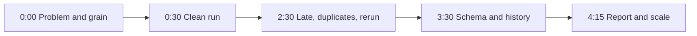

## What you will have at the end

Hala records her demo three times. The first take lasts nine minutes, because she explains the generator line by line. In the second take she says nothing for 12 seconds, the time one `dbt build` needs, and she forgets what she was saying. The third take lasts four minutes and fifty seconds. It is the first one that a stranger could follow, and it is the only one she sends.

A defence is not a lecture about your code. It is a short demonstration with an argument. Here is the problem. Here is the pipeline running. Here is the evidence that it handles late rows, duplicates, reruns and change. Here is what I would do next. A mentor cannot read every file in your project. A five-minute recording shows whether you understand the decisions in them. It is also a way to practise the project question in an interview, which chapter 12.4 described.

At the end of this chapter you will have a recording of about five minutes and a link to it that opens without signing in. You will also have a short notes file in your repository. The notes hold a first draft of answers to four questions that your mentor may ask afterwards. Plan about 50 minutes: 15 to prepare, 20 for two or three takes, 5 for the upload and 10 for the answers.

## Where the project is now

Your repository passes the eight pipeline tests, the seven quality tests and the test of your own for the hardest constraint. Your README and runbook have all their sections. The run takes your scenario from a folder with nothing in it to a tested warehouse and a report page. Everything you will show exists. What remains is to choose what to show, in what order, and what to say while it runs.

## The shape of five minutes

Five minutes is shorter than it sounds. If you spend two minutes on the generator, you have three left for everything the mentor cares about. So the plan puts the proof first and the code last. The table gives the timing. The right column is what you say, and it is short on purpose.

| Time | Show | Say |
|---|---|---|
| 0:00 to 0:30 | Top of the README and the report page | The person, the decision and the grain in one sentence |
| 0:30 to 2:30 | A clean folder, then the demo command | Zones and where personal data goes, while it runs |
| 2:30 to 3:30 | The fact count next to the generator's count, one late record, a rerun | How late data, duplicates and reruns are handled, with numbers |
| 3:30 to 4:15 | The new field and the type 2 dimension | NULL before the change and a value after it; two versions of one record |
| 4:15 to 5:00 | The report on a phone, the runbook | The hardest constraint and what changes at a hundred times the data |

The diagram shows the same plan as a path. Follow it from the left.



What to notice: the clean run sits in the second box, and it takes the longest. A full Mizan demo of 16 days took 148 seconds on the laptop we used to check these steps. Yours may be faster or slower. If your run takes longer than the two minutes in the table, keep talking about the zones until it ends, and make the later segments shorter. Do not hide the wait, and do not cut it. Use it. While the commands scroll, explain the three zones, where the names and phone numbers stay, and how the secret is passed. That is a good use of the time, because privacy is one of the four things a mentor will ask about.

## Decisions before you record

The first decision is whether to script every word or only the order. Read-aloud scripts sound flat, and a lost line makes you forget where you were. Notes work better: one line per segment, with the number you want to say. Write the numbers down before you start, because you will not remember them under the camera. For the fact count, that is the generator's number of good records and the number of rows in the fact table. For late data, it is one record, its upload date and the date it belongs to.

The second decision is how to record. Your computer's screen recorder, with your voice, is enough. A phone camera pointed at the laptop is harder to read. If your laptop cannot record the screen at all, ask your mentor how to submit instead. Do not speed up the video without saying so, and do not cut the run. A mentor can see a cut.

The third decision is when to record. Record when the power and the connection are good, not at the end of a tiring day. Record the file on your own disk first, and upload it when the connection is stable. Check the size, and test a ten-second clip before the long take. A five-minute screen recording at a low resolution is much smaller than one at full resolution. The link must open without signing in. Try it in a private browser window before you submit.

## What to say

Say the number and what it proves, in one sentence. Here is a strong pair of sentences for the third segment, told with the Mizan run of 16 days. "The generator made 1,507 distinct records and 8 bad rows. The fact table should hold 1,499 rows, and it holds 1,499. I ran the last day twice and a hash of the whole table did not change." It names the evidence and the conclusion. A weak sentence is: "Here you can see that it handles duplicates and late data." The viewer cannot check anything, so it is a claim and not evidence.

The same rule applies to privacy. Do not say that the data is anonymous. Say where the names stop. "The names and phone numbers are in the restricted zone only. The shared zone has a key, made with a secret that is read from the environment." Then open one file from each zone, with the personal columns visible in one and missing in the other.

Say what you did not do. "I did not run a backfill of more than three days" is a strength when said plainly, because it shows you know where your work ends. Speak slowly, in short sentences, in plain words. A mentor would rather hear one clear sentence than three careful ones.

## The four questions

After you submit, your mentor replies with one or two questions. They come from this list. Draft your answers now, in three sentences each, in a file called `DEFENCE.md`, so that you are not thinking from nothing when the question arrives. Your recording may already answer some of them.

1. **Grain.** State the grain of your fact table. Show one row. What would break if two rows had the same key?
2. **Idempotency.** What happens if the job runs twice for the same day, or a power cut stops it half way? How do you know?
3. **Privacy.** Where does personal data live, who can read it, and how long is it kept? What would you do if someone asked you to delete one person?
4. **Scale.** What changes at a hundred times the data? What would you measure first?

For the scale question, do not name a size at which a cluster becomes necessary. You learned in chapter 10.4 that the size is something you measure on your own data. A strong answer says what you would measure first, such as the time of each task and the memory use, and what you would change last.

## The task

Rehearse from a clean folder, record, upload, and write the answers. Follow these steps in order.

First, run the tests and check that your working folder is committed. A mentor will look at your repository after the recording.

```powershell
cd C:\de\capstone
pytest -q
git status
```

```bash
cd ~/de/capstone
pytest -q
git status
```

Second, remove everything the pipeline makes, so that you start from the same state as a stranger. Then run the demo command and time it with a watch.

```powershell
Remove-Item -Recurse -Force data, lake, state, logs, site, warehouse.duckdb, transform\target -ErrorAction SilentlyContinue
$env:CAPSTONE_KEY = "any-long-random-text-for-this-project"
python scripts/demo.py --days 14
```

```bash
rm -rf data lake state logs site warehouse.duckdb transform/target
export CAPSTONE_KEY="any-long-random-text-for-this-project"
python scripts/demo.py --days 14
```

Third, record. Keep one rule: if you make a mistake, finish the segment and keep going. Two or three takes are normal. Fourth, upload the file and open the link in a private window. Fifth, write the four answers in `DEFENCE.md` and commit it.

## Expected output

The demo prints one line per date, then the report line. The set of tasks in your line matches the tasks in your runner. This is how the last lines looked for the Mizan pipeline with 14 days.

```text
2026-03-12 extract_registry=ok, land=ok, publish=ok, dbt_build=ok, checks=ok, report=ok
2026-03-13 extract_registry=ok, land=ok, publish=ok, dbt_build=ok, checks=ok, report=ok
2026-03-14 extract_registry=ok, land=ok, publish=ok, dbt_build=ok, checks=ok, report=ok
wrote site/index.html
```

## Break it on purpose

Open a new terminal, so that your secret is not set, and run the demo again from a clean folder. The run must stop with a clear message. It must not crash with pages of error text, and it must not leave a half-finished shared zone. A mentor may try exactly this.

In the Mizan pipeline the message was this. It is in the `detail` of the failed task in `logs/runs.jsonl`, and the date line shows `publish=failed`.

```text
MissingKeyError: MIZAN_KEY is not set. Set it in your shell before publishing, for example: export MIZAN_KEY=some-long-random-text
```

If your project prints something less clear, fix the message before you record. It takes ten minutes, and it is the kind of detail that shows care.

## If you are stuck

First hint: the usual problem is time, not content. If your take is over six minutes, cut the code and keep the evidence. Show a number, not a file. If your take is under three minutes, you probably skipped the proof of reruns or the schema change. Put them back.

If the demo fails in the middle of a take, do not repair it on camera. Open `logs/runs.jsonl`, find the first line with `"status": "failed"` and fix the cause after the take. If your voice or your connection fails, record the segments separately and say at the start of the video that it is joined from separate takes.

## Commit your work

Commit `DEFENCE.md` with your notes and answers. A suggested message: `Add defence notes and answers to the four questions`.

## Submit your recording

```openquestion
prompt: "Paste the link to your five-minute recording. Optionally, add three lines: your scenario, your grain in one sentence, and the last line of 'pytest -q'. Your mentor will reply with one or two of the four questions (grain, idempotency, privacy, scale), and you answer them in writing or in a voice note."
required: true
minWords: 0
allowSpeechInput: true
allowUrl: true
urlRequired: true
urlLabel: "Recording link"
urlHint: "A link your mentor can open without signing in. Screen and voice, or voice with screenshots, about five minutes."
modelAnswer: "Mentor key. Listen for four things in every scenario: the grain said in one sentence and shown on one row; a rerun of one day that leaves the counts and a fingerprint unchanged; the place where personal data stops and the secret that is not in any file; and a scale answer that starts with measuring. The defence questions: 1 Grain: state it, show one row, say what breaks with a repeated key. 2 Idempotency: run a day twice or stop half way; the answer names replacing a partition or merging on the key, and the test that proves it. 3 Privacy: zones, who reads what, retention, how to delete one person. 4 Scale: what to measure first (task times, memory), what changes last, no fixed size. What to listen for in each scenario. Aid distribution: grain is one parcel handout with handout_id; two registrations of one family become one household key made from the normalised phone with a secret; coverage counts distinct households served over distinct households registered; probe the risk that two families sharing a phone are merged and one is wrongly seen as served, and that a changed phone splits one family in two; names and phones stay restricted; the point's area is type 2. Clinic appointments: grain is one appointment with its current status; the status with the latest status_at wins, so an old line arriving late does not undo a newer one; an appointment today is not a no-show yet; the reason is health data and never leaves the restricted zone; a key from the phone is a pseudonym and not anonymity, and local law and a data protection adviser decide real cases; the doctor's clinic is type 2. Solar and power readings: grain is one reading with device_id and read_at; event time decides the day, so a reading three days late changes an old daily total and needs a backfill beyond the lookback; a batch in reverse order gives the same totals; missing readings are not zero; energy is watts times a quarter of an hour; the device's shop is type 2. School attendance: grain is one student on one school day; closed days leave the denominator; a student who moved class keeps the old class's past rate because the fact joins the version valid on its date; late sheets from one teacher arrive together; names and parent phones stay restricted. Freelance shop orders: grain is one order in its current state; the highest version wins, not the latest upload, so version 3 before version 2 gives the same order; a deleted order stays out of net sales and a refund is subtracted once; customer name, phone and address stay restricted; the product's category is type 2; probe what happens when a refund arrives after a weekly report was read. Rubric (Met, Partly, Not yet). Demo: Met when the run starts from a clean folder on camera and ends without error; Partly when it was run before and only shown; Not yet when it is not shown. Evidence: Met when the fact count is compared with the generator's count, a late record and a rerun are shown with numbers; Partly when one of them is missing; Not yet when there are no numbers. Change: Met when the new field and the two versions of the changed record are shown; Partly when only one is shown; Not yet when neither. Explanation: Met when grain, privacy and the hardest constraint are each said in plain words; Partly when one is missing; Not yet when two or more are missing. Time: Met when the recording is between 4 and 6 minutes; Partly when it is between 3 and 4 or 6 and 8; Not yet otherwise. Pass rule: no Not yet and at least three Met. The follow-up answers are read with the same mindset: short, with a number or a test name. A model answer for a different case, a water delivery round, to question 2: If the job runs twice for 3 March, the landing step replaces the partition for that date, and the fact table is keyed on stop_id, so the second run writes the same rows. I run the last day twice in a test and compare a hash of the whole fact table, not only the count. If the power fails half way, the file is written to a temporary name and swapped in at the end, so the next run starts clean."
```

**Next:** Check your project against the ten must-haves and look back at your first pipeline.
