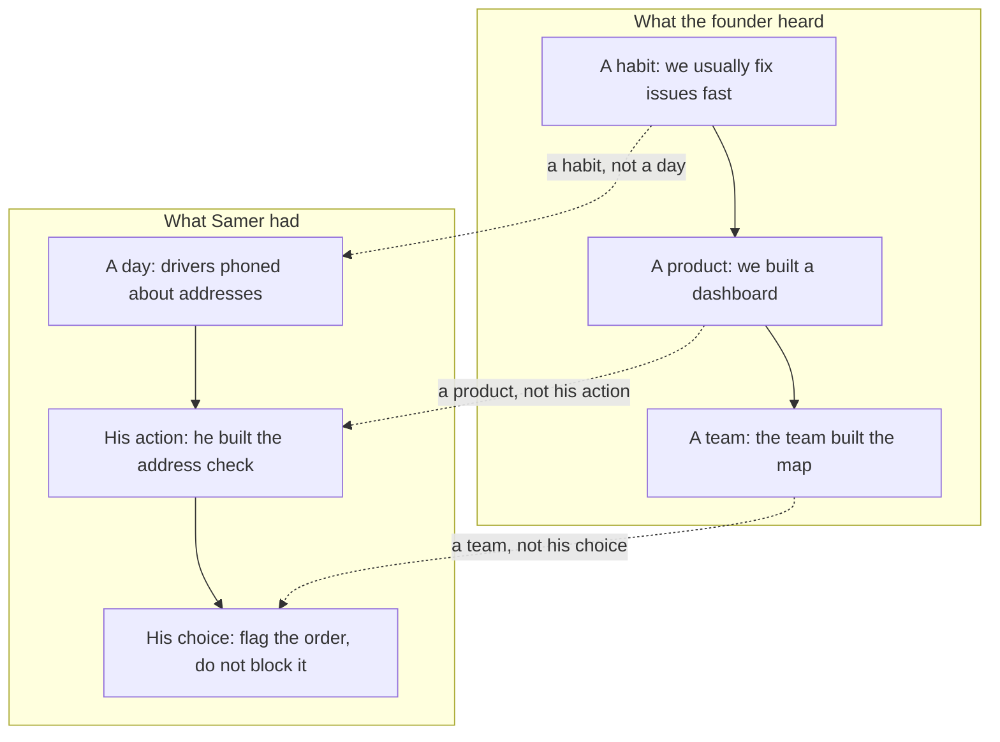

<BigWordAlert term="Ownership" plainEnglish="You made the decisions in a piece of work, and you answer for how it went, good or bad." whyItMatters="A founder wants to know which part of the work was yours, because that part shows what you will do for them." />

## A call at 10:00

Samer is 26. He is a <GlossaryTerm term="backend developer" definition="A developer who builds the parts of an app that users do not see, such as the data and the rules behind the screens." />. For 14 months he has worked at a small courier company, in a team of four developers. Together they built a delivery tracking dashboard. The dispatch staff use it all day to see where every delivery is.

Now Samer wants a new job. A startup of six people is building an inventory app for small shops. Its founder has agreed to a video call. Samer chose the time with care. The power in his street is usually on at 10:00, so he booked the call for then. He charged his laptop and his phone the night before, and he told his family that he needed the room for 40 minutes.

The founder does not read from a list. He talks, and he asks questions as they come to him. Many founder interviews work this way. Samer expected to talk about his skills. He did not expect to be asked about one piece of his work again and again.

## The first three questions

Here is how the first part of the call went.

> **Founder:** "Tell me about a time you fixed a problem fast."
>
> **Samer:** "We usually fix issues fast. When dispatch reports a bug, we look at it the same day."
>
> **Founder:** "Can you give me one example?"
>
> **Samer:** "Sure. We built a delivery tracking dashboard. It shows every delivery on a map."
>
> **Founder:** "What exactly did you do on it?"
>
> **Samer:** "The team built the map, the filters and the delivery list. We also wrote the tests."

Every answer is true. Samer is not lying, and he is not careless. But look at his words. "We usually" comes first. "We built" and "the team built" come next. The founder asked for a time, and Samer gave a habit. The founder asked what Samer did, and Samer gave what his team did. Before you read on, think about what the founder will do now.

```predict
prompt: "Samer has just listed what his team built. What does the founder do next?"
options:
  - id: moves-on
    label: "Accepts the list and moves to a new topic"
  - id: asks-again
    label: "Asks again which part was Samer's own"
correctOptionId: asks-again
explanation: "The founder asked what Samer did, and the answer was about the team. An unanswered question usually comes back, in the same words or in smaller words. In a free conversation the follow-up is where the interview happens, so a list of the team's work does not end the topic."
```

The founder asked again, in a smaller way.

> **Founder:** "Which of those did you write yourself?"
>
> **Samer:** "It was a real team effort. We all worked on everything."
>
> **Founder:** "OK. Thanks, Samer. We will be in touch."

Samer closed his laptop and felt the call had been polite. He had answered every question. But he had not said one thing the founder could check or remember. After 20 minutes the founder knew that Samer worked in a team that built a dashboard. He still did not know what Samer would do for his six-person company.

## What Samer never said

In his fourth month at the courier company, Samer noticed something small. Drivers kept phoning the dispatch desk to ask about delivery addresses. An address was missing a building number, or a street name was spelled in a way the driver did not know. Samer asked the dispatch staff what the calls were about. They showed him a sheet where they tick the reason for every call.

Then Samer acted. He built an address check on the order screen. When an address looks wrong, the screen shows a flag. He also made a choice. The check flags a bad address, and it does not block the order. He chose this because dispatch told him that a blocked order would be lost when a customer was waiting on the phone.

Was this a time he fixed a problem fast? Yes. It was a real day, a real problem, and a real decision. Samer left it out because it felt too small, and because "we" felt polite. This is a very common mistake. People forget that their own small decisions are exactly what an interviewer wants to hear about.

The same thing happens in every kind of work. A designer says "we redesigned the sign-up screens" and forgets that she was the one who watched five users and found the step where they stopped. An operations coordinator says "we reduced late parcels" and forgets that he was the one who started writing down every late parcel. The big result belongs to the team. The noticing, the choice and the checking often belong to one person. Those are the parts a founder can trust, because they are small enough to be checked.



The diagram puts two things side by side that the dialogue kept apart. The left column is what the founder heard, in the order he heard it. The right column is what Samer actually had. Each dotted arrow joins two things at the same level, and each one is a mismatch: a habit where there should be a day, a product where there should be an action, a team where there should be a choice. The founder never saw the right column, so he could not ask about it.

It helps to see the call from the founder's side. He has about 40 minutes and a team of six. If he hires wrongly, the cost is large: pay, months of work, and a gap in a very small team. So he is not asking for a perfect answer. He is trying to learn what this person does when a problem comes to them. "We usually fix issues fast" does not tell him. "The team built the map" does not tell him either. He cannot tell whether Samer led the work, copied a colleague's code, or watched from the side. Samer did nothing wrong, and the founder did nothing unfair. The two of them simply never reached the facts.

## Why this matters in founder and small-team interviews

Research on hiring finds that planned interviews, where everyone gets the same questions and a scoring guide, predict job performance better than free conversations. Many founder interviews are free conversations. You cannot change their method, but you can give the kind of evidence a good scoring guide would look for: one specific episode, what you did, why, what happened, and how you know.

Expect many follow-up questions. In one study of mock interviews, the interviewers asked about four follow-up questions on average in free conversations, and fewer than one in planned interviews. Founders who write about hiring say much the same thing. They ask what you have actually done, pick one project, and keep asking until they know which part was yours.

You can expect questions like "What did you get done last month?", "What exactly did you do?", "Why that way?" and "How would you solve this problem we have now?". Some small teams also ask you to try a short piece of real work. That is another chance to show what you can do. It is not a trick.

None of this means that the founder wants to trick you. A good founder is curious. He wants to find the one thing you did that he can believe, and he keeps asking until he finds it. If your answers keep giving him something real, the questions go well. If your answers keep giving him a group or a habit, the questions end with nothing. The rest of this module is about giving the questions something to find.

## Two words used all through this course

When this course says an answer **holds**, it means you can answer the next "why?" with a fact or a decision. When an answer **breaks**, the next "why?" has no honest answer. You will see both words often. An answer that holds is not a perfect answer. It is one that you can keep explaining, one question at a time, without making anything up.

## How this course lets you practise

This course teaches five qualities that work for any question. Tell one real time. Say which part was yours. Explain the decision. Give an honest number. Give the real reason. You will not memorise a list of questions, because a free conversation does not follow a list.

At the end of each module you can practise with an AI interviewer. It asks one opening question, follows your answer with "why?" and "how do you know?", moves to a second topic, and ends with feedback: your strengths, your weaknesses with a fix for each, and next steps. It needs a <GlossaryTerm term="key" definition="A long secret code from an AI company. It lets this platform send your messages to that company's AI. Keep it private." /> that you get from an AI company and save in your settings. Your questions and answers are saved for you and your mentor, who can read them. They are also sent to the AI company behind your key, which is why the privacy rule below matters. Some keys need paid credit. So the AI practice is optional, and every module has a written task that completes the same step for free.

Two rules protect you. First, never paste your full name, phone number, email, address, ID numbers, passwords, keys, client or employer names, or other people's details into the AI interviewer. Use roles instead, such as "a logistics client" or "my team lead". Second, the feedback can be wrong. AI tools tend to agree with you and to like long answers. Check every point against your own words, and ask your mentor when you disagree.

## People in this course

All the people and teams in this course are fictional, and so is the founder in Samer's story. Later you will also meet Hadeel, a provided fellow for anyone who prefers not to use their own work. She is 24 and a <GlossaryTerm term="frontend developer" definition="A developer who builds the parts of an app that people see and touch, such as screens and forms." />. She did a six-month remote internship with a five-person team that built a clinic booking app, and later she did freelance work for a bakery. Her full resume is shown in 3.6. Whenever this course says "use Hadeel's", you can use her material instead of your own, and you should say that you did.

One small word needs a gloss. To <GlossaryTerm term="release" definition="To make a change available to real users. Many teams say 'ship' for this." /> work means to make it available to users. This course says "release". Everything else you need is defined where it first appears.

<LearningObjectives items={["Answer with one real time instead of what you usually do", "Say which part of the work was yours and which was the team's", "Tell the decision you made: the options, what mattered then and what happened", "Say how you know the result, and what you would change"]} />

## Key words

| Word | Plain English |
|---|---|
| **Free conversation** | An interview where the interviewer chooses questions as they go, with no fixed list |
| **Follow-up question** | A question that asks for more about the answer you just gave, such as "why?" |
| **Your part** | The work and the decisions that were yours, not the team's |
| **End to end** | The whole path of a piece of work: noticing the problem, deciding, building, releasing it to users and checking after |
| **Decision** | A choice between real options, made for a reason you had at the time |

## What is in this module

| Chapter | You will practise |
|---|---|
| 1.2 | Telling one time, not what you usually do |
| 1.3 | Saying "I" and "we" so the line between them is clear |
| 1.4 | Telling the decision, the trade-off and what you would change |
| 1.5 | A graded quiz with five short cases, including an AI answer to check |
| 1.6 | One story you owned, practised with the AI interviewer or in writing |

**Next:** What a story is, what it is not, and how Samer's answer could have become one.
