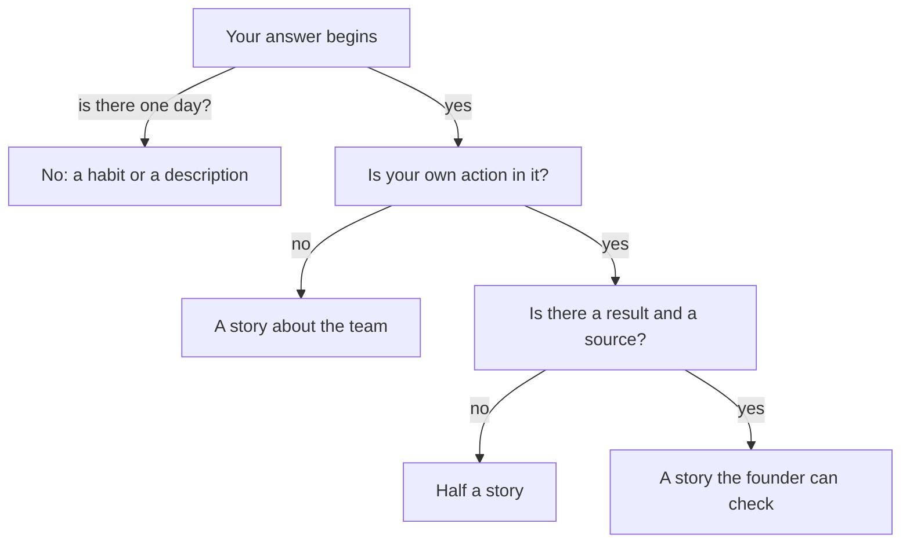

## Three sentences, none about a day

The evening after his call, Samer opened the notes on his phone and typed what he remembered saying. "We usually fix issues fast." "We built a delivery tracking dashboard." "It was a real team effort." He read the three sentences twice. Then he noticed something odd. He had spoken for about ten minutes, and none of the sentences was about a day.

A day has a date, a place, a problem and a person who did something. Samer's answers had none of these. He had described a team, a product and a habit. This chapter teaches the difference, because the founder asked for one thing and Samer gave another. Start with a question about how the founder reacts.

## Predict first

Samer will answer "Tell me about a time you fixed a problem fast" in three tries: first a sentence about himself, then a sentence about what his team usually does, and finally one real day. After each weaker answer, the founder asks one follow-up question.

```predict
prompt: "How many follow-up questions does the founder ask before Samer reaches a real story?"
options:
  - id: two
    label: "Two, one after each weaker answer"
  - id: one
    label: "One, the second answer is close"
correctOptionId: two
explanation: "The self-description draws 'Can you give me an example?'. The sentence about what the team usually does draws 'Which time?'. The third answer is a real day, and it needs no follow-up to become a story. Each weaker answer needs one more question before the founder gets something he can check."
```

## The idea in plain words

When someone asks "Tell me about a time...", they ask for one episode. In this course a **story** means one real episode, told in order: the problem, what you did, and how it ended. It does not need drama. It does not need a happy ending. It needs one day, or one week, that you can point to.

There are two weaker kinds of answer, and almost everyone gives them at first. The first is a **self-description**: "I am hard working", "I am quick and calm under pressure". It says what you are like. It has no time and no event, so nobody can check it.

<BigWordAlert term="Pseudo-story" plainEnglish="An answer that sounds like a story but describes what you usually do, such as 'whenever a client complained, I checked the logs first'." whyItMatters="It has no one day to check, so a founder has to ask 'which time?' before he can learn anything." />

The second kind is the pseudo-story. It uses real work in its words, so it feels like an answer. But the words "usually", "whenever", "always" and "when X happens, we..." give it away. They describe a pattern, not an event. Look at Samer's first answer: "When dispatch reports a bug, we look at it the same day." That is a good habit. It is still a habit.

## What the research found

Researchers led by Adrian Bangerter recorded 62 real selection interviews, mostly with students at a university in Switzerland. They looked at the answers to questions that ask about the past. Only about a quarter of those answers (23 percent) were stories about one specific episode. The most frequent kind of answer was a pseudo-story. In that study, stories and near-stories raised the interviewers' hiring recommendations, and plain self-descriptions lowered them.

Two more findings help you. First, the stories in the study had more about the situation than about what the person did or what happened. Second, the researchers suggested that candidates may not know how much detail the interviewer wants. This is a learnable skill. It is not a talent. In a free conversation, a founder keeps asking, so a habit answer will not end the topic. It only adds questions before you reach the part he can use. That last point is the course's own reasoning, and the canvas below shows it.

## Step through the founder's questions

The canvas follows Samer through the founder's questions. At every step, the note ends with a question for you. Answer it in your head before you press Next, then compare. Notice what the founder can check at each step.

<InteractiveCanvas slug="story-or-usually" />

Here the canvas shows how each kind of answer sounds and what the next question is. Start by answering the question at the end of each note, then press Next to see if you were right. The canvas is one example: real founders differ, and your own story needs your own facts.

## How to find your day

If no day comes to mind, do not search for your biggest success. Search for your smallest real problem. Ask three questions. When did something break, and what did I do the same week? When did someone ask me a question that I could answer only because I had looked at the work closely? When did I change my mind about how to do something? Each question points at a day. A small day with a clear problem and a clear action is better than a large season with neither.

Then check the day against the founder's next question. If he asks "why?", can you answer? If he asks "how do you know it worked?", do you have a source, or a plain "I did not measure that"? You will learn more about both answers in the next chapters. For now, your task is only to find one day that is yours.

## One worked example, from another job

Reem is an operations coordinator at a translation agency. The interviewer asks her about a time she improved a process. Her first answer is a self-description: "I always try to make our file handling simpler." The follow-up that breaks it is "Can you give me an example?". She has none ready, so she gives a pseudo-story: "When translators send the wrong file, I usually check the version and tell them." The follow-up that breaks that is "Which time?".

Now build the stronger answer in three steps. Step one is to choose a day. Reem thinks of the weeks when clients kept complaining about wrong files. Step two is to keep the background to one sentence: "In June, translators kept sending clients the wrong file version." Step three is to spend her words on what she did and what happened: "I added a version name to every file and a check before sending. The agency's complaints sheet showed 10 wrong-file complaints in the four weeks before and 4 in the four weeks after."

Count what the interviewer got: a time, a problem, an action, a number and a source. The second answer is not smarter than the first. It is only about one time. The same move turns Samer's three sentences into his address-check story in four sentences: the day, the problem, what he built, and the call sheet.



This diagram adds three tests that the canvas does not show. The canvas shows the first one, the day. The diagram adds two more: is your own action in the answer, and does it have a result with a source? Each "no" leads to a different weak answer, and each weak answer draws a different follow-up question. "A habit or a description" draws "Which time?". "A story about the team" draws "What did you do?". "Half a story" draws "How do you know?". Only the bottom box needs no follow-up.

## A day when it went wrong

Asma is a support analyst at a small app company. Before her first founder interview, she practised with a friend. The friend asked, "Tell me about a time you helped an unhappy customer." Asma said, "I always reply to customers within a day, and I try to stay calm." The friend asked, "Which time?" Asma opened her mouth and found nothing. She had answered hundreds of customers, and she could not name one.

The problem was not her memory. She had never written anything down, so every customer had become part of the same blur. Her friend gave her a small task. Before any interview, choose three small episodes from the last year. Write one line for each: the day, the problem, what you did, and what happened. Asma wrote three lines in 15 minutes. The first one began, "In March, a customer was charged twice."

The lesson is not to prepare a perfect story. It is to have the day ready before the question comes. A pseudo-story is rarely a choice. It is what is left when no day was ready.

## Try it on your own resume today

Open your resume and choose the one line you are proudest of. Write one sentence for each part of a story: the day or week, the problem you saw, what you did, and what happened. If you cannot write the day, you have a pseudo-story. Search your memory for the smallest real episode behind the line. If you prefer not to use your own work, use Hadeel's, whom you met in 1.1. On one visit to a clinic near her home, she watched three patients struggle with one long form on their phones. Write the story you would tell if you were her.

## Check your understanding

```quiz
type: mcq
question: "Fadi is a mobile developer. Interviewer: 'Tell me about a time you found a bug before users did.' Fadi: 'Last month the delivery app showed an order as on the way after it was delivered. I fixed it.' Fadi's facts: he found the status refreshed only when the screen was reopened, made it refresh every 30 seconds, and wrong-status tickets fell from 9 to 2 in the support inbox. What should he add so this is a story?"
options:
  - "The app has 50,000 users in 6 cities. The status screen is one of the screens that users open most, on phones and on tablets."
  - "I found the status refreshed only on reopening, so I made it refresh every 30 seconds. Wrong-status tickets fell from 9 to 2."
  - "My lead was pleased with the fix. Two teammates told me it was a good fix, and the 3 of them said so at the weekly meeting."
  - "I like to fix status bugs fast. I check the screen on my own phone 2 or 3 times before I send any change to the lead."
correct: 1
explanations:
  - "This is background about the app, with numbers that say nothing about what Fadi did. The study of real interviews found that candidates already give more about the situation than about their actions."
  - "Right. It adds what he found, what he did and what happened, with a source in the support inbox. These are the parts the founder cannot yet check."
  - "Praise from his lead and teammates is other people's opinion. It does not say what Fadi did, and the founder cannot check it."
  - "'I like to fix' and 'I check' describe a habit again. The founder asked for one time, and this answer gives none."
```

```quiz
type: mcq
question: "Salma designs the event form for a university club. Her draft answer: 'The club has 400 members and holds events every term. The old form was slow. Many people used it on phones. Last term I moved the Submit button up.' Her facts: she tested the form with 3 friends on small phones, 2 could not find Submit, and after she moved it all 3 sent the form. Which edit makes the answer a stronger story?"
options:
  - "Add the club's history: it has 400 members, 12 committee roles and 6 events each term. Then say that the form was updated last term."
  - "Replace it with 'I usually test with 3 or 4 users and then fix the biggest problem I find on each form.'"
  - "Add a second project, so the interviewer sees 2 pieces of work. Then move the form story to the end of the answer."
  - "Cut the club to one sentence, then add the test with 3 friends, the 2 who missed Submit and the result after the change."
correct: 3
explanations:
  - "Her draft already has three sentences of background and one of action. More background repeats what the study found candidates do: tell more about the situation than about what they did."
  - "'I usually test' is a habit. It drops the one real time she has, which is last term's change."
  - "Two projects mean two thin answers instead of one good one. The interviewer asked for one time."
  - "Right. One sentence of background is enough. The space goes to what she saw, what she changed and what happened, which is where the interviewer's questions will go."
```

**Next:** Separating "I" from "we": what exactly did you do, and what did the team do?
