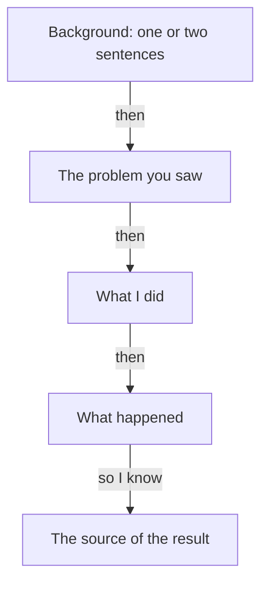

## Three sentences, none about a day

The evening after his call, Samer opened the notes on his phone and typed what he remembered saying. "We usually fix issues fast." "We built a delivery tracking dashboard." "It was a real team effort." He read the three sentences twice. Then he noticed something odd. He had spoken for about ten minutes, and none of the sentences was about a day.

A day has a date, a place, a problem and a person who did something. Samer's answers had none of these. He had described a team, a product and a habit. This chapter teaches the difference, because the founder asked for one thing and Samer gave another.

## The idea in plain words

When someone asks "Tell me about a time...", they ask for one episode. In this course a **story** means one real episode, told in order: the problem, what you did, and how it ended. It does not need drama. It does not need a happy ending. It needs one day, or one week, that you can point to.

There are two weaker kinds of answer, and almost everyone gives them at first. The first is a **self-description**: "I am hard working", "I am quick and calm under pressure". It says what you are like. It has no time and no event, so nobody can check it.

<BigWordAlert term="Pseudo-story" plainEnglish="An answer that sounds like a story but describes what you usually do, such as 'whenever a client complained, I checked the logs first'." whyItMatters="It has no one day to check, so a founder has to ask 'which time?' and you lose a turn." />

The second kind is the pseudo-story. It uses real work in its words, so it feels like an answer. But the words "usually", "whenever", "always" and "when X happens, we..." give it away. They describe a pattern, not an event. Look at Samer's first answer: "When dispatch reports a bug, we look at it the same day." That is a good habit. It is still a habit.

## What the research found

Researchers led by Adrian Bangerter recorded 62 real selection interviews, mostly with students at a university in Switzerland. They looked at the answers to questions that ask about the past. Only about a quarter of those answers (23 percent) were stories about one specific episode. The most frequent kind of answer was a pseudo-story. In that study, stories and near-stories raised the interviewers' hiring recommendations, and plain self-descriptions lowered them.

Two more findings help you. First, the stories in the study had more about the situation than about what the person did or what happened. Second, the researchers suggested that candidates may not know how much detail the interviewer wants. This is a learnable skill. It is not a talent. Notice also that those were planned interviews. A founder in a free conversation will not accept a habit for long, because he keeps asking. So the pseudo-story costs you a turn, and the self-description costs you two. This part is the course's own reasoning, and the canvas below shows it.

## Predict before you step through

Samer's second answer was a habit. Here is a different sentence from a similar answer. Decide whether it is a story.

```predict
prompt: "Samer says: 'Whenever dispatch complained about a bug, I checked the logs first.' Is this a story?"
options:
  - id: habit
    label: "No, it describes a habit"
  - id: story
    label: "Yes, it names a task and an action"
correctOptionId: habit
explanation: "The word 'whenever' turns many days into one pattern. The sentence names a task and an action, but there is no one day: no date, no particular bug, no result. A founder can only ask 'which time?'."
```

The canvas below follows Samer through the founder's questions. Step through it slowly. At each step, ask yourself what the founder can check.

<InteractiveCanvas slug="story-or-usually" />

**What this shows:** three kinds of answer to the same question, and the follow-up each one draws. **Try this:** at step 3, check your prediction, then count the turns Samer spent before his first real answer. **What changed:** with every step, the answer moved closer to one day. The self-description needed two follow-ups before it reached a story, and the story needed none, because it already held a time, Samer's part and a number. **Limits of the model:** this is one example, and some interviewers accept a habit and move on. Your own story needs your own facts.

## A full worked example

Here is the weak answer again, and what breaks it. The question is "Tell me about a time you fixed a problem fast." Samer's pseudo-story is "We usually fix issues fast. When dispatch reports a bug, we look at it the same day." The follow-up that breaks it is "Which time?" Samer cannot answer in the same style, because there is nothing to continue. He has to leave the habit and find a day.

Now the stronger answer, built in three steps. Step one is to choose a day. Samer thinks of the address calls. Step two is to keep the background short. He needs only one sentence for the situation: "In my fourth month, drivers kept phoning dispatch about wrong addresses." Step three is to spend his words on what he did and what happened: "I built a check on the order screen that flags a bad address. The dispatch call sheet showed about 12 address calls a week before, and about 5 a week in the four weeks after."

Count what the founder got: a time, a problem, an action, a number and a source. Samer said it in four sentences. The next "why?" has something real to hold. The founder can ask, "Why a check and not a message to the drivers?" and Samer has an answer, because it was his decision. Chapter 1.4 comes back to that decision.

Here is a second example from another kind of work. Reem is an operations coordinator at a translation agency. Asked about a time she improved a process, she says, "I always try to make our file handling simpler." That is a self-description. A stronger answer is, "In June, translators kept sending the wrong file version to clients. I added a version name to every file and a check before sending. The agency's complaints sheet showed six wrong-file complaints the month before and two the month after." The second answer is not smarter. It is only about one time.



The diagram shows where a story spends its words. Start small with the background. Then move quickly to the problem, to your action, and to what happened. The last box matters most for a founder who asks "how do you know?". Each arrow is a place where the founder can ask for more. If a box is empty, the founder will ask about it.

## Where people go wrong

**Too much background.** The study found that candidates tell more about the situation than about their actions. If you spend 40 seconds on how the company works, you have used the time that belongs to your own part. Keep the background to one or two sentences.

**A story that is too big.** "Over the whole year, I improved our testing" is not one time. It is a season. Pick the smallest piece that still has a problem, an action and a result, such as one week or one bug.

**A story that is not yours.** If your part was small, say so and tell your part. Chapter 1.3 shows how. Do not tell the team's famous win as if it were your story.

**Waiting for a dramatic story.** A good story is not a crisis. Samer's address check was small. It was also his, it was real, and it had a number. A founder can believe that kind of story more easily than a large one.

**Using "usually" as a habit of speech.** Many people say "usually" when they mean "once, and I think it happened often". Hear it in your own answers. When you say "usually", stop and ask which day you mean.

## Try it on your own resume today

Open your resume and choose the one line you are proudest of. Write one sentence for each part of a story: the day or week, the problem you saw, what you did, and what happened. If you cannot write the day, you have a pseudo-story. Search your memory for the smallest real episode behind the line. If you prefer not to use your own work, use Hadeel's: while building a clinic booking page, she watched three patients struggle with one long form on a phone. Write the story you would tell if you were her.

## Check your understanding

```quiz
type: mcq
question: "Adam is an operations assistant at a charity shop. The interviewer asks, 'Tell me about a time you improved something.' Adam's facts: in October the stock sheet showed 14 coats the shop did not have, he found that donated coats were counted twice, and he fixed the formula. Which opening uses these facts as a story?"
options:
  - "I am careful with numbers, and I have kept the charity shop's stock sheet right for a whole year, month after month."
  - "When a sheet looks wrong, I usually check the formulas first, and then I fix whatever I find in them before the next count."
  - "In October the stock sheet showed 14 coats we did not have. Gifts were counted twice, so I fixed the formula."
  - "Our team has a good process for the stock sheet, and we check it together every month so that we fix any errors quickly."
correct: 2
explanations:
  - "This describes Adam. It has no day and no event, so the interviewer has nothing to check. It is a self-description."
  - "'Usually' and 'whenever I find' describe a habit. The facts name one month and one problem, and this answer uses neither."
  - "Right. It names a time (October), a problem (14 coats that did not exist), the cause Adam found and what he did. Every part can be checked."
  - "This is about the team and about a monthly habit. It does not say what Adam did, and it leaves out the October problem."
```

```quiz
type: mcq
question: "Salma designs the event sign-up form for a university club. Her draft answer is: 'The club has 400 members and holds events every term. The old form was slow. Many people used it on phones. Last term I removed the phone number step.' The interviewer wants a story. What is the best edit?"
options:
  - "Add more about the club: its history, its committee and the events it has held in past terms"
  - "Cut the club to one sentence, then add what she saw and what happened after"
  - "Replace it with 'I usually look for the step where people stop and then I fix that step'"
  - "Add a second project, so the interviewer sees how much work she has done in other places"
correct: 1
explanations:
  - "Her draft already has three sentences of background and one of action. In the study of real interviews, candidates told more about the situation than their own actions. More background makes this worse."
  - "Right. One sentence of background is enough. The space goes to what she saw, what she changed and what happened, which is where the interviewer's questions will go."
  - "'I usually look for' is a habit. It drops the one real time she has, which is last term's change."
  - "A second project means two thin answers instead of one good one. The interviewer asked for one time."
```

**Next:** Separating "I" from "we": what exactly did you do, and what did the team do?
