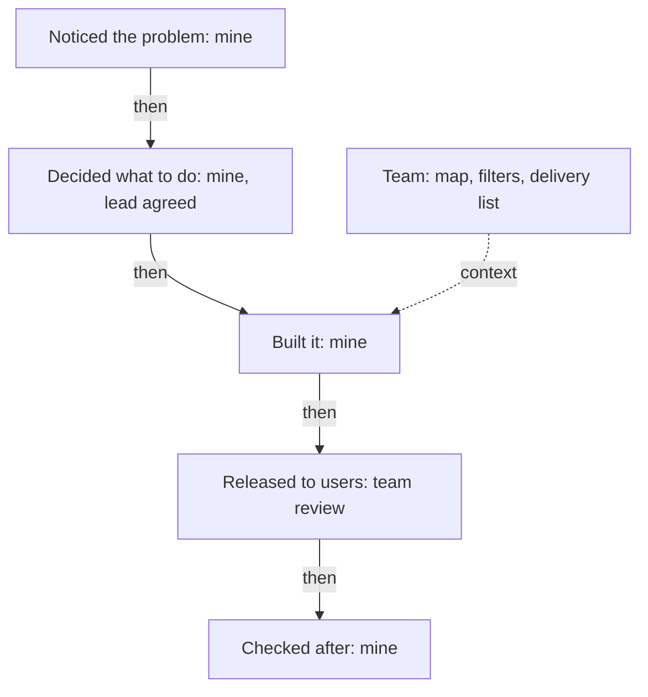

## "So what did you do?"

A week after his call, Samer practises with his friend Fadi, a mobile developer who agrees to play the founder. Fadi asks about the dashboard project. Samer answers, and Fadi stops him. "That was all 'we'," Fadi says. "I still do not know what you did. So, what did you do?"

Samer tries again. This time he says "I" in every sentence. "I built the map. I built the filters. I wrote the tests." Fadi nods slowly. In fact, a teammate wrote the filter code, and Samer only reviewed it. Samer wants to sound strong, so he does not say that. Before you read on, think about what Fadi does next.

```predict
prompt: "Samer says 'I' for everything, including filters a teammate wrote. What does Fadi do?"
options:
  - id: moves-on
    label: "Believes all of it and moves to a new topic"
  - id: check
    label: "Asks one small check question about one piece"
correctOptionId: check
explanation: "A claim as wide as 'I built all of it' is easy to test with one small question, such as 'Who wrote the filter code?'. The founder does not need to doubt Samer to ask it. If the answer is 'a teammate', the claim breaks, and the other parts of the answer lose some trust."
```

Fadi asked, "Who wrote the filter code?" Samer was quiet, and then he said, "A teammate." Fadi smiled, because the practice had worked. It had shown Samer the two ways this question goes wrong: too much "we", and too much "I".

## What a clear line sounds like

Hiring guides written by startup founders suggest a question for team projects: "So what did you do?" The founders do not doubt that the team did good work. They want to know which part they can believe was yours. The question usually comes twice, in smaller words the second time, as it did with Samer.

The rule is simple. Use "we" for the team's work. Use "I" for your part. Make the line between them clear in one sentence: "The team built the app. I designed the sign-up flow and ran the user tests." Both parts matter. The first sentence shows that you see the team. The second shows what you bring.

Researchers who study faking in interviews name a kind of faking called borrowing: answering with other people's experiences or accomplishments. Saying "we" is not borrowing. But if you cannot separate your part, you look as if you are borrowing, even when you are not. The founder cannot see inside your memory. He sees only whether your words still stand at the second question.

## End to end

You met the words "end to end" in 1.1. Here is how to use them. The whole path of a piece of work has five places: you noticed the problem, you decided what to do, you built it, it was released to users, and you checked what happened after. A strong story shows how many of these places were yours. Samer owned all five for the address check, with one thing he should say aloud: his team lead agreed to the plan before he started.

Many people own only some of the places. A developer is given a ticket, builds it and passes it on. That is fine. The honest and strong answer is to say which places were yours and to own them fully: "My manager decided what to build. I built it and wrote the tests. I did not see how it did after the release." This is a better answer than one that pretends to a whole path, because a founder who asks about the missing places will find them empty.

## Step through two answers

The canvas has three actors: the Founder, Samer, and Samer's notes. The notes hold what Samer really did, written before the interview. Step through the weak answer first, then the strong one.

<InteractiveCanvas slug="my-part-team-part" />

The canvas shows two answers to the same question and how the founder reacts to each. Try it by saying, at each founder question, what you would answer before you read Samer's reply. It is one conversation with prepared notes, so a real founder may ask different second questions.

## A worked example from a volunteer project

Nadia is a frontend developer who helped two other volunteers build a timetable sheet for a school. The lead teacher decided the timetable rules. A second volunteer made the print layout. Nadia wrote the check that finds two classes in the same room at the same time.

Start with her weak answer: "We built a timetable sheet for the school." The follow-up that breaks it is "Which part was yours?". If she says "I helped", the word "helped" hides the work. If she says "all of it", the question "Who set the timetable rules?" breaks the claim. Neither answer gives the founder anything to use.

Now build the strong answer in four steps. First, name the team's work in one short sentence: "Three volunteers built the timetable sheet." Second, say your part with action words: "My part was the clash check." Third, show the path: "I saw that teachers found clashes by hand. I wrote the check and tested it on last year's timetable. It found 6 clashes the teachers already knew and 4 that nobody had seen." Fourth, say who decided what: "The lead teacher set the rules. I chose how the check reports a clash."

Notice the fourth step. Nadia does not claim the teacher's rules, and she does not hide them. A founder who hears that kind of sentence trusts the other sentences more. The next question is no longer "what did you do?". It is "why report clashes that way?", and Nadia is ready, because it was her choice. Samer's strong answer in the canvas has the same four parts.



This diagram shows Samer's path with an owner on each step. Four boxes are marked "mine", one is shared, and the team's work sits to the side as context. A story like this gives the founder five places to ask questions, and Samer can answer each one. If you owned only the middle, mark only the middle box. That is still a strong answer, as long as you describe it fully.

## Where people go wrong

**Saying "we" to be polite.** In many places, "we" is the modest and respectful word. A founder reading your answers does not hear modesty. He hears an answer with no person in it. You can stay modest and still be accurate: "The team built the dashboard" is modest. "My part was the address check" is accurate. Both can be said in one breath.

**Saying "I" for everything.** The opposite mistake is as common. A claim wider than your work cannot answer a small check question, and then the founder doubts everything else. Say "I" only for what you can describe in detail.

**Using soft verbs.** "I helped with", "I was involved in" and "I supported" hide what you did. Ask yourself: helped with what? Replace the soft verb with the real action, such as "I wrote", "I tested" or "I decided".

**Hiding the team.** Removing the team from the story is not the answer. A story with no one else in it sounds unlikely, and the founder wants to know that you can work with people. Name the others by role: "a teammate", "the designer", "my lead".

**Leaving out what was not your decision.** If your lead decided something, say so. Module 3 shows that "that was not my decision" is a strong answer. It is much stronger than a decision you claim and cannot explain.

## Try it on your own resume today

Choose one project on your resume that a team worked on. Make two columns on paper or on your phone. In the first, write what the team did. In the second, write what only you did, using verbs such as noticed, decided, built, tested, checked. Then add a third short line: what was decided by someone else. If you prefer not to use your own work, use Hadeel's first resume line, which you can read about in 1.1. She built the patient booking page of a clinic booking app. Other people built the backend and the clinic dashboard. On one visit to a clinic near her home, she watched three patients struggle with one long form on their phones, and she proposed splitting it into three short steps. The designer agreed. Write the two columns for her.

## Check your understanding

```quiz
type: mcq
question: "Tareq builds the checkout for a small online shop, in a team of three. A coupon feature was released last quarter. The frontend developer built the coupon box. Tareq's manager chose the discount rules. Tareq wrote the server check for the codes and its tests. The founder asks, 'What exactly did you do?' Which answer is accurate and clear?"
options:
  - "I added coupon codes to the checkout and tested them. I took the lead on the feature so that it reached users on time."
  - "We added coupon codes to the checkout, in a team of three. I was part of the small team that worked on it from start to finish."
  - "My manager chose the discount rules and a teammate built the coupon box. I built the server check for the codes and wrote its tests."
  - "I led the coupon project from the first idea to the release. I made sure that each rule from my manager worked in the code."
correct: 2
explanations:
  - "This claims the whole feature, but the frontend developer built the coupon box and the manager chose the rules. One question about the box would break it."
  - "'We' and 'part of the small team' leave the founder where Samer was: he still does not know what Tareq did."
  - "Right. It names what others did by role and says Tareq's own part with two action words. Each piece matches a stated fact, and the founder can go straight to a 'why' about the code check."
  - "'Led from the first idea' contradicts the fact that his manager chose the discount rules. A leader would have made that decision."
```

```quiz
type: mcq
question: "Reem is an operations coordinator at a translation agency. Her lead asked for fewer wrong-file complaints and approved her plan. Reem designed the version names and the check before sending, and she counted the complaints on the agency's sheet: 10 in the four weeks before and 4 in the four weeks after. Which sentence about her part is accurate?"
options:
  - "The lead asked for fewer wrong-file complaints and approved my plan. I designed the version names and the check, and counted complaints: 10 to 4."
  - "I ran the project from the first idea to the last report. The lead only signed the form at the end, after the 4 weeks had passed and the names were in use."
  - "We cut wrong-file complaints from 10 to 4 in four weeks. I was one of the coordinators who used the new version names on the shared drive."
  - "I helped with the version names, and I was involved in counting the complaints. The lead and the team did most of the main work on it."
correct: 0
explanations:
  - "Right. It says what the lead did, what Reem designed and what she counted, with the source figures. Each part matches the facts, and her own part is clear."
  - "The lead asked for the change and approved the plan, so Reem did not own every place on the path. 'The lead only signed' also changes the stated fact."
  - "'We' hides who designed the names and the check, and 'one of the coordinators who used' undersells her. She designed them."
  - "'Helped with' and 'was involved in' are soft verbs that hide the work. The facts say she designed the names and the check and counted the complaints."
```

**Next:** The decision at the centre of a story: the options you had, what mattered then, and what you would change.
