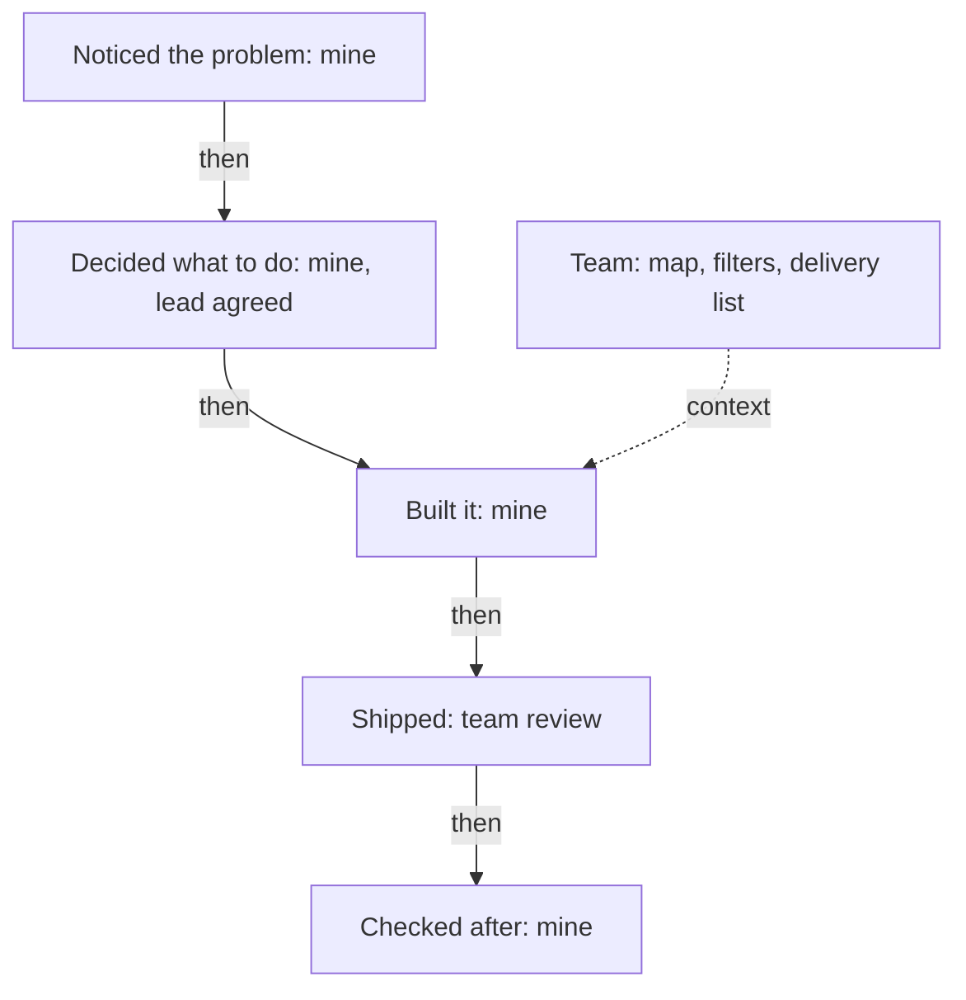

## "So what did you do?"

A week after his call, Samer practises with his friend Fadi, a mobile developer who agrees to play the founder. Fadi asks about the dashboard project. Samer answers, and Fadi stops him. "That was all 'we'," Fadi says. "I still do not know what you did. So, what did you do?"

Samer tries again. This time he says "I" in every sentence. "I built the map. I built the filters. I wrote the tests." Fadi nods slowly. Then he asks, "Who wrote the filter code?" Samer is quiet. A teammate wrote it. He had only reviewed it. Fadi smiles, because the practice has worked. It has shown Samer the two ways this question goes wrong.

## The idea in plain words

Founders who write about hiring say that when a project was a team project, they ask: "So what did you do?" They are not rude, and they do not doubt that the team did good work. They want to know which part they can believe was yours. The question usually comes twice, in smaller words each time, as it did with Samer.

The rule is simple. Use "we" for the team's work. Use "I" for your part. Make the line between them clear in one sentence: "The team built the app. I designed the sign-up flow and ran the user tests." Both parts matter. The first sentence shows that you see the team. The second shows what you bring.

Researchers who study faking in interviews name a kind of faking called borrowing: answering with other people's experiences or accomplishments. Saying "we" is not borrowing. But if you cannot separate your part, you look as if you are borrowing, even when you are not. The founder cannot see inside your memory. He sees only whether your words hold up at the second question.

## End to end

You met the words "end to end" in 1.1. Here is how to use them. The whole path of a piece of work has five places: you noticed the problem, you decided what to do, you built it, it shipped, and you checked what happened after. A strong story shows how many of these places were yours. Samer owned all five for the address check, with one exception that he should say aloud: his team lead agreed to the plan before he started.

Many people own only some of the places. A developer is given a ticket, builds it and passes it on. That is fine. The honest and strong answer is to say which places were yours and to own them fully: "My manager decided what to build. I built it and wrote the tests. I did not see how it did after the release." This is a better answer than one that pretends to a whole path, because a founder who asks about the missing places will find them empty.

## Predict before you step through

Samer now knows that "we" alone does not work. A natural idea is to say "I" for everything. Think about what the founder will do.

```predict
prompt: "To sound strong, Samer says 'I worked on all of it', including filters a teammate wrote. What does the founder do?"
options:
  - id: moves-on
    label: "He is satisfied and moves on"
  - id: check
    label: "He asks a check question"
correctOptionId: check
explanation: "A claim as wide as 'all of it' is easy to test with one small question, such as 'Who wrote the filter code?'. The founder does not need to doubt Samer to ask it. If the answer is 'a teammate', the claim breaks, and the other parts of the answer lose some trust."
```

The canvas has three actors: the Founder, Samer, and Samer's notes. The notes hold what Samer really did, written before the interview. Step through it and watch where the weak answer breaks and where the strong answer holds.

<InteractiveCanvas slug="my-part-team-part" />

**What this shows:** two answers to "What exactly did you do?" and how the founder reacts to each. **Try this:** at step 4, say what the founder asks next, then check step 5, and find the two sentences in step 8 that draw the line. **What changed:** the weak answer needed three founder questions to fall apart. The strong answer moved the interview to a new question, "Why flag?", because the founder had a clear part to ask about. **Limits of the model:** this is one conversation, and Samer's notes are what he prepared before.

## A full worked example

Start with the weak answer. Fadi asks, "What exactly did you do on the dashboard?" and Samer says, "We built the map, the filters and the delivery list." Under the second question, "Which of those did you build?", the answer cannot continue. If he says "all of it", the third question, "Who wrote the filters?", breaks the claim. If he says "I helped", the word "helped" hides the work. Neither answer gives the founder anything to use.

Now build the strong answer in four steps. First, name what the team did in one short sentence: "The four of us built the dashboard." Second, say your part with action words: "My part was the address check on the order screen." Third, show the path: "I noticed drivers phoning dispatch about addresses. I built the check. I chose to flag bad addresses and not block them. I checked the dispatch call sheet after." Fourth, say who decided what: "My team lead agreed the plan. The choice between flagging and blocking was mine, after I spoke to dispatch."

Notice the fourth step. Samer does not claim the team lead's approval, and he does not hide it. A founder who hears that kind of sentence trusts the other sentences more. The next question is no longer "what did you do?". It is "why flag?", and Samer is ready, because it was his choice.

Here is a second example, from a volunteer project. Nadia is a frontend developer who helped three volunteers build a timetable sheet for a school. The lead teacher decided the timetable rules. A second volunteer built the print layout. Nadia wrote the check that finds two classes in the same room at the same time. Her honest answer is: "The lead teacher set the rules and another volunteer made the print layout. My part was the clash check. I wrote it, tested it on last year's timetable, and found four clashes the teachers had missed." That answer is clear, short and checkable.



This diagram shows Samer's path with an owner on each step. Four boxes are marked "mine", one is shared, and the team's work sits to the side as context. A story like this gives the founder five places to ask questions, and Samer can answer each one. If you owned only the middle, mark only the middle box. That is still a strong answer, as long as you describe it fully.

## Where people go wrong

**Saying "we" to be polite.** In many places, "we" is the modest and respectful word. A founder reading your answers does not hear modesty. He hears a blank. You can stay modest and still be accurate: "The team built the dashboard" is modest. "My part was the address check" is accurate. Both can be said in one breath.

**Saying "I" for everything.** The opposite mistake is as common. A claim wider than your work breaks at one small question, and then the founder doubts everything else. Say "I" only for what you can describe in detail.

**Using soft verbs.** "I helped with", "I was involved in" and "I supported" hide what you did. Ask yourself: helped with what? Replace the soft verb with the real action, such as "I wrote", "I tested" or "I decided".

**Hiding the team.** Removing the team from the story is not the answer. A story with no one else in it sounds unlikely, and the founder wants to know that you can work with people. Name the others by role: "a teammate", "the designer", "my lead".

**Leaving out what was not your decision.** If your lead decided something, say so. Module 3 shows that "that was not my decision" is a strong answer. It is much stronger than a decision you claim and cannot explain.

## Try it on your own resume today

Choose one project on your resume that a team worked on. Make two columns on paper or on your phone. In the first, write what the team did. In the second, write what only you did, using verbs such as noticed, decided, built, tested, checked. Then add a third short line: what was decided by someone else. If you prefer not to use your own work, use Hadeel's first resume line. She built the patient booking page of a clinic booking app. Other people built the backend and the clinic dashboard. After watching three patients struggle with one long form on a phone, she proposed splitting it into three short steps, and the designer agreed. Write the two columns for her.

## Check your understanding

```quiz
type: mcq
question: "Tareq builds the checkout for a small online shop, in a team of three. A coupon feature shipped last quarter. The frontend developer built the coupon box. Tareq's manager chose the discount rules. Tareq wrote the server check for the codes and its tests. The founder asks, 'What exactly did you do?' Which answer is accurate and clear?"
options:
  - "My manager chose the discount rules and a teammate built the coupon box. I built the code check and wrote its tests."
  - "I added coupon codes to the checkout and tested them, and I took the lead so that the whole feature reached users on time."
  - "We added coupon codes to the checkout, and I was part of the small team that worked on it from start to finish."
  - "I led the coupon project from the first idea to the release, and I made sure that every part of it worked well."
correct: 0
explanations:
  - "Right. It names what others did by role and says Tareq's own part with two action words. Each piece matches a stated fact, and the founder can go straight to a 'why' about the code check."
  - "This claims the whole feature, but the frontend developer built the coupon box and the manager chose the rules. One question about the box would break it."
  - "'We' and 'part of the team' leave the founder where Samer was: he still does not know what Tareq did."
  - "'Led from the first idea' contradicts the fact that his manager chose the discount rules. A leader would have made that decision."
```

```quiz
type: mcq
question: "Reem is an operations coordinator at a translation agency, in a team of five. A client asked the agency to track file delivery times. The operations lead chose what to track and sent the monthly report. Reem built the tracking sheet and filled it in every day. Nobody checked whether late files went down. What is the most honest way for Reem to describe her part?"
options:
  - "I ran the tracking project end to end, from the first idea to the final report, and I showed the client the results."
  - "We tracked delivery times every day and late files went down, so the whole project was a clear success for the client."
  - "I only filled in a sheet every day, so there is no part of this project that I can talk about in an interview."
  - "I built and filled the tracking sheet. The lead chose what to track. I did not check if late files fell."
correct: 3
explanations:
  - "The lead chose what to track and sent the report, so Reem did not own the whole path. 'End to end' claims places that were not hers."
  - "This says 'we' and claims a result, but nobody checked whether late files went down. The claim has no source."
  - "This sells her short. She built the sheet and filled it every day, which is real work with a real owner, and she can describe it fully."
  - "Right. She owns the middle of the path and says so. She also names the place nobody checked, which is honest and easy to follow with 'I would count late files for a month'."
```

**Next:** The decision at the centre of a story: the options you had, what mattered then, and what you would change.
