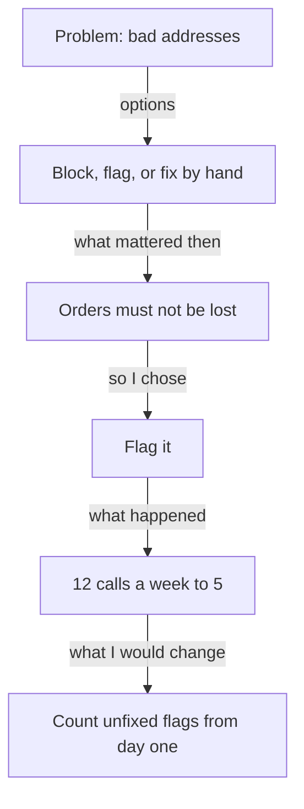

## "What else could you have done?"

Fadi, playing the founder again, listens to Samer's new answer about the address check. It is much better. It has a day, a problem, a clear "my part" and a number. Then Fadi asks, "Why flag the bad addresses? What else could you have done?"

Samer says, "Nothing really. Flagging was the obvious way." Fadi shakes his head. "Then it was not a decision," he says. "A decision is when you could have gone another way. If there was only one way, I have learned nothing about how you think."

Samer thinks about it. There were other ways. He had simply forgotten them, because the choice had felt natural at the time. This chapter is about getting them back and putting them into the story.

## The idea in plain words

A **decision story** is a story built around a choice. It has six parts. First, the options you had. Second, what mattered at the time. Third, why you chose one. Fourth, what happened. Fifth, how you know what happened. Sixth, what you would change. If you tell these six parts, the founder's "why?" has an answer at every turn.

The words <GlossaryTerm term="trade-off" definition="What you give up to get something else, for example a faster build that costs you some safety." /> matter here. Every real option gives you something and costs you something. When you name what you gave up, the founder hears that you thought about it. A choice with no cost is usually a choice nobody thought about.

Interview trainers often teach a common answer shape called STAR: the situation or task, your action, and the result. It is a fair shape, and you can use it. But look at where the words go. In a study of real interviews, candidates told more about the situation than about their actions or results. So keep the situation to one or two sentences, and spend most of your time on what you did and why. The "why" is the decision.

## What the research found

The research on interview questions says little about decisions as such. What it supports is smaller and still useful. Researchers developed two kinds of questions. One asks what you would do in a made-up situation. The other asks about a time in the past, such as "Tell me about a time...", and past examples are one of the better guides interviewers have. Founders who write about hiring add that they go deep into one project to find what you actually did. A decision gives them a place to dig, and a candidate with a clear decision can dig with them.

One more point comes from this course's own view, not from research. A story where something went wrong and you changed course is a strong story. It shows that you check your work and that you can change your mind. Samer has one: the first version of his flag did not work. You will see it below.

## Samer's decision, in full

Samer had three options for the bad addresses. He could block the order until the address was fixed. He could flag the order and let it go through, so dispatch could fix the address. Or he could fix addresses by hand every morning, with no new code at all.

What mattered then? Dispatch told him that a blocked order would be lost when a customer was waiting on the phone, so orders had to go through. The calls from drivers were the problem, so saving those calls mattered too. He had about a week, so build time mattered only a little. And he did not want dispatch to carry too much extra work.

He chose to flag. The order goes through, the screen shows "check address", and dispatch fixes it with the customer. Here is what happened. In week one the flag was a small icon in the right-hand column. Dispatch missed it. The call sheet showed 11 address calls that week, about the same as the 12 a week before. Samer watched dispatch use the screen for 20 minutes and saw that nobody looked at the right-hand column. He moved the flag to the first column and added the words "Check address". In the four weeks after that, the call sheet showed 20 address calls, about 5 a week. In the four weeks before the check, it showed 48, about 12 a week.

How does he know? The source is the dispatch call sheet, and the number of deliveries was about the same each week (from the dashboard's own counts). He adds an honest limit: four weeks is short, and he cannot say the check was the only cause. What would he change? He would count flagged addresses that nobody fixed from day one, and he would watch dispatch use the first version before he shipped it, not after.

## Predict before you change the weights

Before the canvas, think about what mattered. Suppose dispatch had said that a blocked order could always be rescued by phoning the customer back.

```predict
prompt: "If losing orders had mattered much less to Samer, could his choice have changed?"
options:
  - id: could-change
    label: "Yes, blocking could have won"
  - id: same
    label: "No, flagging is simply the better option"
correctOptionId: could-change
explanation: "A choice depends on what mattered at the time. Block the order saves the most driver calls. It loses on 'no lost orders' only because dispatch said orders were lost. If that mattered much less, blocking could come out ahead, and a different Samer would have told a different, honest story."
```

The canvas below scores Samer's three options on four things. Each score is Samer's own judgment on a scale from 1 to 5. You change how much each thing mattered, and the winner may change.

<InteractiveCanvas slug="samer-decision-weights" />

**What this shows:** the same three options give different winners when what mattered is different. **Try this:** set "No lost orders" to "Matters a little" and check your prediction, then set "Quick to build" to "Matters most". **What changed:** with the weights as they were then, flagging wins with 28 points to 25 for each of the others. With less weight on lost orders, blocking wins. With more weight on build time, fixing by hand edges ahead. **Limits of the model:** the scores are judgments, not measurements, and a table cannot hold everything Samer knew.

## A full worked example

Look at the weak answer and what breaks it. Samer says, "I chose to flag because it was the best option." The follow-up that breaks it is "Best by what?" Without options or reasons, he can only say "it just was". The answer sounds like a conclusion, and the founder cannot tell whether Samer reasoned or guessed.

The stronger answer has the six parts: "I had three options: block the order, flag it, or fix addresses by hand each morning. Dispatch told me blocked orders would be lost when a customer was on the phone, and that mattered most. I chose to flag. In the first week dispatch missed the flag, so I moved it to the first column. Address calls on the dispatch sheet went from about 12 a week to about 5 over four weeks. If I did it again, I would count unfixed flags from the start."

Here is a second example from a different role. Asma is a support analyst at a small app company. She had to decide how to answer a flood of complaints. Her options were a template for the first reply, a handwritten answer to each customer, or an automatic message only. What mattered then was a reply within one day, and warmth. She chose a template with one personal line. The inbox tool's report showed the first reply time fell from about 20 hours to about 6 hours over four weeks each. Two customers said the reply felt cold, so she added a line asking about their problem. She says what she would change: write the personal line first, then the template.



The diagram shows the order in which a decision story runs, and each arrow is a question the founder may ask. The second box and the third box are the ones most people skip. Without them, the arrow from the problem goes straight to the choice, and the founder cannot tell if you reasoned.

## Where people go wrong

**Options that are not real.** "I could have done nothing" is not an option you weighed. Name two or three choices that a sensible person might have made, even if you rejected them quickly.

**Reasons invented afterwards.** It is tempting to say the reason that sounds smartest now. Say what mattered then. If your reason was "my lead asked me to", say that. Module 3 teaches this carefully.

**A perfect ending.** A story where everything worked first time sounds unlikely, and it gives the founder nothing to ask about. If something went wrong, tell it. It is the best part of the story.

**An empty "what I would change".** "I would work harder" and "I would communicate more" cannot be checked. A real change names something specific, such as "I would watch dispatch use it before I ship".

**A script that sounds memorised.** If you say the shape in the same words every time, the founder will hear a script. Use the six parts as questions you can answer, not as sentences to recite.

## Try it on your own resume today

Take the story you wrote in 1.2 or 1.3. Write two or three options you had, even if one was "do nothing for now". Write what mattered at the time, in the order of importance. Write one thing that went wrong or surprised you, and one thing you would change. If you prefer not to use your own work, use Hadeel's. After watching three patients struggle with one long form on a phone, she proposed splitting it into three short steps. List the options you think a developer in her place could weigh, and what might have mattered to her.

## Check your understanding

```quiz
type: mcq
question: "Adam, an operations assistant at a charity shop, chose a paper tally sheet at the door to count donations. His options were a barcode scanner ($120, two weeks to learn) or a month-end count. His budget was $40, and volunteers change every week. The interviewer asks, 'Why the tally sheet?' Which answer holds up under the next why?"
options:
  - "Paper tally sheets are the best practice for charity shops, so it was the obvious and the safest choice for us."
  - "A $120 scanner is far over our $40 budget, and volunteers change weekly, so a sheet needing no training fit."
  - "I like simple solutions, and a tally sheet is the simplest thing that anybody could ever put at a door."
  - "I compared the options for a long time and then picked the one that felt the most strategic for the shop."
correct: 1
explanations:
  - "'Best practice' and 'obvious' give no reason from the facts. The next why, 'best by what?', has no answer."
  - "Right. It uses the stated facts: the price against the budget, and the weekly change of volunteers. It names what mattered then, and the next why has something to hold."
  - "This is a preference, not a reason from the case. It ignores the budget and the volunteers, which were the facts that mattered."
  - "'Felt the most strategic' is a reason that sounds good afterwards. It names no option, no cost and nothing that mattered at the time."
```

```quiz
type: mcq
question: "Nadia wrote a check that finds two classes in one room at the same time for a school timetable. It ran in about two seconds. Later, the school added two new rooms mid-term, and the check missed two clashes because the room list was fixed in the code. The interviewer asks, 'What would you change?' Which answer follows from the facts?"
options:
  - "I would work harder and test more, so that nothing like this can happen again."
  - "I would make the check run faster, since speed matters for a timetable."
  - "I would keep the room list in a sheet teachers can edit, so new rooms are checked."
  - "I would change nothing, because the check found the clashes that were in last year's data."
correct: 2
explanations:
  - "This cannot be checked. It does not name the cause, which was the fixed room list."
  - "The check already ran in about two seconds, so speed was not the problem. The facts point at the room list."
  - "Right. The change follows from what went wrong: new rooms were missed because the list lived in the code. It is specific and she could do it."
  - "Two clashes were missed after the rooms were added, so 'nothing' ignores a real problem that the facts state."
```

**Next:** A short quiz with five cases on stories, your part and decisions, including an AI answer to check.
