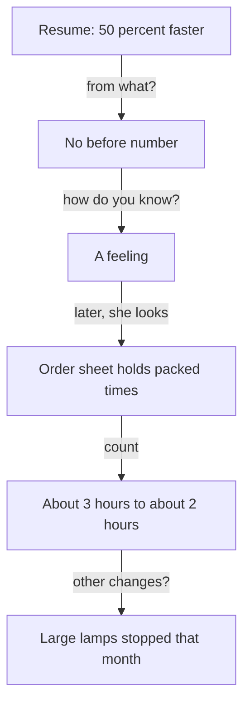

<BigWordAlert term="Baseline" plainEnglish="The number before your change, so that the number after your change means something." whyItMatters="Without a baseline, a percentage has nothing to be a percentage of, and a founder will ask 'from what?'." />

## A call from the storeroom

Leen is 28. She is an operations coordinator at a small online shop that sells handmade goods to customers abroad. The shop has a team of five. Leen packs parcels, keeps the stock shelves in order, and writes the notes that new helpers read on their first day. Last year she introduced two changes. She wrote a packing checklist, and she moved the shelves so that the items people order most are closest to the packing table.

Now she is applying to a small team that builds a tool for online shops. The founder has agreed to a video call. Leen takes the call from the shop's storeroom, because it is the quietest room, and her phone has a steady signal there. She has put the line from her resume at the top of her notes: "Made packing 50 percent faster."

She is proud of it. The change was real. Everyone in the shop felt it. The founder starts the call by saying that he likes the line. Then he asks a question.

## The second question

> **Founder:** "Your resume says you made packing 50 percent faster. Tell me about that."
>
> **Leen:** "I wrote a checklist and moved the shelves. After that, packing was much faster."
>
> **Founder:** "Fifty percent faster from what? How long did it take before?"
>
> **Leen:** "I do not remember exactly. It felt like half the time."
>
> **Founder:** "How did you measure it?"
>
> **Leen:** "I did not measure it. It was a feeling. But everyone said it was faster."

Leen's answers are honest, and the founder does not think she lied. But look at what he now holds. He has a percentage with no start, no end and no source. He does not know whether packing took ten minutes or three hours before, whether it is still done at the same pace, or whether 50 percent is a guess. The 50 came from a feeling, and the feeling was not wrong. It was only not a number.

A feeling is a useful start. It tells you where to look, because Leen did feel that packing was faster, and the feeling pointed at something real. The mistake was to write the feeling on her resume as if it were a count. A founder who reads "50 percent" hears a measurement. When he asks how it was measured, the gap between what he heard and what Leen has is larger than the gap in the packing time. It also makes the other lines on her resume harder to trust, because every number now needs a check.

Before you read on, think about what Leen could have done. The shop keeps an order sheet that records the time each order was marked packed.

```predict
prompt: "The shop's order sheet records when each order was marked packed. Could Leen have found a before number?"
options:
  - id: yes
    label: "Yes, from the order sheet"
  - id: no
    label: "No, it is too late to know"
correctOptionId: yes
explanation: "The sheet already held the evidence. She had never looked at it for this purpose. Many people hold numbers like this without knowing it: an order sheet, a log, a bill or a support inbox. Chapter 2.3 shows where to look."
```

After the call, Leen opened the sheet. A packing day is about 20 orders. In the four weeks before her changes, a packing day took about 3 hours. In the four weeks after, a packing day with the checklist and the new shelves took about 2 hours. From 3 hours to 2 hours is a third less time. It is a real saving, and it is not 50 percent. She also noticed that in the same month, the shop stopped selling large glass lamps, which took the longest to pack. So not all of the change was the checklist.

## What Leen could have said

If Leen had looked at the sheet before the call, her answer could have been short and true. She could have said: "A packing day took about 3 hours in the four weeks before my change and about 2 hours in the four weeks after. That is a third less time. The source is the order sheet. In the same month the shop stopped selling large glass lamps, so part of the change is not mine." That answer has a before, an after, a time window, a source, and an honest share. It is a smaller claim than 50 percent. It is also a claim she can defend at every question.

The same problem appears in every kind of work. A designer writes "increased sign-ups by 300 percent". When the founder asks from what, she says sign-ups went from 2 a week to 8 a week. The percentage is correct, and the founder can see that it is only 6 more people. An engineer writes "made the app much faster" and cannot say how fast it was before. In each case, the person did something real. The number did not carry it, because it had no start.

The founder might still ask about the lamps, and Leen could say, "I do not know how much came from the lamps. I would compare orders without lamps." That is a good answer too. It shows that she knows what she does not know and what she would do next.



The diagram shows two stories in one. The top three boxes are the interview, where each question took away some of the number. The bottom three boxes are what Leen found afterwards, where each step added a fact. The fix is not to remove the number from the resume. It is to go and find the evidence, and to say what it shows. Notice also that the bottom path ends with a fact that makes the claim smaller: the lamps. That is not a loss. A founder who hears Leen name the lamps herself learns that she checks her own claims before he does.

## Why this matters in founder and small-team interviews

Founders who write about hiring say that they ask what you have actually done and what you got done recently. They want the result, but they also want to see how you think about a result. A person who says "here is the number, here is where it comes from, and here is what I am not sure about" shows judgment, and judgment is what a small team needs from a person who will work with little supervision. A number is the quickest way to answer, so people add numbers to their resumes. But a number invites the next question: "from what?", "over what time?", "how do you know?". A percentage with no base is hard to defend, because it can describe a tiny change or a huge one. Going from 2 sign-ups to 8 is 300 percent more, and it is 6 people.

Some people stretch the truth on resumes. Founders know this, and they check. This is not a reason for fear. It is a reason to prefer numbers that you can explain. A smaller number with a source holds up at the next question. A large number with no source becomes your problem, because the founder may remember it for the rest of the interview, and you will have to defend it on the job. Some advice says to quantify everything. This course says the opposite when the choice is between an invented number and an honest gap: "I did not measure that, and here is what I would measure" is a full answer.

## What this module teaches

You will learn four things. First, what a number needs: a before, an after, a time window and a source. Second, where to find the numbers you never looked at, such as a database count, the logs, a bill or a support inbox. Third, how much of a change was yours, because other things change too. Fourth, how to say "I did not measure that" in a way that helps you. You will follow Leen through the first and third, and a developer through the second. All the people and teams in this module are fictional, and so is the founder.

Each part is practical. Say your numbers out loud as you practise: "three hours to two hours" is easier to say, and easier for a founder to follow on a video call, than a percentage with no start. You will end the module with two stories from your story bank that each have either an honest number or an honest gap with a plan to measure. You do not need new software. A phone, a spreadsheet and permission to look at the right data are enough. If you have no number, that is a starting point and not a failure.

<LearningObjectives items={["State a result with a before, an after, a time window and a source", "Find evidence of your impact in data you never looked at", "Say how much of a change was yours", "Say 'I did not measure that' and what you would measure instead"]} />

## Key words

| Word | Plain English |
|---|---|
| **Time window** | The period you measured, such as four weeks before and four weeks after |
| **Source** | Where the number comes from, such as an order sheet or a log |
| **Attribution** | How much of a change came from your work, and how much from other things |
| **Honest gap** | A number you did not measure, said plainly with what you would measure |

## What is in this module

| Chapter | You will practise |
|---|---|
| 2.2 | Stating a result with a before, an after, a window and a source |
| 2.3 | Finding the numbers you never looked at, in data you may see |
| 2.4 | Saying how much of a change was yours, and "I did not measure that" |
| 2.5 | A graded quiz with five short cases, including an AI answer to check |
| 2.6 | Two stories with honest numbers or gaps, practised with the AI interviewer or in writing |

**Next:** What a number needs, and how Leen's three hours became two.
