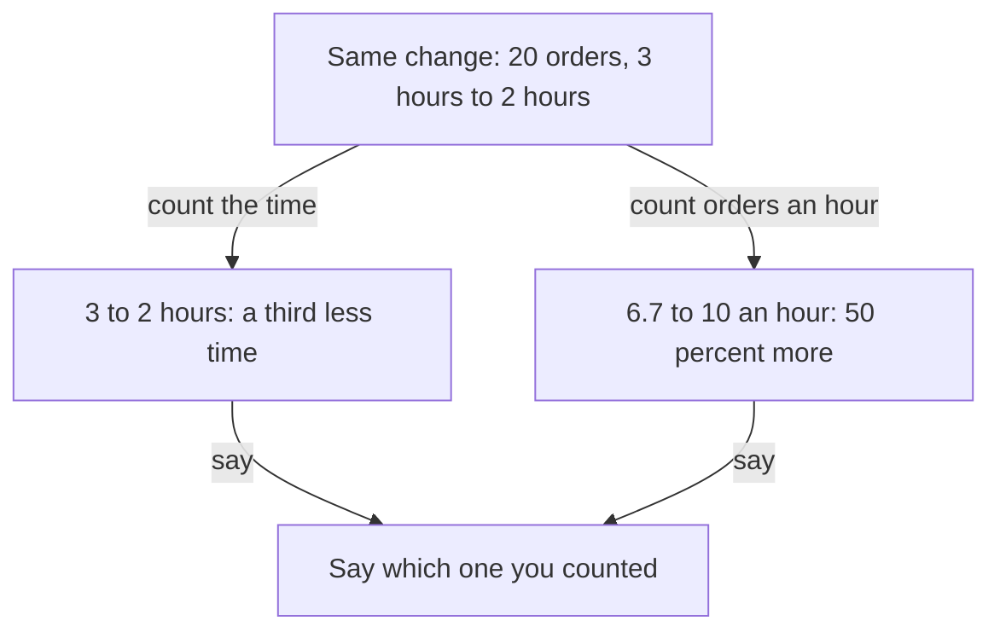

## Three numbers on a phone

That evening, Leen sits at home with her phone and opens the shop's order sheet. She does not feel proud. She feels curious. The sheet has a column that shows when each order was marked packed. Packers start at 09:00, so the last packed time shows how long the day took. She counts. A packing day is about 20 orders. In the four weeks before her changes, a packing day took about 3 hours. In the four weeks after, a packing day with the checklist and the new shelves took about 2 hours.

She writes the three numbers on a piece of paper: 3 hours, 2 hours, four weeks. For the first time, she can say what she did in a way that anyone can check. This chapter teaches what those numbers need, so that your own numbers can do the same.

## Four things every number needs

A number needs four things. The first is what it was before, called the baseline. The second is what it was after. The third is the time window, which is how long you measured. The fourth is the source, which is where the number comes from. After that you say how much of the change was yours, and that is the subject of chapter 2.4.

This is a method of measuring. It is not a research finding, and no study says that four weeks is the right window. What matters is that you can name the period and that it is long enough to see normal ups and downs. One week can be an unusual week. A few weeks give a fairer picture.

Why are all four needed? Because each one answers a question that a founder asks next. "From what?" asks for the before. "To what?" asks for the after. "Over what time?" asks for the window. "How do you know?" asks for the source. If one is missing, the founder asks about that one. If you have all four, he moves to the next topic.

## Predict first

Leen's resume line said "50 percent faster". Her packing day went from about 3 hours to about 2 hours. Before the next section explains how percentages depend on where you count from, decide which statement about the time is correct.

```predict
prompt: "Leen's packing day went from about 3 hours to about 2 hours. Which statement about the time is correct?"
options:
  - id: third
    label: "A third less, about 33 percent less"
  - id: half
    label: "Half the time, so 50 percent less"
correctOptionId: third
explanation: "One hour less out of 3 hours is a third. Fifty percent less would mean a packing day of 1.5 hours. The 50 percent figure only appears if you count the other way, as orders an hour, and then it is 50 percent more orders."
```

## Percent of what

A percentage depends on the number it is counted from. Take Leen's packing day. It went from 3 hours to 2 hours. That is 1 hour less, and 1 hour is a third of 3 hours. So packing took a third less time, about 33 percent less.

Now count it in a different way. In 3 hours, the shop packs 20 orders, which is about 6.7 orders an hour. In 2 hours, it packs the same 20 orders, which is 10 orders an hour. Ten is 50 percent more than 6.7, so the shop packed about 50 percent more orders every hour. Both ways of counting are correct. "A third less time" and "50 percent more orders an hour" describe the same change.

This means "50 percent faster" holds only if Leen says that she counted orders an hour. On her resume, with no explanation, a reader hears something different, and the founder could not know which way she counted. Leen did not know either number when she wrote it. The safe habit is to say the plain numbers, "about 3 hours to about 2 hours", and then, if you like, add the percentage and say what you counted. A percentage on its own hides which way you counted, and it hides how big the numbers are underneath. Going from 2 to 8 is 300 percent more, and it is 6 more.

## Change the numbers yourself

The canvas has three sliders: the before number, the after number and the weeks measured. It shows the change from before, the change in the plain number, and the same change counted the other way. Start with Leen's numbers.

<InteractiveCanvas slug="percent-from-what" />

The canvas shows one change counted from two directions, and how a big percentage can sit on a small number. Start with Leen's numbers and check your prediction, then try the second suggestion in the panel. It is arithmetic on two numbers, so it cannot tell you whether your work caused the change.

## A full worked example

Start with Leen's weak line: "Made packing 50 percent faster." The follow-up that breaks it is "From what?". Leen has no before number, so the line cannot answer. The founder cannot check it, and he cannot tell whether it is a guess.

Build the stronger answer in four steps. Step one is the before: "In the four weeks before my change, a packing day took about 3 hours." Step two is the after: "In the four weeks after, it took about 2 hours." Step three is the source: "I took both from the order sheet, which records when each order is marked packed." Step four is to say what that means in plain words: "That is about a third less time. Counted as orders an hour, it is about 50 percent more." Then she adds one honest sentence: "The shop also stopped selling large glass lamps that month, so not all of this is the checklist."

Read what the founder now holds. He has two numbers, two windows, one source, two ways to read the change and one limit. He cannot ask "from what?" because she already said. He can ask something deeper, such as "How did you decide where to move the shelves?", and that is a better interview.

Here is a second example, from an engineering role. Fadi is a mobile developer who fixed a bug that made a delivery app close by itself. His weak line is "Reduced crashes by 58 percent." From what? His stronger answer is: "In the two weeks before the fix, the crash report tool showed 12 crashes for every 1,000 sessions. In the two weeks after, it showed 5. That is 7 fewer for every 1,000 sessions, a drop of about 58 percent. Two weeks is short, so I treat it as a hint." Notice that he says the plain change (7 fewer) beside the percentage, he names the source, and he is honest about the window.



The diagram splits one change into two true statements. The left branch counts the time, and the right branch counts the orders an hour. They give different percentages, 33 and 50, from the same twenty orders. Both branches meet at the bottom, where Leen says which one she counted. A number you can defend always has that last box. It is the reason the plain numbers, 3 hours and 2 hours, come first.

## Mistakes to look for

**A percentage alone.** "Improved sign-ups by 300 percent" sounds large, and it has no base. Always add the numbers underneath, such as "from 2 to 8".

**Choosing the best weeks.** If you pick the four best weeks after and the four ordinary weeks before, your result looks better than it was. Pick the same length of period on each side, and pick the periods before you look at the result.

**Mixing sources.** If the before comes from a sheet and the after comes from memory, the two are not comparable. Use the same source for both, and say which.

**False precision.** "Reduced time by 33.3 percent" sounds exact, but the numbers were "about" 3 and "about" 2. Say "about a third".

**A number for everything.** Some advice says to put a number on every line. If you did not measure, an invented number is worse than an honest "I did not measure that". Chapter 2.4 teaches how to say it.

**Leaving out the unit.** "Went from 12 to 5" means little. Twelve what? Crashes for every 1,000 sessions, or crashes a day? The unit is part of the number.

## Try it on your own resume today

Find one line on your resume with a number or the word "faster", "more" or "less". Write the four parts under it: before, after, window, source. If one is missing, write "missing" and ask where you could find it. Chapter 2.3 shows where. If you prefer not to use your own work, use Hadeel's second line from her resume (shown in full in 3.6): "Added text-message reminders; missed appointments fell from 18 percent to 11 percent." She counted missed appointments out of all appointments in the clinics' booking records, for two months before and two months after. Write the four parts for her. One part is not here yet: how much of the fall was hers. That comes in chapter 2.4.

## Check your understanding

```quiz
type: mcq
question: "Adam is an operations assistant at a charity shop. The month-end stock count took 4 hours, and now it takes 1 hour. He compared the last 3 month-ends with the 3 before, using the volunteers' time log. Which resume line can he defend at the next 'why'?"
options:
  - "Cut stock counting time by 75 percent over 3 month-ends, from the volunteers' time log."
  - "Cut the month-end count from 3 hours to 1, comparing 3 month-ends with the 3 before, from the log."
  - "Cut the month-end count from 4 hours to 1, comparing the last month-end with the first, from the log."
  - "Cut the month-end count from 4 hours to 1, comparing 3 month-ends with the 3 before, from the log."
correct: 3
explanations:
  - "75 percent has no start and no end. The next question, 'from what?', has no answer in the line."
  - "The baseline is wrong. The facts say 4 hours, not 3, so the line changes a stated number."
  - "The window is wrong. The facts compare 3 month-ends with 3 before, not the last one with the first one, and one month-end is too small to trust."
  - "Right. It has the before (4 hours), the after (1 hour), the window (3 month-ends each side) and the source (the time log), in one line."
```

```quiz
type: mcq
question: "Nadia changed the teacher training sign-up page at a school. In the week before there were 2 sign-ups. In the first week after there were 8, and in the second week after there were 5. The interviewer asks, 'So you increased sign-ups by 300 percent?' Which reply is most useful?"
options:
  - "Yes, 300 percent in week one. That shows how much better the new page is than the old page for the teachers who sign up."
  - "Yes, and week two was 150 percent more than before. So the new page keeps getting better week after week."
  - "Yes: 2 to 8 in the first week, so 6 more people, then 5 in week two. Two weeks is short, so I call it a hint."
  - "I would rather not give a percentage. Percentages can mislead, so I give only the count of 8 in week one."
correct: 2
explanations:
  - "300 percent is only the first week. It ignores week two, when sign-ups fell to 5, and it gives no base."
  - "Week two was 150 percent more than the week before the change, but it was lower than week one (8 to 5). 'Keeps getting better' is not what the numbers show."
  - "Right. It confirms the arithmetic, gives the plain numbers and the second week, and is honest that two weeks is short."
  - "Refusing the percentage does not help. The count of 8 alone also leaves out the 2 before and the 5 in week two."
```

**Next:** Where to find the numbers you never looked at: a database count, the logs, a bill, the support inbox.
