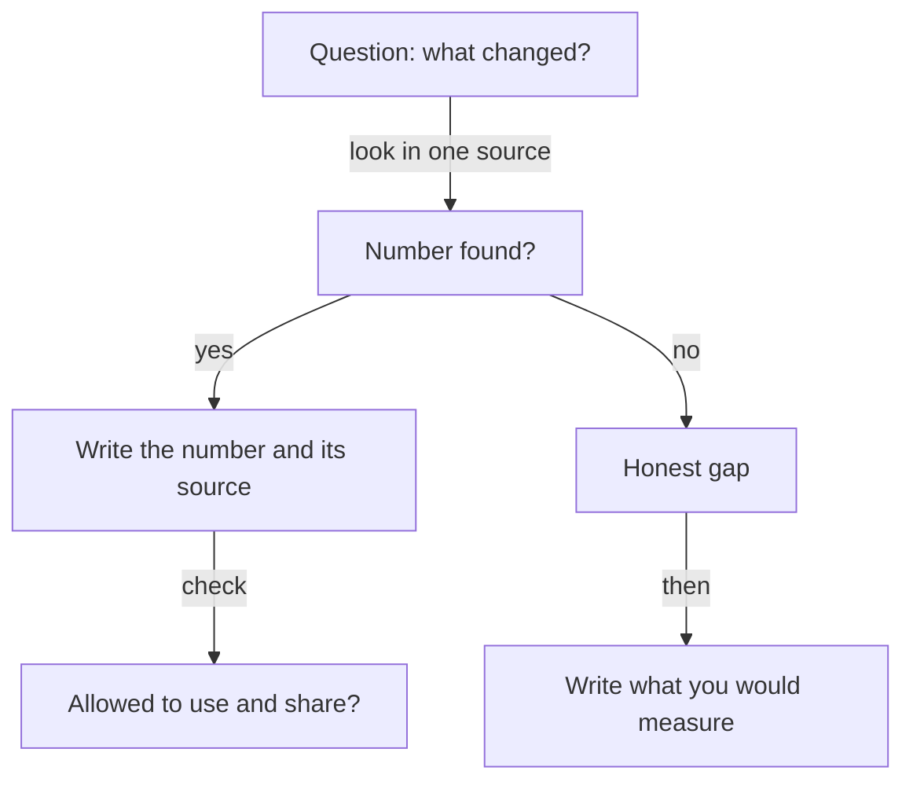

## "I never measured it"

Bilal is 23 and a backend developer in a team of four at a small online shop. Last year he changed how the checkout handles a slow payment provider. Before his change, the checkout page gave up after 5 seconds and showed an error, even though the payment often went through later. After his change, the page waits up to 20 seconds and then checks the result. On his resume he wrote: "Fixed checkout payment failures."

In a practice call, a friend asks him, "How many fewer failures?" Bilal says, "I do not know. I never measured it." The friend asks, "Then how do you know it worked?" Bilal has no answer. He believes it worked, because the complaints seemed to stop. But he never looked. Before you read why that is not the end of the story, make a guess.

```predict
prompt: "Bilal never measured his fix. Can he still find a before and after number?"
options:
  - id: logs
    label: "Yes, the logs may already hold it"
  - id: none
    label: "No, he never measured it at all"
correctOptionId: logs
explanation: "Not measuring is different from not having data. The payment log already wrote down every attempt and every failure. Bilal can count them after the fact, if his lead agrees, for the four weeks before and the four weeks after."
```

## Where evidence hides

"I never measured it" and "there is no number" are not the same thing. Many systems write down what happens without anyone asking them to. A shop's database records every order. The logs, which are files where a system writes down what happened and when, record every error. A support inbox holds every complaint. A bill records what a service cost. When you want a number, the first question is not "how do I measure this?". It is "where was this already written down?"

Here are the places to look, and what each can hold. This list is the course's own method, not a research finding.

A **database count** can give orders, sign-ups or records processed. **Logs and API call counts** can give errors, failed payments and response times. An <GlossaryTerm term="API call" definition="A request that one program sends to another, for example from a shop's checkout to a payment service." /> count shows how often a service was used. **Analytics** can give visits and finished sign-ups. **Bills** can give cloud cost before and after, or the hours of a paid tool. **The support inbox** can give complaints a week. **Time records** can give hours spent before and after. **People's words** give what a client or user said. These are words and not numbers, and you should quote them as words.

Both kinds of impact count. Business impact is money, users or time. Technical impact is speed, errors or cost. When you write a result, say which kind it is, so the founder knows what the number means.

## Rules for using data

The rules come first, because the numbers belong to someone. Ask your lead before you query data. Use only data you are allowed to see. Count and do not copy: you need totals, not customer records. Never paste private data into the AI interviewer, which means no names, no card details, no order lists and no log lines that hold personal details. Write the number and where it came from, and nothing else.

Write each number with its source, in the same note, so you do not lose it. Some systems delete old logs after a while, so write the count down when you have it. And if you cannot get a number now, that is not a failure. It becomes an honest gap, which the next chapter teaches how to say.

## Step through Bilal's search

The canvas has four actors: You (Bilal), The data, The people and Your notes. At every step, the note ends with a question for you. Answer it in your head before you press Next, and notice which sources give him a number and which one does not.

<InteractiveCanvas slug="find-your-numbers" />

The canvas shows one question per source and each answer written down with where it came from. Before you start, check your prediction, then count how many sources gave Bilal a number. The numbers are the case's own, and your lead decides what data you may read.

## A worked example from design

Bilal's search has a summary: he asked his lead, counted failed payments in the log (5 percent before, 2 percent after), cross-checked with the support inbox, claimed nothing from the bill, and wrote one honest gap about sales. Look at a second search, in a different kind of work, with a different source.

Salma designed the event sign-up form for a university club. She wants to know if her redesign helped. Her question is: of the people who started the form, how many finished it? She asks the club president for access to the form tool's step report, and the president agrees. She reads only the totals. In the term before, 62 out of 100 people who started the form finished it. In the term after her redesign, 81 out of 100 finished. That is a business number from analytics, and she writes it with its source: the form tool's step report.

She also writes one line of people's words. The club president told her that the committee stopped getting messages that said "where do I click". She quotes it as words, not as a number, because nobody counted the messages. Then she adds the honest limit: "I did not count those messages. I would count them in the committee chat for two weeks."

Check the weak version of the same task. Salma says, "I think more people finished the form." The follow-up "How do you know?" has no answer, though the form tool held the numbers all the time. The difference between the weak and strong versions is one request to the club president and one afternoon.



The diagram argues that both outcomes of a search are useful. A number goes into your notes with its source. An empty search goes into your notes as an honest gap with a plan. Notice that every path ends with something written down. The only path that leads nowhere is the one where you do not look.

## A count that went wrong

Salma made one mistake on the way, and she caught it by luck. Her first draft said: "In the term before, 62 out of 100 people who started the form finished it. After, 81 out of 100 people who visited the page finished it." She tried to explain the draft to a friend, and she could not say what the second "100" was. The first count began with people who started the form. The second began with people who only visited the page, which is a larger group that includes people who never started.

The two numbers could not be compared. She went back to the step report, took the same line for both terms, and got the 62 and 81 above. The lesson is small and useful. Before you write a before and an after, say aloud what you counted each time. If the two sentences are not the same, the numbers are not ready.

The same care applies to privacy. When you count, count totals from a source you are allowed to use. Do not export a table of people to work on at home, and do not paste log lines into a chat tool. One total and one source are all a resume line needs.

## Try it on your own resume today

Pick one project. Go through the seven places: database, logs, analytics, bills, the support inbox, time records and people's words. For each, write one question and one name: who owns it, and could you ask? Then write a short request, such as: "Could I count failed payments in the payment log for the four weeks before and after my change? I need only totals, not customer details." If you prefer not to use your own work, use Hadeel's freelance work, which you can read about in 1.1. She built an online order form and a stock sheet for a family bakery, and she did not count orders. Where could she have found a number? Think about the form's own records and the phone calls.

## Check your understanding

```quiz
type: mcq
question: "Tareq works on the checkout of a small online shop. He wants to count how many orders used the coupon check he built. The orders table holds customer names and addresses. His lead has not been asked. What is the right first step?"
options:
  - "Copy the orders table to his laptop and count the last 4 weeks at home. Tell his lead about it later."
  - "Ask his lead if he may count coupon orders for the last 4 weeks. Take only the total and no customer details."
  - "Paste 20 rows into an AI chat and ask it to count the coupon orders. The rows hold names, but only for 1 minute."
  - "Count the coupon orders in the table now. He is the developer, so he does not need to ask his lead for 4 weeks of data."
correct: 1
explanations:
  - "Copying the table moves customers' names and addresses to a personal laptop. The count needs only totals, and the lead has not agreed."
  - "Right. Asking first and taking only totals follows both rules: use data you are allowed to see, and count instead of copy."
  - "Pasting rows into an AI chat sends private customer data to a tool, even for a minute. The course's rule is never to paste private data."
  - "Being the developer does not give permission to use customer data. Being able to open a table is not the same as being allowed to use it."
```

```quiz
type: mcq
question: "Asma is a support analyst at a small app company. She moved the help desk to a new tool. The bills show $60 a month for the old tool and $45 for the new one. She never tracked her hours, and the new tool's report shows 140 tickets in both months. She wants to write a result. Which one matches her evidence?"
options:
  - "Saved 8 hours a month on tickets by moving to the new tool. The report shows the same 140 tickets in both months."
  - "Cut the cost of the help desk by 25 percent and the time on tickets by 25 percent too. Both come from the bills."
  - "Cut the monthly cost of the help desk from $60 to $45 (the bills). I did not measure the hours."
  - "Saved time and money by moving to a faster tool. The report shows 140 tickets in each of the 2 months."
correct: 2
explanations:
  - "No source gives 8 hours. Asma never tracked her hours, so the number would be invented, and the same ticket count does not show any time saved."
  - "$60 to $45 is 25 percent, but that is the price. Applying it to time repeats a number from a different source."
  - "Right. It uses the one source she has (the bills) and states the gap in plain words. She can add: 'I would track my hours for a month.'"
  - "'Saved time' and 'faster' have no source. The report shows the same 140 tickets, which does not show speed either way."
```

**Next:** How much of a change was yours, and how to say "I did not measure that" so that it helps you.
