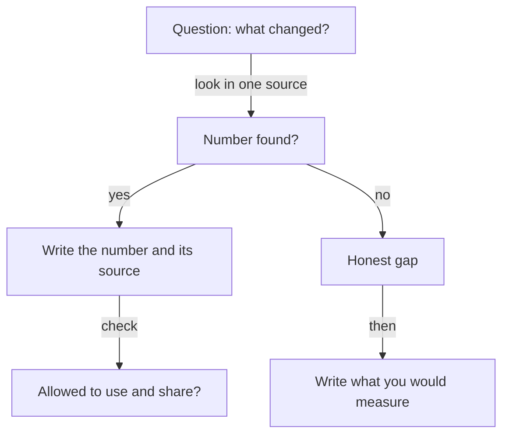

## "I never measured it"

Bilal is 26 and a backend developer in a team of four at a small online shop. Last year he changed how the checkout handles a slow payment provider. Before his change, the checkout page gave up after 5 seconds and showed an error, even though the payment often went through later. After his change, the page waits up to 20 seconds and then checks the result. On his resume he wrote: "Fixed checkout payment failures."

In a practice call, a friend asks him, "How many fewer failures?" Bilal says, "I do not know. I never measured it." The friend asks, "Then how do you know it worked?" Bilal has no answer. He believes it worked, because the complaints seemed to stop. But he never looked.

## The idea in plain words

"I never measured it" and "there is no number" are not the same thing. Many systems write down what happens without anyone asking them to. A shop's database records every order. The logs, which are files where a system writes down what happened and when, record every error. A support inbox holds every complaint. A bill records what a service cost. When you want a number, the first question is not "how do I measure this?". It is "where was this already written down?"

Here are the places to look, and what each can hold. This list is the course's own method, not a research finding.

A **database count** can give orders, sign-ups or records processed. **Logs and API call counts** can give errors, failed payments and response times. An <GlossaryTerm term="API call" definition="A request that one program sends to another, for example from a shop's checkout to a payment service." /> count shows how often a service was used. **Analytics** can give visits and finished sign-ups. **Bills** can give cloud cost before and after, or the hours of a paid tool. **The support inbox** can give complaints a week. **Time records** can give hours spent before and after. **People's words** give what a client or user said. These are words and not numbers, and you should quote them as words.

Both kinds of impact count. Business impact is money, users or time. Technical impact is speed, errors or cost. When you write a result, say which kind it is, so the founder knows what the number means.

## Rules for using data

The rules come first, because the numbers belong to someone. Ask your lead before you query data. Use only data you are allowed to see. Count and do not copy: you need totals, not customer records. Never paste private data into the AI interviewer, which means no names, no card details, no order lists and no log lines that hold personal details. Write the number and where it came from, and nothing else.

Write each number with its source, in the same note, so you do not lose it. Some systems delete old logs after a while, so write the count down when you have it. And if you cannot get a number now, that is not a failure. It becomes an honest gap, which the next chapter teaches how to say.

## Predict before you step through

Bilal did not measure his fix. Think about what that means for his numbers.

```predict
prompt: "Bilal never measured his fix. Can he still find a before and after number?"
options:
  - id: logs
    label: "Yes, logs may hold it"
  - id: none
    label: "No, he never measured it"
correctOptionId: logs
explanation: "Not measuring is different from not having data. The payment log already wrote down every attempt and every failure. Bilal can count them after the fact, if his lead agrees, for the four weeks before and the four weeks after."
```

The canvas has four actors: You (Bilal), The data, The people and Your notes. Step through it and notice which sources give him a number, and which one does not.

<InteractiveCanvas slug="find-your-numbers" />

**What this shows:** one question per source, and each answer written down with where it came from. **Try this:** before step 1, check your prediction, then count how many sources gave Bilal a number. **What changed:** the payment log gave two counts, the support inbox gave two more, and the cloud bill gave nothing to claim. Bilal wrote the gap down instead of guessing. **Limits of the model:** the numbers are the case's own, and your lead decides what data you may read.

## A full worked example

Here is the weak answer and what breaks it. Bilal says, "I think it fixed most of the failures." The follow-up that breaks it is "How do you know?". The only honest reply is "I do not", and the founder learns nothing.

Now the stronger answer, step by step. First, Bilal asks one question: how many payments failed before and after the fix? Second, he asks his lead if he may count in the payment log, and his lead says yes for totals only. Third, he counts. In the four weeks before, 124 payments failed out of 2,480 attempts, which is 5 percent. In the four weeks after, 52 failed out of 2,600 attempts, which is 2 percent. Fourth, he asks the support person to count messages saying "I paid but saw an error". There were 19 in the four weeks before and 6 in the four weeks after. Fifth, he checks the cloud bill. It is the same in both periods, within its usual ups and downs, so he claims nothing about cost.

Check the arithmetic. 124 out of 2,480 is exactly 5 percent. 52 out of 2,600 is exactly 2 percent. The failures fell by 72, from 124 to 52, which is more than half. Bilal can now say, "Failed payments fell from 5 percent to 2 percent over four weeks each, from the payment log. The support inbox agrees: 19 messages before and 6 after. I did not measure sales. I would ask the marketing lead for the count of finished checkouts." That is a technical result, a second source for it, and an honest gap with a plan.

Here is a second example, in design. Salma designed the event sign-up form for a university club. She asks the form tool for its step report. In the term before, 62 out of 100 people who started the form finished it. In the term after her redesign, 81 out of 100 finished. That is a business number from analytics. The club president also told her that the committee stopped getting messages that said "where do I click". That is people's words, and Salma quotes it as words, not as a number.



The diagram argues that both outcomes of a search are useful. A number goes into your notes with its source. An empty search goes into your notes as an honest gap with a plan. Notice that every path ends with something written down. The only path that leads nowhere is the one where you do not look.

## Where people go wrong

**Looking at data you should not.** You may be able to open a table that you are not meant to read. Being able to is not permission. Ask your lead first, and use only what the work needs.

**Copying instead of counting.** A list of customers' orders on your laptop is a risk to them and to you. A single total is enough for a resume.

**Pasting private data into the AI interviewer.** The drills in this course ask for stories and numbers, not records. Use roles and totals, such as "a payments client" and "124 of 2,480".

**Using one source and calling it proof.** One count can be wrong. A second source, such as the support inbox, makes the claim stronger. If the two disagree, say so.

**Counting different things.** If the before count is failed attempts and the after count is failed orders, the two are not comparable. Check that you counted the same thing in the same way.

**Claiming what the source does not show.** The bill showed no change, so Bilal claims no saving. A claim that your source does not support is worse than no claim.

## Try it on your own resume today

Pick one project. Go through the seven places: database, logs, analytics, bills, the support inbox, time records and people's words. For each, write one question and one name: who owns it, and could you ask? Then write a short request, such as: "Could I count failed payments in the payment log for the four weeks before and after my change? I need only totals, not customer details." If you prefer not to use your own work, use Hadeel's freelance work. She built an online order form and a stock sheet for a family bakery, and she did not count orders. Where could she have found a number? Think about the form's own records and the phone calls.

## Check your understanding

```quiz
type: mcq
question: "Tareq works on the checkout of a small online shop. He wants to count how many orders used the coupon check he built. The orders table holds customer names and addresses. His lead has not been asked. What is the right first step?"
options:
  - "Copy the whole orders table to his laptop, so that he can count at home without asking anyone."
  - "Ask his lead if he may count coupon orders, taking only totals and no customer details."
  - "Paste some of the rows into an AI chat and ask it to do the counting for him quickly."
  - "Leave out the count, since the orders belong to the shop and he can never use them in any way."
correct: 1
explanations:
  - "Copying the table moves customers' names and addresses to a personal laptop. The count needs only totals, and the lead has not agreed."
  - "Right. Asking first and taking only totals follows both rules: use data you are allowed to see, and count instead of copy."
  - "Pasting rows into an AI chat sends private customer data to a tool. The course's rule is never to paste private data."
  - "He does not have to give up the number. A count with permission, as totals, is a fair way to use the shop's data."
```

```quiz
type: mcq
question: "Reem is an operations coordinator at a translation agency. She moved the agency's file handling to a new tool. The bills show $60 a month for the old tool and $45 for the new one. She never tracked her hours, and the new tool's report shows 140 files in both months. She wants to write a result. Which one matches her evidence?"
options:
  - "Saved 8 hours a month on file handling, which gave the whole team more time for translation work."
  - "Cut the cost of file handling by 25 percent and the time by the same amount for the whole team."
  - "Cut the monthly cost of file handling from $60 to $45 (the bills). I did not measure hours."
  - "Saved time and money by moving to a better tool, as the files moved faster in the new tool."
correct: 2
explanations:
  - "No source gives 8 hours. Reem never tracked her hours, so the number would be invented."
  - "$60 to $45 is 25 percent, but that is the price. Applying it to time repeats a number from a different source."
  - "Right. It uses the one source she has (the bills) and states the gap in plain words. She can add: 'I would track my hours for a month.'"
  - "'Saved time' and 'faster' have no source. The report shows the same 140 files, which does not show speed either way."
```

**Next:** How much of a change was yours, and how to say "I did not measure that" so that it helps you.
