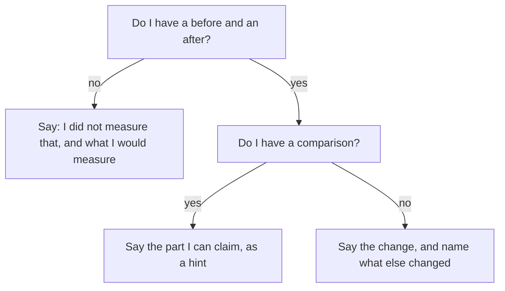

## "How much of that was the checklist?"

Leen has a second interview, with another small team. She is ready this time. She says, "A packing day took about 3 hours in the four weeks before my change and about 2 hours in the four weeks after, from the order sheet." The founder nods. Then he asks, "How much of that was your checklist?"

Leen remembers the glass lamps, and she says so. The founder asks, "How much of the change was the lamps?" Leen does not know. She sees that she has done the first half of the work, a before and an after, and not the second half. This chapter is the second half.

Leen looks at the order sheet again. In the four weeks after her change, the shop had two kinds of packing day. On some days Leen packed with the checklist and the new shelves, and the sheet showed about 2 hours. On other days a part-time packer, who had not learned the new way yet, packed the old way. The sheet showed about 2.5 hours on those days, down from about 3 hours.

## Predict first

Leen sees that packing got shorter on the old-way days too, by half an hour. Think about how much of the one hour she saved can really be called hers.

```predict
prompt: "The old-way days also got half an hour shorter. How much of Leen's saved hour can she claim?"
options:
  - id: all
    label: "All of it, since the checklist was new"
  - id: half
    label: "Only about half an hour of it"
correctOptionId: half
explanation: "Packing got half an hour shorter without her checklist. That half hour is the change that happened without her work: the lamps and anything else. The rest, about half an hour, is the part she can claim, as a hint."
```

## What attribution means

Most changes have more than one cause. A packing day can get shorter because of a new checklist, and also because the shop stopped selling large lamps, because a new helper joined, or because it was a quiet month. The change you can claim is the change you saw, minus the change that happened without your work. This is called attribution: how much of a change came from you.

The best way to estimate it is a comparison. A comparison group is something similar that did not get your work in the same period: other days, another team, another site. Whatever happened to the comparison group happened without you. The difference between the two is a hint about your share. It is a hint, not proof, because the two groups are never exactly alike.

If you have no comparison, you can still be honest. Say the change you saw, name the other things that changed in the same period, and say that you cannot separate them. If you did not measure at all, say so, and say what you would measure. These are not weak answers. They are the answers that still stand after the next "why".

## Why honesty is also the strategy

You might think a bigger claim is safer, because people cannot check. Think again. A large review of lie-detection studies found that people catch lies only a little better than guessing. So honesty is not about fear of being caught. It is about giving answers that still stand after the fifth "why", and a made-up number will not stand there.

Researchers who study faking in interviews found that follow-up questions increased faking in one experiment. Candidates said the questions told them which answers mattered. This is useful for you. When the "why" comes and you do not know, you do not have to invent. "I did not measure that" is a full answer. Interviewers can work with an honest gap. They cannot work with a number that does not hold at the next question, and you would have to defend that number on the job.

## Subtract and see

The canvas subtracts the comparison from the total. Leen's numbers are the starting point. Change the comparison and watch the part she can claim.

<InteractiveCanvas slug="how-much-was-yours" />

The canvas shows that the part you can claim is the total change minus what the comparison days saved without you. Check your prediction at the defaults, then move the comparison to see the claim shrink or grow. It is simple arithmetic, and a comparison is a hint, not proof.

## A full worked example

Start with the weak answer: "I made packing a third faster." The follow-up that breaks it is "How much of that was you?". Leen cannot answer, because she counted only the total. The founder cannot tell whether the lamps, the season or the checklist did the work.

Now build the stronger answer. Step one is the total, with its source: "A packing day fell from about 3 hours to about 2 hours, from the order sheet." Step two is the comparison: "In the same four weeks, days packed the old way fell from about 3 hours to about 2.5." Step three is the subtraction, stated as a hint: "So about half an hour of the hour is the part I can claim. The rest happened without the checklist, probably because the shop stopped selling large lamps." Step four is the limit: "The two kinds of day are not exactly alike, so I call it a hint."

Check the arithmetic. Total change is 3 minus 2, which is 1 hour. Comparison change is 3 minus 2.5, which is 0.5 hour. Her part is 1 minus 0.5, which is 0.5 hour, half of the total. As a share of the original 3 hours, that is about 17 percent less time from her work, against 33 percent in all. Now the founder has a smaller and more useful claim. He can also see that Leen knows the difference between "what happened" and "what I did".

Here is a second example, from engineering. Fadi fixed a bug that made a delivery app close by itself. In the two weeks before, the crash report tool showed 12 crashes for every 1,000 sessions. In the two weeks after, it showed 5. In the same two weeks, support for one old phone version ended, and the tool showed that this version had caused 3 of the 12 before. Without that version, the before count would have been 9, so the fix cut it from 9 to 5. Fadi says: "Crashes fell by 7 for every 1,000 sessions. About 3 of those 7 are from the old phone version leaving, so my fix is about 4. That is an estimate. I got it by taking the old version's crashes out of the before count."

Notice the label on the estimate. Fadi says it is an estimate and says how he got it. That is what makes it honest.



The diagram is a way to choose what to say. It has no path that ends with an invented number. Each of the three endings is something you can say aloud and defend. The top ending is the gap, the middle is the hint with a comparison, and the lowest is the change with its limits named. Pick the one your evidence supports.

## Sentences you can use

These sentences are plain, short and honest. Practise saying them. "I did not measure that." "I do not know how much was mine." "This number is an estimate. I got it by taking out the old version's crashes." "Other things changed in the same month: the shop stopped selling large lamps." "If I did it again, I would count orders for four weeks before and after." The last one turns a gap into a plan, and it is the sentence that makes "I did not measure that" sound strong.

## Mistakes to check for

**Claiming the whole change.** If anything else changed in the same period, the whole change is not yours. Say so before the founder asks.

**Hiding the other changes.** A founder who finds the lamps himself trusts the rest of your answer less than one who hears about them from you.

**A comparison that is not alike.** If the comparison group is very different from yours, the subtraction is wrong. Say how the groups differ.

**False precision.** "My share was 47.3 percent" suggests a precision you do not have. Say "about half".

**An unlabelled estimate.** If a number is a guess, say so, and say how you made it.

**A gap with no plan.** "I did not measure that" followed by silence can sound like giving up. Add what you would count and when.

**Inventing under pressure.** When the "why" comes quickly, it is tempting to produce a number. Take a moment and say, "Let me think for a moment." If you still do not have the number, say so.

## Try it on your own resume today

Choose one line with a result. Write what else changed in the same period: a season, another release, a price change, a new person, a campaign. Write whether you have a comparison, such as another team, another site or other days. Then write your claim in the form that your evidence supports: the hint with a comparison, the change with its limits, or the gap with a plan. If you prefer not to use your own work, use Hadeel's reminders line (the second line of her resume, shown in full in 3.6). In the second month after her reminders, two of the six clinics also started phoning patients. What could she compare? Think about the other four clinics.

## Check your understanding

```quiz
type: mcq
question: "Asma is a support analyst. She added a help article on login problems. Login complaints fell from 40 a week to 28 a week. In a second region that did not get the article, they fell from 40 to 34, because developers fixed a login bug. Which claim does her evidence support?"
options:
  - "Complaints fell by 12 a week because of my article. The 12 is the change, and it is mine to claim."
  - "None of it is mine. Complaints also fell by 6 in the region without the article, so the article had no effect."
  - "About 12 a week, because the second region is too different from mine. The drop of 6 there should be ignored."
  - "They fell by 12 a week. In the other region they fell by 6, so about 6 is my share, as a hint."
correct: 3
explanations:
  - "The other region fell by 6 without the article, so the 12 is not all hers. The bug fix and the article both played a part."
  - "The other region fell by 6, but hers fell by 12. Half of her drop is left over, so 'none' is more than the evidence shows."
  - "Both regions started at 40 a week, so they were alike at the start. The facts do not support 'too different'."
  - "Right. 12 minus 6 is 6. She labels it a hint, because the regions are never exactly alike."
```

```quiz
type: mcq
question: "Tareq built a coupon check for a small online shop's checkout. The interviewer asks, 'How many more orders did it bring?' Tareq never saw order counts. The product manager owns them, and she has not shared them. Which reply is best?"
options:
  - "I did not measure that. The product manager holds the counts. I would ask for 4 weeks of orders with and without a coupon."
  - "About 15 percent more, I think. Coupons often raise orders by about that much, so 4 weeks of data would probably agree with me."
  - "I cannot answer that. I only built the check, and I did not look at the orders in the 4 weeks after the release."
  - "A lot more. The manager told me the feature was a success, and the 4 weeks after the release were busy."
correct: 0
explanations:
  - "Right. It is honest about the gap, says who holds the data, and names what he would ask for. It leaves the interviewer a next step."
  - "The 15 percent has no source for this shop. 'Often' is a guess that borrows from other cases, and it fails at 'how do you know?'."
  - "Honest, but it gives up. It does not say who holds the numbers or what he would count, so the interviewer learns little."
  - "This borrows a conclusion from the manager and invents a size. Tareq saw no numbers, so he cannot say 'a lot more'."
```

**Next:** A short quiz with five cases on baselines, sources, attribution and honest gaps, including an AI answer to check.
