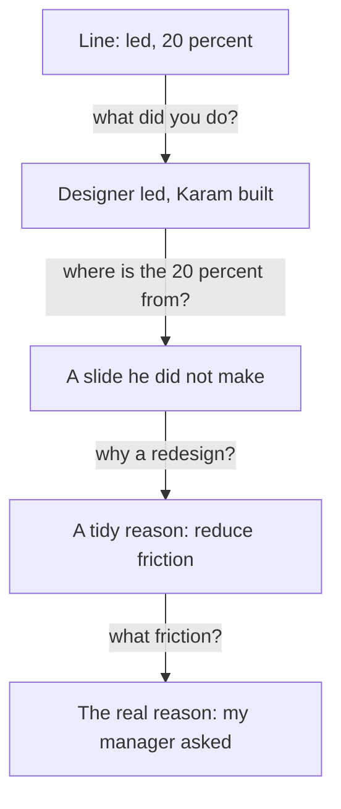

## The line that came apart

Karam is 25. He is a frontend developer, and he has worked for one year at a small web agency. This week he has a video call with the founder of a seven-person team that builds an online booking tool for small salons. The power came back an hour before the call, so he charged his laptop and kept his phone ready as a hotspot. He sits in the quiet room of the house, with his resume open on the screen.

The first line of his resume is his proudest. It says: "Led the redesign of the checkout page, increasing conversion by 20 percent." He has read it many times. It looks strong, and it is the line he expects the founder to ask about first.

The founder does ask about it. She reads the line aloud and says, "Tell me about this one." Karam answers in the way he has seen in many resume guides.

> **Karam:** "We redesigned the checkout page to reduce friction in the funnel. I led the work, and conversion went up 20 percent."

The answer takes ten seconds. It sounds like a resume line spoken aloud, and the founder does not say it is wrong. She just asks the next question. Before you read it, think about which part of the line Karam is ready to defend.

```predict
prompt: "The founder will ask Karam about three parts of his line: what he built, where the 20 percent comes from, and why the redesign happened. Which question can Karam answer best?"
options:
  - id: built
    label: "What he built"
  - id: number
    label: "Where the 20 percent comes from"
correctOptionId: built
explanation: "Karam wrote the code for the page, so he knows what he built. The number came from someone else's slide, and the reason he gave was a phrase he had read in other resumes. The first question he can answer. The other two start to go wrong at once."
```

## What the founder asked next

The next question was short. "You led it. What did you do yourself?" Karam said he led the frontend work. The designer did the screens, and he built them. The founder nodded and said, "So the designer led the redesign, and you built the page." Karam said yes, that was fair. The word "led" in his resume had just become smaller, and it was still only the second minute.

> **Founder:** "Where does the 20 percent come from?"
>
> **Karam:** "My manager showed it on a slide. I think it came from the analytics."
>
> **Founder:** "Do you know the number of orders before and after, and over what weeks?"
>
> **Karam:** "No. I only saw the slide."

Then came the question Karam had not prepared for. The founder asked, "Why did the agency redesign the checkout at all?" Karam gave his first answer again, to reduce friction in the funnel. She asked what friction he had seen. He said the old page had too many fields. She asked who found that. There was a pause. Then Karam said, "My manager asked us to do it."

Karam did not lie on purpose. He had copied the shape of the lines he had seen in other resumes, and he had not stopped to ask if every word was his. But the call changed after that pause. Three answers in a row had been smaller than the line. The founder was polite and moved on to another topic. Karam knew that his best line had become a weak one, in less than five minutes, and he did not know how.

## What was true all along

Here is the unfair part. Karam had real work to show. He built a checkout page for a real client, from another person's screens, in two weeks. He made a decision inside that work: he built the form as one page, because it was about two days faster than three steps. He shipped it, and the page is live. None of that was in the answers he gave.

His resume made a claim that was bigger than his work, and his work was good enough without it. A founder can follow one true line for ten minutes and enjoy it. She cannot do that with a line where the second why has nothing under it. This module teaches how to find out, before the interview, which of your lines are true all the way down.

That evening Karam wrote down the three answers that had gone wrong. Each one broke in a different way. The word "led" said more than he did. The 20 percent was a number he could not source. The reason was one he had not had at the time. When he looked at them side by side, he saw that each one could have been checked in ten minutes, a week before the call, with a pen and the project files. That is the useful news in this story. The problem was not his skill. It was that he had never asked himself the founder's questions.

The same thing happens in every role. Imagine Sara, a product designer, with the line "Improved onboarding so users stayed longer." A founder would ask which screens were hers, longer than what, and how she knows. If she has the answers, the line is a strong one. If she does not, the line is a gamble, even though her design may be good. The questions are the same for a designer, an operations coordinator or a backend developer.

Now imagine Karam's call with an honest line. The founder asks what he did, and he says he built the page from the designer's screens and chose to make it one page. She asks why one page, and he says it was faster and he did not test which version sold more. She asks about the number, and he says it came from his manager and he does not know how it was measured. Each answer is smaller than the line was, but each one is true. The founder can trust the next answer, and the one after that. This is the difference the module is about.

## Why founders ask why

Many founder interviews are free conversations. The founder decides the questions as the talk goes on. Researchers who study hiring find that planned interviews, where every candidate gets the same questions and a scoring guide, predict job performance better than free conversations. You cannot change the founder's method. But you can give the kind of evidence a good scoring guide would look for: what you did, why, what happened, and how you know.

Founders who write about hiring say much the same thing. They ask what you have actually done, they pick one project, and they keep asking until they know which part was yours. Expect questions like "What exactly did you do?", "Why that way?" and "How do you know?" These are not tricks. A small team has few people, and each hire matters. The founder wants to know what you can do on your first week, and your own past work is the best clue.

This course calls the habit of asking "why?" again and again a why chain. The idea comes from factory problem-solving, and in this module you will use it on your own resume. Most of the work is quiet. You read each line, ask the questions yourself, and write down what is true.

<BigWordAlert term="Why chain" plainEnglish="Asking 'why?' about one line of your resume, and then 'why?' about each answer, until your real decisions show." whyItMatters="A founder can follow the chain from any line. A line you can explain at every step is safe to put on the page. A line that has nothing under the second why costs you more than a line you never wrote." />

## Karam's call as a chain

The diagram shows what happened to Karam's line. Each arrow is a question the founder asked. Each box is the answer Karam gave. Notice that the answers get smaller, and that the last box is the first true one.



Look at the direction of travel. The line starts with a big claim and ends at a small, true fact. That is what a why chain does to any claim. If the small fact at the bottom is still good, the line is safe. In Karam's case the small fact was good: he built a real page for a real client. The harm came from a line that promised more than the bottom of the chain could hold.

## What this module teaches

Karam, the founder and the other people in this module are fictional. The ideas are real, and so are the interview habits. In this module you will do four things, in order. You will learn how a why chain works and where it breaks. You will learn to give the reason you had at the time, instead of a tidy reason that sounds good. You will audit every line of your resume with five questions and rewrite the lines that fail. Then, in the gate, you will defend one line through four whys, with a mentor or with the AI interviewer.

Nothing in this module asks you to make your work sound smaller. It asks you to make your lines match your work. Honest lines are also easier to say. You do not have to remember a story, because you only have to remember what happened.

<LearningObjectives items={["Follow a why chain on a resume line down to a decision you made or a fact you checked", "Spot a chain that ends at blame, at a single guess or at a reason you cannot support", "Give the reason you had at the time, including 'that was not my decision', instead of a tidy reason", "Audit each resume line with five questions and rewrite the lines that fail", "Defend one resume line through a chain of whys"]} />

## Key words

| Word | Plain English |
|---|---|
| **Why chain** | Asking "why?" again and again about one line, until your real decisions show |
| **Stop point** | Where a chain can end: a decision you made or a fact you checked |
| **Tidy reason** | A reason that sounds good, made up after the work was done |
| **Real reason** | The reason you had at the time, even if it is "my manager asked me" |
| **Audit** | To check each line of your resume with the same questions |

## What is in this module

| Chapter | You will practise |
|---|---|
| 3.2 | How a why chain works, and three ways it breaks |
| 3.3 | Giving the real reason, not a tidy one |
| 3.4 | The five-question audit, and rewriting a weak line |
| 3.5 | A quiz with five short cases, including an AI answer to check |
| 3.6 | Your audited resume, and one line defended through four whys |

**Next:** How a why chain works, and how to tell a chain that ends well from one that breaks.
