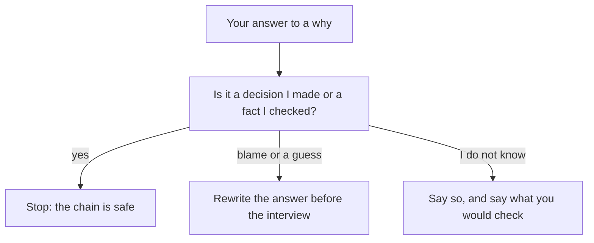

## One line, five questions

Iyad is 31 and works at a small studio that builds apps. His resume says: "Reduced app load time by 40 percent." The app is a bus times app for a small city. He is proud of the line, and he has told the story of that week to friends many times. Then a founder says, "Tell me about this one," and asks "Why?" five times in a row. Iyad has to answer each one with something he can stand behind. The answers are not a script. They are what he knows about his own work.

Chapter 3.1 showed what happens when a line cannot take the second why. This chapter starts with the opposite case. Iyad's chain stands from the first why to the fifth, and it is worth seeing exactly why. After that you will see the three ways a chain fails, because each one is a mistake that fellows really make.

## Where the five whys comes from

The five whys is attributed to Taiichi Ohno, an engineer who helped build a Japanese car maker's production system. The habit is simple: when something goes wrong, ask "why?", then ask "why?" about each answer, until you reach something you can fix. Founders use the same habit on your resume. For every line they ask what you did, why you did it, what happened and how you know. In this course you use the habit on yourself, before the interview.

Two honest notes about the method. First, it was made for fixing problems in factories, not for interviews. We did not find a study that tested it as an interview method. It is a habit that founders use, and it is a useful way to check your own lines. Second, it follows one chain of causes. Real problems often have more than one cause, and people who see different parts of a system may answer the whys differently. A writer on patient safety has argued that the method tends to oversimplify complex problems. So we use it as a checking habit, not as proof.

## Where a chain should end

A chain does not need five steps. Five is a habit, not a rule. A chain can end after three whys or after six. It should end at one of two places. The first is a decision you made, with the reason you had for it. The second is a fact you checked, such as a count, a timing or a message you can show.

There is a third honest place to end, and it matters for fellows. Sometimes the chain goes past what you know. The decision was made before you joined, or by your manager, or by the client. Then the strong answer is to say so: "That decision was made before I joined. What I did was..." You stop at the edge of your own part and you say where it is. This is not a weak answer. A made-up reason is a weak answer.

Before you step through Iyad's chain, think about its last why, which is about how much of the change was his own work. Complaints about the app freezing stopped within two weeks. In the same month, the app also moved to a faster host.

```predict
prompt: "Complaints stopped within two weeks, and the app also moved to a faster host that month. At the end of his chain, what does Iyad's strong answer say?"
options:
  - id: honest-limit
    label: "The host changed too, so I cannot claim it all"
  - id: all-mine
    label: "The change worked, so it was mostly my doing"
correctOptionId: honest-limit
explanation: "A strong chain names the other change and still keeps what is his. The founder can trust a fact like this, because it shows Iyad looked for other causes. Claiming most of it would invite one more why that he cannot answer. Giving it all to the host would hide a change he made and measured."
```

The canvas has six boxes. They are named for the job of each why, so the same boxes can show a strong chain and a weak one. Each note ends with a question. Answer it in your head before you press Next.

<InteractiveCanvas slug="resume-line-why-chain" />

The canvas follows one resume line down five whys, then shows two chains that fail. Try the first question before you press anything. It shows one chain only, and real problems have more than one cause.

## What Iyad's answers rested on

Here is the chain in one paragraph. Iyad started because early users were on slow phones and the support inbox had several messages a week about the app freezing. He found the cause by watching what the app loaded: the home screen asked for the full list of bus routes before it showed anything. He compared three fixes and chose the one-day change, because the others needed backend work. He timed the app ten times before and ten times after on the cheapest test phone. Each time he put the ten times in order and took the middle one, so that one very slow run could not change the answer. The middle times were about 10 seconds and about 6 seconds, and four seconds out of ten is 40 percent. Last, he said that the host also changed that month.

Now see how each answer could have been weak, and what the next why would do to it. For the third why, a weak answer is "It was the best solution." The founder asks, "Best compared with what?" and Iyad has nothing to say. For the fourth, a weak answer is "I measured it." The founder asks, "How? On which phone?" and the answer was not written down. The strong answers are not longer or more clever. They are specific, and each one is a fact that Iyad had before the interview.

## Three ways a chain fails

The first way is **blame**. The chain ends at a person or a team, and there is nothing the fellow decided or checked. "The app was slow because the other team's server is slow." This answer feels safe, because it moves the problem away from you. But a founder hears a person who found nothing and changed nothing. If your chain ends at blame, ask one more why: what did I see, or what did I decide, inside that?

The second way is **one cause when there were several**. This is easy to do, because a neat story has one cause. Take Mazen, an operations assistant at a small online shop. His line says: "Cut late deliveries with a morning check of open orders." In March, the order sheet showed 9 of 40 orders sent a day late. He looked at each one. Six had waited for a stock check, and three had address problems. His morning check helps with the six. It does not help with the three. If he says "late orders were caused by missing checks," the founder will ask about the other three. If he says "there were two causes, and my check covers the larger one," his answer still stands.

The third way is **a reason you cannot support**. This is Karam's failure at the second why. The first answer sounded good, and nothing was under it. A reason can fail because you never looked, or because you did not know, or because it was another person's decision. In each case, the honest repair is the same. Say what you did know, say what you did not, and say who decided. Chapter 3.3 is about this repair.

Another kind of end deserves a mention: the chain that ends with "I don't know." It is not a failure. If you did not measure the result, say so and say how you would. "I did not measure that, and here is what I would count" is a full answer. It is far stronger than a number made up in the room.

## A test for each answer

The canvas followed one line. The diagram shows the test you can run on any answer in any chain. After each answer, ask yourself one question: is this a decision I made or a fact I checked? If yes, the chain can stop. If it is blame or a guess, the answer needs rewriting before the interview. If you do not know, say so, and say what you would check.



What to notice: there are three exits, and only one of them is to keep going. A chain does not need to find a perfect answer at every step. It needs to be honest at every step. The second and third exits are both fine in an interview, as long as you have thought them through. They go badly only when the first time you meet them is in front of the founder.

## The week Tamer prepared the wrong whys

Tamer is a developer who had five lines on his resume and four days before a call. He spent his time on the first why of each line, because that is where a founder starts. He wrote a clear, confident answer to "Why did you build this?" for all five lines. On the call, the founder asked the first why about his search filter, and Tamer answered well. Then she asked the third why: "Why a filter and not a search box?" Tamer had not prepared it. He talked about how filters are common in apps, and he could hear the answer getting thinner as he spoke.

After the call he made a plain list. For each line he wrote the first three whys and one source for each answer. By the third line he had found two answers he could not source. He rewrote those two lines the same evening. The lesson is not that he failed. The lesson is where the effort goes. The first why is easy because you know it. The second and third whys are where the difference is, so that is where to practise.

## Your turn today

Choose the line on your resume that you are proudest of, or use Iyad's line if you prefer. Write it at the top of a page. Below it, write "why 1" to "why 5". For each why, write your answer in one or two sentences, and next to it write where the answer comes from: a message, a count, a thing you saw, a choice you made. If you cannot write the source, put a question mark. Do not fill the question marks with guesses. They show you what to find out, and chapter 3.4 shows what to do with them.

## Check your understanding

```quiz
type: mcq
question: "Hiba works in operations at a small print shop. Her line is: 'Cut reprint jobs with a size check.' She says: 'The job sheet showed 14 reprints in March, 11 from wrong file sizes. I added a size check before printing. In April there were 5 reprints. The shop also stopped its rush-order service in April.' Which is the strongest end to her chain?"
options:
  - "Reprints fell from 14 to 5, so the size check cut them by 64 percent."
  - "Reprints fell from 14 to 5, but rush orders also stopped in April, so only part is mine."
  - "Reprints from wrong sizes fell from 11 to 5, so the check cut those by 55 percent."
  - "The job sheet shows 14 reprints, but customers sent wrong sizes, so the count is theirs."
correct: 1
explanations:
  - "The counts are right, but the rush-order service stopped in the same month. This answer gives the whole change to the check and invites a why she cannot answer."
  - "Right. She has the counts from the job sheet and she names the other change in April. The chain ends at a fact she checked and an honest limit."
  - "The 11 is a March count and the 5 is the April total for all reprints. Mixing the two compares different things, and the 55 percent is not in her sheet."
  - "This ends at blame. It says nothing about what Hiba saw or decided, and it gives the founder nothing to check."
```

```quiz
type: mcq
question: "Anas, a frontend developer at a web agency, has the line 'Made the search page faster.' His timings: the page took 6 seconds to load, and one data request took 4 of those seconds. After he made the images smaller, the page took 5 seconds. A founder asks why the page was slow. What should Anas say?"
options:
  - "Large images took most of the 6 seconds. I made them smaller, which saved 1 second."
  - "The data request took 4 of the 6 seconds. The backend team owns that request, so the delay was theirs."
  - "The page took 6 seconds before and 5 after. I cannot say why it was slow, because I only timed the load."
  - "Two causes: a request took 4 of the 6 seconds, and images added time. I fixed the images, which saved 1 second."
correct: 3
explanations:
  - "One request took 4 of the 6 seconds, so images were not the whole cause. This answer would fail at the next why."
  - "This ends at blame. Anas also changed the page by 1 second, so he found a real cause of his own."
  - "He measured the timings, so he knows more than this. An honest answer uses what he found."
  - "Right. His timings show two causes, and he names which one he fixed and what it saved. That answer still stands at the next why."
```

**Next:** Real reasons, not tidy ones: how to give the reason you had at the time.
