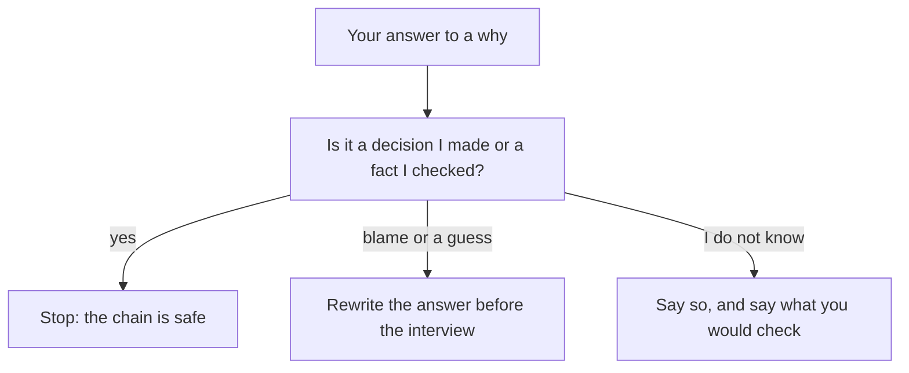

## One line, five questions

Iyad is 26 and works at a small app studio. His resume says: "Reduced app load time by 40 percent." He is proud of it, and he has told the story of that week many times to friends. Then a founder says, "Tell me about this one," and asks "Why?" five times in a row. Iyad has to answer each one with something he can stand behind. The answers are not a script. They are what he knows about his own work.

Chapter 3.1 showed what happens when a line cannot take the second why. This chapter shows the opposite case first. Iyad's chain holds from the first why to the fifth, and it is worth seeing exactly why. After that you will see the three ways a chain breaks, because each one is a mistake that fellows really make.

## The idea in plain words

The five whys comes from factory problem-solving. An engineer at a large Japanese car maker, Taiichi Ohno, told teams to ask "why?" when a machine failed, and then to ask "why?" about each answer, until they reached something they could fix. Founders use the same habit on your resume. For every line they ask what you did, why you did it, what happened and how you know. In this course you use the habit on yourself, before the interview.

Two honest notes about the method. First, it was made for fixing problems in factories, not for interviews. No study has tested it as an interview method. It is a habit that founders use, and it is a useful way to check your own lines. Second, it finds one chain of causes. Real problems often have more than one cause, and people who see different parts of a system may answer the whys differently. A writer on patient safety has argued that the method tends to oversimplify complex problems. So we use it as a checking habit, not as a proof.

## Where a chain should end

A chain does not need five steps. Five is a habit, not a rule. A chain can end after three whys or after six. It should end at one of two places. The first is a decision you made, with the reason you had for it. The second is a fact you checked, such as a count, a timing or a message you can show.

There is a third honest place to end, and it matters for fellows. Sometimes the chain goes past what you know. The decision was made before you joined, or by your manager, or by the client. Then the strong answer is to say so: "That decision was made before I joined. What I did was..." You stop at the edge of your own part and you say where it is. This is not a weak answer. A made-up reason is a weak answer.

Before you step through Iyad's chain, think about where it will end. The last why is about how much of the change was his own work.

```predict
prompt: "Iyad's app got faster, and complaints about freezing stopped. At the end of his chain, what does a strong answer say?"
options:
  - id: all-mine
    label: "The change worked, so the whole result was mine"
  - id: honest-limit
    label: "The server changed too, so not all was mine"
correctOptionId: honest-limit
explanation: "In the example, the server changed in the same month. A strong chain says so. The founder can trust a fact like this because it shows Iyad looked for other causes. Claiming all of the result would invite one more why that he cannot answer."
```

The canvas has six boxes. They are named for the job of each why, so the same boxes can show a strong chain and a broken one. Step through it. The last two steps show two chains that break.

<InteractiveCanvas slug="resume-line-why-chain" />

**What this shows:** one resume line followed down five whys to a fact the fellow checked, then two broken chains next to it. **Try this:** before step 6, say where you think Iyad's chain will end. At step 8, find one honest sentence Karam could say at why 2. **What changed:** at each step, the answer moved from the claim toward something Iyad could show: a message in the inbox, a thing he saw, a choice he made, a set of timings, a limit. **Limits of the model:** it shows one chain with one set of answers. Real founders ask different whys, and real problems have more than one cause.

## Iyad's chain in writing

Here is the chain with the answers written out, so you can see what each one rests on. Notice that every answer is something Iyad can point to.

**Why did you work on load time?** "Users in our pilot were on slow phones, and the support inbox had several complaints a week about the app freezing on start." The source is the support inbox.

**Why was it slow?** "The home screen loaded every product image at full size before it showed anything." He found this by looking at what the app loaded, not by guessing.

**Why this fix and not another?** "I compared caching, smaller images and lazy loading. Smaller images were a one-day change. Caching needed backend work we did not have time for." This is the decision, with the options and the reason.

**Why 40 percent?** "I timed start-up on our cheapest test phone, ten runs before and ten after: about 5 seconds to about 3." Two seconds out of five is 40 percent, and the method is stated.

**How much of that was you?** "Complaints stopped in the next two weeks, but we also changed the server that month, so I cannot say it was only my change." The chain ends at an honest limit.

Now see how each answer could have been weak, and what the next why would do to it. For the third why, a weak answer is "It was the best solution." The founder asks, "Best compared with what?" and Iyad has nothing to say. For the fourth, a weak answer is "I measured it." The founder asks, "How? On which phone?" and the answer was not written down. The strong answers are not longer or more clever. They are just specific, and each one is a fact that Iyad had before the interview.

## Three ways a chain breaks

The first way is **blame**. The chain ends at a person or a team, and there is nothing the fellow decided or checked. "The app was slow because the server team is slow." This answer feels safe, because it moves the problem away from you. But a founder hears a person who found nothing and changed nothing. If your chain ends at blame, ask one more why: what did I see, or what did I decide, inside that?

The second way is **one cause when there were several**. This is easy to do, because a neat story has one cause. Take Mazen, an operations assistant at a small online shop. His line says: "Cut late deliveries with a morning check of open orders." In March, the order sheet showed 9 of 40 orders sent a day late. He looked at each one. Six had waited for a stock check, and three had address problems. His morning check helps with the six. It does not help with the three. If he says "late orders were caused by missing checks," the founder will ask about the other three. If he says "there were two causes, and my check covers the larger one," his answer holds.

The third way is **a reason you cannot support**. This is Karam's break at the second why. The first answer sounded good, and nothing was under it. A reason can fail to hold because you never looked, or because you did not know, or because it was another person's decision. In each case, the honest repair is the same. Say what you did know, say what you did not, and say who decided. Chapter 3.3 is about this repair.

Another kind of end deserves a mention: the chain that ends with "I don't know." It is not a break. If you did not measure the result, say so and say how you would. "I did not measure that, and here is what I would count" is a full answer. It is far stronger than a number made up in the room.

## A second way to see it

The canvas followed one line. The diagram shows the test you can run on any answer in any chain. After each answer, ask yourself one question: is this a decision I made or a fact I checked? If yes, the chain can stop. If it is blame or a guess, the answer needs rewriting before the interview. If you do not know, say so, and say what you would check.



What to notice: there are three exits, and only one of them is to keep going. A chain does not need to find a perfect answer at every step. It needs to be honest at every step. The second and third exits are both fine in an interview, as long as you have thought them through. They are bad only when the first time you meet them is in front of the founder.

## Where people go wrong

A common mistake is to prepare the answers to the first why only, because that is where the founder starts. The second and third whys are where the difference is. A second common mistake is to use long technical words to fill the gap. A founder who hears three technical terms in a row will usually ask a simpler why, and the long answer does not help. A third mistake is to treat the why chain as a test you can fail. It is a way to find out what you know. If a chain breaks while you practise, you have learned something cheap. The same break in an interview costs more.

## Try it on your own resume today

Choose the line on your resume that you are proudest of. Write it at the top of a page. Below it, write "why 1" to "why 5". For each why, write your answer in one or two sentences, and next to it write where the answer comes from: a message, a count, a thing you saw, a choice you made. If you cannot write the source, put a question mark. Do not fill the question marks with guesses. They show you what to find out, and chapter 3.4 shows what to do with them. If you prefer not to use your own line, use Iyad's line and write what he could say if the server had not changed that month.

## Check your understanding

```quiz
type: mcq
question: "Hiba works in operations at a small print shop. Her line is: 'Cut reprint jobs with a size check.' She says: 'The job sheet showed 14 reprints in March, 11 from wrong file sizes. I added a size check before printing. In April there were 5 reprints. The shop also stopped its rush-order service in April.' Which is the best way to end her chain?"
options:
  - "Reprints fell from 14 to 5, so the check cut them by 64 percent"
  - "Reprints fell from 14 to 5, but rush orders also stopped"
  - "Customers are careless with file sizes, so the check was needed"
  - "I did not measure it, so I only know the check felt useful"
correct: 1
explanations:
  - "The counts are real, but the rush-order service stopped in the same month. This answer gives the whole change to the check and invites a why she cannot answer."
  - "Right. She has the counts from the job sheet and she names the other change in April. The chain ends at a fact she checked and an honest limit."
  - "This ends at blame. It says nothing about what Hiba saw or decided, and it gives the founder nothing to check."
  - "She did count, in the job sheet. Saying she did not measure would hide a good fact she has."
```

```quiz
type: mcq
question: "Anas, a frontend developer at a web agency, has the line 'Made the search page faster.' He says it was slow because of large images. His timings: the page took 6 seconds to load, and one data request took 4 of those seconds. After he made the images smaller, the page took 5 seconds. What should Anas say at the 'why was it slow?' step?"
options:
  - "Large images were the cause, and I fixed that cause"
  - "The slow request from the backend team was the cause"
  - "There were two causes, and I fixed the smaller one"
  - "I cannot say why it was slow, I only changed the images"
correct: 2
explanations:
  - "One request took 4 of the 6 seconds, so images were not the whole cause. This answer would break at the next why."
  - "This blames another team. Anas also changed the page by 1 second, so he did find a real cause of his own."
  - "Right. His timings show a data request of 4 seconds and a smaller part from images. Saying there were two causes, and which one he fixed, holds at the next why."
  - "He measured the timings, so he knows more than this. An honest answer uses what he found."
```

**Next:** Real reasons, not tidy ones: how to give the reason you had at the time.
