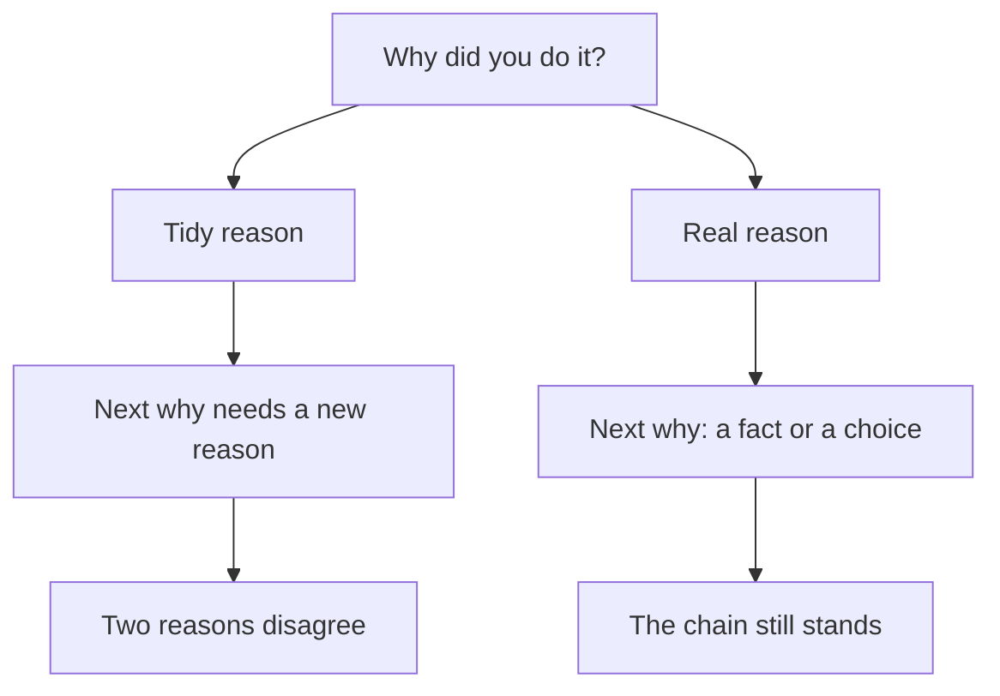

## The answer that came out smoothly

Two days after his call, Karam sits with his friend over tea. The friend plays the founder and asks, "Why did the agency redesign the checkout page?" Karam answers at once: "To reduce friction in the funnel." It comes out smooth and sure. He has said it before, in the call, and he has said it to himself many times since.

That is exactly the problem. The answer is fluent because he has practised it, not because it is the reason he had. Karam is not sure he ever looked for friction. The reason has grown around the work after it was finished, the way a story grows when you tell it often.

This chapter is about that gap, between the reason you had and the reason you can now say. It is one of the most common ways for a good resume line to fail the third why, and it can be fixed with a pen and ten minutes.

## Why memory tidies up

Psychologists have found that people often explain their own choices with reasons that sound right but were not the real ones. When you are asked why you did something, you do not always look back and read the reason. Often you build one that fits what should have caused your choice. It feels like remembering. It is closer to reasoning. The explanation can be confident and still wrong.

A second effect makes this worse. Once you know how something turned out, it seems more predictable than it was. Researchers call this hindsight bias. Karam's redesign was released and the numbers on his manager's slide looked good, so a reason like "we wanted to reduce friction" feels as if it must have been there from the start. Warning people about hindsight bias did not clearly help in the studies. What may help is to rebuild what you knew at the time, before the result.

<BigWordAlert term="Hindsight bias" plainEnglish="Once you know how something turned out, it feels as if it was easy to see coming, and you remember your reasons as clearer than they were." whyItMatters="It makes a tidy reason feel like a true memory. Writing down what you knew and wanted at the time is how you find the real reason." />

## Tidy does not mean lying

It is important to say this plainly. Karam was not lying on purpose, and neither are most fellows who give a tidy reason. They believe it, or they half believe it, because it sounds like the kind of reason a good developer should have. The trouble is not the intention. The trouble is what happens under the next why.

A tidy reason has nothing under it. So when the founder asks what friction you saw, you have to make a second reason to hold up the first. When the founder asks who found that, you may need a third. Sooner or later two of them disagree. A true reason does not have this problem, because every why after it has a fact to point at. Research on lie detection finds that people tell lies from truth only a little better than guessing, so honesty is not about being caught. It is about giving answers that still stand after the fifth why.

Before you use the canvas, think about the tidy reason and the three whys a founder could ask about it: why a redesign, what friction did you see, and who found it.

```predict
prompt: "Karam says the tidy reason 'to reduce friction' and the founder asks three whys. At which why does a true fact first come out and contradict the tidy reason?"
options:
  - id: second
    label: "At why 2, what he saw"
  - id: third
    label: "At why 3, who found it"
correctOptionId: third
explanation: "The first answer stands because nothing in it can be checked yet. The second is a theory that fits the first. The third question, who found it, makes Karam say the true fact, that his manager asked, and that contradicts the friction he claimed to have seen."
```

The canvas replays Karam's conversation with three characters: the founder, Karam, and his notes from that week. The first six steps show the tidy reason failing. The last three show the repair. Each note ends with a question. Answer it before you press Next.

<InteractiveCanvas slug="tidy-reason-breaks" />

Watch which answers need a new piece at each why, and which need none. The canvas shows one conversation only. Notes written later can also be wrong, and a real founder may ask other whys.

## The then-note

The repair in the canvas is a habit, and you can start it today. For each resume line, write a short note about the time of the work, before you think about the result. Answer four questions. What did I know that week? What did I want? Who asked for the work, and what other options did we have? What did I decide myself? Write it in a few plain lines. Do not improve it. Karam's note for the checkout page looked like this.

| Question | Karam's note |
|---|---|
| What did I know? | The redesign was planned. The designer's screens were ready. I did not look at any data. |
| What did I want? | To finish in two weeks, and to learn the new form library. |
| Who asked, and what options? | My manager asked. The screens allowed one page or three steps. |
| What did I decide? | One page, because it was about two days faster. I did not test which version sells more. |

Read the last row again. It is a real decision, and it is Karam's own. He did not choose to redesign, and he did not choose the screens. But he chose one page, he knows why, and he knows what he did not test. That is enough to answer many whys. It is also more interesting to a founder than a general reason about the funnel, because it shows how Karam thinks when no one is watching.

## The strong answer, in the room

Here is Karam's answer to "Why did you redesign the checkout page?" with the then-note behind it.

> **Karam:** "My manager asked me to build it. The plan was set, and the designer's screens were ready. Inside that, I decided to build the form as one page, because it was about two days faster than three steps. I did not test which version sells more."

The answer is four sentences. It separates what was not his decision from what was. It gives a reason that a fourth why can only confirm: "Why two days faster?" has an answer in his notes. This pattern works for many lines: "My lead asked me to, and inside that I decided..." The first half is honest about the limits of his part. The second half is where he shows judgment. Neither half needs to be defended, because both are true.

"That was not my decision" is also a full and strong answer on its own. Suppose the founder asks why the agency chose that form library. If Karam did not choose it, he can say, "That was decided before I joined the project. I can tell you what it was like to use." The honest edge of your part is a safe place to stop a chain. A made-up reason is not.

## A second example, from a support inbox

Ruba is the part-time support person on a small app team. Her resume line says: "Sorted the support inbox into labels so the team could see what users ask." Asked why, she first says, "To make the team more efficient." That is the tidy reason. A better answer comes from her note. On a Monday, two developers told her they could not find messages about login problems. The founder said she could try a new system for a month. Ruba first labelled messages by the page of the app they came from. After one week she changed to labels by the kind of problem, because the developers kept asking how many login problems there were, and never which page.

Notice how the real version also shows a change of mind: she tried one way, saw it did not help, and moved to another. A founder reads this as someone who watches what happens and adjusts. The tidy reason could not carry this. It is also a story that a stranger can check, because the developers and the founder were there.



The diagram shows one question with two paths. On the left path, each why asks you to invent another piece, and the pieces meet in a contradiction. On the right path, each why finds something already there. What to notice is that the right path is not longer or harder. It only needs the then-note to exist before the question is asked.

## The note written after the numbers

Anas is a frontend developer who read this advice and wrote a then-note for his best line. He wrote it on a Sunday evening, after he had opened the sales numbers to check how the project did. The numbers were good. His note said: "I wanted to raise sign-ups, so I made the button larger and clearer." It felt true. Then he found a message he had sent to his lead that week. It said: "Just making the button bigger like you asked, will send it today."

His note had been written by the result. In the room, a founder would have asked "How did you know the button was the problem?" and Anas would have had nothing. So he wrote a second note from the message alone: his lead asked for a larger button, and he chose the size by trying three on his own phone. The second note was shorter and less proud, and it was the one that held up. The lesson is about order. Write what you knew and wanted first, from messages and files if you can. Look at the numbers afterwards.

Two short cautions go with it. Do not go too far the other way: "My manager made me do it" with nothing else makes you sound like a person who watched, so always add the part you decided, however small. And if you truly do not remember, say so: "I do not remember exactly. What I remember is..." Founders can work with that.

## Your turn today

Pick the line you worked on in chapter 3.2. Write the four-question then-note for it. Use the project files, your messages and your calendar to help you remember, and write only what they support. Then say your answer to "Why did you do this?" aloud, in three or four sentences, that begin with who asked. If you do not want to use your own work, write the then-note for Ruba's inbox, using only the facts in this chapter.

## Check your understanding

```quiz
type: mcq
question: "Tamer built a dark mode for a small notes app. His lead asked for it after three users wrote to the support inbox. Tamer picked the phone's own dark setting instead of a switch inside the app, because it needed less code. A founder asks, 'Why did you build dark mode?' Which answer stands up at the third why?"
options:
  - "Three users asked for dark mode, so I decided to build it, and I picked the phone's own setting."
  - "My lead asked after three users wrote in, and dark mode cuts eye strain for people who use the app at night."
  - "My lead asked after three users wrote to support, and I picked the phone's own setting because it needed less code."
  - "It was my lead's decision after three messages, so I cannot say more about how the feature was built."
correct: 2
explanations:
  - "The lead asked for the feature, not Tamer. This answer takes a decision that was not his, and the next why would show it."
  - "The eye strain reason is not in Tamer's facts. It is a tidy reason added to a true start, and nothing is under it."
  - "Right. It says who asked and why, and names the choice Tamer made inside the request. Each further why has a fact behind it: the three messages and the code that was saved."
  - "The lead asked for the feature, but Tamer made a real choice about how to build it. This answer hides a decision that was his."
```

```quiz
type: mcq
question: "Sara, a product designer, has the line 'Chose the blue button colour to raise sign-ups.' Her notes: the client's brand colour is blue, she ran no tests, and she chose the larger of two button sizes after trying both on her own phone. A founder asks, 'Why blue?' Which answer should she give?"
options:
  - "Our tests showed blue works well for sign-ups. I also chose the larger of two sizes, after trying both on my phone."
  - "Blue was my choice, and the client's brand colour had no part in it. I tried two sizes on my phone."
  - "The client's brand colour is blue, so I made no choices about the button. The client set the size too."
  - "The client's brand colour is blue and I ran no tests. I chose the larger of two sizes, trying both on my phone."
correct: 3
explanations:
  - "Her notes say she ran no tests. The first sentence is a tidy reason, and the second sentence does not rescue it."
  - "The brand colour was the reason for blue. This answer takes the choice for herself, and the founder could check it with the client."
  - "She did make a choice: the size. This answer gives away a decision that was hers."
  - "Right. It gives the real reason for blue, says plainly that she ran no tests, and names the choice that was hers. Every sentence has a fact behind it."
```

**Next:** The resume line audit: five questions for every line, and how to rewrite the lines that fail.
