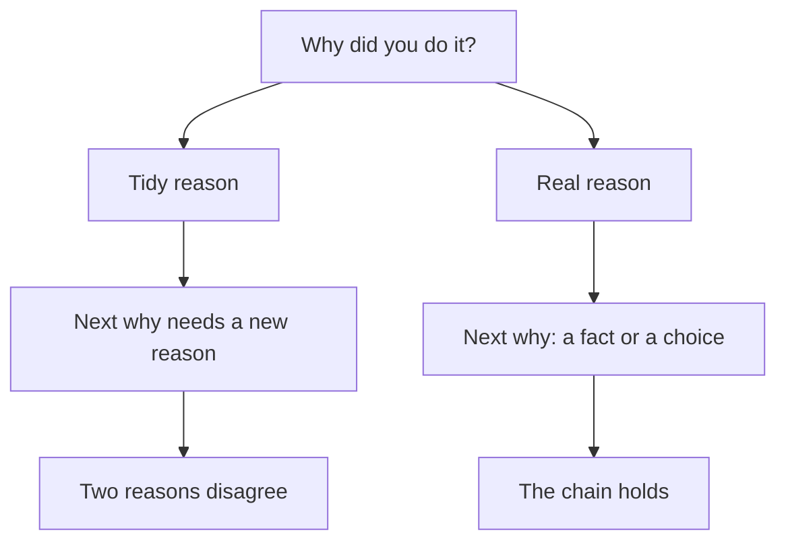

## The answer that came out smoothly

Two days after his call, Karam sits with his friend over tea. The friend plays the founder and asks, "Why did the agency redesign the checkout page?" Karam answers at once: "To reduce friction in the funnel." It comes out smooth and sure. He has said it before, in the call, and he has said it to himself many times since.

That is exactly the problem. The answer is fluent because he has practised it, not because it is the reason he had. When his friend asks what friction he saw, the answer is smooth again: "The old page had too many fields." The friend asks who found that. Karam stops. He remembers the Monday meeting where his manager said the redesign was planned and asked him to build it. He never found any friction. The reason had grown around the work after it was finished.

This chapter is about that gap, between the reason you had and the reason you can now say. It is one of the most common ways for a good resume line to fail the third why, and it can be fixed with a pen and ten minutes.

## Why memory tidies up

Psychologists have found that people often explain their own choices with reasons that sound right but were not the real ones. When you are asked why you did something, you do not always look back and read the reason. Often you build one that fits what should have caused your choice. It feels like remembering. It is closer to reasoning. The explanation can be confident and still wrong.

A second effect makes this worse. Once you know how something turned out, it seems more predictable than it was. Researchers call this hindsight bias. Karam's redesign shipped and the numbers on his manager's slide looked good, so a reason like "we wanted to reduce friction" feels as if it must have been there from the start. Warning people about hindsight bias did not clearly help in the studies. What may help is to rebuild what you knew at the time, before the result.

<BigWordAlert term="Hindsight bias" plainEnglish="Once you know how something turned out, it feels as if it was easy to see coming, and you remember your reasons as clearer than they were." whyItMatters="It makes a tidy reason feel like a true memory. Writing down what you knew and wanted at the time is how you find the real reason." />

## Tidy does not mean lying

It is important to say this plainly. Karam was not lying on purpose, and neither are most fellows who give a tidy reason. They believe it, or they half believe it, because it sounds like the kind of reason a good developer should have. The trouble is not the intention. The trouble is what happens under the next why.

A tidy reason has nothing under it. So when the founder asks what friction you saw, you have to make a second reason to hold up the first. When the founder asks who found that, you may need a third. Sooner or later two of them disagree, as Karam's did. A true reason does not have this problem, because every why after it has a fact to point at. Research on lie detection finds that people tell lies from truth only a little better than chance, so honesty is not about being caught. It is about giving answers that still stand after the fifth why.

Before you step through the canvas, think about which reason is safer when the founder keeps asking.

```predict
prompt: "A founder keeps asking why about one of your decisions. Which kind of reason is safer?"
options:
  - id: then
    label: "The reason you had at the time"
  - id: strategic
    label: "The reason that sounds most strategic"
correctOptionId: then
explanation: "The reason you had at the time has facts under it: who asked, what you knew, what you chose. Each new why can point at one of them. A strategic reason has to be built again at each why, and the pieces may disagree."
```

The canvas replays Karam's conversation with three characters: the founder, Karam, and his notes from that week. The first six steps show the tidy reason breaking. The last three show the repair.

<InteractiveCanvas slug="tidy-reason-breaks" />

**What this shows:** the same why questions put to a tidy reason and to the real reason. **Try this:** before step 6, guess what Karam will say when the founder asks who found the friction. At step 9, find what was not Karam's decision and what was. **What changed:** the tidy answers needed a new piece at every why, and the real answer needed none. The notes from the week gave Karam three facts: the manager asked, the screens were ready, and the deadline was two weeks. **Limits of the model:** this is one conversation. Notes written later can also be wrong, and a real founder may ask other whys.

## The then-note

The repair in the canvas is a habit, and you can start it today. For each resume line, write a short note about the time of the work, before you think about the result. Answer four questions. What did I know that week? What did I want? Who asked for the work, and what other options did we have? What did I decide myself? Write it in a few plain lines. Do not improve it. Karam's note for the checkout page looked like this.

| Question | Karam's note |
|---|---|
| What did I know? | The redesign was planned. The designer's screens were ready. I did not look at any data. |
| What did I want? | To finish in two weeks, and to learn the new form library. |
| Who asked, and what options? | My manager asked. The screens allowed one page or three steps. |
| What did I decide? | One page, because it was about two days faster. I did not test which version sells more. |

Read the last row again. It is a real decision, and it is Karam's own. He did not choose to redesign, and he did not choose the screens. But he chose one page, he knows why, and he knows what he did not test. That is enough to answer many whys. It is also more interesting to a founder than a general reason about the funnel, because it shows how Karam thinks when no one is watching.

## The strong answer, in the room

Here is Karam's answer to "Why did you redesign the checkout page?" with the then-note behind it.

> **Karam:** "My manager asked me to build it. The plan was set, and the designer's screens were ready. Inside that, I decided to build the form as one page, because it was about two days faster than three steps. I did not test which version sells more."

The answer is four sentences. It separates what was not his decision from what was. It gives a reason that a fourth why can only confirm: "Why two days faster?" has an answer in his notes. This pattern works for many lines: "My lead asked me to, and inside that I decided..." The first half is honest about the limits of his part. The second half is where he shows judgment. Neither half needs to be defended, because both are true.

"That was not my decision" is also a full and strong answer on its own. Suppose the founder asks why the agency chose that form library. If Karam did not choose it, he can say, "That was decided before I joined the project. I can tell you what it was like to use." The honest edge of your part is a safe place to stop a chain. A made-up reason is not.

## A second example, from operations

Ruba volunteers at a charity shop. Her resume line says: "Reorganised donated coats by size so volunteers could find them." Asked why, she first says, "To make the shop more efficient." That is the tidy reason. A better answer comes from her note. On a Saturday, three volunteers told her they could not find children's coats. The manager said she could try a new arrangement for a month. Ruba first sorted by colour, and after a week she changed to size, because the volunteers were asked for sizes and never for colours.

Notice how the real version also shows a change of mind: she tried colour, saw it did not help, and moved to size. A founder reads this as someone who watches what happens and adjusts. The tidy reason could not carry this. It is also a story that a stranger can check, because the manager and the volunteers were there.



The diagram shows one question with two paths. On the top path, each why asks you to invent another piece, and the pieces meet in a contradiction. On the bottom path, each why finds something already there. What to notice is that the bottom path is not longer or harder. It only needs the then-note to exist before the question is asked.

## Where people go wrong

The first mistake is to write the then-note after you have looked at the result. Then the result colours what you remember. Write what you knew and wanted first, and look at the numbers afterwards. The second mistake is to go too far the other way. "My manager made me do it" with nothing else makes you sound like a person who watched. Always add the part you decided, however small. The third mistake is to hide behind "we decided" when you do not remember who decided. The fourth is to invent a memory when you have none. If you do not remember, say so: "I do not remember exactly. What I remember is..." Founders can work with that. They cannot work with a reason that changes at the next question.

## Try it on your own resume today

Pick the line you worked on in chapter 3.2. Write the four-question then-note for it. Use the project files, your messages and your calendar to help you remember, and write only what they support. Then say your answer to "Why did you do this?" aloud, in three or four sentences, that begin with who asked. If you do not want to use your own work, write the then-note for Ruba's coats, using only the facts in this chapter.

## Check your understanding

```quiz
type: mcq
question: "Tamer built a dark mode for a small notes app. His lead asked for it after three users wrote to the support inbox. Tamer picked the phone's own dark setting instead of a switch inside the app, because it needed less code. A founder asks, 'Why did you build dark mode?' Which answer holds best at the third why?"
options:
  - "Dark mode lowers eye strain and raises how long users stay in the app"
  - "My lead asked after three users wrote in; I picked the phone's setting"
  - "It was my lead's decision, so I cannot say more about how it was built"
  - "The team wanted a more modern look that fits the brand better overall"
correct: 1
explanations:
  - "This sounds strategic, but nothing in Tamer's facts says he looked at eye strain or time in the app. The next why would have no answer."
  - "Right. It says who asked and why, and it names the choice Tamer made inside the request. Each further why has a fact behind it: the three messages, and the code that was saved."
  - "The lead asked for the feature, but Tamer made a real choice about how to build it. This answer hides a decision that was his."
  - "'We' hides who decided anything, and a look that fits the brand is not what the facts say. It is a tidy reason."
```

```quiz
type: mcq
question: "Sara, a designer at an agency, has the line 'Chose the blue button colour to raise sign-ups.' A founder asks why blue. Sara says, 'Our tests showed blue works best.' The founder asks which tests. Sara says, 'The client's brand colour is blue, and I did not run tests.' What does this exchange show?"
options:
  - "Her second answer is the dishonest one and should be left out"
  - "Her first answer was tidy; her second is the real reason"
  - "The founder should not have asked a second why about a colour"
  - "Both answers are fine, because blue is a normal colour to use"
correct: 1
explanations:
  - "The second answer is the true one. The dishonest answer was the first, which claimed tests that did not happen."
  - "Right. The first answer sounded good but had no tests under it. The second is the reason she had, and she should have started with it, then added any choice that was hers."
  - "A founder asks a second why on any line. The exchange shows why it is worth preparing for, not that the question was unfair."
  - "The colour is not the problem. The first answer claimed tests that did not happen, and the two answers disagree."
```

**Next:** The resume line audit: five questions for every line, and how to rewrite the lines that fail.
